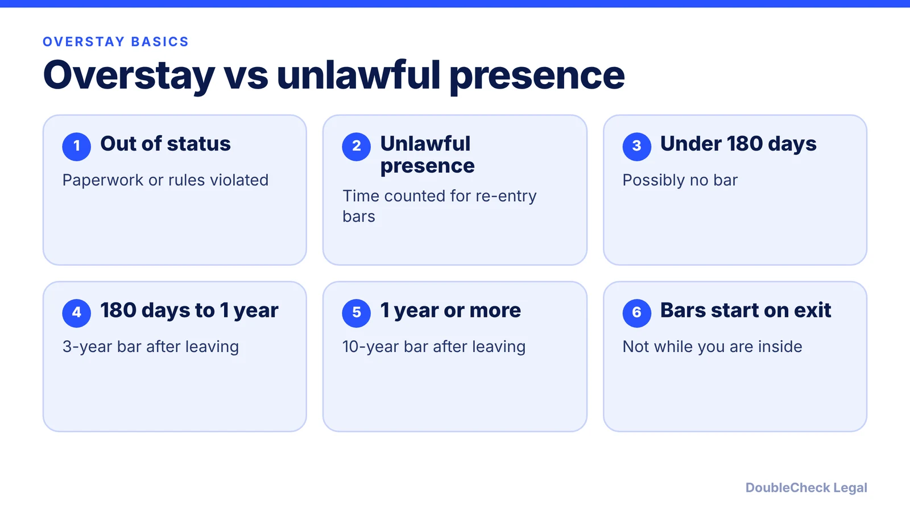
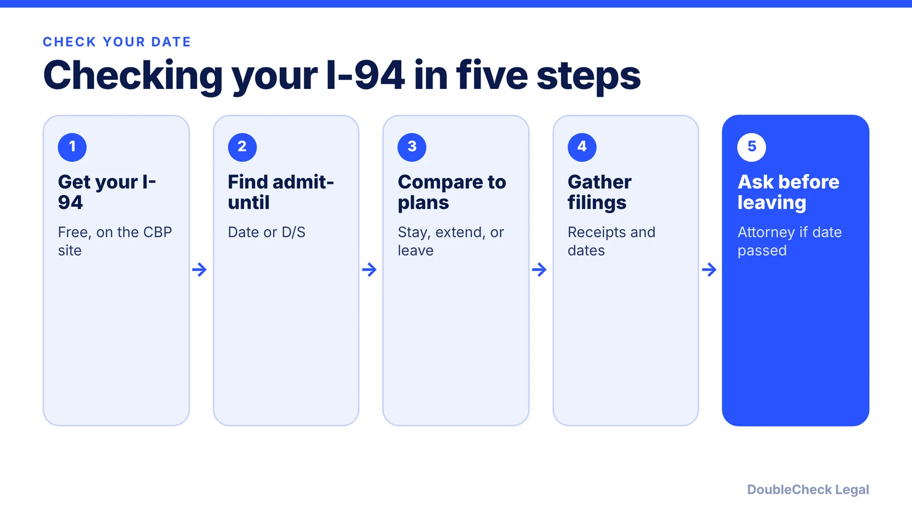

*How overstays, unlawful presence and the 3-year and 10-year bars work, as of November 2026.*

**Key takeaways:**

- Overstay and unlawful presence are not the same thing; only unlawful presence counts toward the bars.
- More than 180 days up to one year can mean a 3-year bar; one year or more can mean a 10-year bar, once you leave.
- Your I-94 admit-until date, not your visa date, usually sets the clock; check it free on the CBP site.
- Waivers (I-601, I-601A) require extreme hardship to a qualifying relative; see an attorney before leaving if your date has passed.

## 1. The quick answer

**Quick answer:** An overstay means staying past the date or conditions of your admission. Unlawful presence is a separate, narrower concept: time counted against you for re-entry bars under INA 212(a)(9)(B). Per Messersmith Law, more than 180 days but less than one year of unlawful presence in a single stay, followed by departure, triggers a 3-year bar; one year or more triggers a 10-year bar. The bars take effect only when you leave the U.S. Being out of status does not always mean you are accruing unlawful presence, and some situations, such as a properly filed pending extension, can pause the count. If your date has passed or is close, speak with an immigration attorney before you travel.

## 2. Overstay, status, and unlawful presence: how they differ

These terms are often used as if they were the same. They are not.

- **Out of status** is about whether you are following the terms of your admission, such as working without authorization or leaving school.
- **Unlawful presence** is time that counts toward the bars. Per [CitizenPath](https://citizenpath.com/unlawful-presence-explained/), someone who overstayed but filed a green card application may be out of status without accruing unlawful presence.
- **Overstay** usually means remaining after the "admit until" date on your Form I-94.

**Where the clock usually starts.** Per CitizenPath, accrual generally begins the day after your authorized stay expires, based on the I-94 date. Its example: admitted until June 1, 2024 and staying until December 1, 2024 is 183 days of unlawful presence. Per [Headman Law Group](https://headmanlaw.com/insights/i-94-record-how-to-find-check-and-correct/), your visa's expiration date does not set how long you may stay; the I-94 date does.

**Duration of status (D/S).** Some admissions, typically F-1 and J-1, show "D/S" instead of a date, meaning you may stay while you keep your status. Per CitizenPath, for D/S students accrual generally begins if the related activity stops. Per the [University of Wisconsin ISS](https://iss.wisc.edu/students/current-students/unlawful-presence/), a 2018 policy memo on F, J and M unlawful presence was invalidated by a permanent nationwide injunction on February 6, 2020, so older articles describing it can be outdated. The same page says DHS published a final rule on July 17, 2026 to replace D/S with fixed admission periods; see our [SEVIS and I-20 article](/blog/sevis-i-20-explained-maintaining-f-1-status/) for the court status, and ask your school's DSO before relying on either.

An overstay can also affect future visas. Per Headman Law Group, under INA 222(g) an overstay generally voids your visa, so you typically need a new one for future trips.

## 3. How the 3-year and 10-year bars work, and common exceptions

Per [Messersmith Law](https://messersmithlaw.com/ina-212a9b):

- **3-year bar (INA 212(a)(9)(B)(i)(I)):** unlawful presence of more than 180 days but less than one year in a single stay, with voluntary departure before removal proceedings begin. It lasts three years from departure.
- **10-year bar (INA 212(a)(9)(B)(i)(II)):** unlawful presence of one year or more in a single stay. It lasts ten years from departure.
- Under June 2022 USCIS guidance, the period runs from departure even if the person returns to the U.S. during it, and a return can raise other grounds, such as INA 212(a)(9)(C).

**Time that generally does not count**, per Messersmith and CitizenPath:

- Time before age 18.
- Time while a bona fide asylum application is pending (unless the applicant worked without authorization).
- A pending properly filed adjustment of status application, generally.
- A pending change or extension of status filed on time, "under certain conditions". Messersmith says up to 120 days may be tolled for the 3-year ground if you were lawfully admitted, filed a nonfrivolous request before your stay expired, and did not work without authorization.
- DACA, TPS, deferred action or parole.
- Statutory exceptions for some battered spouses and children and for severe trafficking, if conditions are met.

These exceptions turn on exact dates and filing details. A filing that is late, defective, or combined with unauthorized work may not protect you, so do not assume you qualify.

**How to check your I-94 date.** Per [NYU](https://www.nyu.edu/students/student-information-and-resources/student-visa-and-immigration/current-students/travel-and-visitors/i-94-record.html), use the "Get Most Recent I-94" option on the CBP website after you have entered the U.S., and check the date of entry, class of admission, and admit-until date. Per Headman, the record is free, and you should avoid third-party sites that charge for it. If the record is wrong, NYU lists emailing CBP, using the CBP Traveler Communications Center, or contacting a CBP deferred inspection site; Headman says USCIS-issued I-94s are corrected with Form I-102.

## 4. Waivers, and when to see an attorney right away

Waivers exist, but they are narrow. Per [Messersmith Law](https://messersmithlaw.com/ina-212a9b):

- **Form I-601** is a discretionary waiver for the unlawful presence ground. It requires extreme hardship to a U.S. citizen or lawful permanent resident spouse or parent. Children are not qualifying relatives on their own, though their circumstances can factor into the hardship to the qualifying relative.
- **Form I-601A**, the provisional unlawful presence waiver, is requested before leaving the U.S. for consular processing. It waives only the unlawful presence ground, still requires extreme hardship to a qualifying relative, and does not confer status or guarantee a visa. Per CitizenPath, the steps are I-130 petition, then I-601A, then the consular interview.
- **Nonimmigrant waivers** under INA 212(d)(3)(A) use a different standard for temporary visas.

Neither waiver covers fraud or a prior removal, and neither is automatic. Hardship is more than ordinary family separation.

**When you can handle it yourself.** Checking your own I-94 date, understanding your status, and gathering your records are reasonable first steps. For F-1 and J-1 students, your DSO is the starting point.

**When to see an attorney immediately:**

- Your I-94 date has passed, or will pass soon, and you have no timely filing pending.
- You are thinking about leaving the U.S. and have more than 180 days of possible unlawful presence.
- You have a prior removal, a prior overstay, or an earlier unauthorized stay.
- A relative is filing for you and you need to know whether a waiver is possible.

Do not look for ways to avoid a bar by hiding facts; misstatements to officials create bigger problems. For the green card side, see [the I-485 guide](/blog/i-485-adjustment-of-status-guide/) and [marriage-based green card timelines](/blog/marriage-based-green-card-process-timeline/). For cost and finding the right lawyer, see [immigration lawyer fees](/blog/immigration-lawyer-fees-flat-fee-vs-hourly/) and [how to find a good immigration lawyer](/blog/how-to-find-good-immigration-lawyer-startup-founder/). Students may also want [the F-1 60-day grace period](/blog/f-1-60-day-grace-period-after-opt-ends-options/).

## Where DoubleCheck fits

[DoubleCheck](https://www.contactdoublecheck.com) helps businesses and founders start legal work with AI, verify it, and, when professional advice is warranted, connect with an independent attorney, including for immigration questions. Attorney availability and practice areas vary. Attorneys on DoubleCheck are independent professionals; an attorney-client relationship forms only if an attorney accepts your engagement.

**Sources:** [CitizenPath on unlawful presence](https://citizenpath.com/unlawful-presence-explained/); [Messersmith Law on INA 212(a)(9)(B)](https://messersmithlaw.com/ina-212a9b); [University of Wisconsin ISS](https://iss.wisc.edu/students/current-students/unlawful-presence/); [NYU on I-94 records](https://www.nyu.edu/students/student-information-and-resources/student-visa-and-immigration/current-students/travel-and-visitors/i-94-record.html); [Headman Law Group on I-94](https://headmanlaw.com/insights/i-94-record-how-to-find-check-and-correct/).

## FAQ

**What is the difference between overstaying and unlawful presence?**

Overstay usually means staying past your I-94 date. Unlawful presence is time that counts toward re-entry bars. Per CitizenPath, someone can be out of status without accruing unlawful presence, for example while a green card application is pending.

**How long is the 3-year bar versus the 10-year bar?**

Per Messersmith Law, more than 180 days but less than one year of unlawful presence in a single stay can trigger a 3-year bar, and one year or more can trigger a 10-year bar. Each runs from the date you leave the U.S.

**Does a pending extension or change of status stop unlawful presence?**

Often, but conditions apply. Per Messersmith Law, up to 120 days may be tolled for the 3-year ground if the request was nonfrivolous, filed before the stay expired, and you did not work without authorization. Confirm your facts with an attorney.

**What waivers exist for unlawful presence?**

Per Messersmith Law, Form I-601 and the provisional Form I-601A are discretionary and require extreme hardship to a U.S. citizen or permanent resident spouse or parent. Children are not qualifying relatives on their own.

---

*General information only. This article is not legal, tax, investment, or accounting advice.*
