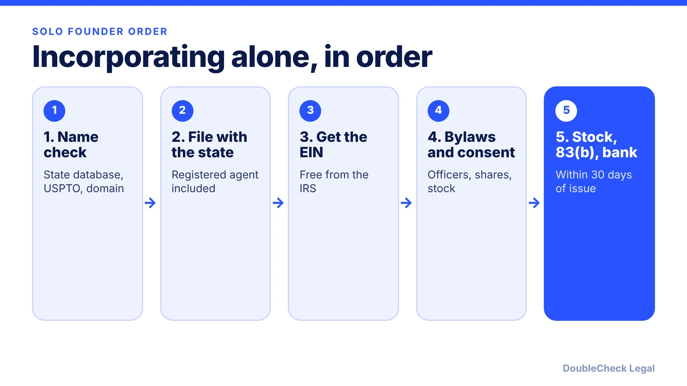
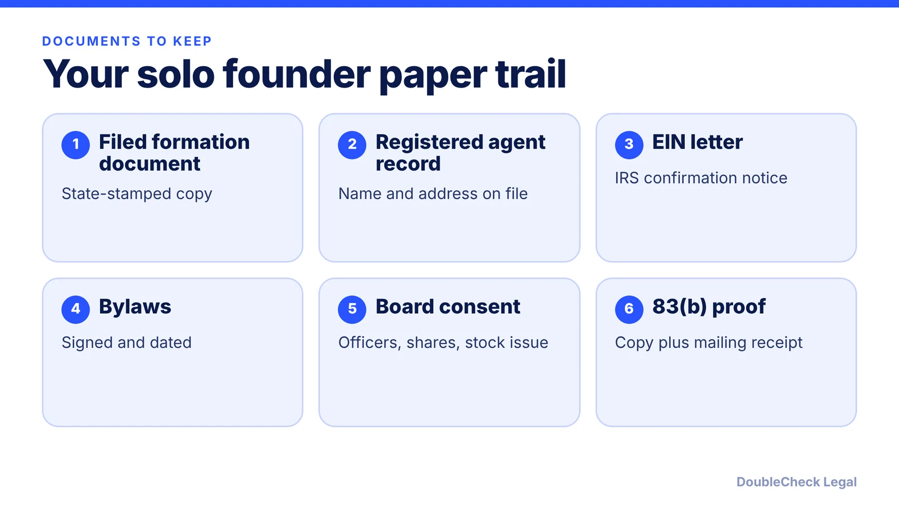

*Solo does not mean shortcut. Here is the usual order of steps, what each one needs, and where one-person companies slip.*

**Key takeaways:**

- Typical order: name, state filing with registered agent, EIN, bylaws and board consent, stock issuance, 83(b) if vesting, bank account.
- The 83(b) election must be filed within 30 days of the stock transfer, per IRS Form 15620.
- Most errors are skipped paperwork: unissued stock, no IP assignment, no foreign qualification.
- Get an attorney to check share structure, vesting and tax elections before investors do.

## 1. The quick answer

**Quick answer:** To incorporate a business as a solo founder, the usual order is: clear the name, file the formation document with the state (which names a registered agent), get an EIN, adopt bylaws and sign a board consent, issue your founder stock, file an 83(b) election within 30 days if the stock vests, then open the bank account. Each step feeds the next: the bank wants the EIN letter and corporate documents, and the 83(b) clock starts the day the stock is issued. Most mistakes come from doing steps out of order or skipping the paperwork after the state filing. This guide assumes a corporation; LLC owners follow a shorter version of the same path.

Two published checklists agree on this core sequence. Rho's startup incorporation checklist (figures stated as current to October 17, 2026) puts the filing, registered agent, EIN, bylaws, board consent, stock issuance and 83(b) in that order, with the bank account in the first 90 days. Stripe's checklist (last updated October 30, 2026) lists the EIN, then stock and 83(b), then the bank account.

## 2. The steps in order, with what each one needs

**1. Check the name.** Rho suggests checking the state name database, the USPTO and domains and social handles before you file. A name can be available in the state registry and still conflict with someone else's trademark; see [trademark and business name check](/blog/trademark-business-name-check/).

**2. File the formation document and name a registered agent.** In Delaware this is the certificate of incorporation, and in Texas it is the certificate of formation. The Texas Secretary of State's instructions say the for-profit corporation filing fee is $300, the registered agent must be a Texas-registered entity or an individual Texas resident, a corporation cannot act as its own agent, and at least one director who is a natural person is required. Delaware details are in [how to incorporate in Delaware step by step](/blog/how-to-incorporate-in-delaware-step-by-step/) and [Delaware registered agent requirements](/blog/delaware-registered-agent-requirements/). Deciding shares and par value now saves a headache later; see [what to put in a Delaware certificate](/blog/delaware-certificate-of-incorporation-what-to-put-in-authorized-shares-par-value/).

**3. Get the EIN.** The IRS says its online tool issues the EIN immediately if approved, requires the responsible party's SSN or ITIN, can be used only for a business with its principal place of business in the US or a US territory, allows one EIN per responsible party per day, and never charges a fee. Foreign founders without an SSN have a different path: [EIN without an SSN](/blog/get-ein-without-ssn-foreign-founder/). See also [how to get an EIN for free](/blog/how-to-get-an-ein-for-your-business-free/).

**4. Adopt bylaws and sign the initial board consent.** Per Rho, bylaws are not filed with the state, but banks and investors ask for them, and the board consent adopts the bylaws, appoints officers and approves stock issuances. As a solo founder you will usually sign as the sole director, then as the officers.

**5. Issue founder stock.** Rho says founder stock is usually issued under stock purchase agreements at par value. Record it in a cap table on day one. See [founder stock purchase agreements](/blog/issue-founder-stock-purchase-agreement/).

**6. File the 83(b) election if the stock vests.** The IRS Form 15620 (April 2025) says the election must be filed no later than 30 days after the property was transferred. Law-firm summaries from 2025 say the IRS now allows online submission through an ID.me-verified account; the Startup Law Blog (undated) notes the online tool caps securities per submission and can distort very low per-share prices. Whether to file is a tax question; see [83(b) election for founders](/blog/83b-election-startup-founders/).

**7. Open the bank account.** Stripe's checklist says to gather the EIN letter, filed certificate, bylaws, board resolution and signer IDs first. See [bank account and liability protection habits](/blog/llc-startup-bank-account-commingling-liability-protection-habits/).

## 3. Where solo founders go wrong

The same two checklists name the mistakes repeatedly:

- **Missing the 83(b) window.** Stripe's checklist says there is no extension and no appeal, and that you may owe ordinary income tax as shares vest and the value rises. It also advises certified mail with a return receipt. Rho states the 30-day rule the same way. Your own calendar is the only safeguard.
- **Assuming the company owns your work.** Rho says the company does not own founder work until an IP assignment is signed, and missing assignments can stall financing. See [confidentiality and IP assignment agreements](/blog/confidentiality-ip-assignment-agreements-startups/).
- **Skipping foreign qualification.** Both say incorporating in one state does not cover operating in others. Read [foreign qualification explained](/blog/foreign-qualification-register-llc-in-another-state/).
- **Never issuing the stock.** Rho calls unissued equity a diligence red flag, and Stripe says an unclear cap table is a common reason term sheets stall.
- **Mixing personal and company money.** Both say commingling can undermine liability protection.
- **Missing annual filings.** The Delaware Division of Corporations says franchise tax and the annual report are due March 1 each year; Rho says late filings bring penalties and can cost good standing. See [Delaware franchise tax for startups](/blog/delaware-franchise-tax-startups/).

Also check that you chose the right entity at the start: [LLC vs C corp for startups](/blog/llc-vs-c-corp-startups/) and [solo founder legal checklist using AI](/blog/solo-founder-legal-checklist-using-ai/) cover that choice.

## 4. Handle it yourself, or get an attorney

**Often manageable alone:** the name check, the state filing, the EIN and the bank account, especially for a simple single-founder company that will not raise money soon. Online filing portals walk you through required fields, and the IRS EIN tool is free.

**Worth having an attorney check:** the share structure and par value, whether your founder stock needs vesting, whether the 83(b) election makes sense and how to document it, IP assignment, and any plan to raise venture money or to operate in more than one state. These documents are hard to fix after investors see them. An AI tool can help you draft and organize the documents, but the numbers, dates and tax elections should be verified by a person who can be accountable for them. Fees, forms and deadlines change, so check the state agency and IRS pages as of November 2026.

For the broader overview, see [how to incorporate a company in the US](/blog/how-to-incorporate-a-company-in-the-us/) and [do I need a lawyer to start an LLC](/blog/do-i-need-a-lawyer-to-start-an-llc-diy-ai-or-attorney/).

## Where DoubleCheck fits

[DoubleCheck](https://www.contactdoublecheck.com) helps businesses and founders start legal work with AI, verify it, and, when professional advice is warranted, connect with an independent attorney, including for immigration questions. Attorney availability and practice areas vary. Attorneys on DoubleCheck are independent professionals; an attorney-client relationship forms only if an attorney accepts your engagement.

**Sources:** [Rho, Startup Incorporation Checklist (figures current to Oct. 17, 2026)](https://www.rho.co/blog/startup-incorporation-checklist); [Stripe, Startup incorporation checklist (updated Oct. 30, 2026)](https://stripe.com/resources/more/startup-incorporation-checklist); [IRS, Get an employer identification number](https://irs.gov/businesses/small-businesses-self-employed/get-an-employer-identification-number?dpm=9044); [IRS Form 15620 (Rev. 4-2025)](https://irs.gov/pub/irs-pdf/f15620.pdf); [Texas Secretary of State, Form 201 instructions](https://www.sos.texas.gov/corp/instructions/201.shtml); [Delaware Division of Corporations, franchise tax](https://corp.delaware.gov/frtax/); [The Startup Law Blog, electronic filing of 83(b) elections (undated)](https://www.thestartuplawblog.com/electronic-filing-of-section-83b-elections-a-modern-convenience-with-important-deadlines/); [National Law Review, new electronic filing option for 83(b) elections (July 30, 2025)](https://natlawreview.com/article/new-electronic-filing-option-section-83b-elections).

## FAQ

**What is the order of steps to incorporate as a solo founder?**

The usual order is name check, state filing with a registered agent, EIN, bylaws and board consent, founder stock issuance, an 83(b) election if the stock vests, and then the bank account. Published checklists from Rho and Stripe follow this core sequence.

**Can I incorporate alone with no co-founder?**

Yes. Many checklists treat a one-person company the same as any other, with you signing as director and officers. Texas requires at least one director who is a natural person, per the Texas Secretary of State.

**Do I need an EIN before I open a bank account?**

Usually yes. Stripe lists the EIN letter, filed certificate, bylaws, board resolution and signer IDs as the documents to gather before applying. The IRS says it never charges a fee for an EIN.

**When is the 83(b) election due?**

No later than 30 days after the stock is transferred to you, per IRS Form 15620 (April 2025). Stripe and Rho both say the deadline cannot be extended, so confirm the issue date and file promptly.

---

*General information only. This article is not legal, tax, investment, or accounting advice.*
