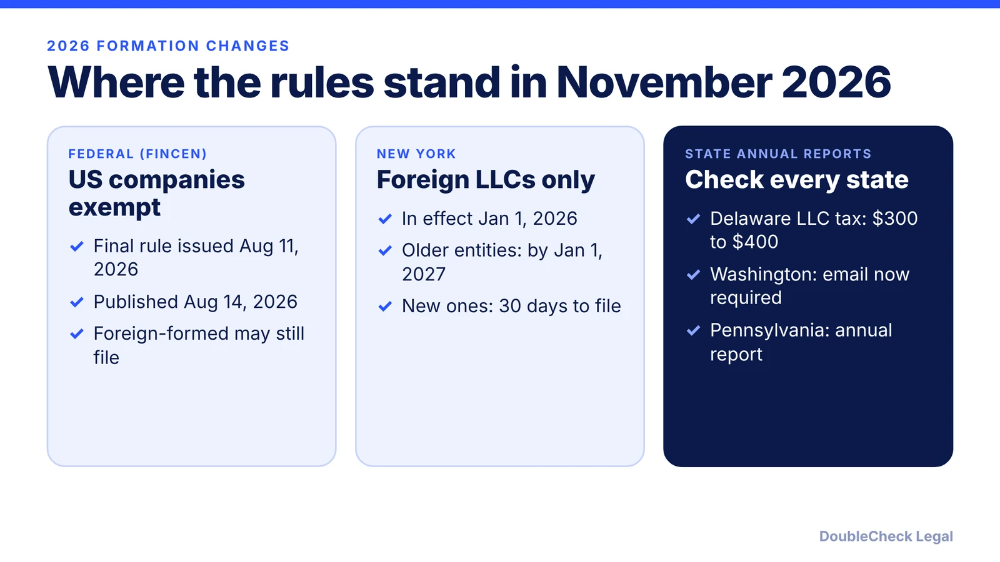
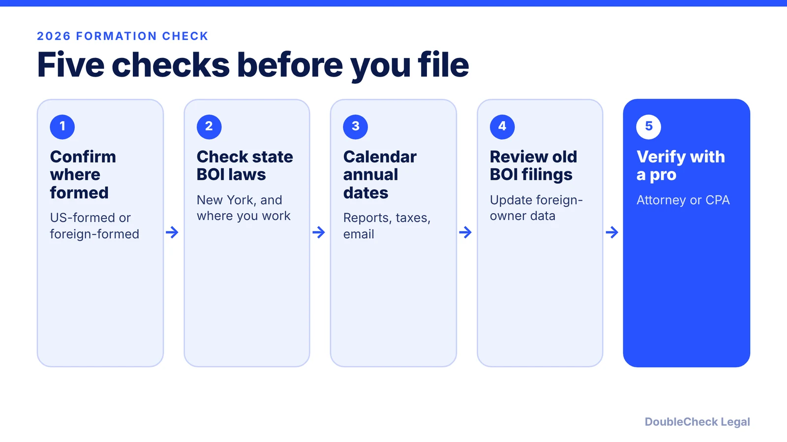

*What changed for small-business formation in 2026: FinCEN BOI status, New York's LLC Transparency Act, annual report changes and what to check, as of November 2026.*

**Key takeaways:**

- FinCEN's final rule (issued August 11, 2026) exempts US-formed companies and US persons from federal BOI reporting; certain foreign-formed entities can still report.
- New York's LLC Transparency Act took effect January 1, 2026 and, per state guidance summarized by law firms, covers only foreign LLCs.
- Delaware, Washington, Pennsylvania and Connecticut have changed annual report or fee rules; check your state agency.
- The Corporate Transparency Act litigation was not fully over as of August 2026 per MoFo, so keep watching.

## 1. The quick answer

**Quick answer:** If you incorporate a small business in 2026, the biggest change is that US-formed companies no longer have to file federal beneficial ownership information (BOI) reports. Per law firm summaries of FinCEN's final rule (issued August 11, 2026 and effective when published August 14, 2026), only certain foreign-formed entities registered to do business in a US state remain reporting companies. New York's LLC Transparency Act took effect January 1, 2026 but, per state guidance summarized by law firms, covers only foreign LLCs. State annual report and fee rules keep changing, so check your own state, as of November 2026.

This post covers what changed and what to do about it. For the full formation process, read [how to incorporate a business: LLC vs S corp vs C corp, costs and timeline](/blog/how-to-incorporate-a-business-complete-guide-llc-s-corp-c-corp-costs-timeline/). For the older BOI background, see [the BOI explainer](/blog/beneficial-ownership-report-boi-2026/).

## 2. FinCEN BOI: what the final rule did

The timeline, per the sources below:

- **March 21, 2025:** FinCEN issued an interim final rule that removed US companies and US persons from BOI reporting (Troutman Pepper Locke).
- **August 11, 2026:** FinCEN announced the final rule, which adopts the interim rule with limited changes (MoFo, Aug. 20, 2026).
- **August 14, 2026:** The rule was published in the Federal Register at 91 Fed. Reg. 52508 and became effective (Debevoise, Sept. 2026; MoFo).

What it means, per MoFo and Debevoise:

- Domestic reporting companies are permanently exempt, and companies formed by filing with a US state are excluded.
- Reporting companies do not report BOI on US-person beneficial owners or company applicants, and US persons do not have to give BOI to a reporting company.
- Anyone who already obtained a FinCEN identifier does not have to update it.
- Foreign-formed entities registered to do business in a US state or tribal jurisdiction can still be reporting companies, subject to the exemptions that remain. Initial reports are due within 30 days of the earlier of actual notice of registration or the Secretary of State's first public notice, and changes within 30 days.
- FinCEN intends to delete previously reported information on US persons and domestic companies (Debevoise).

Caveats worth knowing:

- Troutman Pepper Locke says FinCEN has not assessed penalties for non-filing during the period when court orders and the interim rule suspended enforcement, and notes guidance is still pending.
- MoFo says litigation is not fully over: the Eleventh Circuit held in December 2025 that the Corporate Transparency Act is facially within Congress's Commerce Clause authority, and a Supreme Court petition remained pending as of its August 2026 alert.
- The separate Customer Due Diligence rule for banks is a different regime. MoFo notes a February 13, 2026 exceptive-relief order, and Debevoise says FinCEN targeted March 2027 for a proposed CDD rule. Your bank may still ask about owners when you open an account.

**Practical read:** a new US-formed LLC or corporation does not file a federal BOI report as of November 2026. If your entity was formed under foreign law or you own a US company through a foreign entity, confirm with an attorney. See also [starting a US company as a non-US resident](/blog/start-us-company-as-non-us-resident/).

## 3. State beneficial ownership laws and the NY LLC Transparency Act

Debevoise (September 2026) says New York is the only state with enacted BOI reporting requirements. The rules, per Simpson Thacher (December 23, 2025) and Mintz (February 2026):

- The New York LLC Transparency Act took effect **January 1, 2026**.
- Governor Hochul vetoed a chapter amendment on December 19, 2025 that would have extended coverage to domestic LLCs. Under state guidance, reporting applies only to LLCs formed under non-US law that are registered or seeking to register to do business in New York.
- Foreign LLCs formed or registered before January 1, 2026 have until **January 1, 2027**. Those formed or registered on or after that date have 30 days.
- Non-exempt LLCs file an annual statement disclosing beneficial ownership information or confirming exempt status, filed electronically with the New York Department of State. Mintz reports fines of up to $500 per day plus possible suspension or dissolution; treat that figure as attributed to Mintz and confirm with the Department of State.

Because the New York definitions track the federal Corporate Transparency Act, Debevoise notes later federal changes could affect New York's scope. If you form a normal New York LLC, the BOI filing is not the part to worry about; see [how to start an LLC in New York](/blog/how-to-start-an-llc-in-new-york/), [the New York LLC publication requirement](/blog/new-york-llc-publication-requirement/) and [our New York LLC Transparency Act explainer](/blog/new-york-llc-transparency-act-beneficial-ownership/).

Troutman adds that the federal rule does not preempt state beneficial ownership laws and that other states have enacted or proposed their own, so check whether any filing applies where you operate.

## 4. Annual report and fee changes to watch

Annual filings are where small businesses get hit with late fees. These changes are attributed to the sources named, and each state publishes the final word.

- **Delaware (fees and tax):** per Withum, House Bill 400 was signed May 21, 2026 and raises the annual LLC tax from $300 to $400 for the 2026 tax year (generally paid in 2027), raises the per-series fee from $75 to $100, and changes various Division of Corporations fees effective August 1, 2026. See [Delaware LLC annual tax June 1](/blog/delaware-llc-annual-tax-june-1/) and [Delaware franchise tax for startups](/blog/delaware-franchise-tax-startups/).
- **Other states:** some states have changed what their annual reports must contain, such as business-activity descriptions, contact details or amended-report triggers, so check your state agency for the current form and rules.
- **Pennsylvania:** NFIB (August 2025) describes a state annual report requirement beginning in 2025, with a $7 fee for business corporations, LLCs, LPs and LLPs and an LLC filing window through September 30. Check dos.pa.gov for current rules.

Use [annual report requirements by state](/blog/annual-report-requirements-by-state-llc/) as a starting list, and put every date on a calendar the day you form. If you operate outside your formation state, see [foreign qualification](/blog/foreign-qualification-register-llc-in-another-state/).

## 5. What else to confirm when you form in 2026

- **Your entity choice.** None of the 2026 changes decide LLC vs S corp vs C corp. For that, use [LLC vs C corp for startups](/blog/llc-vs-c-corp-startups/) and [the S corp election deadline](/blog/s-corp-election-form-2553-deadline/).
- **Your EIN.** The IRS says it is free and the page was last reviewed October 16, 2026. See [how to get an EIN for free](/blog/how-to-get-an-ein-for-your-business-free/).
- **Foreign ownership tax forms.** BOI relief does not remove tax reporting such as [Form 5472 for foreign-owned single-member LLCs](/blog/form-5472-foreign-owned-single-member-llc/).
- **Bank questions.** Banks can still ask about owners under their own customer due diligence duties, so keep an ownership list ready.
- **After formation.** Use [the first 30 days checklist](/blog/startup-llc-first-30-days-checklist-after-you-form/) for operating agreement, bank account and licenses.

**When to get help.** Handle simple US-formed LLCs yourself if you are comfortable reading the state page. Bring in an attorney or CPA when ownership crosses borders, when a foreign entity owns the company, when you raise investment or when a state sends a notice you do not understand. See [do I need a lawyer to start an LLC](/blog/do-i-need-a-lawyer-to-start-an-llc-diy-ai-or-attorney/).

## Where DoubleCheck fits

[DoubleCheck](https://www.contactdoublecheck.com) helps businesses and founders start legal work with AI, verify it, and, when professional advice is warranted, connect with an independent attorney, including for immigration questions. Attorney availability and practice areas vary. Attorneys on DoubleCheck are independent professionals; an attorney-client relationship forms only if an attorney accepts your engagement.

**Sources:** [MoFo, FinCEN Ends Beneficial Ownership Reporting Requirements for U.S. Companies (Aug. 20, 2026)](https://www.mofo.com/resources/insights/260820-fincen-ends-beneficial-ownership-reporting); [Debevoise, FinCEN Finalizes Narrowed Beneficial Ownership Reporting Regime (Sept. 2026)](https://www.debevoise.com/insights/publications/2026/09/fincen-finalizes-narrowed-beneficial-ownership-rep); [Troutman Pepper Locke, Relief is real but not universal](https://www.troutman.com/insights/relief-is-real-but-not-universal-fincen-permanently-ends-boi-reporting-for-us-companies/); [Simpson Thacher memo (Dec. 23, 2025)](https://www.stblaw.com/docs/default-source/memos/firmmemo_12_23_25); [Mintz, NY LLC Transparency Act update (Feb. 2026)](https://www.mintz.com/insights-center/viewpoints/2911/2026-02-25-update-new-york-llc-transparency-act-nylta); [Withum, Delaware annual taxes and filing costs](https://www.withum.com/resources/delaware-businesses-face-increased-annual-taxes-and-filing-costs/); [NFIB, Pennsylvania annual report (Aug. 2025)](https://www.nfib.com/?p=40178); [IRS, Apply for an EIN online](https://www.irs.gov/businesses/small-businesses-self-employed/apply-for-an-employer-identification-number-ein-online).

## FAQ

**Do I need to file a BOI report when I form an LLC in 2026?**

Not for a US-formed LLC. Per MoFo and Debevoise summaries of FinCEN's final rule issued August 11, 2026, domestic reporting companies are permanently exempt. Foreign-formed entities registered to do business in a US state can still be reporting companies.

**What is the New York LLC Transparency Act?**

It is a New York law that took effect January 1, 2026. Per Simpson Thacher and Debevoise, it applies to LLCs formed under non-US law that register to do business in New York, with a filing due by January 1, 2027 for older entities.

**Did FinCEN delete the BOI data already filed?**

Debevoise says FinCEN intends to delete previously reported information on US persons and domestic companies and will post a public notice when the process is complete. FinCEN does not confirm individual deletions.

**What annual report changes should small businesses watch in 2026?**

Per Withum, Delaware raised its annual LLC tax from $300 to $400 starting with the 2026 tax year. Other states have also changed annual report content, so check your state agency for exact rules.

**Is the Corporate Transparency Act still being challenged in court?**

Yes, at least as of August 2026. MoFo says the Eleventh Circuit upheld the law as facially within Congress commerce authority in December 2025 and that a Supreme Court review petition remained pending. Confirm current status before relying on it.

---

*General information only. This article is not legal, tax, investment, or accounting advice.*
