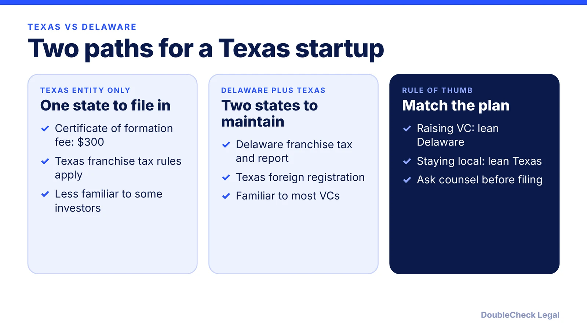
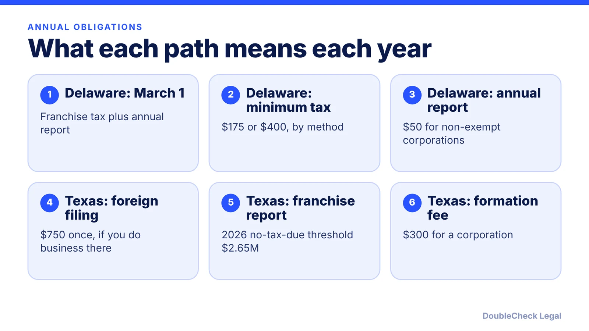

*Delaware has investor familiarity; Texas has fewer filings. Here is how foreign qualification, franchise taxes, courts and costs compare for a Texas-based startup.*

**Key takeaways:**

- A Delaware company run from Texas generally needs Texas foreign registration, which costs $750 per the Texas Secretary of State.
- Delaware's minimum franchise tax is $175 or $400 depending on method, with an annual report fee of $50.
- Capbase says VCs prefer Delaware; the Texas Business Court hears larger disputes (above $5 million).
- Bootstrapped and local: Texas can be simpler. Raising VC: Delaware is the conventional choice.

## 1. The quick answer

**Quick answer:** For a startup based in Texas, the choice is usually Delaware corporation plus Texas registration, or a Texas entity alone. If you expect to raise venture capital, Delaware is the conventional choice: Capbase, a company that sells formation services, says investors especially VCs prefer Delaware corporations. If you are bootstrapping and staying local, a Texas entity avoids a second state's filings. A Delaware company that operates in Texas generally has to register in Texas as well, so it pays for both. As of November 2026, Texas has also built up its own corporate-law tools, including a statewide business court, so the gap is narrower than older articles suggest.

This is the same question as [incorporate in California vs Delaware](/blog/incorporate-california-vs-delaware-startup/), with Texas-specific costs. The facts below each name their source.

## 2. Foreign qualification and the cost of two states

If you incorporate in Delaware but run the company from Texas, you will normally need to register it with Texas as a foreign entity. The Texas Secretary of State says a foreign filing entity must register if it transacts business in Texas, generally meaning it has an office or employee there. The fee is $750 for most entities. An unregistered entity cannot maintain a lawsuit in a Texas court until it registers, may face an injunction, and may owe a civil penalty equal to the fees and taxes it would have paid. Registering within 90 days of first transacting business avoids the late fee, per the same page. Stripe's checklist adds that you may need a registered agent in each state where you do business. More in [foreign qualification explained](/blog/foreign-qualification-register-llc-in-another-state/).

**What a Delaware corporation pays each year.** The Delaware Division of Corporations says franchise tax and the annual report are due March 1, the minimum tax is $175 under the Authorized Shares method and $400 under the Assumed Par Value Capital method, the annual report fee is $50 for non-exempt domestic corporations, and the maximum tax is $200,000 for most corporations. Stripe warns to run both methods before paying because the results can differ widely. See [Delaware franchise tax for startups](/blog/delaware-franchise-tax-startups/) and [Delaware registered agent requirements](/blog/delaware-registered-agent-requirements/).

**What a Texas entity pays.** The Texas Secretary of State lists a $300 fee for a for-profit corporation's certificate of formation. The Texas Comptroller says the no-tax-due threshold for the 2026 report is $2.65 million, and entities at or below it must still file a Public Information Report or Ownership Information Report. A May 14, 2026 article from the CPA firm BPM gives the standard rate as 0.75% and the due date as May 15, 2026. A Delaware company registered in Texas should ask a CPA how Texas franchise tax applies to it. See [Texas franchise tax for LLCs and corporations](/blog/texas-franchise-tax-llc-corporation/) and [Texas certificate of formation fees and forms](/blog/texas-certificate-of-formation-fees-forms/).

## 3. Investor expectations and the Texas Business Court

**Investors.** Capbase (updated February 26, 2026) says VCs prefer Delaware corporations because of Delaware's established statutory and case law, and that VCs will not invest in non-Delaware companies. Treat that as one vendor's view with a clear bias toward Delaware, but it matches how many venture deals are structured. If you may raise a priced round, switching later means a conversion, which adds legal work; see [converting an LLC to a C corp before fundraising](/blog/convert-llc-to-c-corp-before-fundraising/).

**Texas courts.** Gibson Dunn's January 2026 review says the Texas Business Court began hearing cases commenced on or after September 1, 2024, sits in five cities including Houston, Dallas and Austin, and handled 181 new cases in its first year. Its jurisdiction covers corporate governance and similar disputes above $5 million, and, after H.B. 40 (signed June 21, 2025), qualified transactions above $5 million instead of $10 million. A startup's early disputes will often be smaller than that, so it is not a deciding factor for most seed-stage companies.

**Corporate law changes.** Vinson & Elkins (June 1, 2026) says Texas codified the business judgment rule, limited derivative claims and required deference to disinterested directors in related-party transactions, while Delaware's Court of Chancery is credited with deep experience and extensive case law. The firm's savings estimate applies to larger Delaware companies, not a seed-stage startup, so it should not drive your decision.

**The takeaway:** Delaware has the longer track record and investor familiarity. Texas is closing the gap, but a Texas-only entity may need more explanation in diligence.

## 4. How to decide, and when to get a lawyer

Use your plan, not the headline, to choose.

- **Choose Delaware plus Texas registration if** you plan to raise venture capital or issue stock options broadly, and you accept two sets of filings and two sets of annual costs.
- **Choose a Texas entity if** you are bootstrapped or local, want one state to deal with, and do not expect a venture round soon. If you are a small business, see [how to start an LLC in Texas](/blog/how-to-start-an-llc-in-texas/).
- **Either way,** check the entity type too: [LLC vs C corp for startups](/blog/llc-vs-c-corp-startups/).

**Get an attorney to look at it when** you have co-founders, investors in discussion, an existing Texas LLC you might convert, or equity promised to employees. Draft and organize your documents with AI if you like, but have a person check state forms, fees and deadlines against the current agency pages as of November 2026; they change, and a wrong filing is slow to fix. The step-by-step order is in [how to incorporate a business as a solo founder](/blog/incorporate-a-business-as-a-solo-founder-order-of-steps/), and the broader overview is in [how to incorporate a company in the US](/blog/how-to-incorporate-a-company-in-the-us/).

**Related reading:** [How to incorporate a business: complete guide](/blog/how-to-incorporate-a-business-complete-guide-llc-s-corp-c-corp-costs-timeline/); [Delaware incorporation cost, first year](/blog/delaware-incorporation-cost-breakdown-first-year-fees-and-ongoing-taxes/)

## Where DoubleCheck fits

[DoubleCheck](https://www.contactdoublecheck.com) helps businesses and founders start legal work with AI, verify it, and, when professional advice is warranted, connect with an independent attorney, including for immigration questions. Attorney availability and practice areas vary. Attorneys on DoubleCheck are independent professionals; an attorney-client relationship forms only if an attorney accepts your engagement.

**Sources:** [Texas Secretary of State, Foreign entity FAQs](https://www.sos.texas.gov/corp/foreignfaqs.shtml); [Texas Secretary of State, Form 201 instructions](https://www.sos.texas.gov/corp/instructions/201.shtml); [Texas Comptroller, 2026 franchise tax](https://comptroller.texas.gov/taxes/franchise/forms/2026-franchise.php); [BPM, Texas Franchise Tax 2026 (May 14, 2026)](https://www.bpm.com/insights/texas-franchise-tax/); [Delaware Division of Corporations, franchise tax](https://corp.delaware.gov/frtax/); [Gibson Dunn, The Texas Business Court: Year One (Jan. 2026)](https://www.gibsondunn.com/wp-content/uploads/2026/01/The-Texas-Business-Court_-Year-One.pdf); [Greenberg Traurig, Texas Business Court amendments (Aug. 5, 2025)](https://www.gtlaw.com/en/insights/2025/8/texas-government-code-amendments-expand-texas-business-court-system); [Vinson & Elkins via JD Supra, Delaware v. Texas (June 1, 2026)](https://www.jdsupra.com:443/legalnews/delaware-v-texas-5-strategies-for-3579543/); [Capbase, Why you should not incorporate in Texas (updated Feb. 26, 2026)](https://capbase.com/why-you-shouldnt-incorporate-your-company-in-texas); [Stripe, Startup incorporation checklist (Oct. 30, 2026)](https://stripe.com/resources/more/startup-incorporation-checklist).

## FAQ

**Should a Texas-based startup incorporate in Delaware or Texas?**

If you plan to raise venture capital, Delaware is the conventional choice, and Capbase says VCs prefer Delaware corporations. If you are bootstrapped and local, a Texas entity can mean fewer filings. Ask an attorney before filing.

**Does a Delaware company need to register in Texas?**

Generally yes if it transacts business in Texas, such as having an office or employee there. The Texas Secretary of State lists a $750 registration fee for most entities and says an unregistered entity cannot maintain a lawsuit in a Texas court.

**What is the Texas Business Court and does it matter for a startup?**

It is a statewide court that began hearing cases commenced on or after September 1, 2024. Per Gibson Dunn it covers corporate governance disputes above $5 million, so it rarely affects an early-stage startup.

**How much is the Delaware franchise tax for a startup?**

The Delaware Division of Corporations lists a minimum of $175 under the Authorized Shares method and $400 under the Assumed Par Value Capital method, plus a $50 annual report fee, due March 1. Run both methods before paying.

---

*General information only. This article is not legal, tax, investment, or accounting advice.*
