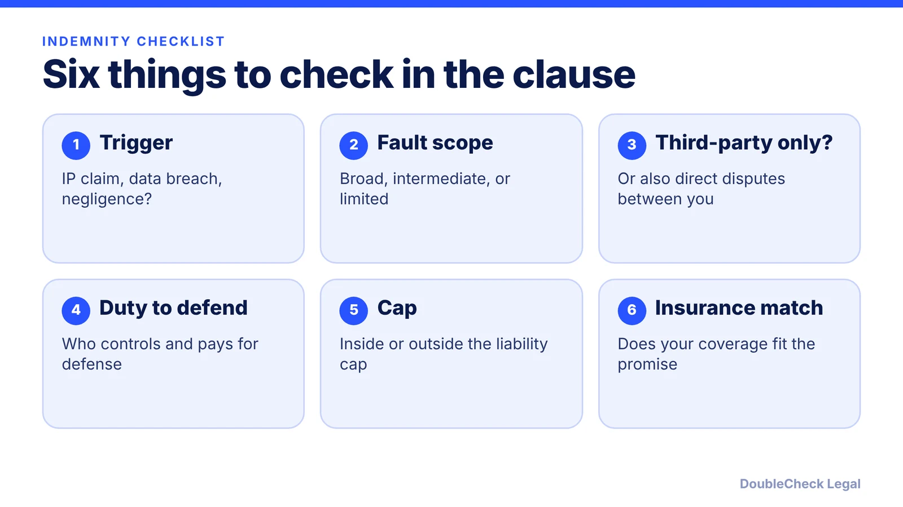
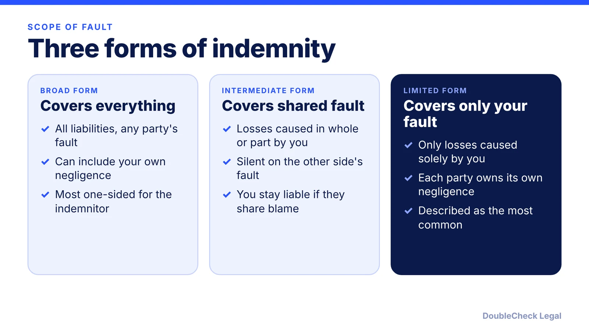

*An indemnity is a promise to cover someone else's losses. The scope and the cap decide how big that promise really is.*

**Key takeaways:**

- Indemnity usually covers third-party claims; direct disputes between the parties are a red flag, per Promise Legal.
- Broad, intermediate, and limited forms differ on whose negligence you cover; limited is the most common, per Levelset.
- 'Defend' and 'indemnify' are different duties, and defense costs can exceed damages.
- Check whether indemnity sits inside or outside the liability cap, and match it to your insurance.

## 1. The quick answer

**Quick answer:** An indemnification clause is a promise by one party to cover certain losses the other party suffers, usually third-party claims, including attorneys' fees, settlements, and judgments. How much risk you take on depends on three things: the trigger (what sets it off), the scope (whose fault it covers), and whether it sits inside or outside the contract's liability cap. Read those three before you sign.

## 2. What indemnity covers and who is protected

Per [Promise Legal](https://blog.promise.legal/startup-central/indemnification-clauses-explained-how-indemnity-works-in-contracts-with-examples/), indemnification means one party agrees to cover certain losses and third-party claims the other faces, and common triggers include IP infringement, data incidents, and negligence. Most commercial indemnities cover third-party claims, not disputes between the two contracting parties, and Promise Legal lists covering direct disputes between the parties as a red flag.

Two ideas are easy to blur:

- **Indemnify** means paying covered losses.
- **Defend** means controlling and paying for the legal defense. Promise Legal warns that defense costs can exceed the underlying damages.

A good clause also says how the indemnified party gives notice of a claim, who manages the defense, and whether the other side can veto a settlement, according to [Law Insider](https://www.lawinsider.com/resources/drafting/rediscover-the-risk-shifting-power-of-indemnity-clauses). It states there is no one-size-fits-all defense mechanism, so read this part closely rather than assuming it works the usual way.

Wording matters. Promise Legal notes that phrases like "arising out of or related to" can reach far beyond the risks the parties intended and can create liability much larger than the contract's value.

## 3. Broad, intermediate, and limited forms

The three common forms differ on whose negligence is covered. Per [Levelset](https://www.levelset.com/blog/explaining-indemnification-clauses/) (a construction-focused source):

Law Insider adds that most states will not enforce indemnification for the indemnitee's own negligence, and recommends reviewing governing law before using a broad form. Levelset notes that several states have anti-indemnity statutes, mainly for construction contracts, ranging from bans on broad and intermediate forms to allowing broad forms only with a stated monetary cap. These rules vary by state, so check yours.

If you are the smaller party and the other side drafted the clause, push for the limited form, or at least a fault qualifier such as "to the extent caused by" your breach, negligence, or willful misconduct (a Promise Legal suggestion).

## 4. Caps, carve-outs, and insurance

Indemnity interacts with the liability cap, so read both clauses together. Promise Legal's points:

- Check whether indemnity is subject to the liability cap (the usual vendor position) or carved out of it. A carve-out can "punch through" the cap and create uncapped exposure.
- Carve-outs are often demanded for IP, data security, bodily injury, and fraud. If one is unavoidable, narrow it or use a separate sub-cap tied to insurance.
- Check whether consequential damages come back in through the indemnity.
- Set a material-prejudice standard so late notice only defeats coverage if it actually harms the indemnifying party.

Then compare the promise to your policies. Promise Legal warns that mismatches between the indemnity and coverage such as general liability, cyber, or tech E&O can leave a company paying out of pocket. See [business insurance types](/blog/business-insurance-types-small-business/) for the basics.

Next steps: read the sibling post on the [limitation of liability clause](/blog/limitation-of-liability-clause-explained/), run through [contract red flags](/blog/contract-red-flags-small-business/), and use the [AI vendor contract checklist](/blog/ai-vendor-contract-checklist/) if the counterparty is an AI vendor. For high-stakes deals, have an attorney review the clause ([what review costs](/blog/how-much-does-a-lawyer-charge-to-review-a-contract/)).

## Where DoubleCheck fits

[DoubleCheck](https://www.contactdoublecheck.com) helps businesses and founders start legal work with AI, verify it, and, when professional advice is warranted, connect with an independent attorney, including for immigration questions. Attorney availability and practice areas vary. Attorneys on DoubleCheck are independent professionals; an attorney-client relationship forms only if an attorney accepts your engagement.

**Sources:** [Levelset, Explaining Indemnification Clauses](https://www.levelset.com/blog/explaining-indemnification-clauses/); [Promise Legal, Indemnification Clauses Explained](https://blog.promise.legal/startup-central/indemnification-clauses-explained-how-indemnity-works-in-contracts-with-examples/); [Law Insider, Risk Shifting Power of Indemnity Clauses](https://www.lawinsider.com/resources/drafting/rediscover-the-risk-shifting-power-of-indemnity-clauses).

## FAQ

**What does an indemnification clause do?**

Per Promise Legal, one party agrees to cover certain losses and third-party claims the other faces, often including attorneys' fees, settlements, and judgments, depending on a trigger such as IP infringement, a data incident, or negligence.

**What is the difference between broad, intermediate, and limited indemnity?**

Per Levelset: broad form covers all liabilities even for the indemnitee's own negligence; intermediate covers losses caused in whole or in part by the indemnitor's negligence; limited covers only losses caused solely by the indemnitor's negligence.

**Is the duty to defend the same as the duty to indemnify?**

No. Per Promise Legal, defending means controlling and paying for the legal defense, while indemnifying means paying covered losses. The clause should say who controls the defense and who approves settlements.

**Are indemnification clauses always enforceable?**

Not always. Per Levelset, courts have held clauses must be clear, specific, and unambiguous, and some states have anti-indemnity statutes. Per Law Insider, most states will not enforce indemnity for the indemnitee's own negligence. Rules vary by state.

---

*General information only. This article is not legal, tax, investment, or accounting advice.*
