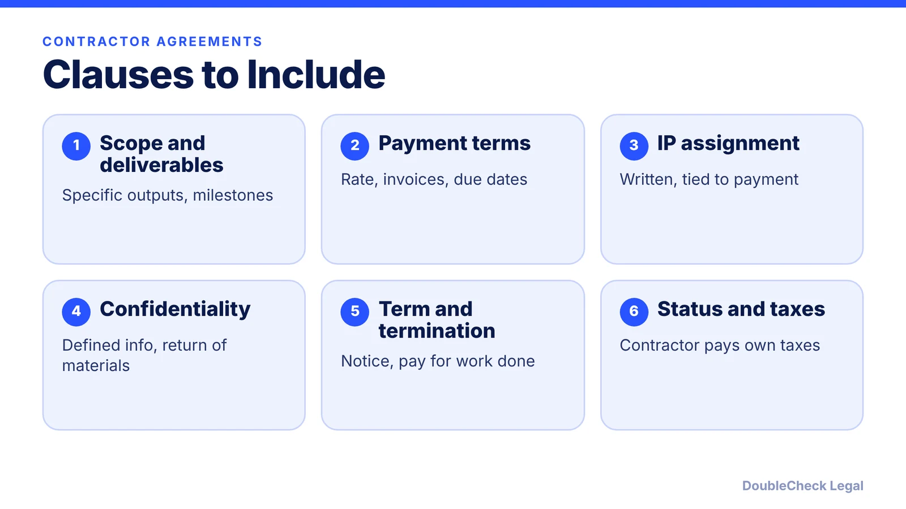
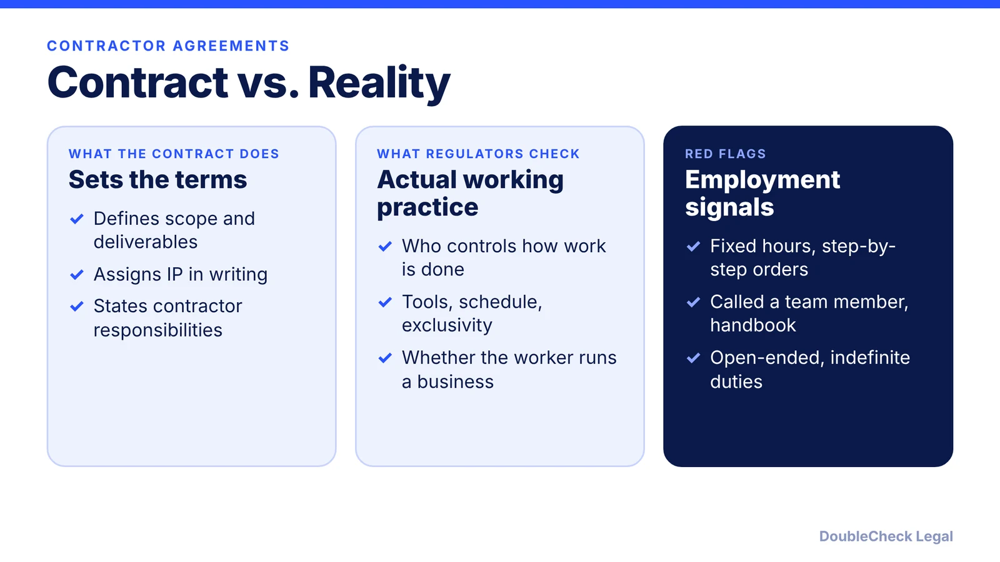

*The clauses that matter in a contractor agreement for startups, and why the IP clause deserves the most attention.*

**Key takeaways:**

- Define specific deliverables and milestones; vague scope reads like employment.
- A contractor can keep copyright in the work unless you have a written assignment or qualifying work-for-hire agreement.
- Confidentiality terms should define the information, set a period, and require return of materials.
- A contract label does not control; regulators examine actual control and independence.

## 1. The quick answer

**Quick answer:** A solid independent contractor agreement covers the scope of work, payment terms, who owns the intellectual property, confidentiality, term and termination, and language that reflects a genuine independent relationship. The IP clause matters most for startups: per Nolo, hiring a contractor does not automatically give you ownership of the work, and you generally need a written assignment (or a written work-for-hire agreement in the limited categories where it applies). The contract cannot fix a misclassified relationship, though, because regulators look at how the work is actually done.

## 2. Scope, payment, and term

Per Ruul's summary of contractor agreements, describe specific deliverables, milestones, and timelines. Open-ended wording like "as requested" reads like employment. A common structure is a master services agreement for the general relationship plus a statement of work for each project.

**Payment:** state the rate structure (project, milestone, or hourly), the invoicing process, due dates, and late-payment terms. Payment should follow the contractor's invoice rather than a payroll-style cycle. If you pay a U.S. contractor $2,000 or more in a year, see the [1099-NEC threshold guide](/blog/1099-nec-2000-threshold-hiring-freelancers/).

**Term:** tie the term to the project, add termination for convenience with notice, and say what happens to work in progress and payment when it ends. Avoid indefinite or auto-renewing terms. For a freelancer-focused walkthrough, see [how to write a freelance contract](/blog/how-to-write-a-freelance-contract/).

## 3. IP assignment and confidentiality

Per Nolo, contractors can keep the copyright to what they create even if you paid for it. To secure ownership:

- **Work made for hire:** applies only if the work falls in one of the nine statutory categories (such as contributions to collective works, translations, or instructional texts) and there is a signed written agreement.
- **Assignment:** for everything else, such as a standalone logo or software, use a written assignment transferring the rights to you. Ruul's summary suggests tying the transfer to full payment and handling the contractor's pre-existing IP separately, usually with a license.

For **confidentiality**, define confidential information, list the standard exclusions, set a fixed period for general information (Ruul says two to five years is common) while protecting trade secrets without a time limit, and require return or destruction of materials. See [confidentiality and IP assignment agreements](/blog/confidentiality-ip-assignment-agreements-startups/) and [how to write an NDA](/blog/how-to-write-an-nda-startups/). If the contractor uses AI tools, read [AI-generated code and IP](/blog/ai-generated-code-ip-startup-founders/).

## 4. Classification warnings to build in

Ruul's guide lists clauses that support contractor status: a statement of independent status, contractor responsibility for taxes and waiver of employee benefits, a genuine right of substitution, control limited to outcomes rather than methods, no exclusivity, the contractor's own tools, and a tax indemnification. It also warns that a contract calling someone a contractor will not protect you if the daily arrangement looks like employment, and that California's ABC test can apply to work performed in California regardless of a governing-law clause.

In practice, avoid set working hours, mandatory company events, and step-by-step instructions, and manage by deliverables. Read [employee vs. independent contractor classification](/blog/employee-vs-independent-contractor-classification-startups/) before you sign. Also add a governing-law and dispute path (negotiation, mediation, then arbitration or court), and review agreements annually. If the contractor works outside the U.S., see [hiring international workers](/blog/hire-international-employees-remote-eor-vs-contractor-vs-sponsorship/).

## Where DoubleCheck fits

[DoubleCheck](https://www.contactdoublecheck.com) helps businesses and founders start legal work with AI, verify it, and, when professional advice is warranted, connect with an independent attorney, including for immigration questions. Attorney availability and practice areas vary. Attorneys on DoubleCheck are independent professionals; an attorney-client relationship forms only if an attorney accepts your engagement.

**Sources:** [Nolo on contractor IP](https://nolo.com/legal-encyclopedia/how-protect-intellectual-property-rights-29913.html); [Ruul on contractor agreements](https://ruul.io/blog/independent-contractor-agreements); [IRS fact sheet FS-15-21](https://www.irs.gov/pub/irs-news/FS-15-21.pdf).

## FAQ

**Do I own work a contractor creates for me?**

Not automatically. Per Nolo, you generally need a written assignment, or a written work-for-hire agreement if the work falls in one of the statutory categories.

**What should the payment clause say?**

Per Ruul, specify the rate structure, invoicing process, due dates, and late-payment terms, and pay on invoice rather than on a payroll cycle.

**Can a contract make someone a contractor?**

No. Per Ruul, substance beats labels: regulators examine actual control and business independence, and California's ABC test can apply regardless of your governing-law clause.

**Should a contractor agreement include a confidentiality clause?**

Usually yes. Define confidential information, list exclusions, set a period for general information, protect trade secrets without a time limit, and require return of materials.

---

*General information only. This article is not legal, tax, investment, or accounting advice.*
