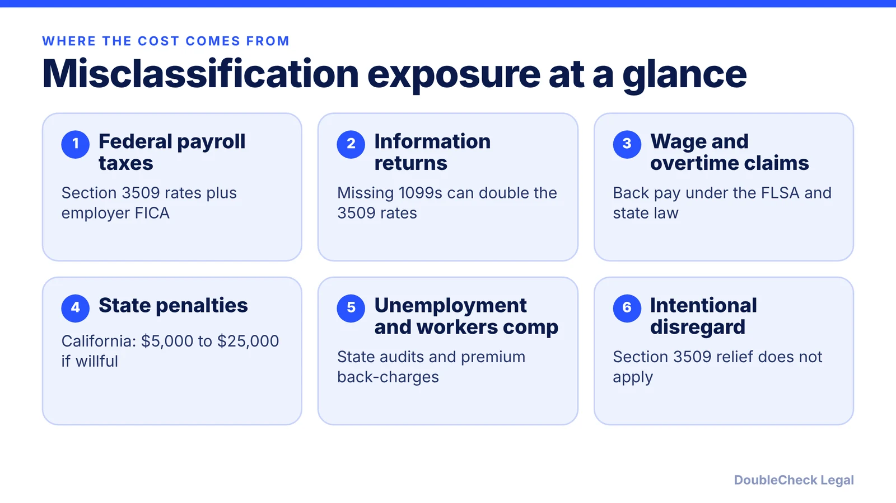
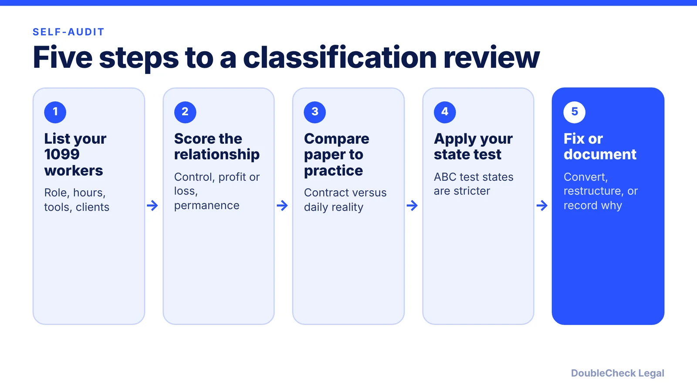

*Misclassifying a worker as an independent contractor can mean back taxes, wage claims and state fines; here is how the costs add up and what relief exists.*

**Key takeaways:**

- Section 3509 reduces, but does not erase, federal payroll tax liability for many misclassified workers.
- Missing 1099s raise the Section 3509 rates, and intentional disregard removes them.
- Wage claims and state penalties, such as California's $5,000 to $25,000 per willful violation, sit on top of federal tax.
- The IRS VCSP and Section 530 offer relief for some employers, with strict eligibility.

## 1. The quick answer

**Quick answer:** The penalties for independent contractor misclassification for employers can include back payroll taxes, interest, penalties, unpaid wages and overtime, and in some states per-violation fines. Federal law sets reduced tax rates for many misclassified workers: under Section 3509, income tax withholding liability is figured at 1.5% of wages and the employee share of Social Security and Medicare at 20% of the usual amount, per Cornell LII's text of the statute. Those rates rise to 3% and 40% if required information returns such as Forms 1099 were also not filed without reasonable cause, and they do not apply at all for intentional disregard. The employer share of FICA and any wage claims come on top. As of November 2026, the federal Department of Labor test is in flux and states such as California apply stricter tests.

## 2. How federal tax liability is calculated

When the IRS reclassifies a contractor as an employee, the business owes the payroll taxes it should have withheld and paid. Section 3509 of the Internal Revenue Code gives many employers a reduced computation, as summarized by [Cornell LII](https://www.law.cornell.edu/uscode/text/26/3509):

- **Income tax withholding:** figured as if the employer had withheld 1.5% of wages.
- **Employee share of FICA:** 20% of the amount that would otherwise be owed.
- **If 1099s were also missed without reasonable cause:** 3% and 40% instead.
- **Intentional disregard:** the reduced rates do not apply, so the employer faces the full amounts.
- **Employer share of FICA:** still owed in full, along with interest and any penalties.

The reduced rates apply to the employer's liability only. The worker's own tax liability is unaffected, and the employer cannot recover the determined tax from the worker. Federal unemployment tax and state unemployment contributions are separate lines that a reclassification can also trigger.

The practical lesson: filing a 1099-NEC for a worker you pay is not a defense, but not filing it makes the numbers worse. See [1099-NEC and the $2,000 threshold](/blog/1099-nec-2000-threshold-hiring-freelancers/) for filing basics.

## 3. Wage, overtime and state exposure

Tax is often the smaller part of the bill. A worker treated as an employee is generally entitled to minimum wage, overtime if non-exempt, and benefits your state requires. Back-pay claims can look back several years depending on the law, and rules vary by state.

**The federal test is moving.** On February 26, 2026, the Department of Labor proposed to rescind the 2024 independent contractor rule and return to a framework like the 2021 rule, centered on two core factors: control over the work and opportunity for profit or loss, per [DLA Piper](https://www.dlapiper.com/en-cz/insights/publications/2026/03/dol-proposes-independent-contractor-rule). Comments were due April 28, 2026. Per [Jackson Lewis](https://www.jacksonlewis.com/index%2ephp/insights/dols-proposed-2026-independent-contractor-rule-what-employers-need-know), DOL has stopped enforcing the 2024 rule, but it can still matter in private FLSA lawsuits. I did not find a confirmed final rule as of November 2026, so check the DOL Wage and Hour page for current status.

**Many states are stricter.** California uses the ABC test: a worker is presumed an employee unless the business proves freedom from control, work outside the usual course of its business, and an independently established trade, per the [California Labor and Workforce Development Agency](https://www.labor.ca.gov/employmentstatus/employers/). That page also states civil penalties of $5,000 to $25,000 per violation for willful misclassification. Other states have their own tests and penalties, so check yours.

For the classification factors themselves, read [employee vs. independent contractor classification for startups](/blog/employee-vs-independent-contractor-classification-startups/) and [independent contractor vs. employee](/blog/independent-contractor-vs-employee/). Overtime exposure is covered in [overtime: exempt vs. nonexempt](/blog/overtime-exempt-vs-nonexempt-small-business/).

## 4. Relief options if you already misclassified

If you suspect past misclassification, two IRS paths are worth knowing. Neither is automatic, and eligibility depends on facts.

**Voluntary Classification Settlement Program (VCSP).** Per the [IRS](https://www.irs.gov/vcsp), you must have consistently treated the workers as nonemployees and filed all required 1099s for the previous three years, and you cannot be under an IRS employment tax audit or a Department of Labor or state audit on these workers. You pay 10% of the employment tax liability that would have been due on the most recent year's compensation, figured under the reduced Section 3509(a) rates. Interest and penalties on that payment are waived, and the IRS will not audit the workers' classification for prior years. Form 8952 is due at least 120 days before you start treating the workers as employees.

**Section 530 relief.** Per the [IRS](https://www.irs.gov/government-entities/worker-reclassification-section-530-relief), this can end federal employment tax liability if you meet three tests: reporting consistency (you filed the required 1099s), substantive consistency (you did not treat similar workers as employees after 1977), and a reasonable basis such as a prior audit, court precedent, long-standing industry practice, or other reasonable reliance. It does not reclassify the worker, and it does not address wage claims or state law.

Both programs address federal tax only. Wage claims, state penalties and state unemployment taxes are separate, which is why a quick conversation with an attorney or CPA before you file anything is usually worth it.

## 5. A practical audit before someone else does one

Run this review now, not after a worker files for unemployment or a claim lands.

1. **List every 1099 worker** and what each actually does day to day.
2. **Score each relationship** on control, schedule, tools, exclusivity, and whether they run their own business.
3. **Check the contract against reality.** Paper labels do not decide the result; the actual working relationship does.
4. **Check your state test.** If you have workers in California or another ABC-test state, apply that test.
5. **Decide:** convert to W-2, restructure the relationship, or document why contractor status holds.

Use a written agreement for genuine contractors; see [what to include in an independent contractor agreement](/blog/independent-contractor-agreement-what-to-include/). Hiring your first employee instead? Start with the [first employee legal checklist](/blog/how-to-hire-first-employee-legal-checklist/) and [state payroll tax registration](/blog/register-for-state-payroll-taxes-new-employer/). If you ask AI to classify a worker, [verify the output](/blog/verify-ai-generated-legal-document/), and consider [when to hire a lawyer](/blog/when-to-hire-lawyer-small-business/).

## Where DoubleCheck fits

[DoubleCheck](https://www.contactdoublecheck.com) helps businesses and founders start legal work with AI, verify it, and, when professional advice is warranted, connect with an independent attorney, including for immigration questions. Attorney availability and practice areas vary. Attorneys on DoubleCheck are independent professionals; an attorney-client relationship forms only if an attorney accepts your engagement.

**Sources:** [Cornell LII, 26 U.S.C. 3509](https://www.law.cornell.edu/uscode/text/26/3509); [IRS VCSP](https://www.irs.gov/vcsp); [IRS Section 530 relief](https://www.irs.gov/government-entities/worker-reclassification-section-530-relief); [DLA Piper, March 2026](https://www.dlapiper.com/en-cz/insights/publications/2026/03/dol-proposes-independent-contractor-rule); [Jackson Lewis](https://www.jacksonlewis.com/index%2ephp/insights/dols-proposed-2026-independent-contractor-rule-what-employers-need-know); [California LWDA](https://www.labor.ca.gov/employmentstatus/employers/).

## FAQ

**What are the penalties for misclassifying an independent contractor?**

They can include back payroll taxes, interest, penalties, unpaid wages and overtime, and state fines. Under Section 3509, federal income tax withholding liability is figured at 1.5% of wages and the employee FICA share at 20%, rising to 3% and 40% if 1099s were not filed, per Cornell LII. California lists $5,000 to $25,000 per violation for willful misclassification.

**Does filing a 1099 protect me from misclassification penalties?**

No. A 1099 does not decide worker status. Filing required 1099s does matter for relief, since Section 530 and VCSP both require consistent 1099 reporting, and missing them raises the Section 3509 rates.

**What is the IRS Voluntary Classification Settlement Program?**

Per the IRS, eligible employers pay 10% of the employment tax liability that would have been due on the most recent year of compensation, figured under Section 3509(a), with interest and penalties on that payment waived and no audit of prior-year classification. You must have filed required 1099s for the previous three years and not be under audit.

**Is the federal independent contractor rule changing in 2026?**

The Department of Labor proposed on February 26, 2026 to rescind the 2024 rule and return to a framework like the 2021 rule, per DLA Piper. As of November 2026 a final rule was not confirmed in the sources reviewed, so check the DOL Wage and Hour Division for current status. State tests such as the California ABC test still apply.

**Should I talk to a lawyer before reclassifying workers?**

Often yes. Reclassification choices affect taxes, wage exposure and state obligations differently, and programs like VCSP have eligibility conditions. An attorney or CPA can review facts before you file anything.

---

*General information only. This article is not legal, tax, investment, or accounting advice.*
