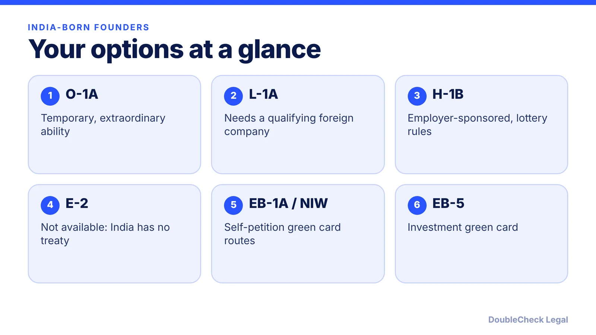
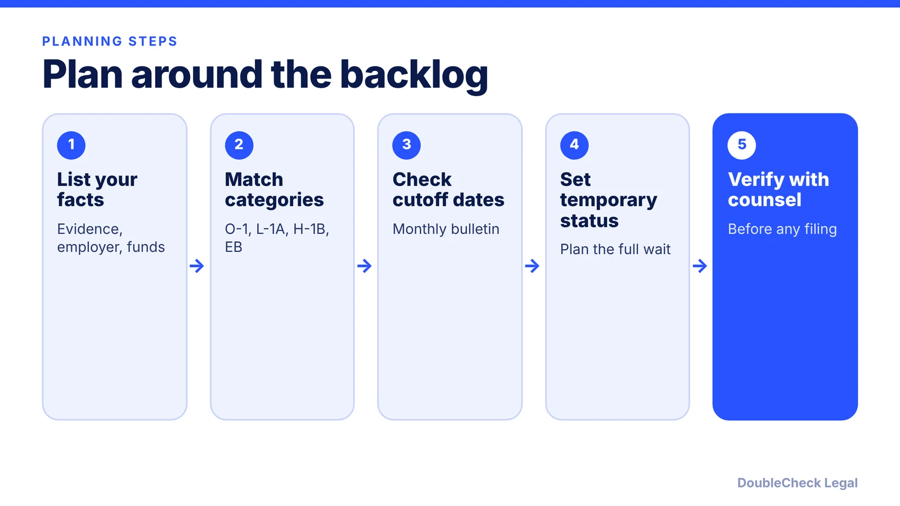

*India-born founders face the same visa menu as others, minus E-2, and a longer green card line. Here is how to plan.*

**Key takeaways:**

- India is not an E-2 treaty country, per Headman Law Group; O-1A, L-1A and H-1B are the main temporary routes.
- November 2026 India Final Action Dates, per Wolfsdorf: EB-1 Feb 1, 2023; EB-2 Nov 1, 2013; EB-3 Jan 22, 2014.
- EB-1A and NIW can be self-filed (CitizenPath); category choice changes the wait by years.
- Confirm the current bulletin and chart each month, and verify strategy with an immigration attorney.

## 1. The quick answer

**Quick answer:** India-born founders can use the same U.S. work and business visas as anyone else, but not the E-2, because law-firm country lists say India is not an E-2 treaty country. The practical split is between temporary status (O-1, L-1A, H-1B) and the green card line, where India has its own, much longer queue. As of November 2026, the Final Action Dates for India per Wolfsdorf's reading of the November Visa Bulletin are EB-1 February 1, 2023, EB-2 November 1, 2013 and EB-3 January 22, 2014. Per EB5Investors.com, EB-5 unreserved India is December 1, 2023. Because the green card wait depends on category, the main strategic question is which category your facts support.

## 2. Temporary status: O-1, L-1A, H-1B (and why not E-2)

**E-2.** Headman Law Group states that India and mainland China are not E-2 treaty countries, and that there is no qualifying commerce, navigation or bilateral investment treaty between India and the United States. Treaty status follows nationality, so living elsewhere does not change it. Check the State Department treaty table before relying on this. See our [E-2 guide](/blog/e-2-treaty-investor-visa-for-founders/).

**O-1A.** The State Department lists O-1 for extraordinary ability in science, art, education, business or athletics. It has no lottery and no country quota, which is why founders with strong evidence consider it. Read the [O-1A evidence guide](/blog/o-1a-visa-for-startup-founders-evidence/).

**L-1A.** The State Department says L-1 requires one year of employment with the related company abroad within the prior three years. For a founder, that means a real foreign business that has been operating, not a company created for the purpose. See [L-1A for new offices](/blog/l-1a-visa-new-office-foreign-founders/).

**H-1B.** For jobs that generally require at least a bachelor's degree, sponsored by an employer. Fees and selection rules moved in 2025 and 2026: see the [H-1B $100,000 fee status](/blog/h1b-100000-fee-status-2026/), the [weighted lottery](/blog/h1b-weighted-lottery-wage-levels-explained/) and the [FY2028 registration timeline](/blog/h-1b-cap-registration-fy2028-timeline-employers/). Owning a company and being employed by it are separate questions: see [starting a company on H-1B](/blog/start-company-on-h1b-visa-ownership-vs-work/).

**Students.** If you are already on F-1 in the U.S., see [OPT and STEM OPT for startups](/blog/f1-opt-stem-opt-start-your-own-startup/) and [F-1 to O-1](/blog/f-1-to-o-1-change-of-status-founders/). For a side-by-side of the employee routes, read [H-1B vs L-1 vs O-1](/blog/h-1b-vs-l-1-vs-o-1-which-visa-for-tech-employees/).

A visitor visa is not a work route; see [what a B-1 visitor can do](/blog/b-1-b-2-visa-business-visitor-what-founders-can-do/).

## 3. Green card routes and the India backlog

Green card categories have separate cutoff dates by country. Per Wolfsdorf's summary of the November 2026 bulletin, India Final Action Dates compare with China like this:

- **EB-1:** India February 1, 2023 (unchanged); China August 1, 2023.
- **EB-2:** India November 1, 2013 (unchanged); China October 1, 2021.
- **EB-3 (skilled workers and professionals):** India January 22, 2014; China January 22, 2022.

A visa number is available only to applicants whose priority date is earlier than the listed date (per UT Southwestern's summary). The State Department bulletin itself did not load for me, so confirm each month at travel.state.gov, including which chart USCIS accepts for filing.

Per CitizenPath, EB-1A and the national interest waiver can both be self-filed. The EB-1 queue for India is far shorter than EB-2 on these dates, which is why founders with strong evidence often compare them. Read [EB-1A vs NIW](/blog/eb-1a-vs-niw-which-is-better-for-founders/), [EB-1A vs O-1](/blog/eb-1a-vs-o-1-founder-which-path/) and [the NIW](/blog/niw-eb-2-national-interest-waiver-founders/). An employer-based route runs through [PERM](/blog/perm-labor-certification-green-card-process/).

EB-5 is the investment route: $800,000 in a targeted employment area or $1,050,000 elsewhere (per Legal Services Incorporated; see our [EB-5 guide](/blog/eb-5-investor-visa-requirements-2026/)). EB5Investors.com reported on October 22, 2026 that India unreserved EB-5 was December 1, 2023 for November.

Background: [how the Visa Bulletin works](/blog/visa-bulletin-explained-priority-dates-eb-categories/) and [priority date retrogression for India and China](/blog/priority-date-retrogression-india-china-backlog/).

## 4. Strategy when there is a backlog

You cannot shorten a queue, but you can choose how to spend the wait. Questions worth working through, ideally with counsel:

- **Which category fits your facts?** The same person may support an EB-2 NIW and an EB-1A. The dates above differ by years.
- **Is your temporary status sustainable?** Plan for the full period you may need to remain in status, not just the next renewal.
- **Where is your priority date?** Keep records. Per Beyond Border, as cited in our retrogression post, an original priority date can be kept when moving between EB-2 and EB-3. Confirm in your case.
- **What happens if a date moves backward?** Retrogression is a bulletin change, not a denial.

**Self-handle vs. attorney.** You can read the bulletin, list your achievements and compare categories yourself. Get an attorney when you choose between EB-1A, NIW and PERM, when you hold a status with a deadline, when you plan a change of status, or when an entity structure matters. See [how to find a good immigration lawyer](/blog/how-to-find-good-immigration-lawyer-startup-founder/) and [fees](/blog/immigration-lawyer-fees-flat-fee-vs-hourly/). To compare all paths, read [which U.S. visa is right for you](/blog/which-us-visa-is-right-for-you-by-situation-decision-guide/).

## Where DoubleCheck fits

[DoubleCheck](https://www.contactdoublecheck.com) helps businesses and founders start legal work with AI, verify it, and, when professional advice is warranted, connect with an independent attorney, including for immigration questions. Attorney availability and practice areas vary. Attorneys on DoubleCheck are independent professionals; an attorney-client relationship forms only if an attorney accepts your engagement.

**Sources:** [Wolfsdorf, November 2026 Visa Bulletin](https://wolfsdorf.com/november-2026-visa-bulletin-selected-employment-categories-make-gains-family-categories-advance/); [UT Southwestern, November 2026 Visa Bulletin](https://www.utsouthwestern.edu/about-us/administrative-offices/international-affairs/immigration-updates/november-2026-visa-bulletin.html); [EB5Investors.com](https://www.eb5investors.com/?p=41888); [Headman Law Group, E-2 countries](https://headmanlaw.com/insights/e-2-investor-visa-2026-treaty-countries-thresholds/); [CitizenPath, employment-based green cards](https://citizenpath.com/employment-based-green-card-process/); [State Department, temporary worker visas](https://adoption.state.gov/content/travel/en/us-visas/employment/temporary-worker-visas.html); [Legal Services Incorporated, EB-5](https://legalservicesincorporated.com/immigration-law/investor-visas/eb5-visa/eb-5-regional-center-program-shutdown-update/). The State Department November 2026 bulletin page did not load, so dates are attributed to the secondary sources.

## FAQ

**Can an India-born founder get an E-2 visa?**

Not based on Indian citizenship. Headman Law Group states that India is not an E-2 treaty country because no qualifying treaty exists between India and the United States. Treaty status follows nationality, so check the State Department treaty table.

**What are the November 2026 green card cutoffs for India?**

Per Wolfsdorf, India Final Action Dates are EB-1 February 1, 2023, EB-2 November 1, 2013 and EB-3 (skilled workers and professionals) January 22, 2014. A visa number is available only if your priority date is earlier than the listed date. Confirm in the State Department bulletin.

**Which green card category has the shortest India line?**

On the November 2026 dates, EB-1 is the shortest of EB-1, EB-2 and EB-3 for India, per Wolfsdorf. Whether you qualify for EB-1A depends on your evidence, so have a lawyer assess it.

**Can I self-petition for a green card as a founder?**

Per CitizenPath, EB-1A and the national interest waiver can be self-filed, without an employer. Eligibility standards are demanding, so many applicants seek attorney review before filing.

---

*General information only. This article is not legal, tax, investment, or accounting advice.*
