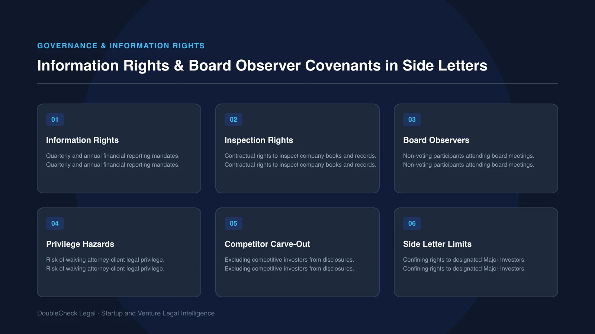
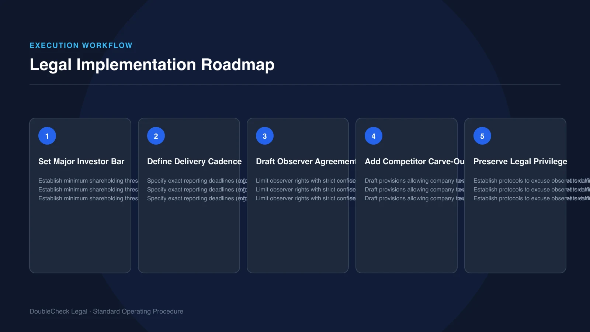

*A rigorous legal guide to venture capital information rights, board observer covenants, side letter drafting standards, attorney-client privilege preservation, and competitor carve-outs under Delaware corporate law.*

**Key takeaways:**
- **Contractual vs Statutory Rights:** Under Delaware General Corporation Law (DGCL) § 220, all stockholders have limited statutory inspection rights; venture side letters expand these into mandatory, scheduled financial disclosures.
- **No Fiduciary Duties for Observers:** Board observers possess no legal fiduciary duties to the corporation, meaning they can theoretically share insights with their venture fund unless constrained by strict non-disclosure covenants.
- **Privilege Destruction Risks:** Having an observer present during legal counseling risks waiving attorney-client privilege; observer agreements must explicitly grant the board right to excuse observers during executive legal sessions.
- **Major Investor Qualification:** Founders should strictly limit observer and detailed information covenants to lead investors meeting high dollar thresholds ($1M+).

## 1. The quick answer: Information rights and board observers explained

When raising capital from venture funds and family offices, institutional investors routinely demand governance participation without taking on director liability:

1. **Information Rights:** Covenants obligating the company to provide quarterly financial statements (balance sheet, income statement, cash flows), annual operating budgets, and capitalization tables.
2. **Inspection Rights:** The right to visit corporate facilities, examine books of account, and consult with corporate officers.
3. **Board Observer Seats:** A contractual right permitting an investor representative to attend all meetings of the Board of Directors in a non-voting capacity and receive all meeting packets.



## 2. In-depth legal analysis: The governance risks of side letter covenants

While information rights appear harmless, poorly structured side letters create profound operational and legal friction as startups scale.

### A. The Absence of Fiduciary Duties for Observers
Under Delaware law, directors owe fiduciary duties of care and loyalty to the corporation and its stockholders (*Guth v. Loft, Inc.*). If a director misuses confidential corporate information, they face personal liability for breach of fiduciary duty.

**Board observers owe no such duties.** They are purely third-party contract counterparties. Without an airtight observer agreement:
- An observer could observe sensitive pricing discussions and leverage that insight for a competitive portfolio company.
- The company cannot bring fiduciary claims against an observer for self-dealing, but must rely solely on breach of contract remedies.

### B. Attorney-Client Privilege Waiver Pitfalls
Under federal and state evidence rules, communicating confidential legal advice in the presence of a third party generally destroys attorney-client privilege.
- **The Threat:** If outside litigation counsel advises the Board on a high-stakes trade secret lawsuit or regulatory investigation while a venture board observer is in the room, opposing counsel can depose the observer and subpoena all legal notes.
- **The Solution:** Every observer covenant must include an explicit **Executive Session / Privilege Carve-Out**:

```
"The Company reserves the right to withhold any information and to exclude such Observer from any meeting or portion thereof if access to such information or attendance at such meeting would adversely affect the attorney-client privilege between the Company and its counsel or result in a conflict of interest."
```

### C. Standard Information Rights Cadence
Standard institutional NVCA documentation provides for tiered disclosure:

| Reporting Level | Timing | Required Contents |
|---|---|---|
| Monthly Financials | Within 30 days of month-end | Unaudited income statement and cash balance |
| Quarterly Financials | Within 45 days of quarter-end | Balance sheet, income statement, cap table update |
| Annual Financials | Within 120 days of fiscal year-end | Audited or GAAP-compliant financial statements |
| Annual Budget | 30 days prior to new fiscal year | Board-approved operating forecast and hiring plan |

## 3. Step-by-step: How to draft and structure investor side letters



To avoid legal gridlock and administrative burnout, corporate counsel should establish a strict side letter playbook:

### Step 1: Establish High "Major Investor" Thresholds
Do not offer information rights to every seed angel. Set the definition of a "Major Investor" at a minimum dollar ownership (e.g., holding at least 500,000 shares of Preferred Stock or having invested over $1,000,000).

### Step 2: Implement Mandatory Confidentiality and Non-Use Clauses
Ensure that side letters bind the investor fund and its observer to strict non-disclosure obligations, restricting dissemination to partners, accountants, and legal advisors with a strict "need to know."

### Step 3: Insert Robust Competitor Carve-Outs
Include language authorizing the Board to withhold financial reporting and exclude observers if the investor invests in or advises a direct competitor:

```
"Notwithstanding anything to the contrary, the Company shall have no obligation to provide information or observer access to any Investor that the Board of Directors reasonably determines is a direct competitor of the Company."
```

### Step 4: Include Automatic Termination Triggers
Draft observer and information covenants to automatically terminate upon:
- The closing of the company’s Initial Public Offering (IPO);
- A Deemed Liquidation Event or acquisition;
- The investor falling below the Major Investor shareholding threshold.

### Step 5: Adopt a Side Letter Tracking Matrix
Centralize all unique reporting deadlines across all side letters to ensure financial teams never miss a disclosure deadline or breach an investor agreement.

## 4. Resolving conflicts between board observers and directors

When board dynamics sour, rogue observers can disrupt meetings, monopolize agendas, or intimidate management. Corporate boards maintain ultimate control over room procedure:
- **Speaking Rights vs Attendance:** Observer agreements should clarify that observers have the right to listen, but may speak only upon invitation by the Board Chairman or CEO.
- **Meeting Materials Access:** Observers should receive materials simultaneously with directors, subject to redactions for conflict matters.
- **Recusal on Conflicted Matters:** If the board evaluates an acquisition offer or commercial partnership involving the observer’s fund, the observer must be formally recused.

## 5. Due diligence checklist: Auditing investor governance rights

1. **Check Delaware § 220 Exposure:** Distinguish statutory shareholder inspection demands from contractual side letter commitments.
2. **Audit VC Fund Affiliates:** Ensure observer rights do not extend indefinitely to unnamed future partners or junior analysts.
3. **Verify Privilege Preservation:** Confirm every board meeting minutes reflect that observers were excused during privileged legal counsel discussions.
4. **Cap Table Synchronization:** Verify that investors demanding information rights continue to hold their qualifying shares.

## Where DoubleCheck fits

[DoubleCheck](https://www.contactdoublecheck.com) gives startup executives, corporate secretaries, and venture counsel an AI-driven platform for tracking side letters and governance commitments. DoubleCheck extracts idiosyncratic reporting deadlines, identifies missing attorney-client privilege carve-outs, flags competitor disclosure hazards, and ensures companies fulfill their investor relations obligations without compromising corporate secrecy.

**Related reading:**
- [Investor Rights Agreement (IRA): Information & Registration](/blog/investor-rights-agreement-ira-information-registration-rights/)
- [Board Control & Protective Provisions: Series A Term Sheets](/blog/board-control-protective-provisions-series-a-term-sheets/)
- [Series A Legal Due Diligence Checklist](/blog/series-a-legal-due-diligence-checklist/)
- [Founder Equity Split: How to Divide](/blog/founder-equity-split-how-to-divide/)

**Sources:** [Delaware General Corporation Law § 220 (Inspection of Books and Records)](https://delcode.delaware.gov/title8/c001/sc07/); [Delaware Court of Chancery, Guth v. Loft, Inc. (Fiduciary Standards)](https://courts.delaware.gov/chancery/); [National Venture Capital Association (NVCA), Model Investors’ Rights Agreement](https://nvca.org/model-legal-documents/); [Federal Rules of Evidence Rule 502 (Attorney-Client Privilege & Work Product)](https://www.law.cornell.edu/rules/fre/rule_502).

## FAQ

**What are contractual information rights in venture capital?**

Information rights are contractual covenants, typically included in an Investors’ Rights Agreement (IRA) or side letter, requiring a startup to deliver audited or unaudited financial statements, annual budgets, and capitalization updates to qualifying investors.

**Does a board observer have fiduciary duties to the corporation?**

No. Unlike elected directors who owe strict fiduciary duties of loyalty and care under Delaware law, board observers owe no statutory fiduciary duties to the company or its shareholders, making strong contractual confidentiality covenants essential.

**Can having a board observer present waive attorney-client privilege?**

Yes. Because a board observer is not a director and represents a third-party investor, the presence of an observer during discussions with corporate legal counsel can destroy the confidentiality necessary to maintain attorney-client privilege.

**What is a competitor carve-out in an information rights agreement?**

A competitor carve-out allows a startup to withhold sensitive financial information, product roadmaps, and trade secrets from any investor who invests in, controls, or operates a competitive commercial enterprise.

**How can AI tools audit investor side letter commitments?**

AI tools scan dozens of disparate investor side letters to compile an automated reporting schedule, flag conflicting observer covenants, and monitor compliance with customized disclosure rules.

---

*General information only. This article is not legal, tax, investment, or accounting advice.*
