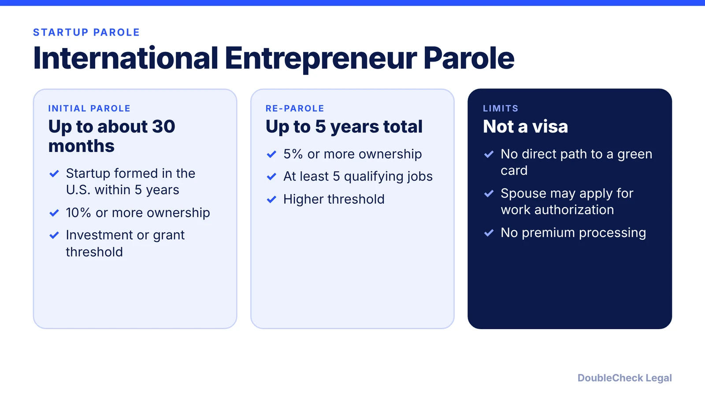
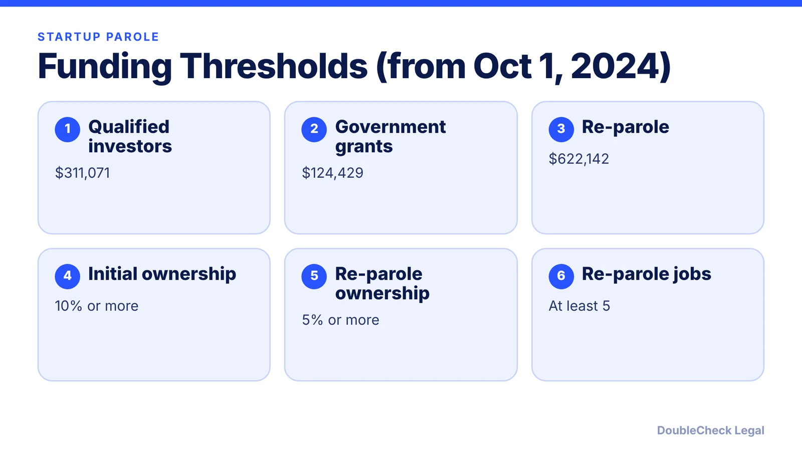

*Is there a startup visa for founders? The International Entrepreneur Rule is the closest thing, but it is parole, not a visa.*

**Key takeaways:**

- The rule allows case-by-case parole for founders of startups that provide a significant public benefit.
- Initial parole needs 10% ownership, a central role, and a funding threshold of $311,071 from qualified investors.
- It is not a visa and has no direct path to a green card.
- Secondary sources say it remained in place as of August 2026; verify before relying on it.

## 1. The quick answer

**Quick answer:** The International Entrepreneur Rule lets DHS grant parole, case by case, to founders whose U.S. startup would provide a significant public benefit. It is not a visa and does not lead directly to a green card. For initial parole, the startup must have been formed in the U.S. within the past five years, you must own at least 10%, have an active central role, and meet an investment or grant threshold. Secondary sources say the rule remained in place as of August 2026, but USCIS's own page was not reachable when this was written.

## 2. The funding thresholds

Per a Mondaq summary of USCIS's adjustments, for filings on or after October 1, 2024 the thresholds are $311,071 from qualified U.S. investors, $124,429 from government grants or awards, and $622,142 for re-parole (from investments, grants, or revenue with about 20% annual growth). They were $264,147, $105,659, and $528,293 before. Alma says the next adjustment is expected October 1, 2027. A startup with weaker numbers can offer compelling alternative evidence.

## 3. Fees and filing

Alma (a vendor page) lists I-941 at $1,200, I-131 at $630 per person, and I-765 at $520 on paper or $470 online, plus a $1,000 parole fee under H.R. 1 effective October 16, 2025. USCIS's I-941 page showed no suspension or termination notice but gave no fee amount, so confirm fees on USCIS before filing. Premium processing is not available.

## 4. Is it still available?

DHS moved to rescind the rule in 2018, but Ogletree reports the proposal was never finalized. Articles from August 2026 (usimmigrationlaw.today, KKTP) describe the program as still in place and strikingly underused. No 2025 or 2026 rescission appeared in what was reviewed, but this is not an authoritative statement from USCIS, so verify with an attorney and the Federal Register before relying on it. Alternatives include [O-1A](/blog/o-1a-visa-for-startup-founders-evidence/), the [E-2](/blog/e-2-treaty-investor-visa-for-founders/), the [L-1A](/blog/l-1a-visa-new-office-foreign-founders/), and the [NIW](/blog/niw-eb-2-national-interest-waiver-founders/). Form the company first: [start a U.S. company as a non-U.S. resident](/blog/start-us-company-as-non-us-resident/).

## Where DoubleCheck fits

[DoubleCheck](https://www.contactdoublecheck.com) helps businesses and founders start legal work with AI, verify it, and, when professional advice is warranted, connect with an independent attorney, including for immigration questions. Attorney availability and practice areas vary. Attorneys on DoubleCheck are independent professionals; an attorney-client relationship forms only if an attorney accepts your engagement.

**Sources:** [USCIS I-941](https://uscis.gov/i-941); [Mondaq](https://www.mondaq.com/unitedstates/general-immigration/1501774/uscis-announces-adjustments-to-thresholds-in-international-entrepreneur-parole-rule); [Alma](https://www.tryalma.com/learn/international-entrepreneur-rule-news); [usimmigrationlaw.today](https://usimmigrationlaw.today/news/international-entrepreneur-parole-2026); [KKTP](https://www.kktplaw.com/blog/2026/august/the-startup-visa-the-united-states-never-created/); [Ogletree](https://ogletree.com/insights-resources/blog-posts/dhs-moves-one-step-closer-to-rescinding-international-entrepreneur-rule).

## FAQ

**Is there a startup visa in the U.S.?**

Not a visa. The International Entrepreneur Rule grants parole case by case. See the alternatives section for visa options.

**How much funding is required?**

For filings on or after October 1, 2024: $311,071 from qualified U.S. investors or $124,429 from government grants, per Mondaq.

**How long does the parole last?**

Initial parole is up to about 30 months, with re-parole possible and a total generally no more than five years, per secondary sources.

**Is the rule still active?**

Secondary sources say yes as of August 2026, and USCIS's I-941 page showed no suspension notice. Confirm with an attorney.

---

*General information only. This article is not legal, tax, investment, or accounting advice.*
