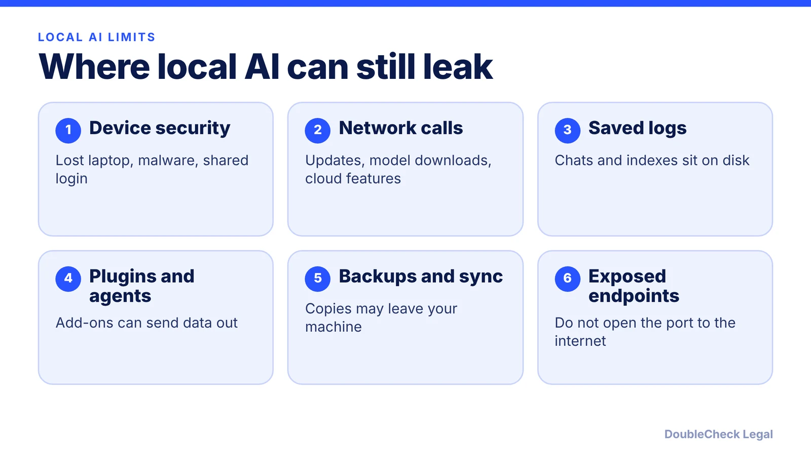
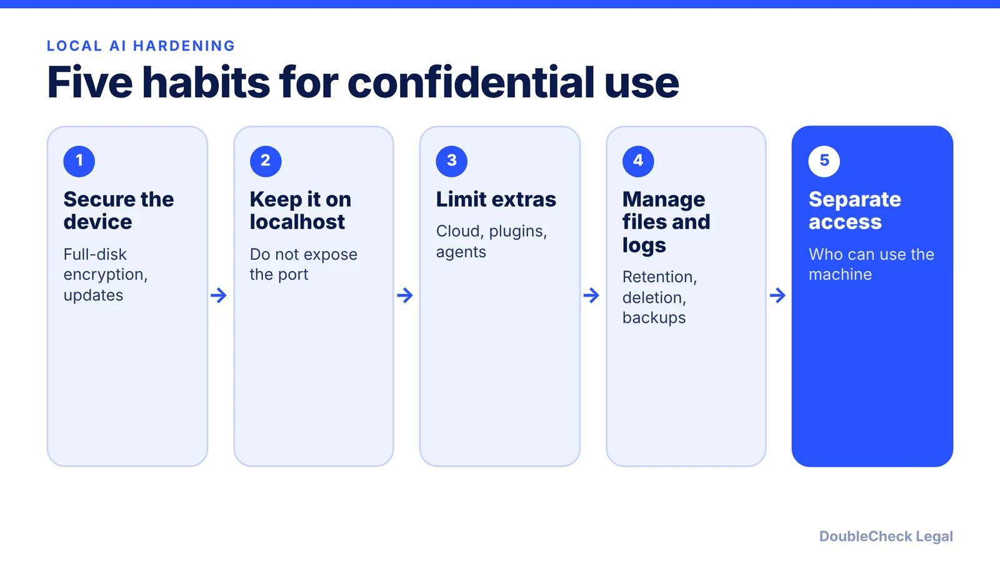

*Why running AI on your own machine is a strong privacy option, where it still falls short, and what the law adds, as of November 2026.*

**Key takeaways:**

- Local use can keep prompts on your machine; Ollama (March 2026) and LM Studio (October 19, 2026) say they do not transmit your chats or documents when run locally.
- Gaps remain: device security, update and download calls, saved logs, plugins and agents, backups and exposed endpoints.
- Privacy law and privilege depend on the data and who directs the work, not just where the model runs; Heppner (Feb 13, 2026) is a caution on privilege.
- Local is often enough for internal drafts with hardening; ask an attorney first for regulated data, litigation or privilege questions.

## 1. The quick answer

**Quick answer:** Local AI is a strong option for confidential documents, because the prompts and files can be processed on a machine you control. Ollama's privacy policy (updated March 2026) says local use does not collect, store, transmit or access your prompts or responses, and LM Studio's policy (updated October 19, 2026) says that when you run models locally, "none of your messages, chat histories, and documents are ever transmitted from your system." But "local" is not the same as "private enough" in every situation. Privacy still depends on your device security, what the app contacts online, saved logs, plugins and agents, backups, and whether anything is exposed to a network. And the law cares about more than where the model runs: privacy statutes and attorney-client privilege depend on who is using the tool, for what, and at whose direction. As of November 2026, treat local AI as a very good foundation, not a finished compliance program.

## 2. What local AI does protect, and what it does not

The core benefit is real. When the model runs on your own hardware, your prompt is not sent to a vendor's servers for inference, so you do not depend on a vendor's retention, training or disclosure terms. For many small businesses handling contracts, customer lists or draft agreements, that removes the biggest question mark of hosted tools. Our guide to [running AI locally with Ollama or LM Studio](/blog/run-ai-locally-for-privacy-ollama-lm-studio-small-business/) covers setup.

What it does not remove is everything around the model. As of November 2026, sources describe these common gaps:

- **Network calls you may not expect.** Per LM Studio's privacy policy, the app sends update checks (version, build, operating system and IP address) and makes model search and download requests, and cloud services only if you buy and use them. Downloading a model also reveals your IP address and which model you want to the host, and tools like Ollama may check for updates or offer optional cloud models and web search, so confirm those features are off if you need strict locality. These calls do not carry your documents, but they are worth knowing, and cloud features do send data out.
- **Saved logs and indexes.** Conversation logs and retrieval databases can sit on disk, so full-disk encryption matters.
- **Plugins, extensions and agents.** Some editor extensions and agent tools can read opened files and send them to remote servers, so review what each one does. A model able to run commands belongs in an environment with no internet access, because blocking the model app alone may not be enough.
- **Exposed endpoints.** Per The Hacker News (January 29, 2026), SentinelLABS and Censys found about 175,000 publicly exposed Ollama hosts in 130 countries, and recommended keeping Ollama bound to localhost (127.0.0.1:11434), which is the default. Setting the host to 0.0.0.0 would expose it to your whole network.

None of this is an argument against local AI. It is a list of settings to check.

## 3. A practical hardening checklist for confidential documents

Treat the machine as part of the privacy design.

In plain terms:

- **Encrypt the disk and keep the system updated.** A lost or stolen laptop with unencrypted chat history is a bigger risk than most network threats.
- **Leave the server on localhost.** Do not publish the port to the internet or a shared network unless you add authentication and know why.
- **Turn off what you do not need.** Disable cloud models and web search where the tool allows it, and review plugins and extensions before installing them.
- **Decide what is stored.** Delete chat history and indexes when a matter ends, and check whether your backup or sync software copies the folders where they live.
- **Know who else uses the machine.** Shared logins and shared folders undermine the benefit.
- **Verify updates and downloads.** Get models and software from the publisher and keep license files with them. See [open-weight vs open-source AI licenses](/blog/open-weight-vs-open-source-ai-licenses-what-businesses-can-do/).

For AI tools that connect to email, chat or drive, see our [AI agent security checklist](/blog/ai-agent-gmail-slack-drive-security-checklist/). If a client contract or vendor questionnaire asks how you handle their data, a short written description of this setup is useful.

## 4. Privacy law and privilege: what local does not decide

Running a model locally changes where data goes. It does not by itself settle your legal duties.

**Privacy law.** If you process personal data, rules such as the GDPR or US state privacy laws can apply wherever the processing happens. On models themselves, William Fry's summary of European Data Protection Board Opinion 28/2024 (December 2024) says a model is anonymous only if extracting personal data from it is highly unlikely and queries do not produce identifiable personal data, otherwise the GDPR applies, and that a business deploying a third-party model should assess its origins. See [GDPR for US startups](/blog/gdpr-for-us-startups/), [CCPA and CPRA compliance](/blog/ccpa-cpra-compliance-small-business/) and [state privacy laws 2027 checklist](/blog/state-privacy-laws-2027-small-business-checklist/).

**Privilege.** In United States v. Heppner (S.D.N.Y., February 13, 2026), per Orrick, a court rejected privilege and work-product claims over a person's own conversations with a consumer AI assistant: AI cannot form an attorney-client relationship, the consumer policy undercut confidentiality, and materials prepared on his own initiative, not at counsel's direction, were not work product. Orrick says attorneys can use private AI tools while maintaining privilege, and warns that even a private tool behind a corporate firewall may not protect a non-lawyer's AI conversations seeking legal advice, unless working at counsel's express direction. It does not separately address on-device tools. So a local model may help with confidentiality, but it should not be assumed to create privilege. Read [AI chats not privileged: Heppner](/blog/ai-chats-not-privileged-heppner/) and [unauthorized practice of law and AI tools](/blog/unauthorized-practice-of-law-ai-tools-businesses/).

**When local is enough, and when to ask first.**

- Local is usually a good fit for internal drafts, summaries and first-pass reviews of your own business documents, with the hardening above.
- Ask an attorney first when the data is regulated (health, children, EU residents), when a client or regulator imposes specific rules, when litigation is possible, or when you want to preserve privilege.
- Whatever the model, verify the output before relying on it: [verify AI-generated legal documents](/blog/verify-ai-generated-legal-document/) and [choosing an AI model for business](/blog/how-to-choose-an-ai-model-for-business-privacy-cost-quality/).

## Where DoubleCheck fits

[DoubleCheck](https://www.contactdoublecheck.com) helps businesses and founders start legal work with AI, verify it, and, when professional advice is warranted, connect with an independent attorney, including for immigration questions. Attorney availability and practice areas vary. Attorneys on DoubleCheck are independent professionals; an attorney-client relationship forms only if an attorney accepts your engagement.

**Sources:** [Ollama, Privacy Policy (updated March 2026)](https://registry.ollama.ai/privacy); [LM Studio, App Privacy Policy (updated Oct 19, 2026)](https://lmstudio.ai/app-privacy); [The Hacker News, exposed Ollama servers (Jan 29, 2026)](https://thehackernews.com/2026/01/researchers-find-175000-publicly.html); [Orrick, United States v. Heppner (March 2026)](https://orrick.com/en/Insights/2026/03/Court-Rules-AI-Conversations-Are-Not-Privileged-What-United-States-v-Heppner-Means-for-You); [William Fry, EDPB Opinion 28/2024 (Dec 19, 2024)](https://www.williamfry.com/knowledge/unwrapping-the-edpbs-guidance-on-ai-models-and-data-protection/).

## FAQ

**Is local AI completely private?**

Not automatically. Ollama and LM Studio say local use does not send your prompts or documents to them, but your device security, logs, plugins, backups, update checks and network settings still affect privacy. Local is a strong foundation that you still need to configure and maintain.

**Does using a local model protect attorney-client privilege?**

Not by itself. In United States v. Heppner (February 13, 2026), per Orrick, a court found no privilege over a person own conversations with a consumer AI tool. Orrick says attorneys can use private tools while keeping privilege, but non-lawyers should work at counsel direction. Ask your attorney.

**Can I put personal data into a local model and stay compliant?**

Not automatically. Privacy laws such as the GDPR can apply wherever processing happens, and the EDPB (Opinion 28/2024, December 2024) says models are not anonymous unless strict conditions are met, per William Fry. Assess your lawful basis and safeguards, and get advice for regulated data.

**What is the biggest mistake with local AI setups?**

Exposing the server or adding unreviewed extras. SentinelLABS and Censys found about 175,000 publicly exposed Ollama hosts (The Hacker News, January 29, 2026). Keep the service on localhost, review plugins and agents, and remove internet access for anything that can run commands.

---

*General information only. This article is not legal, tax, investment, or accounting advice.*
