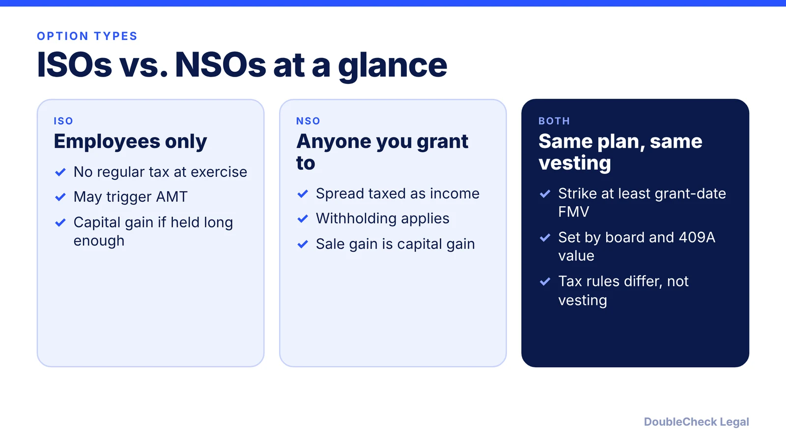
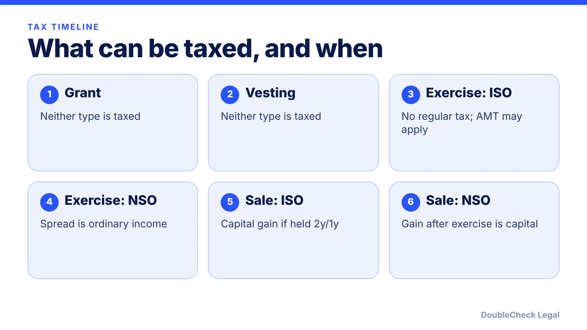

*Two option types, two very different tax paths. Here is what separates ISOs from NSOs and where the $100,000 limit and AMT come in.*

**Key takeaways:**

- ISOs go only to employees; NSOs can go to employees, contractors, advisors, and directors.
- ISOs are limited to $100,000 of grant-date value first exercisable per calendar year; the excess is treated as NSOs.
- ISO exercise generally has no regular income tax but may trigger AMT; NSO exercise is taxed as ordinary income on the spread.
- ISO capital gain treatment requires holding 2 years from grant and 1 year from exercise.

## 1. The quick answer

**Quick answer:** Incentive stock options (ISOs) can go only to employees and can get special tax treatment: generally no regular income tax when you exercise, with capital gain on sale if you meet holding periods. Nonstatutory options (NSOs) can go to anyone, and the spread at exercise is taxed as ordinary income. ISOs are capped at $100,000 of grant-date value that first becomes exercisable in a calendar year; any excess is treated as NSOs. Exercising an ISO may trigger the alternative minimum tax (AMT).

## 2. Who can get each type, and the $100,000 limit

Per [WilmerHale Launch](https://launch.wilmerhale.com/explore/formation/equity-incentives/tax-differences-between-isos-and-nsos), ISOs can go only to employees, while NSOs can go to employees, contractors, advisors, and non-employee directors. That is why advisor and contractor grants are NSOs (see [advisor equity agreements](/blog/advisor-agreement-equity-startups/)).

ISO requirements listed by WilmerHale:

- Exercise price at least 100% of fair market value at grant, or 110% if the holder owns more than 10% of the company.
- Maximum term of 10 years, or 5 years for a more-than-10% holder.
- A plan approved by stockholders that limits total shares.
- Options that are nontransferable.
- **The $100,000 limit:** shares that first become exercisable in a calendar year, valued at grant-date FMV, may not exceed $100,000.

Joe Wallin adds that the limit uses grant-date value, not the later spread, and that any excess is treated as an NSO. He also notes that an employee who stops working for you generally has three calendar months to exercise and keep ISO treatment (one year for disability), though the plan sets the actual expiration date. The strike price itself comes from a valuation; see [409A valuations](/blog/stock-options-409a-valuation-startups/).

## 3. How the tax treatment differs

Per the [IRS](https://www.irs.gov/taxtopics/tc427), with an ISO you generally include nothing in gross income when you receive or exercise the option, but "you may be subject to alternative minimum tax in the year you exercise an ISO." On sale, the income is generally capital gain, unless you miss the special holding period requirements, in which case it is ordinary income. Your employer should send Form 3921 after an ISO exercise.

For an NSO whose value is not readily determined (most startup options), granting is not taxable. At exercise you include the stock's fair market value minus what you paid as income, per the IRS.

**Holding periods (ISO).** WilmerHale and Wallin both state the test: hold the stock at least two years from grant and one year from exercise. Selling earlier is a disqualifying disposition, which is taxed like an NSO, though WilmerHale notes no income or employment tax withholding is required on it. NSO exercises do require withholding.

**Illustration (our arithmetic).** If you exercise 10,000 options at a $1 strike when the stock is worth $5, the spread is $40,000. For an NSO that is ordinary income at exercise. For an ISO it is not regular income at exercise, but the spread is an AMT adjustment, so ask a tax professional whether it creates a bill.

## 4. Choosing and what to do next

Most private companies grant ISOs to employees and NSOs to everyone else. WilmerHale notes that many ISO holders sell soon after exercise, which makes the sale disqualifying, yet companies still grant ISOs for the potential tax benefit.

For founders issuing options:

- Confirm who is an employee, since contractors cannot receive ISOs.
- Track how much vests each calendar year against the $100,000 limit.
- Use a current valuation for the strike price.
- Get stockholder approval of the plan and board approval of each grant.
- Reflect the pool on your [cap table](/blog/cap-table-basics-for-first-time-founders/).

For employees: before exercising, model the AMT, the cash you need, and your 3-month window with a tax professional. If you plan to exercise early, read about the [83(b) election](/blog/83b-election-startup-founders/). If the company might qualify, see [QSBS](/blog/qsbs-section-1202-explained-startup-founders/). Neither this article nor DoubleCheck gives tax advice.

## Where DoubleCheck fits

[DoubleCheck](https://www.contactdoublecheck.com) helps businesses and founders start legal work with AI, verify it, and, when professional advice is warranted, connect with an independent attorney, including for immigration questions. Attorney availability and practice areas vary. Attorneys on DoubleCheck are independent professionals; an attorney-client relationship forms only if an attorney accepts your engagement.

**Sources:** [WilmerHale Launch, Tax differences between ISOs and NSOs](https://launch.wilmerhale.com/explore/formation/equity-incentives/tax-differences-between-isos-and-nsos); [Joe Wallin, ISO vs NSO Stock Options Complete Guide](https://www.thestartuplawblog.com/iso-vs-nso-stock-options-complete-guide/); [IRS, Topic no. 427, Stock options](https://www.irs.gov/taxtopics/tc427).

## FAQ

**What is the $100,000 limit on ISOs?**

Per WilmerHale Launch, shares that first become exercisable in a calendar year, valued at grant-date fair market value, may not exceed $100,000. Per Joe Wallin, the excess is treated as NSOs.

**Do ISOs trigger AMT?**

They can. The IRS says you may be subject to alternative minimum tax in the year you exercise an ISO, and points to the Form 6251 instructions. Whether you owe any depends on your full tax picture, so ask a tax professional.

**Can contractors or advisors get ISOs?**

No. Per WilmerHale Launch, ISOs go only to employees, while NSOs can go to employees, contractors, advisors, and non-employee directors.

**What is a disqualifying disposition?**

Selling ISO stock before holding it two years from grant and one year from exercise. Per WilmerHale Launch, the gain is then taxed like an NSO, but no income or employment tax withholding is required.

---

*General information only. This article is not legal, tax, investment, or accounting advice.*
