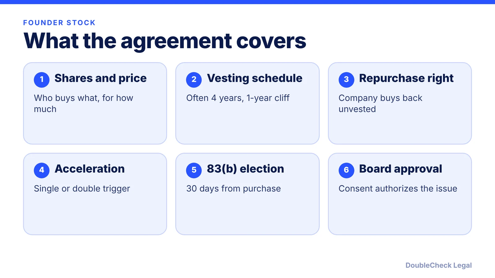
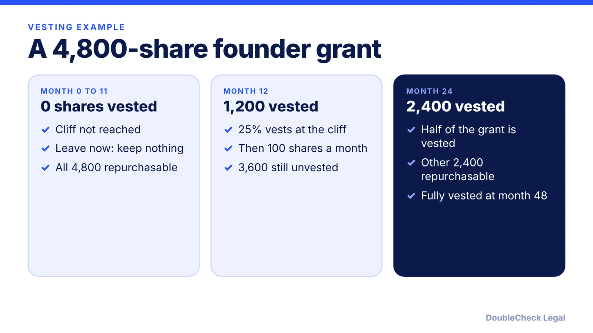

*Founder shares are not just handed out. Here is how the purchase agreement, vesting, and the 83(b) deadline fit together.*

**Key takeaways:**

- Founders typically buy their shares through a purchase agreement, at a nominal price, approved by the board.
- The most common vesting schedule is four years with a one-year cliff, with 25% vesting at one year.
- Unvested shares can be repurchased if a founder leaves, typically at the lower of fair market value or original price.
- An 83(b) election must be filed with the IRS within 30 days of acquiring the shares.

## 1. The quick answer

**Quick answer:** A founder stock purchase agreement is the contract under which a founder buys shares of the new corporation, usually at a nominal price, and agrees to vesting. The most common structure, per Manatt and Mintz, is four years with a one-year cliff: 25% vests at one year and the rest monthly. If a founder leaves early, the company can repurchase unvested shares. Founders then typically consider a Section 83(b) election, which must be filed within 30 days of acquiring the shares.

## 2. What goes in the agreement

Per [Nolo](https://www.nolo.com/legal-encyclopedia/how-to-use-written-consents-to-appoint-your-initial-board-of-directors-and-issue-stock.html), the board's initial consent should list each shareholder, the number of shares, and the price per share. The purchase agreement is the founder-side contract that matches it. Core terms to expect:

- **Purchase price and payment.** Mintz describes the company's repurchase of unvested shares at the original purchase price, which is usually nominal.
- **Vesting.** Ties the founder's shares to continued service.
- **Repurchase right.** Manatt says the repurchase price is typically the lower of fair market value or the original purchase price.
- **Acceleration.** Manatt notes that definitions of "cause" and "good reason" are heavily negotiated.
- **Transfer limits and other restrictions** as set by your counsel.

Different founders can have different schedules based on role and contribution, per Manatt. For deciding the split itself, see [founder equity splits](/blog/founder-equity-split-how-to-divide/) and [how co-founders split equity](/blog/how-co-founders-split-equity-data/).

## 3. Vesting, cliffs, and acceleration

Per Mintz, the typical schedule is four years with a one-year cliff: nothing vests in year one, 25% vests at the one-year mark, and the rest vests in equal monthly or quarterly installments over the next three years. Mintz's example: with 4,800 shares, 1,200 vest at one year and 100 vest each month afterward, so a founder leaving after 24 months keeps 2,400 vested shares and the company may repurchase the other 2,400.

**Acceleration.** Per Manatt, single-trigger acceleration vests shares on one event, usually a change in control, and investors generally resist it. Double-trigger requires a change in control and then a termination without cause or resignation for good reason, and is more commonly used. Mintz adds that if founders have not set up vesting by the first financing, investors often require it. More on cliffs: [cofounder vesting and cliffs](/blog/cofounder-vesting-cliff-explained/).

## 4. The 83(b) election and the order of steps

Per Manatt, without an 83(b) election tax is due on the shares' value as they vest, so the liability grows if the value rises; the election lets the holder pay tax at issuance on the shares' nominal value. It must be filed with the IRS within 30 days of acquiring the shares. Mintz calls the deadline "a hard and fast deadline with no extensions" and says the election usually involves a $0 difference at purchase. Details: [83(b) election for startup founders](/blog/83b-election-startup-founders/). This is tax-sensitive, so use a tax advisor.

A sensible order:

1. Incorporate (see [Delaware C-corp setup](/blog/how-to-incorporate-saas-ai-startup-delaware-c-corp/)).
2. Board approves the issuance by consent (see [setting up a startup board](/blog/how-to-set-up-a-startup-board-of-directors/)).
3. Founders sign purchase agreements and pay.
4. Founders file 83(b) elections within 30 days.
5. Record everything on your [cap table](/blog/cap-table-basics-for-first-time-founders/).

Also align with your [co-founder agreement](/blog/co-founder-agreement-startups/), and if QSBS matters, read [QSBS explained](/blog/qsbs-section-1202-explained-startup-founders/). Have a startup attorney tailor the documents to your situation.

## Where DoubleCheck fits

[DoubleCheck](https://www.contactdoublecheck.com) helps businesses and founders start legal work with AI, verify it, and, when professional advice is warranted, connect with an independent attorney, including for immigration questions. Attorney availability and practice areas vary. Attorneys on DoubleCheck are independent professionals; an attorney-client relationship forms only if an attorney accepts your engagement.

**Sources:** [Manatt, Founder's Stock: Vesting and Acceleration](https://www.manatt.com/insights/newsletters/manatt-for-entrepreneurs/founders-stock-vesting-and-acceleration); [Mintz, Stock Vesting for Startup Companies](https://mintz.com/insights-center/viewpoints/2022-03-15-stock-vesting-startup-companies); [Nolo, How to Use Written Consents to Appoint Your Initial Board of Directors and Issue Stock](https://www.nolo.com/legal-encyclopedia/how-to-use-written-consents-to-appoint-your-initial-board-of-directors-and-issue-stock.html).

## FAQ

**What is a founder stock purchase agreement?**

It is the contract by which a founder buys shares of the company, usually at a nominal price, and agrees to terms such as vesting and repurchase. Per Nolo, the board's consent lists each shareholder, share count, and price per share.

**What is a typical founder vesting schedule?**

Per Manatt and Mintz, four years with a one-year cliff: 25% vests at one year and the rest vests monthly or quarterly afterward. Schedules can differ among founders, per Manatt.

**When is the 83(b) election due?**

Within 30 days of acquiring the shares, per Manatt and Mintz. Mintz describes the deadline as having no extensions.

**What is single-trigger vs. double-trigger acceleration?**

Per Manatt, single-trigger vests unvested shares on one event, usually a change in control. Double-trigger requires a change in control plus a termination without cause or resignation for good reason afterward.

---

*General information only. This article is not legal, tax, investment, or accounting advice.*
