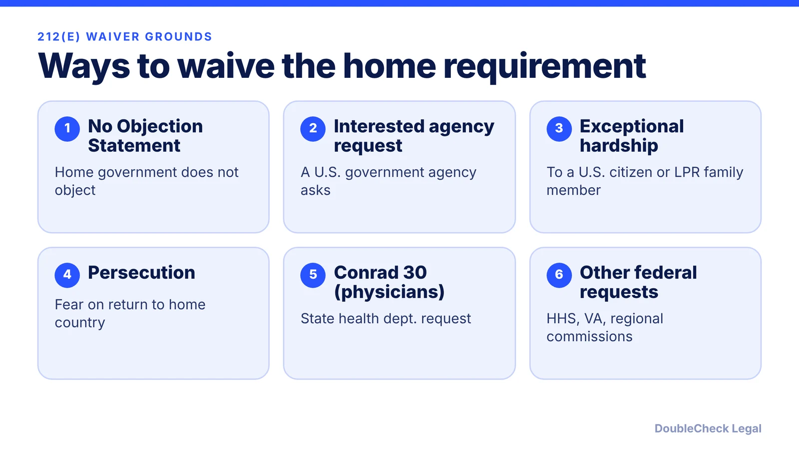
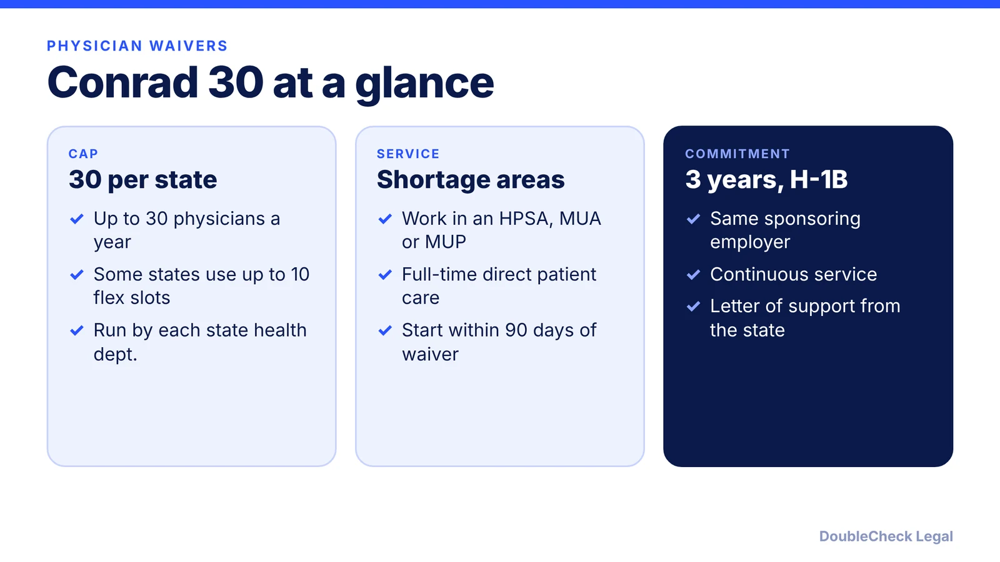

*A J-1 can come with a two-year home-country requirement that blocks H-1B and a green card. Here is how it works as of November 2026.*

**Key takeaways:**

- You may be subject if your J-1 had government or international funding, your field is on your country's Skills List, or you did graduate medical training.
- Check the visa stamp and DS-2019, but request a State Department Advisory Opinion if unsure.
- Waiver grounds include no objection, interested U.S. agency, exceptional hardship, persecution, and Conrad 30 for physicians.
- Waivers are slow (UMass reports more than eight months), so plan before your H-1B or green card timeline.

## 1. The quick answer

**Quick answer:** Some J-1 exchange visitors, and their J-2 dependents, must spend a total of two years physically present in their home country (country of nationality or last legal permanent residence) before they can move to H-1B, L, or K status or get a green card. This is INA section 212(e). Per Stony Brook University, you may be subject if your J-1 funding came from a government or international organization, your field is on the Exchange Visitor Skills List for your country, or you did graduate medical education or training. If you are subject, you either complete the two years or get a waiver.

## 2. Who is subject and how to find out

There are three common triggers, per [Stony Brook](https://www.stonybrook.edu/visa/faculty-scholars-staff/j-1-scholars-and-student-interns/other-topics/2-year-home-residency-requirement-212-e.html) and [WashU](https://oiss.washu.edu/two-year-home-residence-requirement-212e/):

- **Funding.** The program was funded fully or partly by the U.S. government (for example Fulbright), your home government, or an international organization.
- **Skills List.** You are a citizen or resident of a country whose Skills List includes your field.
- **Medical training.** You took part in graduate medical education or training, often through ECFMG sponsorship.

J-2 spouses and children of a subject J-1 are subject too, per Stony Brook.

How to check: look for a statement on the J-1 visa stamp and the "preliminary endorsement" on the DS-2019. Those markings "may not always be final," so they should not be your only basis. If you are unsure, you can request an Advisory Opinion from the State Department. Per WashU, an opinion saying you are not subject means no waiver is needed, and you should keep it for later status changes, including a green card.

This rule is different from the separate 12-month and 24-month bars that apply to some J-1 researchers and professors, per [NC State](https://internationalservices.ncsu.edu/212e-two-year-home-country-physical-presence-requirement/). Check which one your own record raises.

While subject and not yet cleared, Stony Brook lists H-1B, L, K, a green card, and most changes of status inside the U.S. as unavailable. If a later H-1B is the goal, see [H-1B to green card timeline](/blog/h-1b-to-green-card-timeline-tech-workers/) and [F-1 cap-gap and change of status](/blog/f-1-cap-gap-change-of-status-to-h-1b/).

## 3. The waiver types, one by one

The State Department's Waiver Review Division (WRD) handles most requests. Per [travel.state.gov](https://travel.state.gov/content/travel/en/us-visas/study/exchange/waiver-of-the-exchange-visitor.html), the DS-3035 requests a WRD recommendation, and hardship and persecution applicants must also file Form I-612 with USCIS. Per [UMass](https://www.umass.edu/global-affairs/international-students-scholars/212e-waiver), the WRD recommends approval or denial and USCIS makes the final decision, usually following the recommendation.

Per [VisaServe](https://visaserve.com/j-waivers-of-section-212e-of-the-immigration-and-nationality-act/) (a 2011 post) and NC State, the grounds are:

1. **No Objection Statement.** Your home government states it does not object. This is the most common route, per UMass. Those with U.S. government funding, such as Fulbright, may not be eligible, since the WRD generally expects them to return home.
2. **Interested Government Agency (IGA).** A U.S. government agency requests the waiver. NC State advises talking to your international office first.
3. **Exceptional hardship.** Hardship to a U.S. citizen or permanent resident spouse or child if you had to go home.
4. **Persecution.** A claim that you would be persecuted on return.
5. **Conrad 30 and similar programs, for physicians only.**

NC State recommends an attorney for every ground except the No Objection Statement. Hardship and persecution cases are fact-heavy, so documentation matters.

## 4. Conrad 30, timing and what to do next

Per [Rural Health Information Hub](https://www.ruralhealthinfo.org/topics/j-1-visa-waiver), each state health department can request waivers for up to 30 foreign physicians a year. Physicians must serve three continuous years in H-1B status with the sponsoring employer, full-time (40 hours a week) in a federally designated shortage area. If the exchange was funded by the home government, a no-objection letter is also needed. HHS, the VA, and several regional commissions can recommend waivers too, within their own rules. State rules differ, so contact your state's Primary Care Office.

**Timing.** UMass says waivers currently take more than eight months to receive final USCIS approval. Once the State Department approves the recommendation, the DS-2019 cannot be extended, because that would invalidate the approval.

**Practical steps:**

- Confirm whether you are subject before you plan an H-1B or green card; see [H-1B vs L-1 vs O-1](/blog/h-1b-vs-l-1-vs-o-1-which-visa-for-tech-employees/) for options that may not carry the same restriction.
- Tell your J-1 sponsor and international office before applying.
- Keep your I-612 approval; Yale says to carry it when traveling in H-1B status if you were subject. See also [H-1B visa stamping and travel](/blog/h-1b-visa-stamping-travel-abroad-tech-workers/).
- Do not file around the requirement or rely on a marking being missing; get an Advisory Opinion instead.

Outcomes are never guaranteed, and a waiver may limit options under your J program, per NC State. For founders weighing alternatives, compare [US visa options for startup founders](/blog/us-visa-options-for-startup-founders-compared/).

## Where DoubleCheck fits

[DoubleCheck](https://www.contactdoublecheck.com) helps businesses and founders start legal work with AI, verify it, and, when professional advice is warranted, connect with an independent attorney, including for immigration questions. Attorney availability and practice areas vary. Attorneys on DoubleCheck are independent professionals; an attorney-client relationship forms only if an attorney accepts your engagement.

**Sources:** [Stony Brook University, Two-Year Home Residency Requirement](https://www.stonybrook.edu/visa/faculty-scholars-staff/j-1-scholars-and-student-interns/other-topics/2-year-home-residency-requirement-212-e.html); [WashU OISS](https://oiss.washu.edu/two-year-home-residence-requirement-212e/); [NC State International Services](https://internationalservices.ncsu.edu/212e-two-year-home-country-physical-presence-requirement/); [UMass Global Affairs, 212(e) waiver](https://www.umass.edu/global-affairs/international-students-scholars/212e-waiver); [U.S. Department of State, Waiver of the Exchange Visitor Two-Year Requirement](https://travel.state.gov/content/travel/en/us-visas/study/exchange/waiver-of-the-exchange-visitor.html); [VisaServe, J waivers of 212(e)](https://visaserve.com/j-waivers-of-section-212e-of-the-immigration-and-nationality-act/); [Rural Health Information Hub, J-1 visa waiver](https://www.ruralhealthinfo.org/topics/j-1-visa-waiver); [Yale OISS, travel in employment-based status](https://oiss.yale.edu/immigration/h-1b-temporary-worker/maintaining-legal-status/international-travel-in-employment-based-visa-status).

## FAQ

**What is the J-1 two-year home residency requirement?**

Per Stony Brook University, it means you must be physically present in your country of nationality or last legal permanent residence for a total of two years before you can obtain H-1B, L, or K status or a green card, unless you obtain a waiver.

**How do I know if I am subject to 212(e)?**

Per Stony Brook and WashU, check the visa stamp and the preliminary endorsement on your DS-2019, but those markings may not be final. If unsure, request an Advisory Opinion from the State Department.

**What are the 212(e) waiver options?**

Per VisaServe and NC State, grounds include a home-government No Objection Statement, a request from an interested U.S. government agency, exceptional hardship to a U.S. citizen or permanent resident spouse or child, persecution, and state programs such as Conrad 30 for physicians.

**How does Conrad 30 work?**

Per the Rural Health Information Hub, each state can request up to 30 physician waivers a year, and physicians commit to three continuous years in H-1B status in a federally designated shortage area with the sponsoring employer.

---

*General information only. This article is not legal, tax, investment, or accounting advice.*
