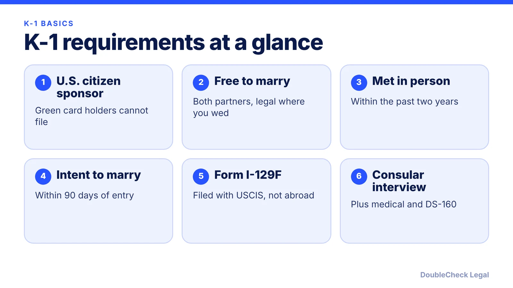
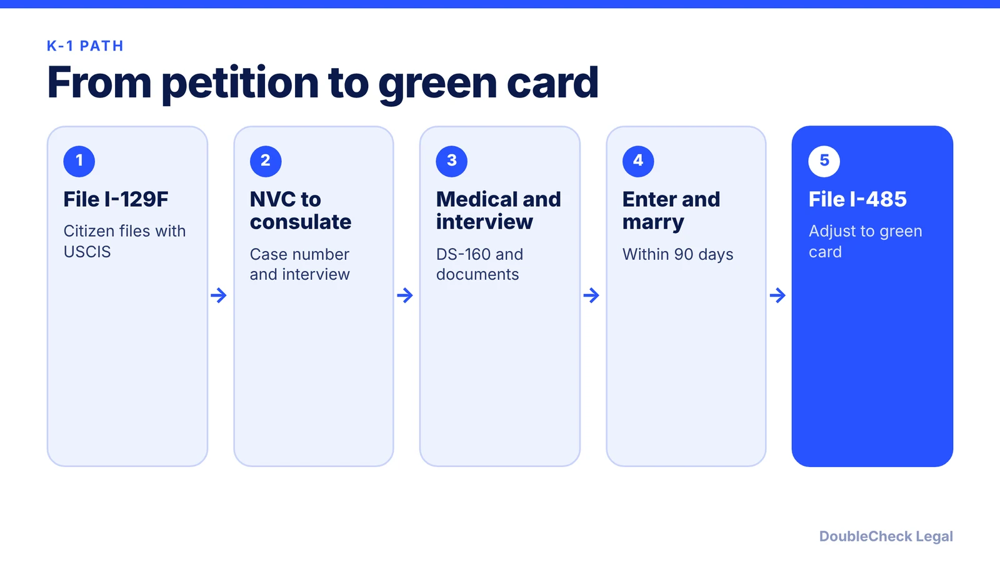

*How the K-1 fiance(e) visa works from petition to green card, as of November 2026.*

**Key takeaways:**

- The sponsor must be a U.S. citizen; green card holders cannot file a K-1.
- You generally must have met in person within two years and intend to marry within 90 days of entry.
- Immi-USA (Aug 2026) reports about 12 months for the I-129F; Beyond Border Global (Sept 2026) puts the K-1 stage near 12.5 to 13.5 months.
- After marriage, the spouse files Form I-485 and the sponsor files Form I-864; a marriage under two years old at approval leads to conditional residence.

## 1. The quick answer

**Quick answer:** A K-1 fiance(e) visa lets the foreign fiance(e) of a U.S. citizen enter the U.S. to marry within 90 days. Per the U.S. Department of State, you both must be free to marry, and you generally must have met in person within the past two years. The citizen files Form I-129F with USCIS, the case moves to the National Visa Center and then a consulate for a visa interview, and after the wedding the new spouse applies for a green card with Form I-485. As of Immi-USA's August 2026 update, USCIS takes about 12 months on the I-129F alone, and Beyond Border Global's September 2026 page puts the whole K-1 stage at roughly 12.5 to 13.5 months.

## 2. Who qualifies, and the two key rules

**The sponsor must be a U.S. citizen.** Per [Beyond Border Global](https://www.beyondborderglobal.com/resources/form-i-129f-k-1-fiance-visa), lawful permanent residents cannot sponsor a K-1. A green card holder who wants to bring a partner generally looks at a marriage-based petition instead; see [the I-130 spousal petition guide](/blog/i-130-petition-spouse-green-card-marriage-based-process/).

**Both of you must be legally free to marry.** Per the [State Department](https://travel.state.gov/content/visas/en/immigrate/family/fiance-k-1.html), the marriage must be legal in the U.S. state where you will marry. Prior marriages need divorce or death certificates for both partners.

**You must have met in person within two years.** The State Department says you "generally" must have met in person in the past two years, and that USCIS may grant an exception for extreme hardship or cultural reasons. Video calls do not count as meeting, per [Boundless](https://www.boundless.com/immigration-resources/faq/k-1-visa/).

**You must intend to marry within 90 days.** Per Beyond Border Global, the couple must intend to marry within 90 days of the fiance(e) entering the U.S. The State Department adds that the K-1 visa allows a single admission and is valid for up to six months from issuance.

**Financial support.** The State Department says the sponsor may need to file Form I-134 at the consular stage. Boundless also describes an income minimum tied to the Federal Poverty Guidelines, but its figures were dated 2024, so check the current I-134 and I-864 instructions before relying on a number. For the later I-864, see [affidavit of support requirements](/blog/affidavit-of-support-i-864-sponsor-requirements/).

**Children.** Per the State Department, eligible children can apply for K-2 visas, must be listed on the I-129F, and each child has a separate application and fee.

## 3. The K-1 steps and timeline, step by step

**Step 1: File Form I-129F.** The citizen files with USCIS; per the State Department it cannot be filed at an embassy abroad. Per [Immi-USA](https://www.immi-usa.com/immigration/marriage-visas/k1-processing-times) (page dated August 10, 2026), USCIS data shows about 12 months on average in 2026, and premium processing is not available for this petition.

**Step 2: NVC and consulate.** After approval, USCIS sends the case to the National Visa Center, which assigns a case number and forwards it to the embassy or consulate where the fiance(e) lives. Immi-USA lists the NVC transfer at 2 to 3 weeks and the interview 4 to 6 weeks after the embassy letter, depending on location.

**Step 3: Visa application, medical, interview.** Per the State Department, the fiance(e) completes the DS-160, gets a medical exam from an authorized panel physician, and brings civil documents, police certificates, photos and relationship evidence. Vaccinations are not required for the visa but are for adjustment of status later. The I-129F is valid for four months from approval, and a consular officer can extend it.

**Step 4: Travel and marry.** Enter within the visa's six-month validity and marry within 90 days. Do not open the sealed packet; give it to the CBP officer at the port of entry.

**Step 5: Adjust status.** After the wedding the spouse applies for permanent residence on Form I-485, and the sponsor files Form I-864. Immi-USA says I-485 typically takes 4 to 12 months, based on its own experience rather than official data. Per [Alaz Law](https://www.alazlaw.com/blog/k-1-visa-after-i-129f-approval-2026/) (October 19, 2026), if the marriage is under two years old at approval, the spouse receives conditional residence and later files Form I-751.

## 4. Fees, risks, and when to get an attorney

**Fees as reported in 2026.** Per [Alaz Law](https://www.alazlaw.com/blog/k-1-fiancee-visa-cost-2026-complete-guide-fees-expenses/) (June 1, 2026) and Beyond Border Global (September 2026), the I-129F fee is $675, non-refundable, with no fee waiver per Alaz. Alaz lists the DS-160 visa fee at $265 and the medical exam at $200 to $650 depending on country. For adjustment of status it lists I-485 at $1,440 by mail or $1,390 online, I-765 at $260 and I-131 at $630, with biometrics included. Fees change, so confirm on USCIS and the State Department pages before paying.

**Common problems.**

- Missing the 90-day marriage deadline. The K-1 status does not convert to a green card without the marriage, and adjustment is through the original sponsor.
- A weak relationship record, or a gap in the two-year in-person meeting rule without a documented exception request.
- Prior marriages not properly ended, or inconsistent civil documents.
- Administrative processing after the interview; see [221(g) delays](/blog/visa-221g-administrative-processing/).

**Handle it yourself when** the sponsor is a citizen, you met recently in person, civil records are clear, and you can follow USCIS and consulate instructions. Many couples file without a lawyer.

**Get an attorney to review when** you have prior marriages or immigration violations, did not meet in person within two years, have criminal history, or need to decide between a K-1 and marrying abroad. Marrying abroad and filing an I-130 is a different route; compare it in [adjustment of status vs consular processing](/blog/adjustment-of-status-vs-consular-processing-which-to-choose/) and the [marriage-based timeline](/blog/marriage-based-green-card-process-timeline/). Next steps: [I-485 guide](/blog/i-485-adjustment-of-status-guide/), [green card interview](/blog/green-card-interview-what-to-expect/), [work and travel while pending](/blog/advance-parole-and-ead-while-i-485-pending/), and [removing conditions](/blog/remove-conditions-on-residence-i-751/). For cost and choosing counsel, see [immigration lawyer fees](/blog/immigration-lawyer-fees-flat-fee-vs-hourly/).

## Where DoubleCheck fits

[DoubleCheck](https://www.contactdoublecheck.com) helps businesses and founders start legal work with AI, verify it, and, when professional advice is warranted, connect with an independent attorney, including for immigration questions. Attorney availability and practice areas vary. Attorneys on DoubleCheck are independent professionals; an attorney-client relationship forms only if an attorney accepts your engagement.

**Sources:** [U.S. Department of State, K-1 visa](https://travel.state.gov/content/visas/en/immigrate/family/fiance-k-1.html); [Immi-USA K-1 processing times](https://www.immi-usa.com/immigration/marriage-visas/k1-processing-times); [Beyond Border Global on Form I-129F](https://www.beyondborderglobal.com/resources/form-i-129f-k-1-fiance-visa); [Alaz Law on 2026 K-1 costs](https://www.alazlaw.com/blog/k-1-fiancee-visa-cost-2026-complete-guide-fees-expenses/); [Alaz Law after I-129F approval](https://www.alazlaw.com/blog/k-1-visa-after-i-129f-approval-2026/); [Boundless K-1 explainer](https://www.boundless.com/immigration-resources/faq/k-1-visa/). USCIS pages for the I-129F were not fetched, so fees and processing times are attributed to secondary sources.

## FAQ

**What are the main K-1 visa requirements?**

Per the State Department, the sponsor is a U.S. citizen, both partners are free to marry, the marriage is legal in the state where you will wed, and you generally met in person within the past two years. Per Beyond Border Global, you must intend to marry within 90 days of entry.

**How long does a K-1 visa take in 2026?**

Immi-USA (August 2026) says USCIS averages about 12 months for the I-129F, then 2 to 3 weeks to the NVC and an interview 4 to 6 weeks after the embassy letter. Beyond Border Global (September 2026) says the K-1 stage is about 12.5 to 13.5 months. Times vary by case and consulate.

**What happens if we do not marry within 90 days?**

Per the State Department, you must marry the sponsor within 90 days of entering the U.S. The K-1 visa is a single-entry visa and does not by itself give permanent residence, so missing the deadline can end the route. Talk to an attorney promptly if a delay is likely.

**Do we file Form I-864 for a K-1?**

Per the State Department, the sponsor may need Form I-134 at the visa stage, and after marriage the sponsor files Form I-864 with the spouse Form I-485 application.

---

*General information only. This article is not legal, tax, investment, or accounting advice.*
