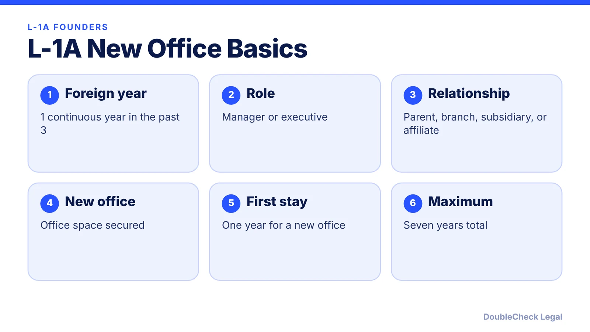
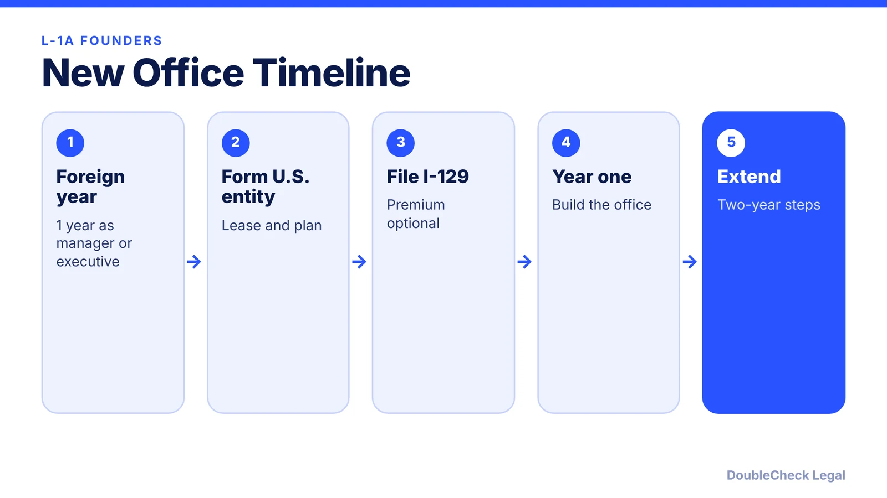

*Have a company abroad and want to open a U.S. office? The L-1A new office visa may fit. Here are the rules and limits.*

**Key takeaways:**

- You need one continuous year in the past three as a manager or executive for the foreign company.
- A new office first gets one year, then two-year extensions up to seven years total.
- No annual cap, dual intent, and a possible EB-1C green card route.
- New offices generally cannot use the blanket L.

## 1. The quick answer

**Quick answer:** The L-1A lets a company with a foreign operation send a manager or executive to open or run a related U.S. office. The person must have worked full-time for the foreign company for at least one continuous year in the past three years in a managerial or executive role. For a new office, the first approval is for one year, with extensions in two-year steps up to seven years total, per Shusterman and Davidson Morris.

## 2. What a new-office petition must show

Shusterman says the petition should show suitable premises are secured and that the U.S. operation can support the managerial or executive role within one year of approval. Evidence includes the size, scope, organizational structure, and financial goals of the U.S. office, the foreign company's financials, and the size of the U.S. investment. A realistic hiring plan matters, because the extension asks whether the office grew. Form the U.S. entity first ([how to start a U.S. company from abroad](/blog/start-us-company-as-non-us-resident/)).

## 3. Why founders choose it, and its limits

- **No annual cap**, and the L-1A allows dual intent, so a green card plan is compatible (Davidson Morris).
- **Possible EB-1C route** to a green card without PERM labor certification (Davidson Morris).
- **Spouse can work:** L-2 spouses are employment authorized incident to status under USCIS policy from November 2021, per Shusterman.
- **Blanket L is usually unavailable** to a new office. F1Jobs says it requires a U.S. office operating at least one year plus size or volume thresholds.
- **Seven-year cap,** then generally a year outside the U.S. unless a green card is pending.

## 4. Compare the other paths

If you have no qualifying foreign company, look at [O-1A](/blog/o-1a-visa-for-startup-founders-evidence/) or the [E-2](/blog/e-2-treaty-investor-visa-for-founders/) if your country has a treaty. Premium processing for the I-129 was $2,965 as of March 2026 with a 15-business-day clock, per F1Jobs; fees change, so confirm before filing. See also [how to find an immigration lawyer](/blog/how-to-find-good-immigration-lawyer-startup-founder/).

## Where DoubleCheck fits

[DoubleCheck](https://www.contactdoublecheck.com) helps businesses and founders start legal work with AI, verify it, and, when professional advice is warranted, connect with an independent attorney, including for immigration questions. Attorney availability and practice areas vary. Attorneys on DoubleCheck are independent professionals; an attorney-client relationship forms only if an attorney accepts your engagement.

**Sources:** [Shusterman](https://www.shusterman.com/l1a-executives-and-managers/); [Davidson Morris](https://www.davidsonmorris.com/l1a-visa/); [F1Jobs](https://www.f1jobs.io/resources/blog/l1-new-office-visa-founders-opening-us-operation).

## FAQ

**How long is the L-1A for a new office?**

Shusterman and Davidson Morris say the first stay is up to one year, then two-year extensions up to seven years in total.

**Does the L-1A have a cap or lottery?**

No. Davidson Morris says there is no annual cap.

**Can my spouse work on L-2 status?**

Per Shusterman, L-2 spouses are employment authorized incident to status under a November 2021 USCIS policy.

**Can an L-1A lead to a green card?**

Davidson Morris says it can lead to the EB-1C category without PERM. Consult an immigration attorney.

---

*General information only. This article is not legal, tax, investment, or accounting advice.*
