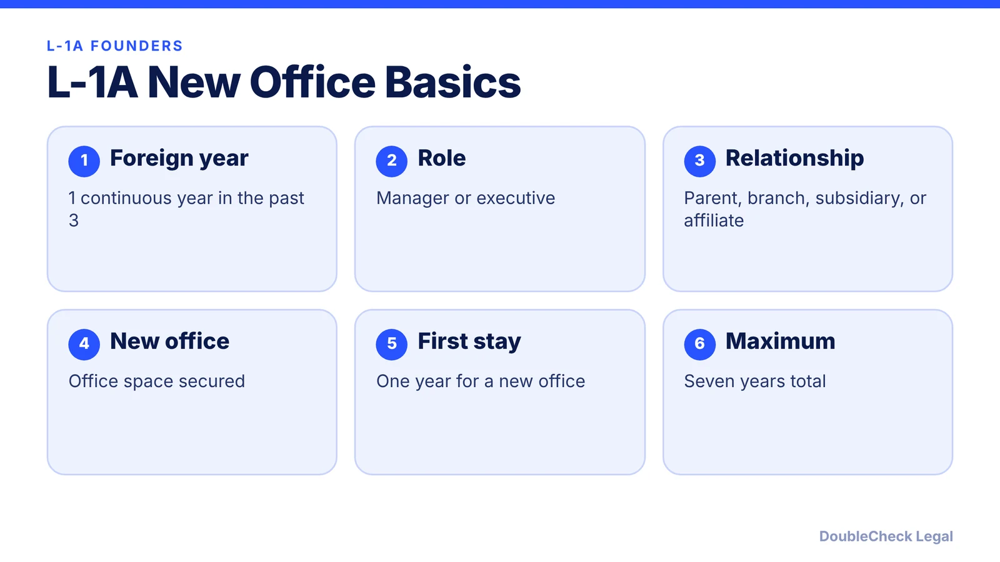
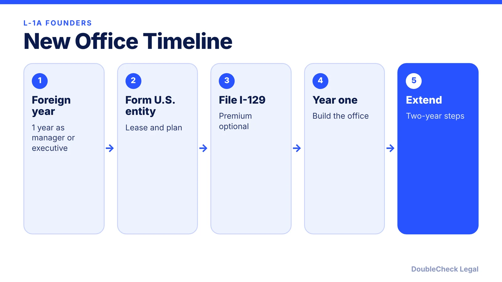

*Have a company abroad and want to open a U.S. office? The L-1A new office visa may fit. Here are the rules and limits.*

**Key takeaways:**

- You need one continuous year in the past three as a manager or executive for the foreign company.
- A new office first gets one year, then two-year extensions up to seven years total.
- No annual cap, dual intent, and a possible EB-1C green card route.
- New offices generally cannot use the blanket L.

## 1. The quick answer

**Quick answer:** The L-1A lets a company with a foreign operation send a manager or executive to open or run a related U.S. office. The person must have worked full-time for the foreign company for at least one continuous year in the past three years in a managerial or executive role. For a new office, the first approval is for one year, with extensions in two-year steps up to seven years total, per the National Law Review and the State Department's Foreign Affairs Manual.

## 2. What a new-office petition must show

A new-office petition generally needs to show that the U.S. operation is being set up and can support a managerial or executive role within about a year. Evidence commonly includes premises, the structure and plans of the U.S. office, the foreign company's financials, and the size of the U.S. investment; your attorney will advise on specifics. A realistic hiring plan matters, because the extension asks whether the office grew. Form the U.S. entity first ([how to start a U.S. company from abroad](/blog/start-us-company-as-non-us-resident/)).

## 3. Why founders choose it, and its limits

- **No annual cap**, and L-1 holders may have dual intent, so a green card plan is compatible (Nolo).
- **Possible EB-1C route** to a green card for multinational managers and executives (Nolo).
- **Spouse can work:** L-2 spouses are employment authorized incident to status under USCIS policy announced in November 2021, per Mintz.
- **Blanket L is usually unavailable** to a new office. The State Department's Foreign Affairs Manual says blanket petitions are not available to applicants seeking to open a new office, and require a U.S. office doing business for at least one year plus size thresholds.
- **Seven-year cap,** then generally a year outside the U.S. unless a green card is pending.

## 4. Compare the other paths

If you have no qualifying foreign company, look at [O-1A](/blog/o-1a-visa-for-startup-founders-evidence/) or the [E-2](/blog/e-2-treaty-investor-visa-for-founders/) if your country has a treaty. Premium processing may be available for the I-129 for a faster decision; fees and timelines change, so confirm the current amount on USCIS's website before filing. See also [how to find an immigration lawyer](/blog/how-to-find-good-immigration-lawyer-startup-founder/).

## Where DoubleCheck fits

[DoubleCheck](https://www.contactdoublecheck.com) helps businesses and founders start legal work with AI, verify it, and, when professional advice is warranted, connect with an independent attorney, including for immigration questions. Attorney availability and practice areas vary. Attorneys on DoubleCheck are independent professionals; an attorney-client relationship forms only if an attorney accepts your engagement.

**Sources:** [National Law Review, Foreign companies staffing a U.S. office with L-1 visas](https://natlawreview.com/article/foreign-companies-staffing-us-office-l-1-visa); [U.S. Department of State, 9 FAM 402.12](https://fam.state.gov/fam/09FAM/09FAM040212.html); [Nolo, L-1 intracompany transferee visa](https://www.nolo.com/legal-encyclopedia/an-l-1-intracompany-transferee-visa-the-us-do-you-qualify.html); [Mintz, USCIS policy changes for H-4, L-2 and E spouses](https://www.mintz.com/insights-center/viewpoints/2806/2021-11-23-uscis-announces-policy-changes-h-4-l-2-and-e-1e-2e-3).

## FAQ

**How long is the L-1A for a new office?**

The National Law Review and the State Department's Foreign Affairs Manual say the first stay is up to one year, then two-year extensions up to seven years in total.

**Does the L-1A have a cap or lottery?**

No. Per Nolo, there are no annual limits, so there is no lottery.

**Can my spouse work on L-2 status?**

Per Mintz, USCIS announced in November 2021 that L-2 spouses are employment authorized incident to status, though paperwork steps (such as an EAD or updated I-94) can still matter.

**Can an L-1A lead to a green card?**

Per Nolo, there is no automatic step from L-1 to a green card, but the EB-1C category for multinational managers and executives is one route. Consult an immigration attorney.

---

*General information only. This article is not legal, tax, investment, or accounting advice.*
