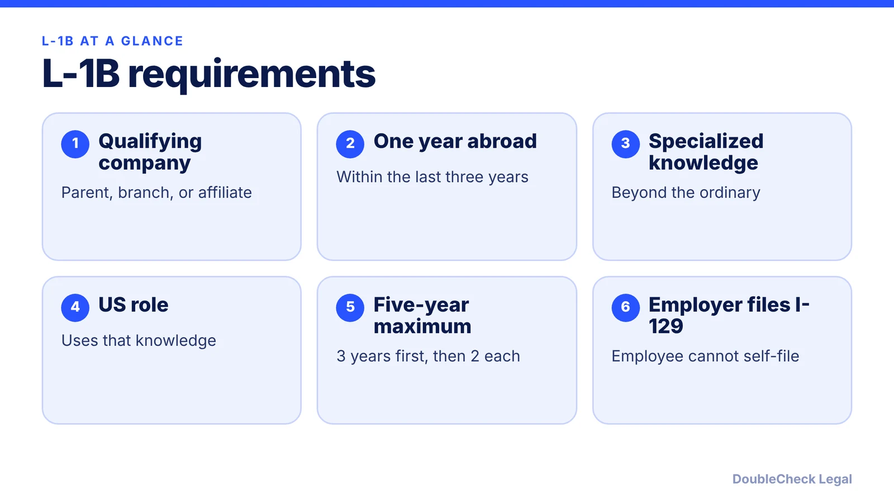
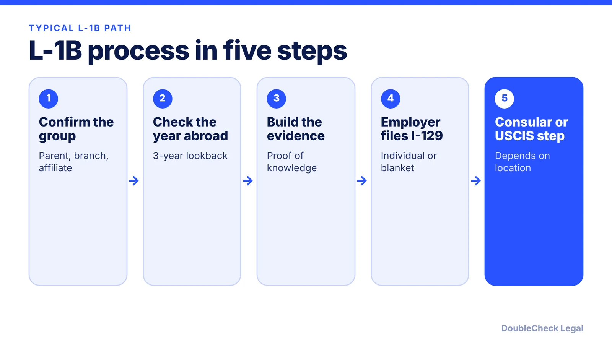

*For tech employees, the hard part of an L-1B is showing the knowledge is specialized to your employer. Here is what the sources say, as of November 2026.*

**Key takeaways:**

- The L-1B requires a qualifying foreign-US company relationship and one continuous year abroad within the prior three years.
- Specialized knowledge is beyond the ordinary and not commonplace; it can be distinct or uncommon in the industry or advanced within the company.
- The maximum stay is five years (L-1A is seven), and a third-party worksite adds control and labor-for-hire limits.
- Blanket petitions are for large groups and do not guarantee L-1B approval.

## 1. The quick answer

**Quick answer:** The L-1B lets a multinational company transfer an employee with specialized knowledge from a qualifying foreign office to the US. The employee generally needs one continuous year of work abroad for the company within the three years before admission, and the maximum total stay is five years, compared with seven for the L-1A. Per [Apsan Law's summary](https://www.apsanlaw.com/services/immigration-law/l1b-specialized-knowledge), specialized knowledge means knowledge "beyond the ordinary and not commonplace" within the industry or the company.

## 2. What counts as specialized knowledge

The regulation (8 CFR 214.2(l)(1)(ii)(D)), as described by [FedRateCalc](https://fedratecalc.com/l1-visa/), covers knowledge of the company's products, services, research, equipment, techniques, management, or other interests and how they apply in international markets, or an advanced level of expertise in its processes and procedures. Being skilled in a common technology is not enough.

Per a [Fragomen alert](https://www.fragomen.com/insights/alerts/uscis-issues-final-guidance-l-1b-specialized-knowledge) on USCIS guidance issued August 18, 2015 (effective August 31, 2015), specialized knowledge "need not be narrowly held" within an organization, and employing many specialists does not by itself weigh against a finding. A petitioner's own statement can be persuasive, but officers may still ask for more evidence. Per the [f1jobs.io summary](https://www.f1jobs.io/resources/blog/l1b-third-party-worksite-rule) of the policy now in the USCIS Policy Manual, the test asks whether the knowledge is either distinct or uncommon compared with the industry, or advanced compared with other employees at the company; one prong is enough.

For tech employees, that means linking the person to your proprietary systems, such as internal platforms, models, tooling, or customer implementation methods, and explaining how the knowledge was gained and why it cannot be quickly taught. Compensation compared with peers can also be reviewed, per Fragomen. Evidence can include:

- a detailed duties statement tied to proprietary work;
- training records and project history inside the company;
- comparisons with similar roles at the company and in the industry; and
- an org chart and the US role description.

## 3. Timing, limits, and third-party worksites

**Stay.** Per FedRateCalc, the initial stay is up to three years for an existing office or one year for a new office; extensions come in increments of up to two years; the maximum is five years in L-1B (8 CFR 214.2(l)(15)(ii)). After the maximum, readmission in L-1 status generally requires one year physically outside the US. See the L-1A comparison in [L-1A visa for foreign founders](/blog/l-1a-visa-new-office-foreign-founders/), which allows seven years.

**Moving to managerial roles.** Per FedRateCalc, an L-1B employee promoted to a managerial or executive role must have served in that role for at least six months, with USCIS approval. A later path may be a green card; see [EB-1C for multinational managers](/blog/eb-1c-multinational-manager-green-card/).

**Third-party placement.** Per the L-1 Visa Reform Act of 2004, as summarized by FedRateCalc and f1jobs.io, if the employee works at another company's site, the employee must not be principally controlled by that company, and the work must not be labor for hire. The petitioner keeps authority over how the work is performed. This matters for consulting and IT services firms.

## 4. Blanket petitions, fees, and alternatives

A **blanket petition** lets large multinationals pre-qualify so employees can apply for L visas at a consulate without an individual USCIS petition. Per the [Apsan Law summary](https://www.apsanlaw.com/services/immigration-law/l1b-specialized-knowledge), the group must be in commercial trade or services, with a US office operating at least one year and at least three domestic and foreign branches, subsidiaries, or affiliates, plus one of: 10 L-1 approvals in the prior 12 months, US subsidiaries or affiliates with combined annual sales of at least $25 million, or a US workforce of at least 1,000. The employee must also be a professional, and blanket approval does not guarantee L-1B classification.

**Fees** (per FedRateCalc, citing Form G-1055; confirm on uscis.gov before filing): the I-129 fee for L petitions is $1,385 on paper or $1,335 online ($695 for small employers and nonprofits), plus an Asylum Program Fee of $600 ($300 for small employers, $0 for nonprofits), and a $500 Fraud Prevention and Detection fee when it applies. A separate $4,500 fee applies to certain employers with 50 or more US employees where more than half are in H-1B, L-1A, or L-1B status, for petitions filed on or before September 30, 2027.

Because L-1B is employer-driven and can be scrutinized, many tech employees compare it with other statuses; see [H-1B vs. L-1 vs. O-1](/blog/h-1b-vs-l-1-vs-o-1-which-visa-for-tech-employees/) and [spouse work rights for L-2 and other dependents](/blog/spouse-work-rights-l-2-e-visa-o-3-dependents/). A foreign founder opening a US entity should also read [how to incorporate a company in the US](/blog/how-to-incorporate-a-company-in-the-us/) and the guide on [finding an immigration lawyer](/blog/how-to-find-good-immigration-lawyer-startup-founder/).

## Where DoubleCheck fits

[DoubleCheck](https://www.contactdoublecheck.com) helps businesses and founders start legal work with AI, verify it, and, when professional advice is warranted, connect with an independent attorney, including for immigration questions. Attorney availability and practice areas vary. Attorneys on DoubleCheck are independent professionals; an attorney-client relationship forms only if an attorney accepts your engagement.

**Sources:** [Apsan Law, L-1B overview](https://www.apsanlaw.com/services/immigration-law/l1b-specialized-knowledge); [FedRateCalc, L-1 Visa](https://fedratecalc.com/l1-visa/); [Fragomen, final guidance on L-1B](https://www.fragomen.com/insights/alerts/uscis-issues-final-guidance-l-1b-specialized-knowledge); [f1jobs.io, L-1B third-party worksite rule](https://www.f1jobs.io/resources/blog/l1b-third-party-worksite-rule). The USCIS L-1B page did not load for us, so check [uscis.gov](https://www.uscis.gov) for current rules and fees.

## FAQ

**How long can I stay in L-1B status?**

Per FedRateCalc, citing 8 CFR 214.2(l)(15)(ii), the maximum is five years: up to three years initially, then extensions of up to two years. A new-office employee's initial stay is up to one year.

**Do I need to be the only person with the knowledge?**

No. Per a Fragomen alert on USCIS's 2015 guidance, specialized knowledge need not be narrowly held within an organization, though officers may still question whether the employer needs the transferee.

**Can an L-1B employee work at a client's site?**

Possibly, with limits. Per FedRateCalc and f1jobs.io, the employee must not be principally controlled by the client and the work must not be labor for hire; the petitioner must keep authority over the work.

**Does a blanket petition guarantee my L-1B?**

No. Per Apsan Law, blanket approval does not by itself guarantee L-1B classification, and the employee must also be a professional.

---

*General information only. This article is not legal, tax, investment, or accounting advice.*
