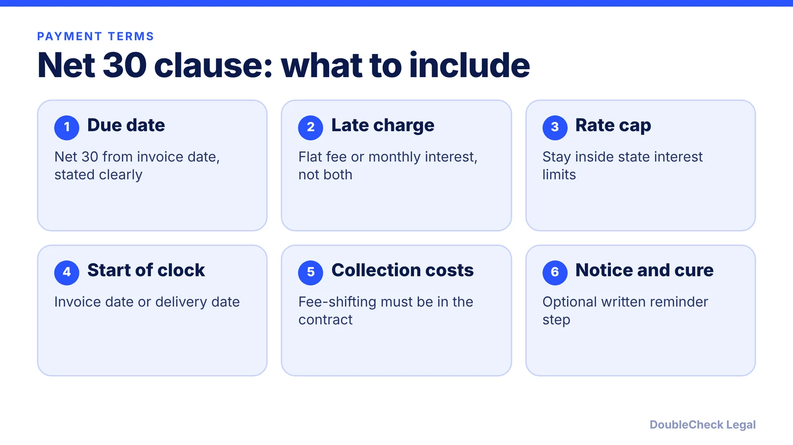
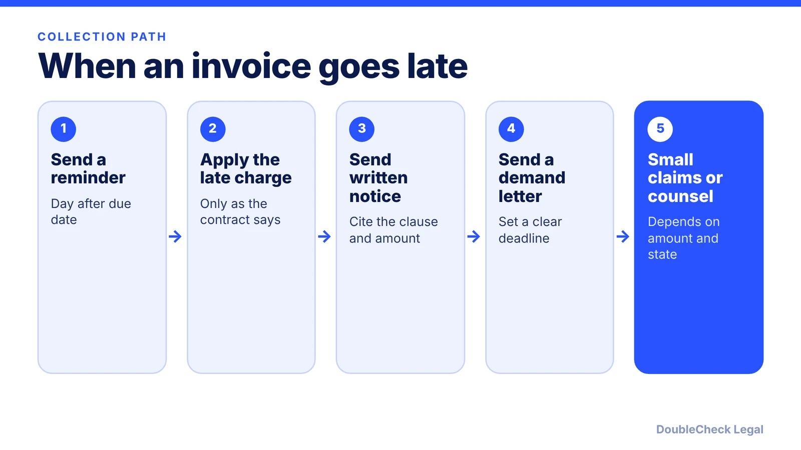

*Net 30 is easy to write and easy to get wrong: the fee has to be agreed in advance, reasonable, and inside your state limits.*

**Key takeaways:**

- Net 30 means payment is due 30 days after the invoice date; say exactly what starts the clock.
- Late fees and interest hold up when they reasonably estimate the harm of late payment, not when they punish.
- State interest limits vary, so use a capped rate and avoid stacking a flat fee on top of interest.
- Put the terms in the signed contract and repeat them on invoices; invoice-only terms may not bind.

## 1. The quick answer

**Quick answer:** Net 30 means payment is due 30 days after the invoice date, and a late payment fee or interest charge is enforceable when it is written into the agreement up front and reasonably tracks the harm of late payment instead of punishing the customer. For a small business, a solid late payment fees and Net 30 payment terms clause has five parts: the due date, the late charge, a cap that stays inside your state's interest limits, what counts as payment, and who pays collection costs. Put it in the signed contract, then repeat it on every invoice. As of November 2026, there is no single national cap on commercial late fees, so limits vary by state.

## 2. What Net 30 means and where the terms must appear

Net 30 is a widely used default in business-to-business sales. Other common terms are due on receipt, Net 60, deposits or milestone payments, and payment on delivery.

The clause only works if the customer agreed to it. That guide notes payment terms printed only on an invoice may not bind a customer unless they were part of the original agreement or accepted through a valid course of dealing. Nolo makes the same point from the fee side: your written agreement should state the payment deadline and the fee, and invoices should repeat that language. Without those provisions, you likely cannot impose finance charges.

Practical placement:

- **Proposal or order form:** state the payment term and the late charge in plain words.
- **Master agreement or statement of work:** put the full clause in the signed document. See [master services agreements and statements of work](/blog/master-services-agreement-and-sow-small-business/).
- **Invoice:** restate the due date and the late charge, and reference the contract.
- **Freelance work:** a short written contract is enough; see [how to write a freelance contract](/blog/how-to-write-a-freelance-contract/) and [what to include in an independent contractor agreement](/blog/independent-contractor-agreement-what-to-include/).

If the deal is only verbal, you may still have a contract, but proving the late fee will be hard. See [whether a verbal contract is enforceable](/blog/verbal-contract-enforceable-small-business/).

Define the clock precisely. Say whether 30 days runs from the invoice date, the date the customer receives the invoice, or the delivery or acceptance date. A vague start date is a common source of arguments.

## 3. Late fees and interest: what courts tend to enforce

The core test is reasonableness. Late fees and interest are more likely to be enforceable when they reasonably estimate the harm from late payment rather than punish the customer, and a fee far above any realistic harm can be struck down as a penalty. For contracts for the sale of goods, the Uniform Commercial Code addresses this directly: [UCC 2-718](https://www.law.cornell.edu/ucc/2/2-718) allows damages to be fixed in advance only at an amount "reasonable in the light of the anticipated or actual harm caused by the breach," and says a term fixing unreasonably large liquidated damages is void as a penalty. For service contracts, state common law usually governs, so check your state's rules.

Interest rate limits are state law. State usury statutes cap the rate on overdue amounts, the limits vary significantly by state, and some commercial transactions may be exempt while consumer transactions can face stricter rules. Nolo says a rate of up to 10% per year probably stays within most state statutes, but it is only a rule of thumb, and Nolo adds that a client could still challenge a fee that exceeds a reasonable estimate of your actual losses. Treat any specific percentage as something to check against your state's rules before you use it.

Two traps to avoid:

- **Flat daily fees on small invoices.** Nolo's example: $10 per day on a $100 invoice exceeds 10% per year after one day.
- **Stacking charges.** Combined late fees and interest can be unenforceable if they are duplicative, punitive, or exceed usury limits. Choose one mechanism.

Language matters too. Nolo advises against calling the fee a "penalty" because a judge may read it as punitive. Call it a late charge or interest on past-due amounts.

Math example from Nolo: a 3% annual rate on a $10,000 debt is 0.25% per month, or $25 per month, not compounded. State the rate as a monthly or annual figure and say whether it compounds.

## 4. Sample structure for your clause (a checklist, not a template)

Draft the clause in this order, then have the final wording checked against your state's rules.

1. **Due date:** "Invoices are due within 30 days of the invoice date."
2. **Late charge:** one mechanism, such as interest on the unpaid balance at a stated monthly rate, or a modest flat fee.
3. **Cap:** "or the maximum rate permitted by law, if lower." This kind of savings language helps if your state's limit is below the stated rate.
4. **Collection costs:** each side generally pays its own attorney's fees unless a contract or statute shifts them. A Florida law firm client alert from July 2026 (Shumaker) makes the same point and notes that one-sided fee clauses can be treated as mutual under Florida law, so mutual wording is the safer drafting default.
5. **Notice and cure:** a short written notice period before you suspend work. The same Shumaker alert notes contracts often require 10 to 15 days written notice before remedies are exercised; that is a drafting norm, not a legal rule.
6. **Suspension rights:** whether you may pause work or deliveries while an invoice is overdue.

Related reading: [how to write a demand letter](/blog/how-to-write-a-demand-letter-small-business/) and [how to collect unpaid invoices in small claims](/blog/how-to-collect-unpaid-invoices-small-claims/).

## 5. Mistakes that weaken the clause

- **Terms only on the invoice.** If the customer never agreed to them, they may not bind.
- **Fee silent in the contract.** Without a stated rate, you may be limited to the statutory rate and may struggle to recover prejudgment interest. Shumaker makes this point for Florida; other states differ.
- **Charging more than state limits allow.** Exceeding the cap can make the interest term unenforceable, or sometimes more.
- **Disguised discounts.** Nolo warns a large early-payment discount could be treated as a disguised late fee.
- **Never enforcing it.** Waiving the fee occasionally to keep a client is a business choice (Nolo suggests it for occasional late payers), but write down that a waiver is not a change to the contract.
- **Ignoring special laws.** Construction, government contracting and subcontractor payments may be governed by prompt-payment statutes. If you work in those areas, the general advice above is only a starting point.

Also check the other side of the contract. If you are the one paying, look for steep late charges, short payment windows and one-sided fee shifting during a [contract red flag review](/blog/contract-red-flags-small-business/). Late payment is one way a contract gets breached; see [breach of contract remedies](/blog/breach-of-contract-remedies-what-you-can-recover-small-business/) and the [statute of limitations for breach of contract by state](/blog/statute-of-limitations-breach-of-contract-by-state-small-business/), because collection deadlines are not unlimited.

## 6. DIY, AI draft or attorney: who should check the clause

A simple Net 30 clause with a modest, clearly stated late charge is something many owners can draft using an AI tool and a template, as long as they verify it. Our guides on [what to check before signing an AI-reviewed contract](/blog/ai-contract-review-what-to-check-before-signing/) and [where AI contract templates fail](/blog/ai-contract-templates-where-they-fail/) cover the checks.

Get an attorney to look at it when:

- you operate in several states, or your customers are consumers;
- the rate you want is high, compounding, or paired with large flat fees;
- the work is in construction, government contracting or another area with payment statutes;
- invoices are large enough that a fee dispute would matter;
- the customer has sent back redlines to your payment terms; see [how to review customer contract redlines](/blog/review-customer-contract-redlines/).

## Where DoubleCheck fits

[DoubleCheck](https://www.contactdoublecheck.com) helps businesses and founders start legal work with AI, verify it, and, when professional advice is warranted, connect with an independent attorney, including for immigration questions. Attorney availability and practice areas vary. Attorneys on DoubleCheck are independent professionals; an attorney-client relationship forms only if an attorney accepts your engagement.

**Sources:** [Nolo, When Can I Charge Late Fees or Finance Charges?](https://www.nolo.com/legal-encyclopedia/question-when-charge-late-fees-finance-charges-28337.html); [Cornell LII, UCC 2-718](https://www.law.cornell.edu/ucc/2/2-718); [Shumaker client alert on Florida late-payment interest (July 13, 2026)](https://www.shumaker.com/wp-content/themes/jrd-shumaker/inc/generate-insight-pdf.php?id=17776).

## FAQ

**What does Net 30 mean on an invoice?**

Net 30 means payment is due 30 days after the invoice date. It is a widely used default in business-to-business sales. State in your contract whether the 30 days starts on the invoice date, the date the customer receives it, or the delivery date.

**Can I charge a late fee if it is not in my contract?**

Probably not. Nolo says that without payment terms and a fee stated in your written agreement, you likely cannot impose finance charges. Terms that appear only on an invoice may not bind a customer who never agreed to them. Add the clause to the signed agreement going forward.

**How much interest can I charge on a late invoice?**

It depends on your state. State usury statutes cap interest on overdue amounts, the limits vary significantly, and some commercial deals may be exempt. Nolo says 10% per year probably stays within most state statutes, but treat that as a rule of thumb and check your state before using any rate.

**Is a late payment fee a penalty?**

It can be if it is far above the real harm of late payment. UCC 2-718, which governs sales of goods, says an unreasonably large liquidated damages term is void as a penalty. For services, state common law decides. A modest charge tied to the cost of late payment is more likely to be upheld.

**Who pays attorney fees if I have to sue for an unpaid invoice?**

Generally each side pays its own unless a contract or statute says otherwise (Shumaker, July 2026). If you want collection costs recovered, say so in the contract, and consider mutual wording because some states treat one-sided fee clauses as mutual.

---

*General information only. This article is not legal, tax, investment, or accounting advice.*
