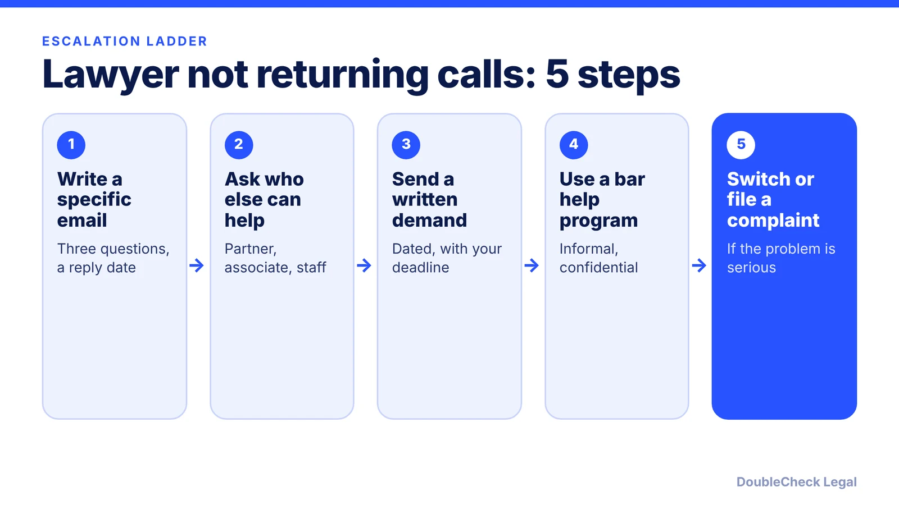
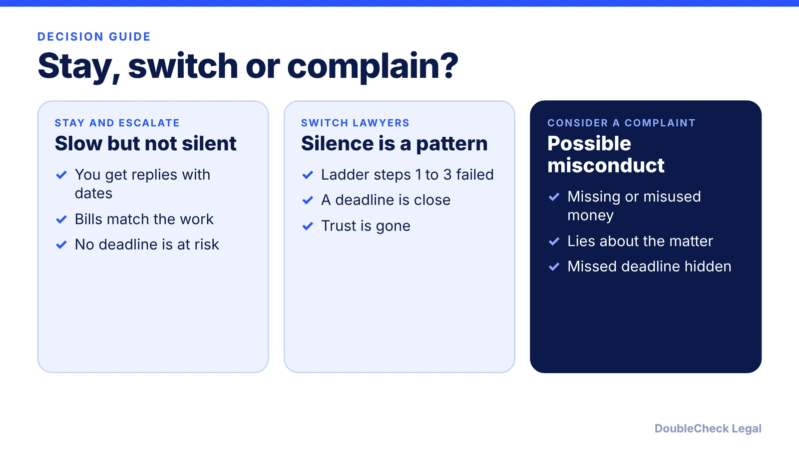

*What to do when your lawyer goes quiet: the communication duty, a five-step escalation ladder, how to get your file, billing questions, and when to switch or file a complaint.*

**Key takeaways:**

- Lawyers must keep you reasonably informed and respond promptly to reasonable requests, but not instantly to every call.
- Escalate in writing: specific email, second contact, dated demand, then a bar help program.
- You can end the relationship at any time and ask for your file; a lawyer generally cannot hold it hostage for fees in some states.
- Fee disputes and misconduct complaints use different channels; check your state bar.

## 1. The quick answer

**Quick answer:** If your lawyer is not returning calls, put your request in writing with a reply date, then escalate in steps: a specific email, a second contact at the firm, a written demand, a state bar help program, and only then a switch or complaint. Lawyers must keep you reasonably informed and promptly comply with reasonable requests for information (Rule 1.4, as published by the New Hampshire courts), but the Oregon State Bar says that does not mean answering every single call. You may end the relationship at any time and ask for your file, per the North Carolina and Minnesota bar publications cited below.

This page covers the next step when silence continues. For warning signs see [signs your lawyer is not working for you](/blog/signs-your-lawyer-is-not-working-for-you-what-to-do/); for an audit of bills and deliverables see [how to tell if your lawyer is actually working on your matter](/blog/how-to-tell-if-your-lawyer-is-actually-working-on-your-matter/).

## 2. What your lawyer owes you: the duty to communicate

Under the Rule 1.4 text published by the New Hampshire courts, a lawyer must keep the client reasonably informed about the status of the matter, promptly comply with reasonable requests for information, and explain matters enough for the client to make informed decisions. The comment adds that if a prompt response is not feasible, the lawyer or staff should acknowledge the request and say when to expect an answer.

**What it does not promise.** The Oregon State Bar's Bar Counsel column says the duty "does not require that lawyers respond to every single phone call," but failing to tell a client about important dates or status can lead to discipline. The Wisconsin State Bar's client bill of rights says a same-day reply is not guaranteed, but you should not be ignored. NYSBA's client rights page (December 19, 2022) says you are entitled to a prompt reply to letters, calls and emails.

**A pattern matters.** NYSBA Ethics Opinion 396 (June 10, 1975, under older canons) says a consistent practice of not answering client calls is improper and can signal that a matter has not been handled properly. It also says a lawyer need not keep answering repeated, unreasonable demands. Rules vary by state, so check yours.

Some silence is normal when a court or agency has not acted. A good lawyer says so.

## 3. The escalation ladder: what to do before you switch

Each step creates a record that helps if you later switch, dispute a bill or complain.

**Step 1: Send one specific email.** State what you need, ask two or three concrete questions, set a reply date (for example three business days) and say how to reach you. Oregon's column, written for lawyers, points to the same basics: a status update with a timeframe, copies of key correspondence, and the fee agreement and expected deadlines.

**Step 2: Ask who else can help.** Contact the assistant, paralegal or another lawyer on the matter and ask for a status summary and a dated next step. The cause is often workload, not neglect.

**Step 3: Send a dated written demand.** Calmly restate the request and your deadline, especially if a court or business date is near, and say what you will do next, such as request your file and consult another lawyer.

**Step 4: Use a bar help program.** Examples:

- **California:** the Attorney-Client Bridge Program helps clients who cannot reach their attorney or want files from a former attorney; once the attorney agrees, the attorney has 10 business days to start communicating or return files. It is not for clients who already filed a complaint or suspect serious misconduct such as withheld settlement funds.
- **Texas:** the Client-Attorney Assistance Program (CAAP) offers mediation-based help restoring communication. It cannot review your case or force action, and you cannot use CAAP and the grievance process at the same time.
- **Oregon:** the Client Assistance Office screens inquiries and complaints, per the Oregon State Bar.

**Step 5: Switch or complain** (section 6).

**When to skip ahead.** If a deadline is days away or money may be missing, go straight to a second lawyer and consider a complaint.

## 4. How to request your file from a lawyer

Ask in writing. The file belongs to the client, per a Minnesota Lawyers Professional Responsibility Board column (2023), and the Arizona State Bar's file Q&A says the lawyer must give you your documents and the documents reflecting work performed for you.

**Include in your request:** the matter and lawyer's name; your complete file (Arizona lists pleadings, evidence, discovery, research, drafts, correspondence and notes, and excludes internal practice-management memoranda); a delivery method and date; return of originals by a trackable method; and an accounting of any funds held for you.

**Things to know**

- **Fees and the file.** Minnesota says a lawyer may not condition return of the file on payment of fees or copying costs. Wisconsin adds that rights to documents the lawyer prepared but has not been paid for may be limited. Rules vary by state.
- **Copy costs.** Minnesota says a lawyer may charge for copies only if you agreed in writing before the engagement ended. Arizona says no charge for documents you have not yet received once.
- **Electronic files** can be produced electronically, per Minnesota.
- **Retention.** Neither state sets one universal retention period, so ask sooner rather than years later.

If you need documents for a deadline, say so in the subject line. For organizing what you get, see [how to hand off an AI-drafted legal document to an attorney](/blog/hand-off-an-ai-drafted-legal-document-to-an-attorney-package/).

## 5. Fee and billing questions when communication has broken down

Silence plus a growing bill often triggers a switch. Ask in writing and keep the tone factual.

- **"Please send an itemized bill for these dates."** NYSBA says clients may request a written itemized bill at reasonable intervals.
- **"Is any of the retainer unearned?"** Wisconsin suggests asking whether a retainer is a down payment on future work or a nonrefundable fee. The North Carolina State Bar journal (June 2017) says a discharged lawyer must take protective steps, including refunding any unearned fees.
- **"Where is my money?"** Client funds must be kept separate from the lawyer's own money, per Wisconsin.

**You may still owe for work done.** North Carolina says a client may discharge a lawyer at any time, with or without cause, but may still owe for services. Read your fee agreement; see [how much a startup lawyer costs](/blog/how-much-does-a-startup-lawyer-cost/) and [immigration lawyer fees](/blog/immigration-lawyer-fees-flat-fee-vs-hourly/).

**Fee disputes use fee programs.** California says fee disputes generally do not qualify as misconduct complaints and points to fee arbitration and mediation. Texas CAAP cannot recover fees; Texas points to its grievance process if you think a fee is unjust. Wisconsin points to its State Bar Fee Arbitration Program.

## 6. When to switch lawyers, and how to complain

**You can switch.** North Carolina and NYSBA both say a client may discharge a lawyer at any time. California notes that switching may delay your case, so line up the next lawyer first when you can.

**How to switch**

1. Find a replacement: [how to choose a good lawyer](/blog/how-to-choose-good-lawyer/), [lawyer referrals](/blog/how-to-get-lawyer-referral/), or [verify a California license](/blog/verify-california-attorney-license-state-bar/).
2. Prepare for the first meeting: [first meeting with a startup lawyer](/blog/how-to-prepare-for-first-meeting-with-startup-lawyer/).
3. Tell the old lawyer in writing, request your file and unearned funds, and name the new lawyer.
4. If the matter is in court, permission may be needed to change counsel (North Carolina cites Rule 1.16(c) for withdrawal).

**Complaints.** Per the State Bar of California, misconduct includes dishonesty, fraud and misuse of client money; fee disputes, poor strategy and disagreement with an outcome generally do not qualify. California and the D.C. Office of Disciplinary Counsel say a disciplinary office can investigate and pursue discipline but cannot represent you, give legal advice or order a refund. California says complaints are confidential unless charges are filed and your identity is usually disclosed to the attorney. Give dates, names and actions rather than conclusions and attach the fee agreement, emails and bills. A malpractice claim is separate; ask a second attorney about time limits.

Related: [how do I know if my lawyer is good](/blog/how-do-i-know-if-my-lawyer-is-good/), [when to hire a lawyer for a small business](/blog/when-to-hire-lawyer-small-business/) and [how to find a good immigration lawyer as a founder](/blog/how-to-find-good-immigration-lawyer-startup-founder/).

## Where DoubleCheck fits

[DoubleCheck](https://www.contactdoublecheck.com) helps businesses and founders start legal work with AI, verify it, and, when professional advice is warranted, connect with an independent attorney, including for immigration questions. Attorney availability and practice areas vary. Attorneys on DoubleCheck are independent professionals; an attorney-client relationship forms only if an attorney accepts your engagement.

**Sources:** [New Hampshire Courts, Rule 1.4 Client Communications](https://www.courts.nh.gov/new-hampshire-rules-professional-conduct/rule-14-client-communications); [Oregon State Bar, Bar Counsel column (2005)](https://www.osbar.org/publications/bulletin/05may/barcounsel.html); [NYSBA Ethics Opinion 396 (1975)](https://nysba.org/?p=9420); [NYSBA, Client Rights and Responsibilities (Dec. 19, 2022)](https://nysba.org/client-rights-and-responsibilities/); [Wisconsin State Bar, Client Bill of Rights](https://www.wisbar.org/forPublic/INeedInformation/Pages/Client's-Bill-of-Rights.aspx); [North Carolina State Bar, Breaking Up Is Hard to Do (June 2017)](https://www.ncbar.gov/for-lawyers/ethics/ethics-articles/breaking-up-is-hard-to-do/); [Minnesota Lawyers Professional Responsibility Board, File Retention and Return (2023)](https://mnbar.org/resources/publications/bench-bar/2023/09/01/file-retention-and-return); [State Bar of Arizona, client file Q&A](https://www.azbar.org/media/kbhpcruv/fileqa07-05-16.pdf); [State Bar of California, Attorney-Client Bridge Program](https://www.calbar.ca.gov/public/concerns-about-attorney/office-public-trust-liaison/office-public-trust-liaison/attorney-client-bridge-program); [State Bar of California, Want to file a complaint](https://www.calbar.ca.gov/public/file-complaints-claims/want-file-complaint); [State Bar of California, Problem with a lawyer](https://www.calbar.ca.gov/Public/Free-Legal-Information/Resolving-Problems/Problem-with-a-Lawyer); [State Bar of Texas, CAAP](https://www.texasbar.com/Content/NavigationMenu/ForThePublic/ProblemswithanAttorney/CAAP/default.htm); [D.C. Office of Disciplinary Counsel, What should you expect](https://www.dcbar.org/Attorney-Discipline/Office-of-Disciplinary-Counsel/Filing-a-Complaint/What-Should-You-Expect).

## FAQ

**Is it a violation if my lawyer does not return my calls?**

It can be if it becomes a pattern. Rule 1.4 requires lawyers to promptly comply with reasonable requests for information and to keep clients informed, but the Oregon State Bar says it does not require an answer to every call. Check your state rule and state bar.

**How long should I wait before escalating?**

No source we found sets one universal number. A practical approach is to email a specific request with a reply date of a few business days, then escalate if there is no response, and move faster if a deadline is close.

**Can my lawyer refuse to give me my file because I owe fees?**

The Minnesota Lawyers Professional Responsibility Board column (2023) says a lawyer may not condition return of the file on payment of fees or copying costs. Wisconsin notes limits for documents the lawyer prepared and has not been paid for. Rules vary by state.

**Will a state bar complaint get my money back?**

Not directly. The State Bar of California and the D.C. Office of Disciplinary Counsel say they cannot order refunds or represent you. Fee arbitration programs and client security funds may help in some situations, depending on your state.

**Can I fire my lawyer in the middle of a case?**

Yes. The North Carolina State Bar and NYSBA both say clients may discharge a lawyer at any time, though you may still owe for services and a court may need to approve a change in a pending matter.

---

*General information only. This article is not legal, tax, investment, or accounting advice.*
