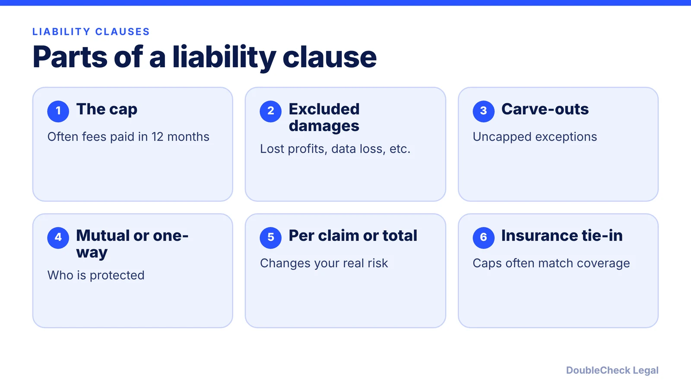
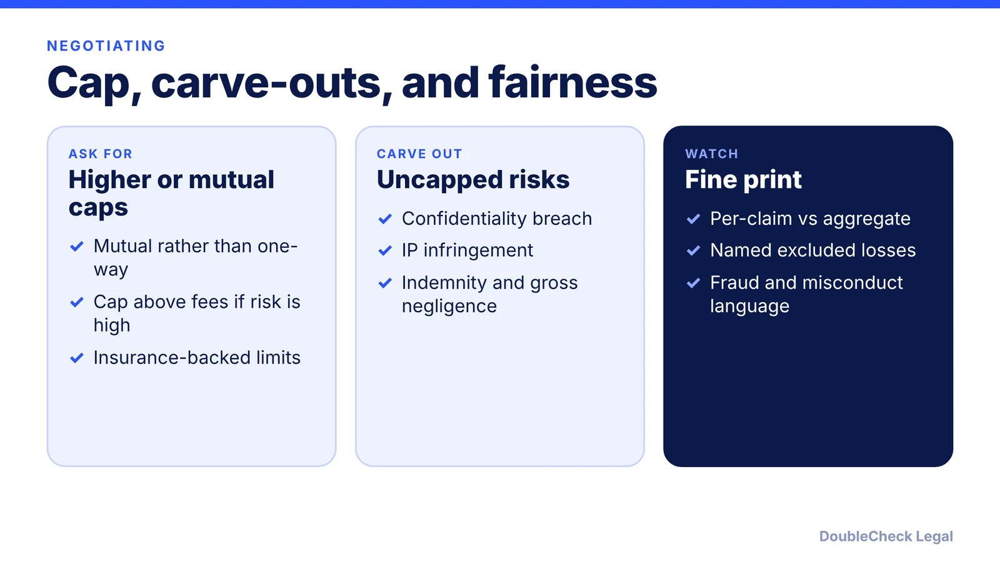

*A liability cap decides how much you can recover when a deal goes wrong. Read it before the work starts.*

**Key takeaways:**

- A limitation of liability clause caps the damages one party can recover, often tied to fees paid in the prior 12 months.
- Consequential damages like lost profits are often excluded, so check what you would actually lose.
- Gross negligence, willful misconduct, and fraud typically cannot be limited away; state law varies.
- Negotiate mutual caps and carve-outs before signing, not after a dispute.

## 1. The quick answer

**Quick answer:** A limitation of liability clause caps the money or damages one party can recover from the other for breaches or performance failures. Per ContractSafe, caps are often tied to contract value, such as fees paid in the prior 12 months, and consequential damages like lost profits are often excluded. Courts do not always enforce these clauses: gross negligence, willful misconduct, and fraud typically cannot be limited away, and enforceability varies by state. Read the cap, the exclusions, and the carve-outs together.

## 2. What the clause usually says

Per [ContractSafe](https://www.contractsafe.com/glossary/limitation-of-liability), the clause may cover the whole agreement or only certain failures. Typical building blocks:

- **A cap.** Often tied to fees, such as those paid in the prior 12 months, or a fixed dollar figure. [UpCounsel](https://upcounsel.com/limitation-of-liability-clauses-in-contracts) lists fees paid, available insurance coverage, a fixed amount such as total contract value, or a combination, and notes caps are often aligned with insurance.
- **Excluded damages.** Consequential damages are often excluded; ContractSafe's examples are lost profits, lost business opportunities, reputational harm, business interruption, and data loss. Because "consequential" can be disputed, contracts often name specific losses.
- **Carve-outs.** Exceptions that remain uncapped. ContractSafe lists breaches of confidentiality, IP infringement, indemnity obligations, and gross negligence.
- **Mutual or one-sided.** Mutual clauses cap both parties equally; one-sided ones protect only one party, and vendors often push for them, per ContractSafe.
- **Per claim or aggregate.** Check whether the cap applies per claim or to all claims combined, since that changes the risk.

Example: if you pay a vendor $2,000 a month and the cap is fees paid in the prior 12 months, the cap is $24,000, even if a data failure costs your business far more. That is our own arithmetic on a hypothetical.

## 3. When a cap may not be enforced

Courts generally apply limits to what these clauses can do, and approaches differ by state. Per ContractSafe and UpCounsel:

- **Gross negligence and willful misconduct** typically cannot be limited away.
- **Fraud** can make the clause, and possibly much of the contract, unenforceable.
- **Personal injury and death** often cannot be capped, especially in consumer contracts (ContractSafe).
- **Public policy and statutes:** a clause may fail if it conflicts with a specific law such as consumer protection, construction, or anti-indemnity statutes (UpCounsel).
- **Unconscionability and ambiguity:** an extremely one-sided clause buried in fine print, or one that is unclear, may not be enforced.
- **Clarity:** UpCounsel says the language should be "unambiguous, clear, conspicuous, unmistakable."
- **State variation:** some states enforce clauses as written, others require explicit wording or void them more readily, per UpCounsel.

Do not count on a court rescuing a bad cap. Negotiate it before signing.

## 4. How to review one before you sign

Ask these questions about any liability clause:

1. **Does it protect me or only them?** If only the vendor is capped, ask for mutual language.
2. **Is the cap realistic for the harm?** If a failure could cost more than a year of fees, ask for a higher cap or an uncapped category for data breach or confidentiality.
3. **Which losses are excluded?** Lost profits may be your main loss.
4. **What is carved out?** Look for confidentiality, IP, indemnity, and gross negligence.
5. **Does it match insurance?** Compare with your coverage.

Pair this with the checklists in [contract red flags for small business](/blog/contract-red-flags-small-business/), [AI vendor contract checklist](/blog/ai-vendor-contract-checklist/), and [reviewing customer contract redlines](/blog/review-customer-contract-redlines/). If a dispute arises, see [how to terminate a contract early](/blog/how-to-terminate-a-contract-early-termination-clause/) and [what makes a contract legally binding](/blog/what-makes-a-contract-legally-binding/).

AI can flag the cap and carve-outs in a long contract (see [AI contract review for small business](/blog/ai-contract-review-small-business/)), but whether it is enforceable depends on your state and facts; an independent attorney can advise. See [lawyer review of a ChatGPT contract](/blog/lawyer-review-chatgpt-contract/).

## Where DoubleCheck fits

[DoubleCheck](https://www.contactdoublecheck.com) helps businesses and founders start legal work with AI, verify it, and, when professional advice is warranted, connect with an independent attorney, including for immigration questions. Attorney availability and practice areas vary. Attorneys on DoubleCheck are independent professionals; an attorney-client relationship forms only if an attorney accepts your engagement.

**Sources:** [ContractSafe, Limitation of Liability](https://www.contractsafe.com/glossary/limitation-of-liability); [UpCounsel, Limitation of Liability Clauses](https://upcounsel.com/limitation-of-liability-clauses-in-contracts).

## FAQ

**What is a limitation of liability clause?**

Per ContractSafe, it caps the money or damages one party can recover from the other for breaches or performance failures. It may cover the whole agreement or only certain failures.

**Is a limitation of liability clause always enforceable?**

No. Per ContractSafe, gross negligence and willful misconduct typically cannot be limited away, fraud can make the clause unenforceable, and unconscionable clauses may not be enforced. Per UpCounsel, approaches vary by state.

**What is a typical liability cap?**

Per ContractSafe, caps are often tied to contract value, such as fees paid in the prior 12 months, or a fixed dollar figure. UpCounsel adds that caps may track available insurance coverage.

**What are carve-outs in a liability clause?**

Exceptions that stay uncapped. Per ContractSafe, common ones are breaches of confidentiality, IP infringement, indemnity obligations, and gross negligence.

---

*General information only. This article is not legal, tax, investment, or accounting advice.*
