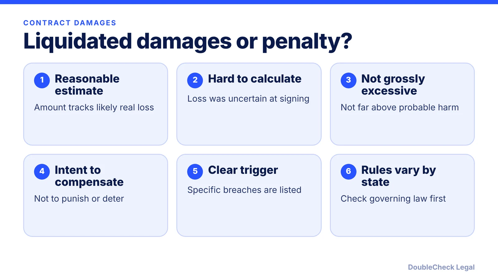
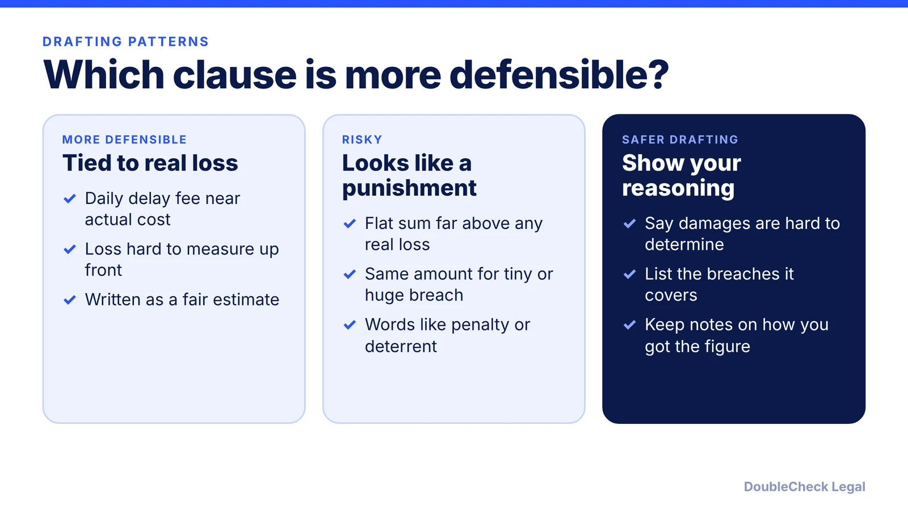

*Liquidated damages vs penalty clause: what makes a pre-set breach payment enforceable, and when courts refuse it.*

**Key takeaways:**

- A clause is more likely enforceable when the amount is a reasonable estimate of hard-to-measure loss.
- A penalty aims to punish or deter, and courts generally refuse to enforce it.
- Labels do not control; courts look at what the clause does.
- Rules vary by state, so check governing law before signing or relying on a clause.

## 1. The quick answer

**Quick answer:** A liquidated damages clause is enforceable when the agreed amount is a reasonable estimate of the harm a breach would cause and that harm was hard to calculate when you signed. A penalty clause is a fixed sum meant to punish or scare the other side into performing, and courts generally refuse to enforce it. The label does not decide the question: courts look at substance over labels, so a clause called "liquidated damages" can still be struck down. Rules vary by state, so check yours before relying on a clause.

## 2. How courts tell the two apart

Most US courts ask a small set of questions. They are not identical everywhere, but the same ideas keep showing up.

- **Was the loss hard to estimate at signing?** UCC 2-718 looks at difficulties of proving loss, so ask: would it have been difficult to quantify the damages when the contract was formed? If damages are easy to calculate, a fixed sum is harder to defend.
- **Is the amount reasonable?** Under UCC 2-718, for sales of goods, the amount must be reasonable in light of the anticipated or actual harm; unreasonably large liquidated damages are void as a penalty.
- **Did the parties intend to compensate?** Courts look at the whole contract and the surrounding circumstances, per a franchise-law article published by the International Franchise Association in March 2026.
- **Is it the only remedy?** In many states, the injured party cannot choose between the stipulated amount and actual damages; check your governing state's rule.

Penalties are refused because contract damages are meant to compensate for loss, not to punish.

Contract language matters but does not control. Wording that describes a reasonable estimate of actual damages is more likely to be treated as liquidated damages than wording aimed at deterrence, but this factor is not conclusive.

For the surrounding rules on what a signed contract does and does not bind you to, see [what makes a contract legally binding](/blog/what-makes-a-contract-legally-binding/).

## 3. Examples: enforceable-looking vs penalty-looking

Abstract tests are easier to apply with concrete drafting patterns. These are illustrations of how the factors play out, not rulings from any court.

Consider a web design agency that tells a client it will launch by a fixed date. If a late launch costs the client lost sales that are hard to pin down, a modest daily fee for late delivery may be a fair estimate. A clause charging the agency a large lump sum for a one-day delay, whatever the real impact, looks more like punishment.

The franchise-law article gives drafting tips that apply well beyond franchising: state that the damages are uncertain and inexact, say expressly that the clause is not a penalty, avoid words such as "penalty," "deterrent," "discipline," or "punishment," specify the breaches the clause covers, and use a reasonable formula backed by records. The same article warns that proper drafting is necessary but not sufficient, because courts still independently review whether the amount is excessive.

## 4. What the law says: UCC, Restatement and state variation

Two sources show up in most discussions.

**Sale of goods (UCC 2-718).** Under the New York text of the Uniform Commercial Code, section 2-718(1) lets parties set damages in advance, but only at an amount that is reasonable in light of the anticipated or actual harm. It states that a term fixing unreasonably large liquidated damages is void as a penalty. Other states adopt their own versions, so confirm your state's text.

**Contracts generally (Restatement (Second) of Contracts, section 356).** Per the franchise-law article, section 356 permits liquidated damages only at an amount reasonable in light of the anticipated or actual loss and the difficulties of proof of loss, and unreasonably large amounts are unenforceable as penalties. The Restatement is persuasive guidance, not a statute; each state's courts decide how closely to follow it.

State variation is real. The same article notes that Minnesota's franchise statute generally bars liquidated damages for premature termination, that New York courts often scrutinize how long a clause compensates a franchisor, and that Florida treats liquidated damages as allowing a default judgment without an unliquidated damages hearing. Those are franchise-context examples, but they show why you should confirm governing law. The article also says that the party trying to avoid a clause generally must show why it should not be applied as written, that courts tend to lean against enforcement when doubts exist, and that whether a clause is a penalty is a question of law for the court or arbitrator.

If your contract picks a governing state, that choice affects this analysis. Related background: [arbitration clauses in small business contracts](/blog/arbitration-clause-explained-small-business-contracts-pros-cons/) can decide who rules on the question.

## 5. If you are the one writing, receiving or challenging a clause

**If you are drafting:** Match the amount to a real estimate, write down how you reached it, and tie it to specific breaches such as late delivery or early termination. Pair it with sensible [limitation of liability](/blog/limitation-of-liability-clause-explained/) and [indemnification](/blog/indemnification-clause-explained-small-business/) terms so the pieces do not contradict each other. Late-payment charges are a close cousin; see [late payment fees and Net 30 terms](/blog/late-payment-fees-net-30-payment-terms-clause-small-business/).

**If you received a clause:** Ask what loss it is supposed to estimate. A figure that no one can explain is a negotiation point before signing, and a [contract red flag](/blog/contract-red-flags-small-business/) to raise early.

**If you are being charged:** Do not assume the clause is void just because it feels harsh. Courts start from the contract, and the burden generally sits with the party attacking it. Check the governing law, the breach that triggered it, and whether you have other defenses. If the contract is already in trouble, see [how to terminate a contract early](/blog/how-to-terminate-a-contract-early-termination-clause/) and [how to void or cancel a contract](/blog/how-to-void-or-cancel-a-contract-grounds-and-limits/).

If you want to know what you could recover instead of a fixed sum, read [breach of contract remedies: what you can recover](/blog/breach-of-contract-remedies-what-you-can-recover-small-business/).

**When to bring in an attorney:** A large dollar figure, a clause that applies in several states, a clause that stacks on top of termination fees, or a dispute already underway are all good reasons. An AI tool can help you summarize a clause and list questions, but check its answer against the contract text and your state's rules, as covered in [how to verify AI-generated legal documents](/blog/verify-ai-generated-legal-document/).

## Where DoubleCheck fits

[DoubleCheck](https://www.contactdoublecheck.com) helps businesses and founders start legal work with AI, verify it, and, when professional advice is warranted, connect with an independent attorney, including for immigration questions. Attorney availability and practice areas vary. Attorneys on DoubleCheck are independent professionals; an attorney-client relationship forms only if an attorney accepts your engagement.

**Sources:** [NY Senate, UCC 2-718](https://www.nysenate.gov/legislation/laws/UCC/2-718); [International Franchise Association, Enforcing and Attacking Liquidated Damages (March 2026)](https://www.franchise.org/wp-content/uploads/2026/03/EnforcingAttackingLiquidatedDamages.pdf).

## FAQ

**What is the difference between liquidated damages and a penalty clause?**

Liquidated damages are a reasonable pre-agreed estimate of loss from a breach. A penalty is a sum meant to punish or deter. Courts look at substance over labels and can void a clause that fails the tests, and UCC 2-718 treats unreasonably large liquidated damages as a void penalty for sales of goods.

**Are liquidated damages clauses enforceable?**

Often yes, if the amount is reasonable and the loss was hard to estimate at signing. For goods, UCC 2-718 as published by New York says a term fixing unreasonably large liquidated damages is void as a penalty. State law varies.

**Can I recover more than the liquidated damages amount?**

Often not, but it depends on the contract and the governing state's law, so check both.

**Does calling it liquidated damages make it enforceable?**

No. Courts look at what the clause actually does. Wording that describes a reasonable estimate helps, but it is not conclusive.

**Who has to prove a liquidated damages clause is a penalty?**

Per an International Franchise Association article from March 2026, the party seeking to avoid the clause generally must show why it should not be applied as written. This varies by state.

---

*General information only. This article is not legal, tax, investment, or accounting advice.*
