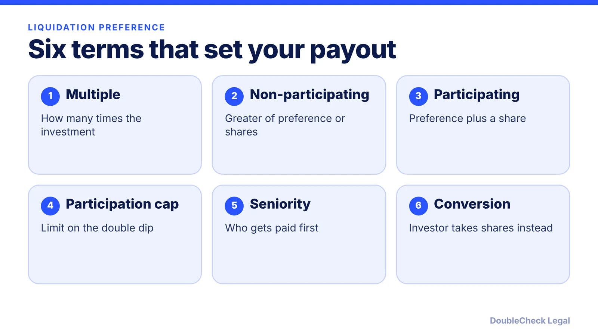
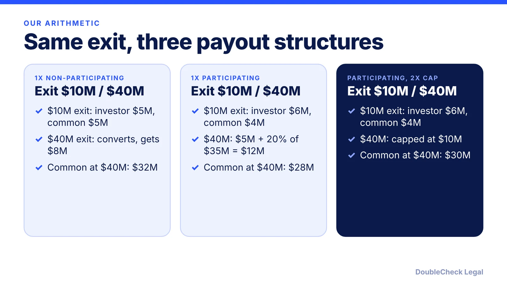

*A liquidation preference decides who is paid first at exit. Here is how the types differ and what they mean for your payout.*

**Key takeaways:**

- Preferred holders are paid before common at a sale or liquidation (per MoFo and LTSE).
- Non-participating pays the greater of the preference or as-converted value; participating pays both.
- In our hypothetical $10M exit, the structure alone moved $1M between investor and common.
- Check seniority across series: a stacked order can leave earlier investors and founders with nothing.

## 1. The quick answer

**Quick answer:** A liquidation preference gives preferred stockholders the right to be paid before common stockholders when the company is sold or liquidated. Per Morrison Foerster, a non-participating preference pays the investor the greater of its multiple (usually 1x) or its as-converted share, while a participating preference pays the multiple first and then a share of what remains. The type, the multiple, and the seniority order across series decide how much founders keep in a modest exit.

## 2. Multiple and participation

Per [Morrison Foerster](https://scaleup.mofo.com/guidance/ask-a-mofo-common-provisions-in-venture-capital-term-sheets-liquidation-preference), the three common types are:

- **Non-participating:** the preferred holder receives the greater of its agreed multiple of investment or its as-converted common value. MoFo calls it "simply downside protection" and the most common type.
- **Participating:** the holder takes its fixed multiple first, then shares pro rata in the remainder with common. MoFo calls it the most investor-favorable option and less common.
- **Capped participating:** works like participating, but total proceeds are capped at a set multiple (for example a 1x preference with participation up to 2x). The holder can instead convert to common and give up the preference.

The multiple is usually 1x but can be 2x, 3x, or higher, per MoFo, which notes that very high multiples can demotivate founders and employees if they become unlikely to receive proceeds. [Kruze Consulting](https://kruzeconsulting.com/liquidation-preference) similarly says multiples above 1x are uncommon and calls non-participating the most common type in Silicon Valley. These descriptions come from advisors, not from a survey, so check what investors are actually proposing in your market.

A sale of the company or substantially all of its assets is generally treated as a liquidation event in term sheets, per Kruze's Y Combinator example. See [key term sheet terms](/blog/term-sheet-key-terms-explained/) for where this clause sits.

## 3. A worked example

This is our arithmetic on hypothetical terms: an investor puts in $5 million for 20% (as-converted), and the rest is common. We compare two exits.

How we got there: non-participating at $10M, the investor compares $5M (preference) with 20% x $10M = $2M and takes $5M. At $40M, 20% x $40M = $8M beats $5M, so it converts. Participating takes $5M first, then 20% of the rest. In the capped case, $5M + 20% x $35M = $12M is cut to the $10M cap; converting would give only $8M, so the investor stays preferred.

The practical point, echoed by [LTSE](https://ltse.com/insights/funding-your-startup-a-founders-guide-to-liquidation-preferences): preference terms mostly change outcomes at lower exit values, and LTSE notes that smaller exits are far more common than big ones.

## 4. Seniority and what to check

With several rounds, the order of payment matters. MoFo says the default is pari passu (all series equal), while a stacked structure pays later series first, and a grouped structure lets certain series share priority. Kruze illustrates the stacked case: if a Series B invested $25 million and has seniority, a $25 million sale returns all of it to Series B, and Series A and the founders receive nothing.

Before you sign:

- Confirm the type (non-participating, participating, capped) and the multiple in the term sheet.
- Confirm seniority across existing and new series, including any [SAFEs or notes](/blog/safe-note-explained-for-founders/) converting into preferred.
- Model payouts at several exit values, using your [cap table](/blog/cap-table-basics-for-first-time-founders/).
- Compare against the [NVCA model documents](/blog/nvca-model-documents-priced-round-explained/) language your lawyer will see, and pair it with [anti-dilution terms](/blog/anti-dilution-provisions-term-sheet/).

An attorney can confirm what counts as a deemed liquidation event in your charter, which varies by document.

## Where DoubleCheck fits

[DoubleCheck](https://www.contactdoublecheck.com) helps businesses and founders start legal work with AI, verify it, and, when professional advice is warranted, connect with an independent attorney, including for immigration questions. Attorney availability and practice areas vary. Attorneys on DoubleCheck are independent professionals; an attorney-client relationship forms only if an attorney accepts your engagement.

**Sources:** [Morrison Foerster, Ask a MoFo: Liquidation Preference](https://scaleup.mofo.com/guidance/ask-a-mofo-common-provisions-in-venture-capital-term-sheets-liquidation-preference); [LTSE, A Founder's Guide to Liquidation Preferences](https://ltse.com/insights/funding-your-startup-a-founders-guide-to-liquidation-preferences); [Kruze Consulting, Liquidation Preference](https://kruzeconsulting.com/liquidation-preference).

## FAQ

**What is a 1x liquidation preference?**

It means the preferred investor first receives 1x its original investment before common holders share in proceeds. Kruze describes a typical 1x preference as investors recovering their original investment first.

**What is the difference between participating and non-participating preferred?**

Per Morrison Foerster, non-participating preferred gets the greater of its preference or its as-converted share. Participating preferred takes its preference first and then shares in the remainder with common, which MoFo describes as the most investor-favorable option.

**What does a participation cap do?**

It limits total proceeds to a set multiple. MoFo's example is a 1x preference with participation capped at 2x, and the holder can instead convert to common and give up the preference.

**What is the difference between pari passu and stacked seniority?**

Per MoFo, pari passu gives all series equal priority, while stacked pays later series first. Which one applies is set in your charter, so confirm it with an attorney.

---

*General information only. This article is not legal, tax, investment, or accounting advice.*
