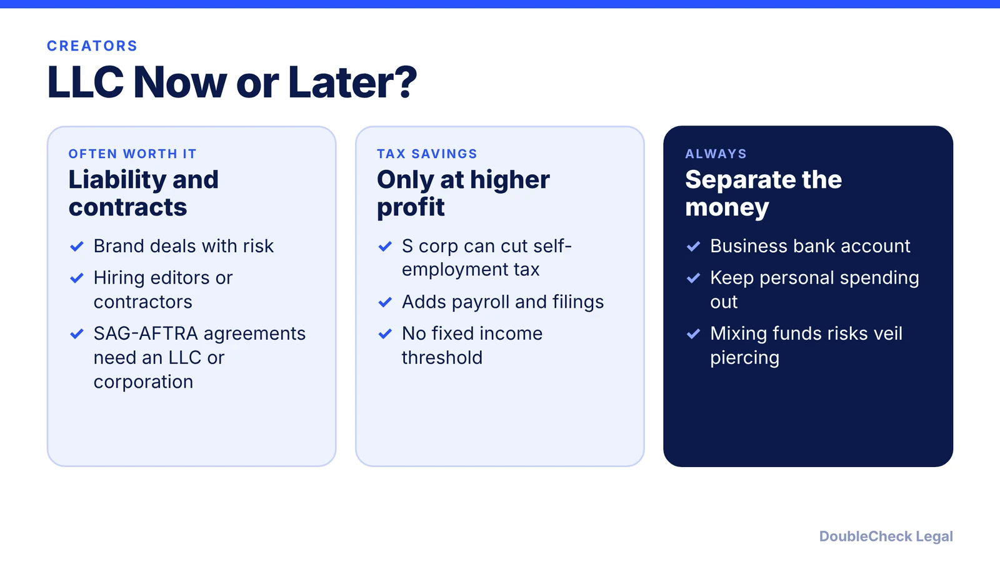
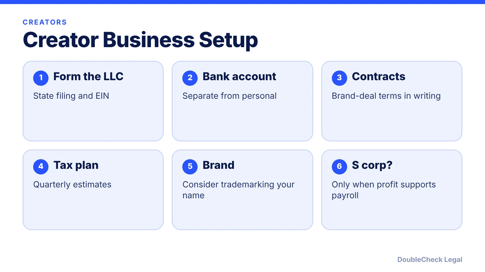

*Should a creator or influencer form an LLC? It protects your assets, but taxes are a different story. Here is when it pays off.*

**Key takeaways:**

- An LLC separates personal and business liability; a sole proprietorship does not.
- An LLC creates no new deductions; savings come mainly from an S corp election at higher profit.
- Per Wolters Kluwer, SAG-AFTRA influencer agreements require an LLC or corporation.
- Use a separate business bank account and written brand-deal contracts.

## 1. The quick answer

**Quick answer:** An LLC separates your personal assets from business debts, which a sole proprietorship does not. But it does not create new tax deductions. Savings mostly come from an S corporation election, and only at higher profit. CLA's illustration shows a creator at $300,000 income saving about $5,000, so at low or moderate income an LLC may not help with tax. Form one before you take on big brand deals, hire help, or sign contracts that carry risk.

## 2. How an LLC is taxed

Per the IRS, a single-member LLC is disregarded for income tax by default (taxed like a sole proprietor), and a multi-member LLC is taxed as a partnership. You can elect corporate treatment with Form 8832. The self-employment tax is 15.3% (12.4% Social Security on the first $184,500 for 2026, plus 2.9% Medicare), you must file Schedule SE if net earnings are $400 or more, and estimated tax payments are generally required if you expect to owe $1,000 or more. See [single-member LLC taxes](/blog/single-member-llc-taxes-disregarded-entity/), [self-employment tax](/blog/self-employment-tax-solo-business-owner-2026/), and [quarterly estimated taxes](/blog/quarterly-estimated-taxes-solo-business-owner/).

## 3. S corp: when it starts to make sense

CLA says S-corp costs include state fees, a registered agent, payroll setup and quarterly filings, plus Form 1120-S and K-1s. There is no fixed IRS income threshold; it depends on profit versus reasonable salary. The IRS says an S corp must be a domestic corporation with one class of stock and no more than 100 shareholders, with no nonresident alien shareholders, elected on Form 2553 ([S corp election deadline](/blog/s-corp-election-form-2553-deadline/)).

## 4. Brand-deal contracts and trademarks

Saral's guide says a brand-deal contract should cover deliverables, payment terms (for example 50% upfront and the rest on approval, or Net 30), usage rights (absent a transfer, the creator generally keeps the copyright), exclusivity, and termination. The USPTO says you do not have to register a trademark to own one, but your rights are limited to the area of use, while federal registration gives broader nationwide rights. Read [AI-generated content and copyright](/blog/ai-generated-content-copyright-solo-business/) and the [solo founder legal checklist](/blog/solo-founder-legal-checklist-using-ai/).

## Where DoubleCheck fits

[DoubleCheck](https://www.contactdoublecheck.com) helps businesses and founders start legal work with AI, verify it, and, when professional advice is warranted, connect with an independent attorney, including for immigration questions. Attorney availability and practice areas vary. Attorneys on DoubleCheck are independent professionals; an attorney-client relationship forms only if an attorney accepts your engagement.

**Sources:** [Wolters Kluwer](https://www.wolterskluwer.com/en/expert-insights/do-social-media-influencers-need-an-llc); [CLA](https://www.claconnect.com/en/resources/articles/26/should-influencers-form-an-llc); [IRS: Limited liability company](https://www.irs.gov/businesses/small-businesses-self-employed/limited-liability-company-llc); [IRS: S corporations](https://www.irs.gov/businesses/small-businesses-self-employed/s-corporations); [IRS: Self-employment tax](https://www.irs.gov/businesses/small-businesses-self-employed/self-employment-tax-social-security-and-medicare-taxes); [USPTO](https://www.uspto.gov/trademarks/basics/what-trademark); [Saral](https://getsaral.com/academy/influencer-contracts-what-to-include-in-your-agreement).

## FAQ

**Do influencers need an LLC?**

Not always. An LLC adds liability protection, but tax savings usually come from an S corp election at higher profit, per CLA.

**Is a single-member LLC taxed differently?**

By default the IRS taxes a single-member LLC like a sole proprietor, and you can elect corporate treatment.

**When should a creator elect S corp status?**

There is no fixed threshold. It depends on profit versus reasonable salary and the added payroll costs. Ask a tax professional.

**Do I need to trademark my name?**

No, you do not have to register to own a mark, but federal registration gives broader rights, per the USPTO.

---

*General information only. This article is not legal, tax, investment, or accounting advice.*
