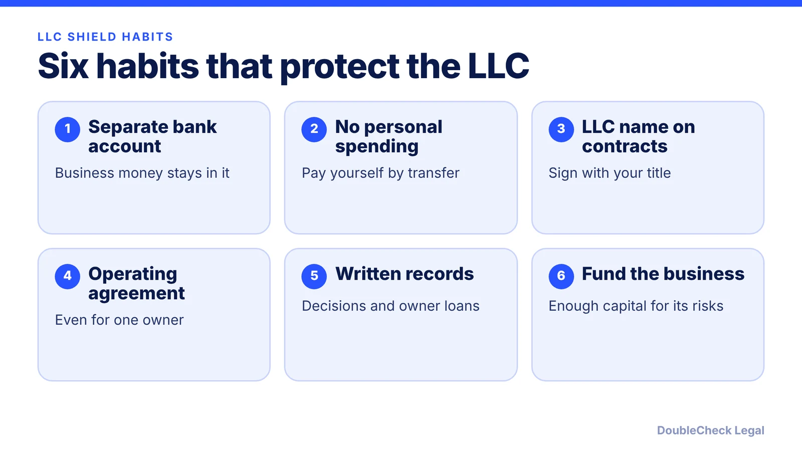
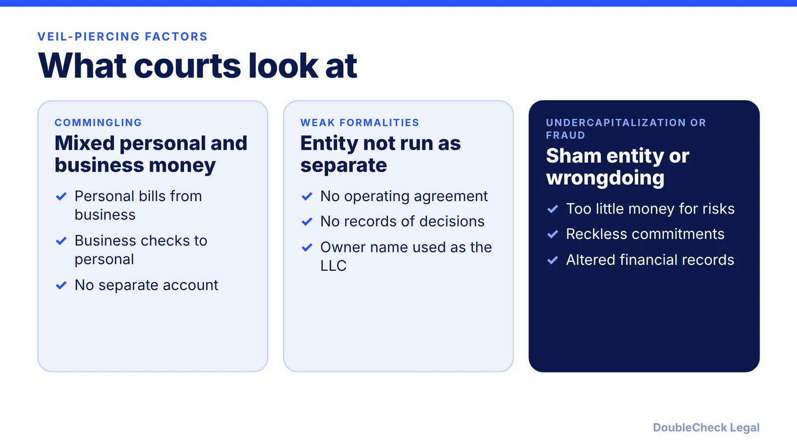

*A separate bank account is the simplest habit that protects an LLC's liability shield. Here is the rest of the list.*

**Key takeaways:**

- Open a separate LLC bank account and keep personal and business money apart.
- Courts usually look for alter ego behavior plus wrongdoing before piercing the veil, and rarely do it lightly.
- Sign in the LLC's name, keep an operating agreement and written records, and fund the business adequately.
- Veil-piercing rules vary by state, so ask an attorney if you have mixed funds or face a claim.

## 1. The quick answer

**Quick answer:** To keep an LLC's liability protection, treat it as a separate legal entity in practice: open a separate business bank account, never mix personal and business money, sign contracts in the LLC's name, keep an operating agreement and records, and fund the business adequately. Nolo explains that courts can ignore an entity's limited liability and hold owners personally liable, which is most likely for closely held corporations and small LLCs, including single-member LLCs. Courts also treat limited liability as a strong presumption and rarely pierce the veil lightly. ZenBusiness (last modified September 1, 2026) calls commingling "more of a legal problem than a tax problem."

The habits below are the practical side of an LLC startup bank account and commingling. They lower risk; they do not guarantee protection, because each state's courts decide on the facts.

## 2. What commingling is and why it matters

Per ZenBusiness (published February 1, 2024, last modified September 1, 2026), commingling means treating the business's money as your own. Its examples include depositing client payments into a personal account, paying personal expenses from business accounts without documentation, and using a personal credit card for business expenses. It lists "the presence of commingled funds" as one important factor courts weigh in veil piercing.

Nolo gives similar examples: paying personal bills from the business account or depositing company checks into a personal account. Its fix is simple: the business should have its own bank account and the owner should keep personal and business money separate.

It also helps with taxes. ZenBusiness says "You can't deduct what you can't document," and that a separate account makes tax preparation easier. For tax treatment of a one-owner LLC, see [single-member LLC taxes](/blog/single-member-llc-taxes-disregarded-entity/).

**If you already mixed funds:** ZenBusiness suggests identifying the personal transactions first and getting CPA help for things like shareholder loans. Do not backdate paperwork; ask an accountant or attorney how to document and correct it going forward.

## 3. Veil-piercing factors in plain English

Nolo describes a two-part approach courts usually apply: an **alter ego** showing (the owner does not keep the business separate from personal affairs) and **fraud or wrongdoing** (the owner acted recklessly or dishonestly, such as making deals the business could not pay for or altering financial records). Courts generally impose personal liability only on those responsible for the wrongful conduct.

The Digital Media Law Project guide lists four factors, noting that two or more make piercing more likely: misuse of company funds, undercapitalization, failure to observe formalities, and fraud. Its content is old (visible dates around 2014) and the site is no longer updated, so use it as a general outline only. It says formalities matter more for corporations, though LLC members should still keep detailed records and minutes of major decisions, and that the analysis is fact-intensive and unpredictable.

Two cautions:

- **State law varies.** Veil piercing is decided under the law of the state where the LLC was formed, and standards differ. Check your state, and see [best state to form an LLC](/blog/best-state-to-form-an-llc-comparison/).
- **LLCs and corporations can both be pierced.** Nolo notes both offer limited liability and both can lose it, while sole proprietorships and general partnerships offer none. See [sole proprietor vs LLC](/blog/sole-proprietor-vs-llc-solo-founder/).

Limited liability also does not cover your own wrongdoing or a personal guarantee you sign. Ask an attorney how that applies to leases and loans.

## 4. A habits checklist for a new LLC

Use this as a starting list, not a legal standard.

1. **Open a business account after the LLC exists and you have an EIN.** Banks usually ask for formation documents and often the operating agreement; see [how to get an EIN](/blog/how-to-get-an-ein-for-your-business-free/). Foreign owners can see [EIN without an SSN](/blog/get-ein-without-ssn-foreign-founder/).
2. **Route all business income and expenses through it.** Pay yourself by a clear transfer, and record owner contributions and loans in writing.
3. **Sign in the LLC's name.** Nolo's example: an owner who interchanged his own name with the business's name on invoices and contracts looked like he had no real separation from the company. Use the LLC's full name and your title.
4. **Have an operating agreement, even as a sole owner.** Nolo says single-member LLCs should have one and keep records of important decisions. See [LLC operating agreement with AI](/blog/llc-operating-agreement-with-ai/).
5. **Keep the entity in good standing.** Missed filings can create their own problems; see [annual report requirements by state](/blog/annual-report-requirements-by-state-llc/).
6. **Fund it for the risks it takes.** Nolo says gross undercapitalization can signal a sham entity, and that starting a business without proper investment and then failing to pay invoices may look reckless.
7. **Use insurance and written contracts for real risks.** Ask an attorney or insurance broker what fits your business.

**Handle it yourself vs. get an attorney.** The bank account, bookkeeping and signature habits are DIY. Get an attorney involved if you have already mixed significant funds, face a claim, are signing a lease or loan with a personal guarantee, or are deciding whether to move to a different entity; see [do you need a lawyer to start an LLC](/blog/do-i-need-a-lawyer-to-start-an-llc-diy-ai-or-attorney/) and [LLC vs C corp for startups](/blog/llc-vs-c-corp-startups/).

**Related reading:** [Startup LLC: the complete guide](/blog/startup-llc-complete-guide-formation-taxes-operating-agreement-and-conversion/)

## Where DoubleCheck fits

[DoubleCheck](https://www.contactdoublecheck.com) helps businesses and founders start legal work with AI, verify it, and, when professional advice is warranted, connect with an independent attorney, including for immigration questions. Attorney availability and practice areas vary. Attorneys on DoubleCheck are independent professionals; an attorney-client relationship forms only if an attorney accepts your engagement.

**Sources:** [Nolo, Personal liability and piercing the corporate veil](https://www.nolo.com/legal-encyclopedia/personal-liability-piercing-corporate-veil-33006.html); [ZenBusiness, The Dangers of Mixing Business and Personal Funds (published Feb. 1, 2024; modified Sept. 1, 2026)](https://www.zenbusiness.com/blog/commingle-funds/); [Digital Media Law Project, Piercing the Corporate Veil (older content, about 2014)](https://www.dmlp.org/node/958). A Wolters Kluwer article on this topic failed to load, so no claims are drawn from it.

## FAQ

**Does a separate bank account protect my LLC from veil piercing?**

It helps but does not guarantee protection. Nolo says an LLC should have its own bank account and the owner should keep personal and business money separate, and ZenBusiness lists commingled funds as one factor courts weigh.

**What happens if I commingle funds in my LLC?**

It can be used as evidence that the LLC is not truly separate. ZenBusiness says commingling can cost you the liability protection through veil piercing, and suggests identifying personal transactions and getting CPA help to fix them.

**Do single-member LLCs need an operating agreement for liability protection?**

Nolo recommends one for single-member LLCs along with records of important decisions. Whether your state requires one varies, so check your state rules.

**Can I sign contracts in my own name for my LLC?**

Avoid it. Nolo notes that interchanging your own name with the business name on contracts and invoices can look like no real separation, so sign in the LLC name with your title.

---

*General information only. This article is not legal, tax, investment, or accounting advice.*
