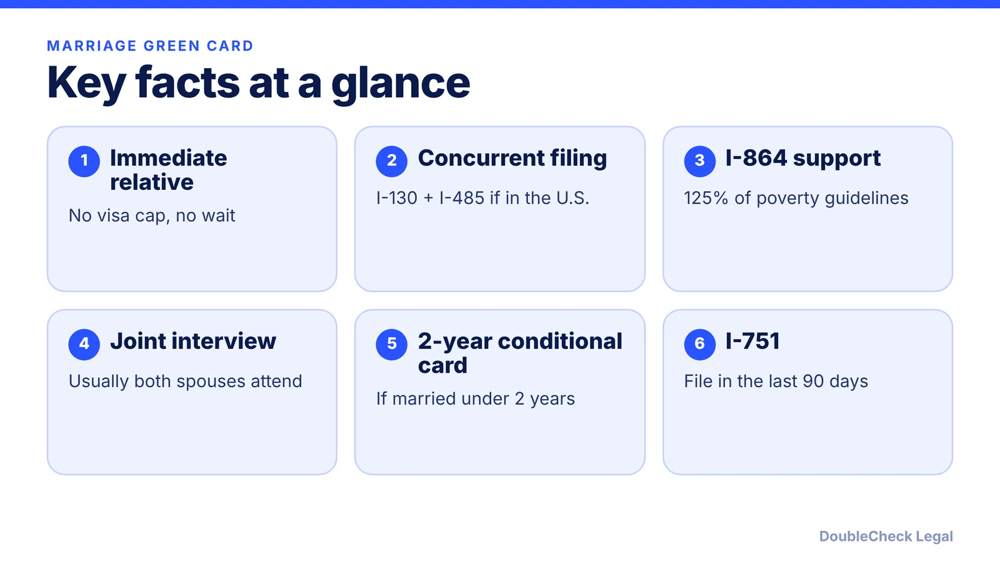
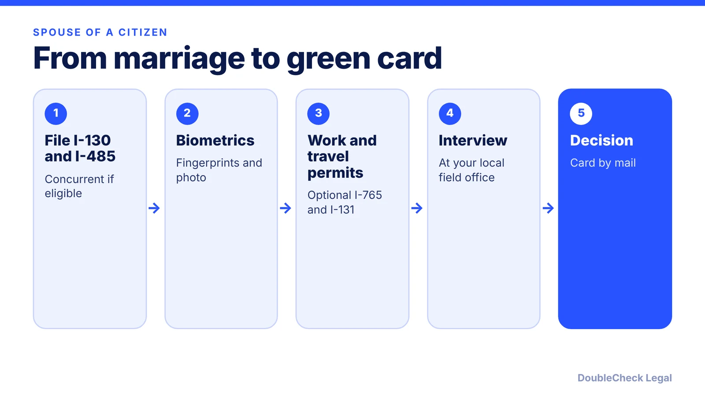

*Married to a U.S. citizen and living in the U.S.? Here is how the filing, interview, and conditional-residence steps fit together, with timelines from published sources.*

**Key takeaways:**

- Spouses of U.S. citizens are immediate relatives: no visa cap and no priority-date wait.
- Spouses in the U.S. can often file the I-130 and I-485 together.
- Evidence should span finances, shared residence, and shared life.
- A marriage under two years old at approval means a 2-year card and an I-751 in the final 90 days.

## 1. The quick answer

**Quick answer:** The spouse of a U.S. citizen is an "immediate relative," so there is no annual visa cap and no priority-date wait (generally). If the foreign spouse is already in the U.S., the couple can often file Form I-130 and Form I-485 together. Expect biometrics, a joint interview at a USCIS field office, and a decision after that. If the marriage is under two years old when the green card is approved, the card is conditional for two years and the couple files Form I-751 in the 90 days before it expires (generally). Timelines vary by field office and path, so check USCIS processing times.

## 2. The process: I-130 and I-485 together

Concurrent filing is generally available to immediate relatives who are physically in the U.S. and seek adjustment of status. Those abroad use consular processing instead, and some applicants, such as those who entered without inspection or are in removal proceedings, may not be able to file this way. If the sponsor is a green card holder rather than a citizen, the spouse falls in category F2A, which depends on the Visa Bulletin; see our guide to [visa bulletin priority dates](/blog/visa-bulletin-explained-priority-dates-eb-categories/).

A typical package includes Form I-130 and I-130A, Form I-485, Form I-693 (medical exam by a USCIS-designated civil surgeon), Form I-864 (affidavit of support), and optionally Form I-765 (work permit) and Form I-131 (advance parole). The sponsoring spouse generally must show income of at least 125% of the federal poverty guidelines on the I-864, per the [State Department](https://travel.state.gov/content/travel/en/us-visas/immigrate/the-immigrant-visa-process/step-1-submit-a-petition/i-864-affidavit-faqs.html) and [8 U.S.C. 1183a](https://uscode.house.gov/us/usc/119-120/t8/s1183a/). For what the I-485 involves in general, and travel and work while it is pending, see our guides to the [I-485 adjustment of status](/blog/i-485-adjustment-of-status-guide/) and [advance parole and EAD](/blog/advance-parole-and-ead-while-i-485-pending/).

## 3. Evidence of a real marriage and the interview

USCIS looks closely at whether the marriage is genuine. Useful evidence generally falls into three kinds; check the USCIS form instructions for what it lists:

- **Financial:** joint bank accounts, shared credit cards, joint tax returns, insurance beneficiary designations, loans.
- **Shared residence:** a joint lease or mortgage, utility bills, mail addressed to both spouses.
- **Shared life:** photos over time, travel records, children's birth certificates, communication logs, and affidavits from people who know the couple.

Breadth across categories usually matters more than sheer volume. Add the marriage certificate and proof of the sponsor's status.

For adjustment cases, an interview is typically required in spouse cases, both spouses generally attend at the local USCIS field office, and you should bring originals of supporting documents, recent tax returns, pay stubs, and passports. Follow the interview notice for exactly what to bring. If any civil document is in another language, it needs a certified English translation; see [USCIS translation requirements](/blog/uscis-certified-translation-requirements-documents/).

## 4. Timelines and conditional residence (I-751)

Timelines vary a lot, and USCIS posts live processing times by form and office, so use those for your case. Requests for evidence and background-check delays can add time.

**Conditional residence.** Generally, if the marriage is less than two years old when the green card is approved, the card is valid for two years; if it is two years or older, you get a standard 10-year card. For a conditional card, the couple files Form I-751 in the 90 days before the card expires. The I-751 receipt notice generally extends conditional status while the petition is pending; confirm the current extension period and processing times on USCIS's I-751 page.

Later, a green card holder can consider [naturalization](/blog/n-400-naturalization-eligibility-requirements/) or compare [green card vs U.S. citizenship](/blog/green-card-vs-us-citizenship-differences/).

## Where DoubleCheck fits

[DoubleCheck](https://www.contactdoublecheck.com) helps businesses and founders start legal work with AI, verify it, and, when professional advice is warranted, connect with an independent attorney, including for immigration questions. Attorney availability and practice areas vary. Attorneys on DoubleCheck are independent professionals; an attorney-client relationship forms only if an attorney accepts your engagement.

**Sources:** [U.S. Department of State: I-864 Affidavit of Support FAQs](https://travel.state.gov/content/travel/en/us-visas/immigrate/the-immigrant-visa-process/step-1-submit-a-petition/i-864-affidavit-faqs.html); [8 U.S.C. 1183a](https://uscode.house.gov/us/usc/119-120/t8/s1183a/).

## FAQ

**Can I file the I-130 and I-485 at the same time?**

Often yes. Lighthouse says immediate relatives physically in the U.S. who are seeking adjustment of status can file concurrently; those abroad use consular processing.

**What evidence proves a bona fide marriage?**

Boundless and Ellis list joint bank accounts and tax returns, a shared lease or utility bills, photos over time, travel records, and affidavits from people who know the couple.

**How long does a marriage-based green card take?**

It varies widely by field office and by whether the spouse is in the U.S. or abroad. Check USCIS's current processing times for your form and office.

**When do I file the I-751 to remove conditions?**

Generally in the 90 days before the two-year conditional card expires. Check the USCIS I-751 page for how your status is treated while the petition is pending.

---

*General information only. This article is not legal, tax, investment, or accounting advice.*
