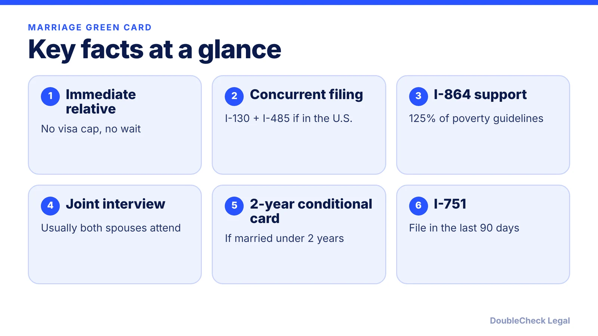
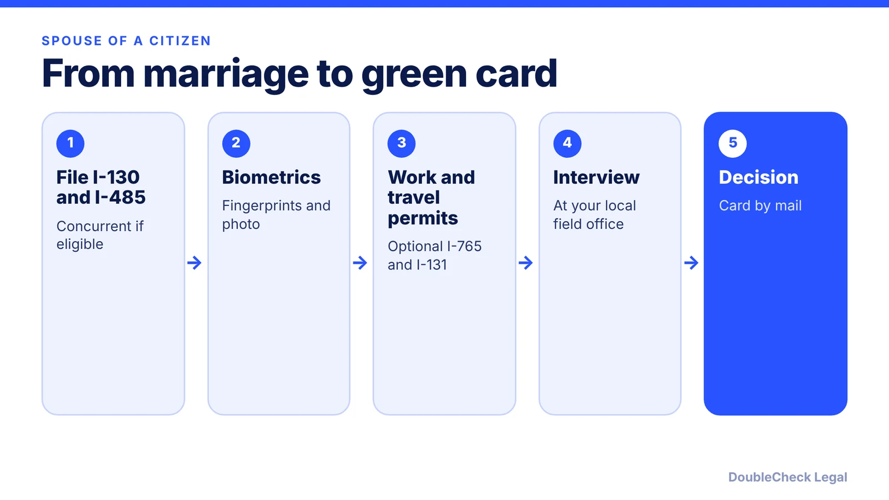

*Married to a U.S. citizen and living in the U.S.? Here is how the filing, interview, and conditional-residence steps fit together, with timelines from published sources.*

**Key takeaways:**

- Spouses of U.S. citizens are immediate relatives: no visa cap and no priority-date wait.
- Spouses in the U.S. can often file the I-130 and I-485 together.
- Evidence should span finances, shared residence, and shared life.
- A marriage under two years old at approval means a 2-year card and an I-751 in the final 90 days.

## 1. The quick answer

**Quick answer:** The spouse of a U.S. citizen is an "immediate relative," so there is no annual visa cap and no priority-date wait (per Manifest and Lighthouse). If the foreign spouse is already in the U.S., the couple can often file Form I-130 and Form I-485 together. Expect biometrics, a joint interview at a USCIS field office, and a decision after that. If the marriage is under two years old when the green card is approved, the card is conditional for two years and the couple files Form I-751 in the 90 days before it expires (per Boundless and Ellis). Published timelines range from under a year to about two years, depending on the source and the field office.

## 2. The process: I-130 and I-485 together

Lighthouse says concurrent filing is available to immediate relatives who are physically in the U.S. and seek adjustment of status. Those abroad use consular processing instead, and applicants who entered without inspection, or who are in removal proceedings, generally cannot file this way (per Lighthouse). If the sponsor is a green card holder rather than a citizen, the spouse falls in category F2A, which depends on the Visa Bulletin (per Boundless); see our guide to [visa bulletin priority dates](/blog/visa-bulletin-explained-priority-dates-eb-categories/).

The package Lighthouse lists: Form I-130 and I-130A, Form I-485, Form I-693 (medical exam by a USCIS-designated civil surgeon), Form I-864 (affidavit of support), and optionally Form I-765 (work permit) and Form I-131 (advance parole). Boundless says the sponsoring spouse must show income of at least 125% of the federal poverty guidelines on the I-864. For what the I-485 involves in general, and travel and work while it is pending, see our guides to the [I-485 adjustment of status](/blog/i-485-adjustment-of-status-guide/) and [advance parole and EAD](/blog/advance-parole-and-ead-while-i-485-pending/).

## 3. Evidence of a real marriage and the interview

USCIS looks closely at whether the marriage is genuine. Boundless and Ellis group useful evidence into three kinds:

- **Financial:** joint bank accounts, shared credit cards, joint tax returns, insurance beneficiary designations, loans.
- **Shared residence:** a joint lease or mortgage, utility bills, mail addressed to both spouses.
- **Shared life:** photos over time, travel records, children's birth certificates, communication logs, and affidavits from people who know the couple.

Ellis emphasizes breadth across categories over sheer volume. Add the marriage certificate and proof of the sponsor's status.

For adjustment cases, Lighthouse says an interview is typically required in spouse cases, both spouses must attend at the local USCIS field office, and you should bring originals of supporting documents, recent tax returns, pay stubs, and passports. Lighthouse puts the receipt notice at 2 to 3 weeks and the decision at 2 to 6 weeks after the interview. If any civil document is in another language, it needs a certified English translation; see [USCIS translation requirements](/blog/uscis-certified-translation-requirements-documents/).

## 4. Timelines and conditional residence (I-751)

Published timelines vary a lot, and USCIS posts live processing times by form and office, so use those for your case. As reported by secondary sources in 2026:

- immi-usa: about 5.8 months, the median USCIS took to decide concurrent I-130 and I-485 cases for U.S. citizen sponsors in FY 2026, and about 12.9 months for an I-130 alone with the beneficiary abroad.
- Lighthouse: roughly 8 to 14 months in total for a concurrent filing, with the interview scheduled 8 to 14 months after filing.
- Boundless: 10 to 20 months for adjustment of status and 12 to 24 months for consular processing for U.S. citizen spouses.

Requests for evidence and background-check delays can add time (per Lighthouse).

**Conditional residence.** Per Boundless, if the marriage is less than two years old when the green card is approved, the card is valid for two years; if it is two years or older, you get a standard 10-year card. For a conditional card, the couple files Form I-751 in the 90 days before the card expires. Ellis says the I-797C receipt notice extends conditional status by 48 months while the I-751 is pending, and typical processing is 12 to 24 months with strong evidence, longer with an RFE or interview. Premium processing is not available for the I-751 (per Ellis).

Later, a green card holder can consider [naturalization](/blog/n-400-naturalization-eligibility-requirements/) or compare [green card vs U.S. citizenship](/blog/green-card-vs-us-citizenship-differences/).

## Where DoubleCheck fits

[DoubleCheck](https://www.contactdoublecheck.com) helps businesses and founders start legal work with AI, verify it, and, when professional advice is warranted, connect with an independent attorney, including for immigration questions. Attorney availability and practice areas vary. Attorneys on DoubleCheck are independent professionals; an attorney-client relationship forms only if an attorney accepts your engagement.

**Sources:** [Boundless: how to apply for a marriage green card](https://www.boundless.com/immigration-resources/how-to-apply-marriage-green-card); [Lighthouse: concurrent I-130 and I-485 filing](https://www.lighthousehq.com/blog/i-130-and-i-485-concurrent-filing); [Ellis: Form I-751](https://www.ellis.com/resources/i-751); [Manifest: marriage green card processing time](https://manifestlaw.com/blog/marriage-green-card-processing-time); [immi-usa: marriage-based green card timeline](https://www.immi-usa.com/immigration/marriage-based-greencard/timeline/).

## FAQ

**Can I file the I-130 and I-485 at the same time?**

Often yes. Lighthouse says immediate relatives physically in the U.S. who are seeking adjustment of status can file concurrently; those abroad use consular processing.

**What evidence proves a bona fide marriage?**

Boundless and Ellis list joint bank accounts and tax returns, a shared lease or utility bills, photos over time, travel records, and affidavits from people who know the couple.

**How long does a marriage-based green card take?**

Sources differ: immi-usa cites a 5.8-month FY 2026 median for concurrent citizen-sponsored cases, Lighthouse says about 8 to 14 months, and Boundless says 10 to 20 months. Check USCIS's current processing times.

**When do I file the I-751 to remove conditions?**

In the 90 days before the two-year conditional card expires, per Ellis and Boundless. The receipt notice extends your status by 48 months while the I-751 is pending, per Ellis.

---

*General information only. This article is not legal, tax, investment, or accounting advice.*
