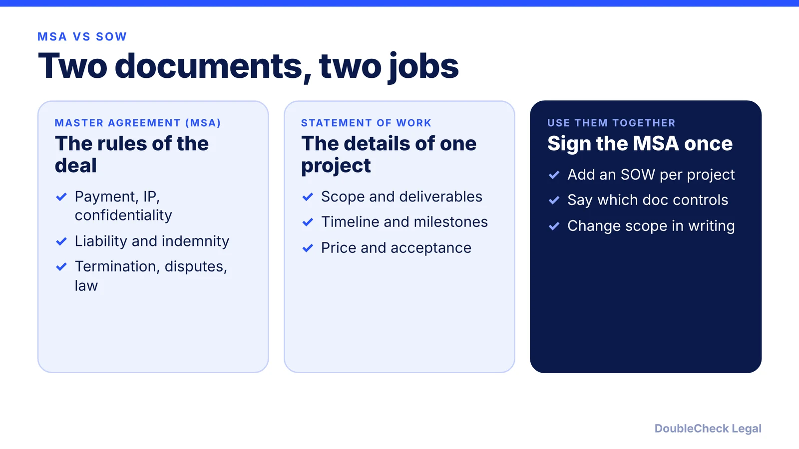
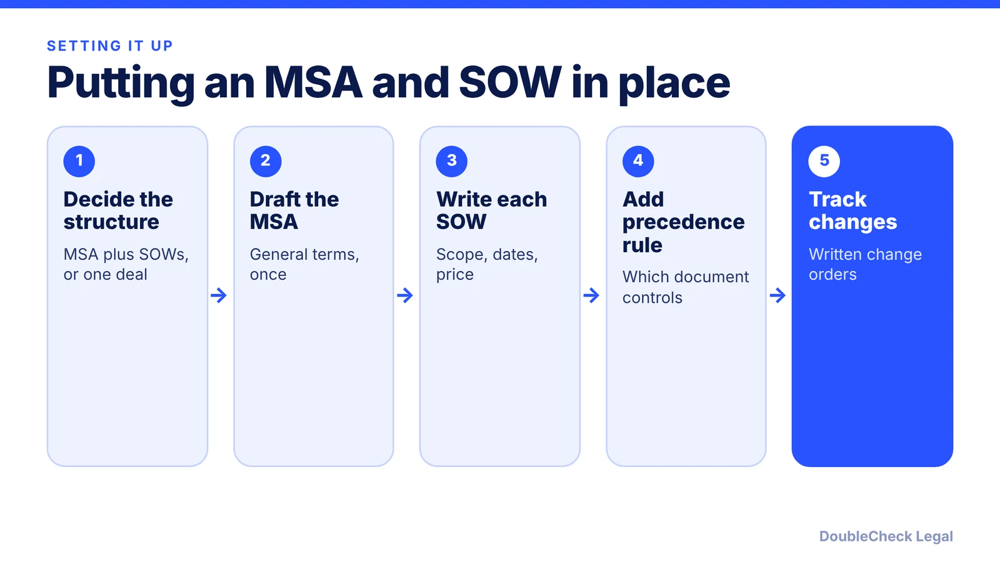

*How an MSA and statement of work divide the job, and what to check before you sign either.*

**Key takeaways:**

- The MSA sets general legal terms once; each SOW covers one project's scope, timeline, and price.
- Add an order of precedence clause so a conflict has a clear answer.
- Handle scope, timeline, and cost changes through written change orders.
- Read the liability cap, IP, acceptance, and termination terms before signing.

## 1. The quick answer

**Quick answer:** A master services agreement (MSA) sets the general legal terms for an ongoing relationship, such as payment, confidentiality, intellectual property, liability, termination, and disputes. A statement of work (SOW) sits underneath it and describes one project: scope, deliverables, timeline, and price. PandaDoc describes the MSA as the framework and the SOW as the project-specific document, and HCR Law says an SOW incorporates the MSA's general terms while the MSA governs the wider relationship.

## 2. What goes in each document

Per the PandaDoc and SpotDraft guides and Hyperstart's review list:

**MSA (signed once, covers many projects)**
- Parties, payment terms and invoicing, and rate cards or general pricing.
- Intellectual property ownership or licensing, and confidentiality.
- Liability limits and indemnification.
- Term, termination, dispute resolution, governing law and jurisdiction.
- Insurance and compliance obligations.

**SOW (one per engagement)**
- Project overview and objectives, tasks, deliverables, and what is out of scope.
- Timeline, milestones, and key dates.
- Roles and responsibilities.
- Cost structure (fixed-price, time-and-materials, or a hybrid) and payment schedule.
- Acceptance criteria and a process for requesting and approving changes.

SpotDraft notes an SOW can usually be ended without ending the MSA, and the signers can differ: authorized company representatives usually sign the MSA, while project managers or department heads often sign SOWs. Decide who at your company has authority to sign each.

For one-off work, an SOW can stand alone, but then it needs the general terms itself. A single freelancer engagement may fit a [freelance contract](/blog/how-to-write-a-freelance-contract/) instead.

## 3. Conflicts, scope creep, and change orders

Most disputes under this structure come from two gaps.

**Which document wins.** Hyperstart says contracts should include an order of precedence clause stating which document prevails in a conflict, usually the MSA unless an SOW explicitly overrides it. Overrides should use clear language such as "Notwithstanding Section X of the MSA," and apply only to that SOW. Neither PandaDoc nor SpotDraft addresses precedence, so do not assume your documents have a rule: read for one.

**Scope changes.** SpotDraft says a well-defined SOW boundary makes change requests easier to manage and helps prevent scope creep. Hyperstart recommends formal change orders for changes in scope, timeline, and cost, plus an internal rule on who can approve SOW changes. HCR Law likewise lists procedures for amending the project and the effect on price and timing as an SOW term.

## 4. Red flags and review

When you are the customer or the vendor, read these first:

- **Liability cap and indemnity** in the MSA. They apply to every SOW.
- **IP ownership.** Does the customer own deliverables on payment, or does the vendor keep them and license them?
- **Payment and acceptance.** What counts as accepted work, and when is each invoice due? See [collecting unpaid invoices](/blog/how-to-collect-unpaid-invoices-small-claims/).
- **Termination.** Hyperstart says active SOWs typically continue under an expired MSA unless the MSA says otherwise, but new SOWs cannot be signed until it is renewed. Check what your document says.
- **Auto-renewal and fee changes** buried in either document.

Our [contract red flags](/blog/contract-red-flags-small-business/) and [vendor contract checklist](/blog/ai-vendor-contract-checklist/) walk through more of these, and if a customer sends you their paper, see [reviewing customer redlines](/blog/review-customer-contract-redlines/). AI can summarize terms and flag unusual clauses quickly. Whether a liability cap or IP clause is acceptable for your business is a judgment call that an independent attorney can help with, particularly for large or long contracts. This is general information, not legal advice.

## Where DoubleCheck fits

[DoubleCheck](https://www.contactdoublecheck.com) helps businesses and founders start legal work with AI, verify it, and, when professional advice is warranted, connect with an independent attorney, including for immigration questions. Attorney availability and practice areas vary. Attorneys on DoubleCheck are independent professionals; an attorney-client relationship forms only if an attorney accepts your engagement.

**Sources:** [PandaDoc: MSA vs SOW](https://www.pandadoc.com/blog/master-services-agreement-vs-statement-of-work/); [SpotDraft](https://www.spotdraft.com/blog/msa-vs-sow); [HCR Law](https://www.hcrlaw.com/news-and-insights/distinguishing-between-a-master-services-agreement-and-a-statement-of-works); [Hyperstart](https://www.hyperstart.com/blog/msa-vs-sow/).

## FAQ

**What is the difference between an MSA and an SOW?**

Per PandaDoc, an MSA establishes the overall relationship and general terms, while an SOW is a project-specific document defining scope, deliverables, timeline, and pricing for one engagement.

**Do I need both an MSA and an SOW?**

Not always. SpotDraft says an SOW is usually created under an existing MSA but can stand alone for one-time or short work. An ongoing relationship with several projects is where an MSA saves repeat negotiation.

**Which document controls if they conflict?**

It depends on the contract's order of precedence clause. Hyperstart says it is usually the MSA unless an SOW explicitly overrides it. Not every contract includes the clause, so check yours.

**Can an SOW end without ending the MSA?**

SpotDraft and Hyperstart both say an individual SOW can usually be terminated without ending the MSA. Confirm the termination terms in your own documents.

---

*General information only. This article is not legal, tax, investment, or accounting advice.*
