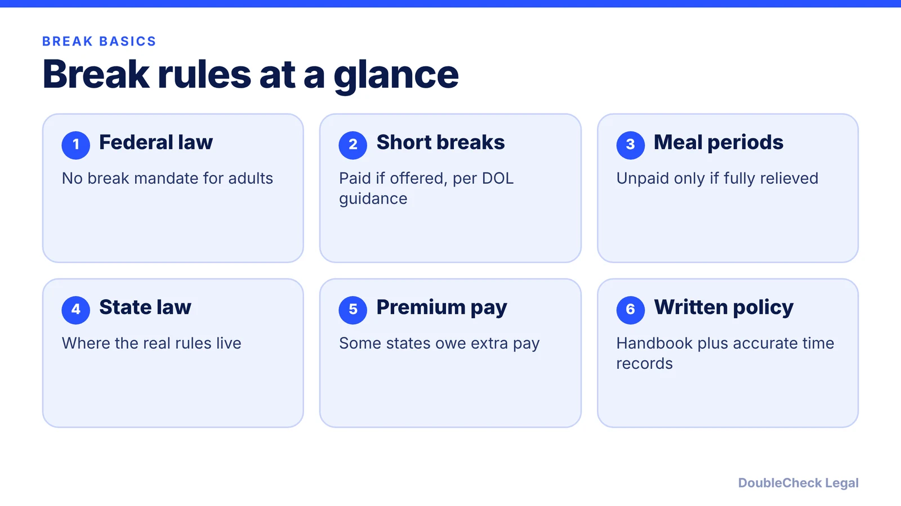
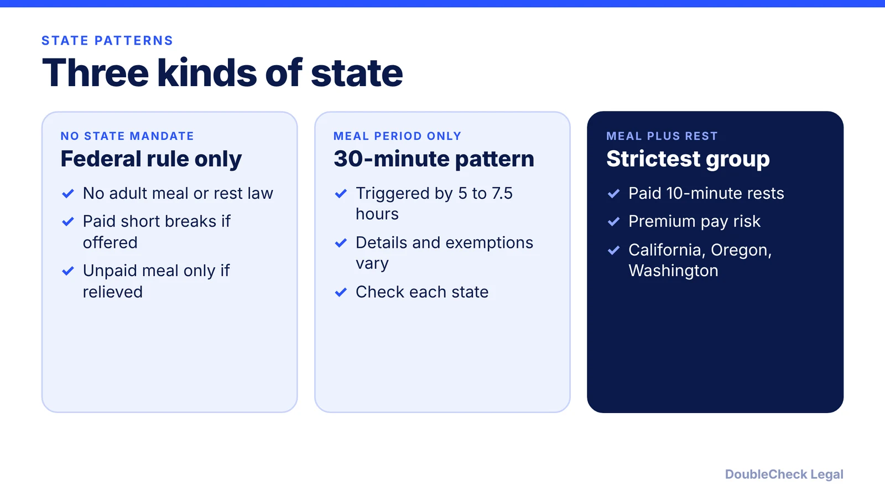

*Meal and rest break laws for small business employers: federal basics, state patterns, premium pay and a checklist, as of November 2026.*

**Key takeaways:**

- Federal law does not require meal or rest breaks for adults, but short breaks you offer are paid and meal periods are unpaid only if employees are fully relieved.
- A minority of states, including California, Colorado, Oregon and Washington, set break rules, and secondary sources differ on details, so verify each state.
- California owes one extra hour of pay for a missed meal period, per its labor agency.
- Write the policy to the strictest state you employ in, and keep time records that match it.

## 1. The quick answer

**Quick answer:** Meal and rest break laws for small business employers come from state law, not federal law. As of November 2026, the federal Fair Labor Standards Act does not require meal or rest breaks for adult workers. If you offer a short break (generally under 20 minutes), it must be paid. A meal period of 30 minutes or more can be unpaid only if the employee is fully relieved of all duties. A number of states, including California, Colorado, Oregon, Washington, Nevada, Kentucky and New York, add their own break rules, and many states add none for adults.

So the practical question is not "what does the law say?" but "which states do my employees work in, and what does each one require?" Sources disagree on a few states, so confirm each state labor department page before you set policy.

## 2. What federal law says (and what it does not)

The federal baseline is narrow. Per the U.S. Department of Labor ([Breaks and Meal Periods](https://www.dol.gov/general/topic/workhours/breaks) and [Fact Sheet #22](https://www.dol.gov/agencies/whd/fact-sheets/22-flsa-hours-worked)):

- Federal law sets no minimum number of meal or rest breaks for adult workers.
- Short rest breaks, roughly 5 to 20 minutes, count as paid hours worked when an employer offers them.
- A bona fide meal period of 30 minutes or more can be unpaid only when the employee is completely relieved of duty.

That last point trips up small employers. If a worker eats at the desk while answering the phone, the time is generally working time, even if your timekeeping system auto-deducts 30 minutes. The break has to be real: free of tasks and, in strict states, free of employer control.

When federal and state rules overlap, the rule that is more favorable to the employee generally controls. Your hours and pay rules also interact with exempt status, so read [overtime exempt vs nonexempt for small business](/blog/overtime-exempt-vs-nonexempt-small-business/) alongside this article. Federal break guidance applies to employees, so classification matters too; see [employee vs independent contractor classification](/blog/employee-vs-independent-contractor-classification-startups/).

## 3. States with meal and rest break requirements

A majority of states have no general adult break mandate, and a minority do. The summary below draws on the state agency pages linked in Sources and the U.S. Department of Labor's table of state meal period rules (which is dated), so verify the current rule with each state labor department before relying on a number.

**States with adult meal and/or rest rules (examples):**

- **California:** per the state Division of Labor Standards Enforcement, a 30-minute meal period is required once a work period exceeds five hours (it must start by the end of the fifth hour), and a second one for shifts over 10 hours. Paid rest breaks are also required under California law; see the DLSE rest period guidance.
- **Colorado:** has meal and paid rest period rules under its Overtime and Minimum Pay Standards (COMPS) Order; confirm current details with the Colorado Department of Labor and Employment.
- **Connecticut:** per the U.S. Department of Labor table, a 30-minute meal for shifts of 7.5 or more consecutive hours, with exemptions.
- **Oregon:** per BOLI, a 30-minute duty-free meal period for work periods of 6 or more hours and a paid 10-minute rest period for each four-hour segment.
- **Washington:** per L&I, a 30-minute meal period for shifts over 5 hours (starting between the second and fifth hour) and a paid 10-minute rest break per four hours.
- **New York:** per the state Department of Labor, meal periods under Labor Law section 162 vary by industry and shift; the law does not require short rest breaks, but those offered (about 5 to 20 minutes) must be paid.
- **Illinois, Kentucky, Maine, Massachusetts:** each has some form of meal period, per the U.S. Department of Labor table.
- **Nevada, New Hampshire, North Dakota, Rhode Island, Tennessee, West Virginia:** meal period or a reasonable opportunity to eat, per the U.S. Department of Labor table; check each state agency for current rules.

Many other states have no general adult meal or rest break requirement, and in those states the federal rule governs; children and minors often have separate rules. Confirm your state with its labor department.

Thresholds (5 hours, 6 hours, 7.5 hours) and break lengths differ, so a single company-wide policy needs to follow the strictest state where you have staff. Some jurisdictions have industry-specific rules as well, and several states differ on details, so check the labor department in each state where you have staff (for example, the Minnesota Department of Labor and Industry).

## 4. Premium pay and the cost of getting it wrong

Some states do not just require breaks, they attach a payment to a missed one.

In California, per the Division of Labor Standards Enforcement, if a required meal period is not provided the employer owes one additional hour of pay at the regular rate for each workday affected. That extra hour does not count as hours worked for overtime. A wage claim generally must be filed within three years of the violation, per the same page. Under [Labor Code section 226.7](https://law.justia.com/codes/california/code-lab/division-2/part-1/chapter-1/article-1/section-226-7), the same additional hour of pay applies when a required rest period is not provided, so a missed meal period and a missed rest break on the same day can each carry a premium.

Other states with strict rules, such as Oregon and Washington, have enforceable break rules, but we are not giving a premium amount for each because the pages we reviewed did not state one uniformly. Dropping an unverified number is safer than guessing.

What triggers liability in practice:

- Meal periods that are interrupted, late, or too short.
- "On-duty" meals without the written agreement some states require. In California, an on-duty meal is allowed only when the job truly prevents relief from duty and both sides agree in writing, per the state page.
- Auto-deducted breaks the employee did not actually take.
- Requiring workers to stay on premises during an unpaid meal, which California says must be paid time.

Break violations often show up inside bigger wage claims alongside overtime and final pay. See [final paycheck laws by state](/blog/final-paycheck-laws-by-state-when-employers-must-pay/) for another place small employers get caught.

## 5. A practical break policy checklist for a small employer

You do not need a 40-page manual. You need a short, accurate policy and records that match it.

1. **List every state where employees work**, including remote staff. See [multi-state remote employees compliance for startups](/blog/multi-state-remote-employees-compliance-startups/).
2. **Pull each state labor department page** and note the hour thresholds, break lengths, and whether rests must be paid.
3. **Write the policy to the strictest state** you employ in, or use state addenda.
4. **Put it in the handbook** and have employees acknowledge it. Our [employee handbook guide](/blog/employee-handbook-small-business-what-to-include/) covers what else belongs there.
5. **Train managers** not to interrupt breaks or ask people to "just answer this one thing."
6. **Fix timekeeping.** Record actual meal start and stop times where your state requires it, and avoid blanket auto-deduct.
7. **Handle exceptions in writing**, for example on-duty meals or waivers where the state allows them.

The same discipline applies when you [hire your first employee](/blog/how-to-hire-first-employee-legal-checklist/): decide your wage-and-hour rules before the first day, not after the first complaint. Employment relationships also depend on state law basics, see [at-will employment by state](/blog/at-will-employment-by-state-exceptions-employers/).

## 6. Using AI to build the policy, and when to involve a lawyer

AI is useful here for drafting a plain-language break policy, building a state-by-state comparison table from the official pages you give it, and turning a policy into a manager checklist. It is weak at remembering which state changed a rule last year, and it can confidently state a threshold that is wrong. Treat every number as a lead to confirm. Our guide on [how to verify an AI-generated legal document](/blog/verify-ai-generated-legal-document/) walks through that check.

Consider a lawyer when:

- You employ people in California, Oregon, Washington or another strict state and have no written break policy.
- You have received a wage claim or demand letter that mentions missed breaks.
- You are unsure whether a role is exempt, or whether on-duty meals are lawful in your industry.
- You are expanding into a new state. See [when to hire a lawyer for a small business](/blog/when-to-hire-lawyer-small-business/).

A short attorney review of the policy and handbook language is usually cheaper than defending a claim.

## Where DoubleCheck fits

[DoubleCheck](https://www.contactdoublecheck.com) helps businesses and founders start legal work with AI, verify it, and, when professional advice is warranted, connect with an independent attorney, including for immigration questions. Attorney availability and practice areas vary. Attorneys on DoubleCheck are independent professionals; an attorney-client relationship forms only if an attorney accepts your engagement.

**Sources:** [U.S. DOL, Breaks and Meal Periods](https://www.dol.gov/general/topic/workhours/breaks); [U.S. DOL, Fact Sheet #22: Hours Worked](https://www.dol.gov/agencies/whd/fact-sheets/22-flsa-hours-worked); [U.S. DOL, Table of Meal Period Requirements Under State Law (2003)](https://www.dol.gov/agencies/whd/state/meal-breaks/2003); [California DIR DLSE, Meal periods FAQ](https://www.dir.ca.gov/dlse/faq_MealPeriods.htm); [Justia, California Labor Code 226.7](https://law.justia.com/codes/california/code-lab/division-2/part-1/chapter-1/article-1/section-226-7); [Oregon BOLI, Meals and breaks](https://www.oregon.gov/boli/workers/pages/meals-and-breaks.aspx); [Washington L&I, Rest breaks, meal periods and schedules](https://www.lni.wa.gov/workers-rights/workplace-policies/rest-breaks-meal-periods-and-schedules); [New York DOL, Meal and rest periods FAQ](https://dol.ny.gov/meal-and-rest-periods-faqs). Also see our [paid sick leave guide](/blog/paid-sick-leave-laws-by-state-small-business-2026/).

## FAQ

**Do small businesses have to give employees breaks?**

Not under federal law, which sets no break requirement for adults. State law may require one, for example California, Colorado, Oregon and Washington, so the answer depends on where your employees work.

**Do employers have to pay for 15-minute breaks?**

Generally yes. Per U.S. Department of Labor guidance, short breaks of roughly 5 to 20 minutes are paid hours worked when an employer offers them.

**Can an employer require employees to work through lunch?**

Only if the time is paid, and some states restrict it. California, for example, allows an on-duty meal only when the job prevents relief from duty and both sides agree in writing, per its labor agency.

**What happens if I miss a required meal break in California?**

Per the California Division of Labor Standards Enforcement, the employer owes one additional hour of pay at the regular rate for each affected workday, and the extra hour does not count toward overtime.

**Is a state break law checklist legal advice?**

No. Break rules change and differ by state and industry, so confirm with the state labor department or an attorney before relying on a summary.

---

*General information only. This article is not legal, tax, investment, or accounting advice.*
