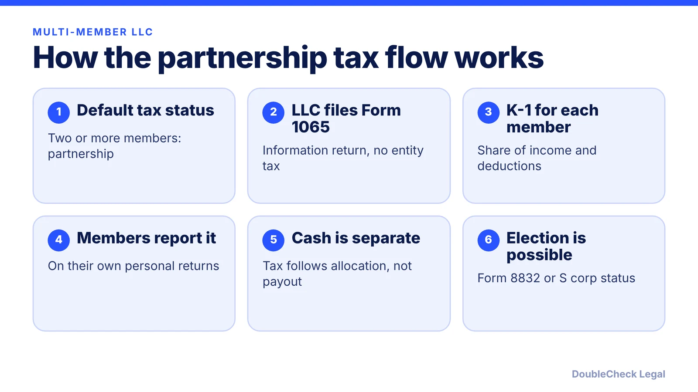
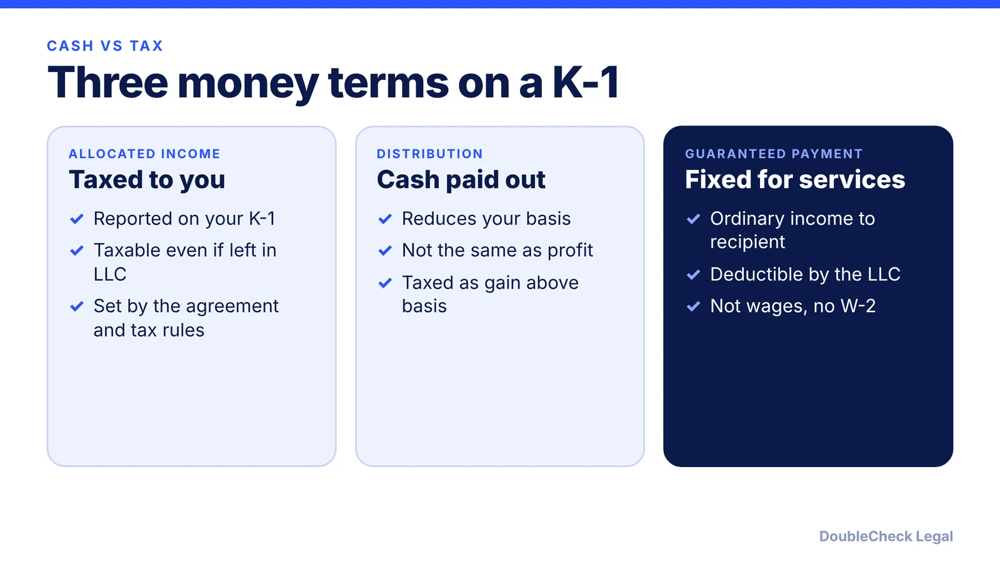

*How a multi-member LLC is taxed as a partnership, what Form 1065 and Schedule K-1 do, and why allocated profit and cash payouts differ, as of November 2026.*

**Key takeaways:**

- By default, an LLC with two or more members is taxed as a partnership and files Form 1065.
- Each member gets a Schedule K-1 and reports a share of income on a personal return.
- K-1 income is taxable as allocated whether or not cash was distributed.
- Late partnership returns are penalized per partner per month; the operating agreement and tax return should match.

## 1. The quick answer

**Quick answer:** Multi-member LLC taxes work like this: by default, the IRS treats an LLC with two or more members as a partnership. The LLC itself does not pay federal income tax. It files a partnership return (Form 1065), gives each member a Schedule K-1 showing that member's share of income, deductions and credits, and each member reports that share on a personal return. Per the IRS Form 1065 instructions, the calendar-year Form 1065 is due March 15, and Form 7004 extends the filing deadline six months to September 15, but per the Form 7004 instructions the extension does not extend the time to pay tax.

The part that surprises new owners is that a K-1 reports your allocated share of profit whether or not the LLC paid you any cash. This post explains the return, the K-1, the cash-versus-tax gap and the decisions that sit upstream of the tax return. For the single-owner version see [single-member LLC taxes and the disregarded entity](/blog/single-member-llc-taxes-disregarded-entity/).

## 2. Partnership return and K-1: what gets filed

The IRS says a domestic LLC with at least two members is classified as a partnership for federal income tax purposes unless it elects otherwise. State law creates the LLC; the IRS decides how it is taxed. Per the IRS, a partnership files Form 1065, an annual information return reporting income, deductions, gains and losses. The partnership does not pay income tax itself; it "passes through" profit or loss to partners.

The IRS also says the partnership must give each partner a copy of Schedule K-1 (Form 1065), and that partners are not employees and should not receive a Form W-2. Each partner reports a share of the partnership's income or loss on a personal return, using forms such as Schedule E and Schedule SE for individuals.

What this means in practice:

- **Form 1065:** one return for the LLC, built from the books for the tax year.
- **Schedule K-1:** one per member, with the member's allocated share. The exact K-1 furnishing deadline is in the Form 1065 instructions, which also describe a penalty for each late Schedule K-1, so ask your preparer which date applies.
- **Matching:** per Carta, the K-1 totals must match Form 1065.
- **Due date:** per the IRS Form 1065 instructions and Block Advisors, the 15th day of the third month after year-end, which is March 15 for a December 31 year, moved to the next business day if it lands on a weekend or holiday.

State returns vary. Some states have their own partnership or LLC filings and fees, which this post does not price. See [California LLC annual tax and fee](/blog/california-llc-annual-tax-and-fee/) for one example of a state-level cost that applies regardless of profit.

**Penalties for being late.** The IRS failure-to-file page shows the penalty is charged per partner, per month or part of a month, for up to 12 months. For returns due after December 31, 2025, the base rate listed is $255 per partner per month; the rate was $245 for returns due in 2025. A four-member LLC that files two months late could face a penalty of $2,040 on that math ($255 x 4 x 2), before any other penalties or relief. A CPA can advise whether relief is available.

## 3. Why you can owe tax on money you never received

A K-1 is not a paycheck. Per IRS Publication 541, a partner's distributive share is determined without regard to distributions, so K-1 income can be taxable as allocated whether or not you receive cash, and distributions are payouts whose tax effect depends on your basis. If the LLC earns $100,000, you own 50% and the LLC keeps the cash to fund growth, your K-1 can show $50,000 of income even though you received nothing. People often call that phantom income.

Key terms, in plain English:

- **Distributive share:** your allocated portion of the LLC's income, loss and deductions, set by the operating agreement and tax rules.
- **Distribution:** cash or property the LLC pays out. Per IRS Publication 541, basis starts with cash and the adjusted basis of property you contribute and falls with distributions (never below zero); basis also rises with allocated income and your share of partnership debt. Gain is generally recognized only when money distributed exceeds your basis, and it is generally capital gain.
- **Guaranteed payment:** a fixed payment for services or capital. Per IRS Publication 541, guaranteed payments are reported as ordinary income by the partner and deducted by the partnership on Form 1065. Per the Tax Adviser (August 2022), guaranteed payments are fixed payments for services and are not eligible for the Section 199A deduction, while distributive share generally is treated as qualified business income.
- **Self-employment tax:** per the IRS, members generally pay self-employment tax on their share of partnership earnings.

A practical consequence is estimated tax. Members who are not on payroll may need to make quarterly estimated payments on their share of profit. See [quarterly estimated taxes for a solo business owner](/blog/quarterly-estimated-taxes-solo-business-owner/) and [self-employment tax for a solo business owner](/blog/self-employment-tax-solo-business-owner-2026/) for the mechanics, which apply to members too.

Many operating agreements address this with a tax distribution clause, which sends members enough cash to cover tax on their allocated income. That is a drafting choice, not a default. See [LLC operating agreement with AI](/blog/llc-operating-agreement-with-ai/) and [startup LLC operating agreement clauses](/blog/startup-llc-operating-agreement-clauses-investors-vesting-and-conversion/).

## 4. Decisions that change the tax picture

The default is not the only option. The IRS says a multi-member LLC can file Form 8832 to be taxed as a corporation, and can also elect S corporation treatment with Form 2553. Per the IRS, a corporation files Form 1120 and an S corporation files Form 1120-S, which also issues K-1s to owners. After an election, the IRS says the LLC generally cannot change again for 60 months. Because that lock-in is a major reason to get advice first, see [S corp election Form 2553 deadline](/blog/s-corp-election-form-2553-deadline/), [S corp reasonable compensation](/blog/s-corp-reasonable-compensation-owner-salary-rules/) and [LLC vs C corp for startups](/blog/llc-vs-c-corp-startups/).

Other points to settle early:

- **Adding or removing a member.** A new member changes allocations and the K-1s. See [how to add a member to an LLC](/blog/how-to-add-a-member-to-an-llc/).
- **Partner-level agreements.** Profit splits, capital contributions and buyouts belong in writing. See [how to write a partnership agreement](/blog/how-to-write-a-partnership-agreement/) and [how co-founders split equity](/blog/how-co-founders-split-equity-data/).
- **Foreign owners.** A foreign-owned LLC has separate rules; see [Form 5472 for foreign-owned single-member LLCs](/blog/form-5472-foreign-owned-single-member-llc/) and [foreign founder US taxes](/blog/foreign-founder-us-taxes-substantial-presence-test/).
- **Spouses.** Per the IRS, a married couple wholly owning an entity as community property may treat it as a partnership or a disregarded entity. Whether that fits depends on the state and facts, so ask a CPA.

Who decides allocations matters too. A partnership allocation that does not match the agreement or has no economic basis can create disputes later, so the agreement and the return should tell the same story.

## 5. Who should handle what

**You can reasonably do:**

- Keep clean books, separate from personal spending, with a running record of each member's contributions and distributions.
- Gather the documents a preparer asks for: formation papers, the operating agreement, bank statements, prior returns and EIN letter.
- Decide the cash plan with your co-owners: how much stays in the business, and whether to send tax distributions.

**Ask a CPA to handle:**

- Preparing Form 1065 and the K-1s, plus state filings.
- Tracking each member's basis and capital account.
- Deciding whether an election such as an S corporation fits, and when to file it.
- Estimated tax planning for members.

**Ask a business attorney to verify:**

- That the operating agreement's allocation, distribution and buyout terms match what the owners intend and what the CPA will report.
- Any change in members, a transfer of interest or a conversion to a corporation.

You can start with AI to summarize an operating agreement or list the questions to ask your preparer, but the tax conclusion and the legal drafting should be verified by a professional. See [do I need a lawyer to start an LLC](/blog/do-i-need-a-lawyer-to-start-an-llc-diy-ai-or-attorney/) and [the startup LLC complete guide](/blog/startup-llc-complete-guide-formation-taxes-operating-agreement-and-conversion/). As of November 2026, confirm current IRS due dates and penalty amounts on irs.gov each year, because they are indexed or adjusted.

## Where DoubleCheck fits

[DoubleCheck](https://www.contactdoublecheck.com) helps businesses and founders start legal work with AI, verify it, and, when professional advice is warranted, connect with an independent attorney, including for immigration questions. Attorney availability and practice areas vary. Attorneys on DoubleCheck are independent professionals; an attorney-client relationship forms only if an attorney accepts your engagement.

**Sources:** [IRS, LLC filing as a corporation or partnership](https://www.irs.gov/node/5184); [IRS, Partnerships](https://www.irs.gov/businesses/partnerships); [IRS, Publication 3402](https://www.irs.gov/publications/p3402); [IRS, Failure to file penalty](https://www.irs.gov/payments/failure-to-file-penalty); [IRS, Instructions for Form 1065](https://www.irs.gov/pub/irs-pdf/i1065.pdf); [IRS, Instructions for Form 7004](https://www.irs.gov/pub/irs-pdf/i7004.pdf); [IRS, Publication 541, Partnerships](https://www.irs.gov/publications/p541); [Block Advisors, Form 1065](https://www.blockadvisors.com/resource-center/small-business-tax-prep/form-1065/amp/); [The Tax Adviser, Guaranteed payments vs distributive share (Aug. 2022)](https://www.thetaxadviser.com/issues/2022/aug/guaranteed-payments-vs-distributive-share-of-income/). Not fetched: Gusto K-1 page (failed to load); the IRS Form 1065 instructions were not retrieved, so the K-1 furnishing deadline is not stated here.

## FAQ

**How is a multi-member LLC taxed?**

Per the IRS, a domestic LLC with at least two members is classified as a partnership for federal income tax purposes by default. It files Form 1065, issues Schedule K-1 to each member, and members report their shares on personal returns. The LLC can elect corporate or S corporation treatment instead.

**When is the partnership return due?**

Per the IRS Form 1065 instructions and Block Advisors, a calendar-year Form 1065 is due March 15, or the next business day, and Form 7004 extends the filing deadline six months to September 15. Per the Form 7004 instructions, the extension does not extend the time to pay tax.

**Do I owe tax on my K-1 if I did not receive cash?**

Yes, it can happen. Per IRS Publication 541, a partner's distributive share is determined without regard to distributions, so your allocated K-1 income can be taxable whether or not you receive cash. A CPA can help plan distributions and estimated payments to cover the tax.

**What is the penalty for filing Form 1065 late?**

Per the IRS, the penalty is charged per partner for each month or part of a month the return is late, up to 12 months. For returns due after December 31, 2025, the base rate listed is $255 per partner per month. Confirm current figures on irs.gov.

**Does a multi-member LLC need an operating agreement?**

Many states do not require one, but it sets profit splits, distributions, voting and buyouts, and it should match what is reported on the K-1s. Ask an attorney to verify the draft.

---

*General information only. This article is not legal, tax, investment, or accounting advice.*
