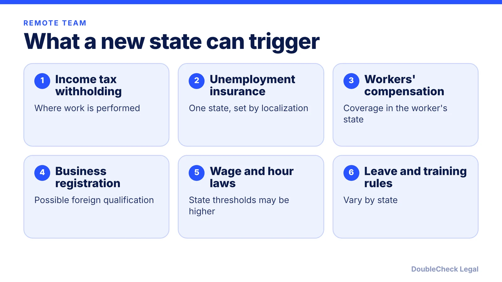
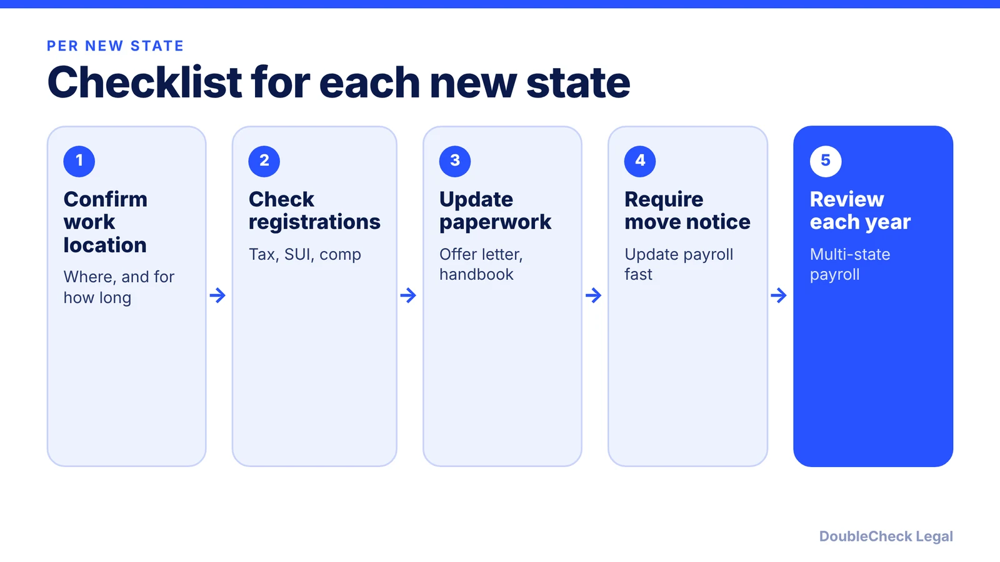

*One remote hire in a new state can bring that state's tax, insurance, and employment rules with it.*

**Key takeaways:**

- Income tax withholding generally follows where the work is performed (KPM).
- Unemployment insurance follows localization rules and usually goes to one state per employee.
- Overtime, vacation pay, and harassment-training rules differ by state; verify each one.
- Document where people work and require notice before they move.

## 1. The quick answer

**Quick answer:** When an employee works remotely from another state, that state's rules generally follow the worker. Per [KPM](https://www.kpmcpa.com/hiring-remote-employees-in-other-states-tax-rules/), income tax withholding generally follows where the work is performed, and you may need a state withholding account, state unemployment insurance (SUI) registration, and workers' compensation coverage there. State wage-and-hour, leave, and harassment-training laws can also apply. Check each new state before the first day of work, not after the first paycheck.

## 2. Tax withholding and unemployment insurance

**Withholding.** Per KPM, employers generally withhold based on where the employee performs the work, not where the employer sits. Its example: a Texas employer with a Colorado remote employee may need Colorado withholding. If an employee moves, withholding changes should begin on the date they start working in the new state. Some state pairs have reciprocity agreements that let an employee pay tax only to the home state, usually with paperwork given to the employer; these exist only between certain states, so confirm one applies. Wolters Kluwer also warns that double taxation can occur.

**Registration.** You may need a state withholding account, periodic returns, remittance of withheld tax, and state W-2 filings (KPM). Wolters Kluwer adds that you may need to qualify your corporation or LLC to do business in the employee's state, which can mean a registered agent and annual reports. See [registering for state payroll taxes](/blog/register-for-state-payroll-taxes-new-employer/).

**Unemployment insurance.** Per KPM, SUI follows "localization of work" rules rather than the withholding rules, in this order: where most services are performed, base of operations, place of direction and control, then the employee's state of residence. SUI is typically paid to only one state per employee. Do not assume it matches the withholding state.

**New-hire reporting.** Report each hire to the state where the employee works; per [Bernstein Shur](https://bipc.com/hiring-your-team-initial-steps-new-employers-must-take), multistate employers can use a multistate form to file in one state.

## 3. Employment law that changes by state

Federal law sets a floor. States often add to it, and a remote hire puts you under the employee's state law:

- **Overtime thresholds:** the federal salary level is $684 per week as of November 2026, but state and local laws can set higher thresholds, per [JD Supra](https://www.jdsupra.com/legalnews/status-quo-dol-final-rule-keeps-9356944/). See [exempt vs. nonexempt](/blog/overtime-exempt-vs-nonexempt-small-business/).
- **Vacation pay:** California bars use-it-or-lose-it policies and requires payout of earned, unused vacation; New York permits forfeiture with advance notice but requires payout if no written policy says otherwise, per [Paycor](https://www.paycor.com/resource-center/articles/pto-payout-laws-by-state/). See [PTO and vacation pay laws](/blog/pto-vacation-pay-laws-small-business/).
- **Harassment training:** California covers employers with five or more employees, including those working outside California ([CalChamber](https://www.calchamber.com/california-labor-law/harassment-training)). New York requires annual training for all employees, including remote ones ([NFIB](https://www.nfib.com/news/news/reminder-new-york-state-mandated-sexual-harassment-prevention-training-is-required-every-year/)). Illinois covers out-of-state employees who regularly interact with Illinois employees ([Taft](https://www.taftlaw.com/news-events/law-bulletins/illinois-department-of-human-rights-releases-model-sexual-harassment-training-and-guidance/)). See [harassment policy requirements](/blog/workplace-harassment-policy-requirements-small-business/).
- **Workers' compensation:** most states require coverage and differ on what counts as work-related, per Wolters Kluwer. See [workers' compensation requirements](/blog/workers-compensation-insurance-requirements-startups/).

Worker classification is state-specific too; working from home does not by itself make someone a contractor (Wolters Kluwer). Review [employee vs. contractor classification](/blog/employee-vs-independent-contractor-classification-startups/).

## 4. A repeatable process for each new state

Treat every new state as a mini-launch. KPM's best practices translate into a checklist:

1. **Ask before hiring:** where will the person actually work, and for how long?
2. **Check registrations:** withholding, SUI, workers' compensation, and business registration.
3. **Update the paperwork:** the offer letter and handbook should reflect the state; Wolters Kluwer recommends documenting remote arrangements in offer letters and contracts. Use state-specific handbook addenda ([handbook contents](/blog/employee-handbook-small-business-what-to-include/)).
4. **Require relocation notice,** and update payroll promptly when someone moves.
5. **Review annually:** KPM suggests periodic reviews of multi-state payroll setups.

Hybrid workers who split time between states make this harder, so track locations (Wolters Kluwer). For workers outside the U.S., the analysis is different; see [hiring international employees: EOR vs. contractor vs. sponsorship](/blog/hire-international-employees-remote-eor-vs-contractor-vs-sponsorship/). If you are still setting up your company, [how to incorporate in the US](/blog/how-to-incorporate-a-company-in-the-us/) is the starting point, and the [first-employee checklist](/blog/how-to-hire-first-employee-legal-checklist/) covers the basics.

## Where DoubleCheck fits

[DoubleCheck](https://www.contactdoublecheck.com) helps businesses and founders start legal work with AI, verify it, and, when professional advice is warranted, connect with an independent attorney, including for immigration questions. Attorney availability and practice areas vary. Attorneys on DoubleCheck are independent professionals; an attorney-client relationship forms only if an attorney accepts your engagement.

**Sources:** [KPM, Hiring Remote Employees in Other States](https://www.kpmcpa.com/hiring-remote-employees-in-other-states-tax-rules/); [Wolters Kluwer, Compliance Considerations for Remote Employees](https://wolterskluwer.com/en/expert-insights/6-compliance-considerations-for-remote-employees); [Bernstein Shur](https://bipc.com/hiring-your-team-initial-steps-new-employers-must-take); [Paycor](https://www.paycor.com/resource-center/articles/pto-payout-laws-by-state/); [JD Supra](https://www.jdsupra.com/legalnews/status-quo-dol-final-rule-keeps-9356944/); [CalChamber](https://www.calchamber.com/california-labor-law/harassment-training); [NFIB](https://www.nfib.com/news/news/reminder-new-york-state-mandated-sexual-harassment-prevention-training-is-required-every-year/); [Taft](https://www.taftlaw.com/news-events/law-bulletins/illinois-department-of-human-rights-releases-model-sexual-harassment-training-and-guidance/).

## FAQ

**Do I have to withhold taxes for the state where my remote employee lives?**

Generally you withhold for the state where the work is performed, per KPM, though reciprocity agreements between some states can change that. Confirm with the state revenue agency.

**Which state gets unemployment insurance for a remote employee?**

Per KPM, SUI follows localization of work: where most services are performed, then base of operations, place of direction and control, and finally the employee's state of residence. It is typically paid to one state.

**Does my company need to register in the employee's state?**

Possibly. Wolters Kluwer notes you may need to qualify your corporation or LLC in the employee's state, which can require a registered agent and annual reports. Requirements vary by state.

**Do state harassment-training laws apply to remote workers?**

They can. New York requires annual training for all employees including remote ones (NFIB), and California's rule counts employees outside California toward the five-employee threshold (CalChamber).

---

*General information only. This article is not legal, tax, investment, or accounting advice.*
