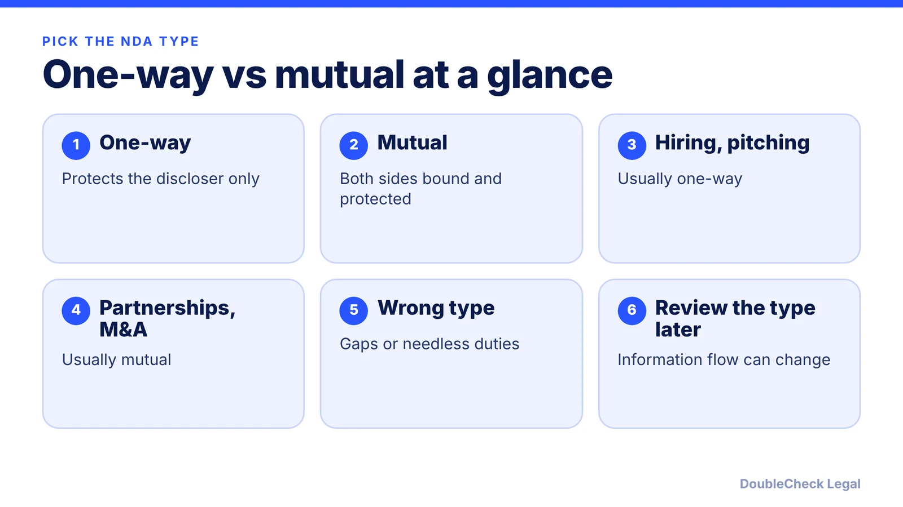
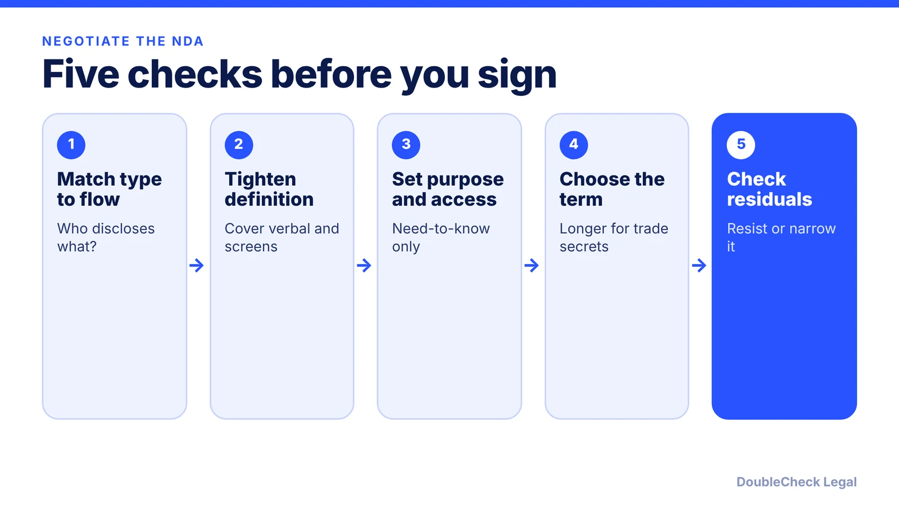

*How to choose between a one-way and a mutual NDA, and which clauses to negotiate, as of November 2026.*

**Key takeaways:**

- Choose by direction of disclosure: one-way if only you share, mutual if both sides do.
- A mutual NDA is not automatically fair; check term, remedies and affiliate sharing.
- Match the term to the information: trade secrets may warrant longer or indefinite protection (ContractSafe).
- Watch residuals clauses and get an attorney to review when information flows both ways or trade secrets are involved.

## 1. The quick answer

**Quick answer:** Pick the NDA type by the direction information will flow. A one-way (unilateral) NDA protects only the party that discloses; the other side takes on the duties. A mutual NDA protects both sides because each one agrees to protect what the other shares. Per ContractSafe, one-way fits things like hiring, most consulting, investor pitches and vendor access to your data, while mutual fits partnership talks, M&A diligence and cases where both sides share sensitive information. Per Mondaq, use a mutual NDA only for true two-way disclosure; otherwise you add obligations for your own company that nobody needed.

## 2. Who each type protects and when to use which

This article is about choosing and negotiating the type. For drafting from scratch see [how to write an NDA for a startup](/blog/how-to-write-an-nda-startups/), and for an NDA someone sent you see [how to review an NDA you received](/blog/review-nda-you-received/).

**One-way (unilateral).** Per [Loio](https://loio.com/guides/mutual-vs-unilateral-nda/), it fits when only your business shares sensitive information, for example when pitching an idea, sharing internal workflows or hiring freelancers. Per [ContractSafe](https://www.contractsafe.com/blog/mutual-vs-one-way-nda), it protects only the disclosing party.

**Mutual (bilateral).** Per Loio, it fits partnerships, integrations, joint ventures and negotiations where both sides share data. Per [Mondaq](https://www.mondaq.com/unitedstates/trade-secrets/1749242/one-way-nda-vs-mutual-nda-for-life-sciences-and-other-technology-companies-a-founders-decision-guide), research collaborations and licensing talks are typical examples.

**Rules of thumb:**

- Decide from the direction of disclosure, not from who has more bargaining power (ContractSafe).
- If you are the only one sharing, a one-way NDA in your favor is usually enough. Offering a mutual NDA when you are the only discloser adds duties for you.
- If you will receive the other side's confidential material as well, mutual is usually the honest fit.
- A mutual NDA is not automatically balanced. Per Loio, one party may still draft it in its own favor, so check survival periods, remedies and who may share with affiliates.
- M&A NDAs are usually mutual, but per Loio an early one-way NDA can be used when only the seller shares a teaser or limited financials.

If your counterparty is a contractor, the NDA often sits inside a bigger paper trail. See [confidentiality and IP assignment agreements](/blog/confidentiality-ip-assignment-agreements-startups/) for how the two fit together.

## 3. Clauses to negotiate: term, carve-outs, trade secrets, residuals

Whichever type you choose, these clauses decide how much protection you really get.

**Definition of confidential information.** Per ContractSafe, specific definitions are easier to enforce than broad ones like "all information shared between the parties." Per Mondaq, the definition should cover verbal and on-screen disclosures, not only documents.

**Purpose and access limits.** Per Mondaq, a tight permitted purpose limits competitive use, and need-to-know limits reduce leakage. Watch affiliate and third-party sharing rights.

**Standard carve-outs.** Per ContractSafe, information that is public, independently developed, or received from a third party without restriction is usually excluded.

**Term.** Per ContractSafe, trade secrets may warrant indefinite protection because their value depends on staying secret. An NDA that lapses while the other side still holds your data leaves a gap, so match the term to the information.

**Trade secrets.** Once a trade secret is public it loses legal protection (Loio). Keep trade secret material out of decks, and see [trade secret protection for small businesses](/blog/trade-secret-protection-small-business-startups/). If the counterparty is an employee, contractor or consultant, the Defend Trade Secrets Act has a notice rule: per Katten, contracts with them that govern confidential information must include a whistleblower immunity notice (or cross-reference a policy that has it), or the company may lose the right to exemplary damages and attorney fees against that individual.

**Residuals clause.** Per [Venable](https://www.venable.com/insights/publications/2018/11/residual-clauses-in-an-nda-for-ma-transactions), a residuals clause shields the receiving party from liability for using information retained in the unaided memory of its people. Venable lists risks for the discloser: vague scope, a heavier burden of proof if you sue, and competitive use. Ways to limit it include resisting it, narrowing it to general knowledge for internal use, excluding intentional memorization, disclaiming any license to your IP, and barring competing development.

## 4. Common mistakes and when to get an attorney

**Common mistakes** (per ContractSafe and Mondaq):

- Using a one-way NDA for a two-way exchange, which leaves one side unprotected, or a mutual NDA for a one-way disclosure.
- Signing a generic template whose definition and term do not match what is actually shared.
- A "mutual" NDA with mismatched survival periods or one-sided remedies.
- Conflicting duplicate NDAs, since many master service agreements already contain confidentiality clauses.
- Not revisiting the type when information starts flowing the other way. ContractSafe suggests signing a replacement NDA before new sensitive disclosures begin.
- In investor pitches, sharing the trade secret itself rather than describing results, or treating one fund partner's NDA as covering the whole firm (ContractSafe).

**When you can handle it yourself.** A short, low-stakes exchange, such as a first call with a freelancer or a beta tester, where you are the only discloser and the paper is a plain one-way NDA with standard carve-outs.

**When to get an attorney to look at it:**

- You will exchange technical or financial information in both directions.
- The other side's paper includes a residuals clause, a very long or perpetual term, or a broad "purpose".
- Trade secrets, source code or patent timing are involved. Per Loio, an NDA is only a short-term safeguard for patents and does not replace filing.
- The counterparty is a competitor, an acquirer or a much larger company.

This is general information, not legal advice. Related reading: [uploading contracts to ChatGPT and confidentiality](/blog/uploading-contracts-to-chatgpt-confidentiality/) and [how to find a startup lawyer in San Francisco](/blog/find-startup-lawyer-san-francisco/).

## Where DoubleCheck fits

[DoubleCheck](https://www.contactdoublecheck.com) helps businesses and founders start legal work with AI, verify it, and, when professional advice is warranted, connect with an independent attorney, including for immigration questions. Attorney availability and practice areas vary. Attorneys on DoubleCheck are independent professionals; an attorney-client relationship forms only if an attorney accepts your engagement.

**Sources:** [ContractSafe: mutual vs one-way NDA](https://www.contractsafe.com/blog/mutual-vs-one-way-nda); [Mondaq: one-way vs mutual NDA for founders](https://www.mondaq.com/unitedstates/trade-secrets/1749242/one-way-nda-vs-mutual-nda-for-life-sciences-and-other-technology-companies-a-founders-decision-guide); [Loio: mutual vs unilateral NDA](https://loio.com/guides/mutual-vs-unilateral-nda/); [Venable on residuals clauses](https://www.venable.com/insights/publications/2018/11/residual-clauses-in-an-nda-for-ma-transactions); [Katten on the DTSA notice provision](https://katten.com/The-Notice-Provision-of-the-Defend-Trade-Secrets-Act).

## FAQ

**What is the difference between a mutual and a one-way NDA?**

Per ContractSafe, a one-way NDA protects only the disclosing party, while a mutual NDA protects both because each side agrees to protect what the other shares.

**Should a startup use a mutual NDA with investors?**

Per ContractSafe, investor pitches usually fit a one-way NDA. It also warns against sharing the trade secret itself in a deck or assuming one partner's NDA covers the whole fund.

**How long should an NDA last?**

Per ContractSafe, trade secrets may warrant indefinite protection. Per Loio, match the duration to the type of information.

**What is a residuals clause in an NDA?**

Per Venable, it shields the receiving party from liability for using information kept in the unaided memory of its people. It can be risky for the discloser, so many resist or narrow it.

---

*General information only. This article is not legal, tax, investment, or accounting advice.*
