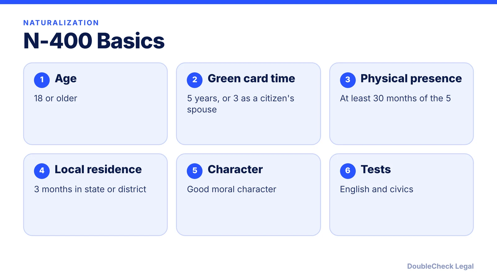
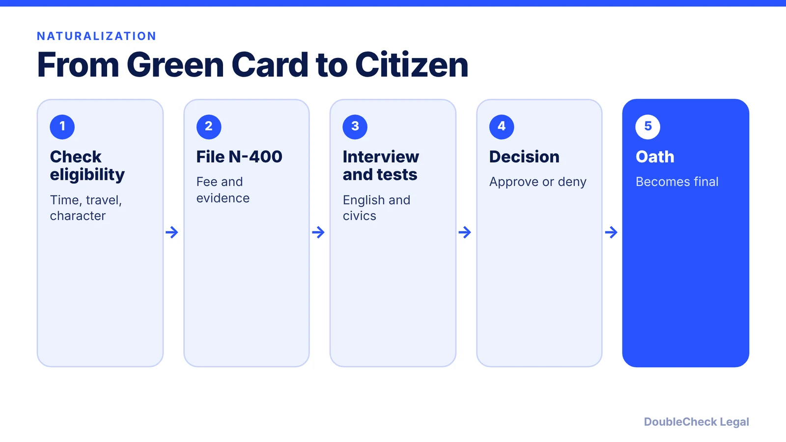

*Ready to become a citizen? Here are the N-400 rules on time, travel, tests, and fees, plus what changed in 2025.*

**Key takeaways:**

- Most applicants need five years as a green card holder; three if married to a U.S. citizen, per the Policy Manual.
- You need at least 30 months of physical presence out of the five years.
- An absence over six months but under a year is presumed to break continuous residence.
- Filers on or after October 20, 2025 take the 2025 civics test.

## 1. The quick answer

**Quick answer:** To naturalize, USCIS's Policy Manual says you generally must be 18 or older, a green card holder for five years (three if married to and living with a U.S. citizen spouse), have continuous residence for five years, be physically present at least 30 months of those five years, live three months in your state or USCIS district before filing, show good moral character, and pass English and civics tests. Applicants who file on or after October 20, 2025 take the 2025 civics test.

## 2. Travel and continuous residence

The Policy Manual says an absence of more than six months but less than a year is presumed to break continuous residence (the presumption can be rebutted), and an absence of one year or more breaks it unless you had an approved N-470. After a break on the five-year path, you can apply after four years and six months back with no presumption, or after four years and one day if you can rebut it. The three-year path requires being married to and in marital union with the citizen for the three years before filing, and the spouse must remain a citizen through the oath.

## 3. The 2025 civics test and interviews

Switchboard says applicants who file on or after October 20, 2025 take the 2025 test: a 128-question bank, 20 questions asked, and 12 correct to pass, while earlier filers take the 2008 test. English reading, writing, and speaking are unchanged. USCIS says if you fail English or civics you can retest between 60 and 90 days after the first interview, with two chances. AILA posted a policy memo (August 2025) resuming neighborhood investigations, covering home and workplace area and at least five years before filing.

## 4. Fees and timing

Citizenpath lists the fee at $710 online or $760 on paper as of September 2026, with a reduced $380 fee by mail only for household income below 400% of the federal poverty guidelines, and fee waivers on Form I-912. Citizenpath also says a $570 increase was reported as proposed in June 2026, so check the live fee. VisaVerge reports about 813,000 pending N-400s in August 2026, an average of 12.7 months and a median of 9.5 months in the April to June quarter. Compare with other paths: [EB-1A](/blog/eb-1a-vs-o-1-founder-which-path/), [PERM](/blog/perm-labor-certification-green-card-process/), [finding an immigration lawyer](/blog/how-to-find-good-immigration-lawyer-startup-founder/).

## Where DoubleCheck fits

[DoubleCheck](https://www.contactdoublecheck.com) helps businesses and founders start legal work with AI, verify it, and, when professional advice is warranted, connect with an independent attorney, including for immigration questions. Attorney availability and practice areas vary. Attorneys on DoubleCheck are independent professionals; an attorney-client relationship forms only if an attorney accepts your engagement.

**Sources:** [USCIS Policy Manual Vol. 12, Part D, Ch. 1](https://www.uscis.gov/policy-manual/volume-12-part-d-chapter-1); [Ch. 3](https://www.uscis.gov/policy-manual/volume-12-part-d-chapter-3); [Vol. 12, Part G, Ch. 2](https://www.uscis.gov/policy-manual/volume-12-part-g-chapter-2); [USCIS naturalization FAQ](https://www.uscis.gov/citizenship/learn-about-citizenship/commonly-asked-questions-about-the-naturalization-process); [Switchboard](https://www.switchboardta.org/2025-changes-to-the-naturalization-civics-test-what-service-providers-need-to-know/); [AILA](https://www.aila.org/library/uscis-policy-memorandum-on-resuming-personal-investigations-of-naturalization-applicants); [CitizenPath](https://citizenpath.com/cost-of-citizenship/); [VisaVerge](https://www.visaverge.com/immigration/uscis-n-400-naturalization-backlog-tops-813000-as-processing-time-reaches-127-months/).

## FAQ

**How long must I be a green card holder to apply for citizenship?**

Generally five years, or three if you have been married to and living with a U.S. citizen for three years, per the Policy Manual.

**Do trips abroad affect naturalization?**

Yes. The Policy Manual says absences over six months but under a year are presumed to break continuous residence, and a year or more breaks it unless an N-470 was approved.

**What is on the new civics test?**

Switchboard says the 2025 test has a 128-question bank; 20 are asked and 12 correct answers pass.

**How much does the N-400 cost?**

Citizenpath lists $710 online and $760 on paper as of September 2026, with reduced fees and waivers for some. Confirm on USCIS.

---

*General information only. This article is not legal, tax, investment, or accounting advice.*
