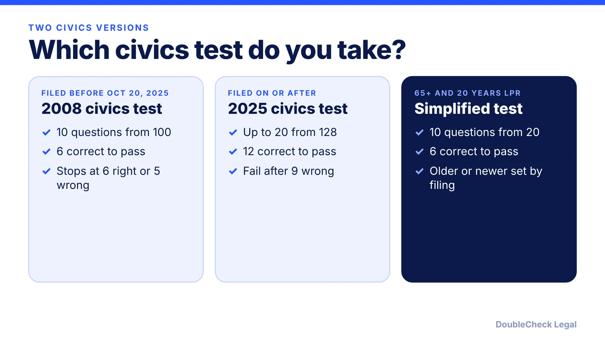
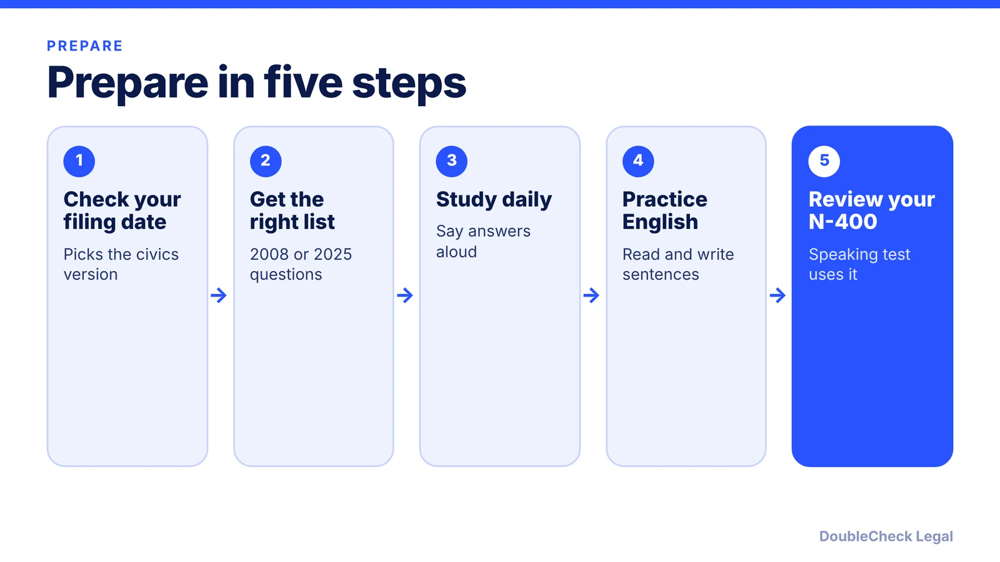

*What the N-400 civics and English tests look like and which version applies, as of November 2026.*

**Key takeaways:**

- Filing date decides the civics version: N-400s filed on or after October 20, 2025 get the 2025 test.
- The 2025 test asks up to 20 of 128 questions and needs 12 correct; the 2008 test is 10 of 100 and needs 6.
- The English test covers speaking, reading one sentence and writing one sentence.
- Age exceptions (50/20, 55/15, 65/20) and the N-648 disability waiver can change what you take.

## 1. The quick answer

**Quick answer:** At the N-400 interview you take an English test (speaking, reading, writing) and a civics test. As of November 2026, which civics version you get depends on when you filed. Per the Federal Register notice of September 18, 2025, applicants who file Form N-400 on or after October 20, 2025 take the 2025 test: up to 20 questions from a bank of 128, with 12 correct answers needed to pass. Applicants who filed earlier take the 2008 test, which USCIS describes as 10 questions from 100, passing at 6 correct. Age and disability exceptions exist, including 50/20, 55/15, 65/20 and Form N-648.

## 2. The civics test: 2025 version, 2008 version, and which applies

**Which version applies.** Per the [Federal Register notice](https://www.federalregister.gov/documents/2025/09/18/2025-18050/notice-of-implementation-of-2025-naturalization-civics-test) (published September 18, 2025), the 2008 test applies to applicants who had already filed or who filed less than 30 days after publication, and the 2025 test applies to those who file 30 or more days after publication. The [New Americans Campaign](https://www.newamericanscampaign.org/new-naturalization-civics-test-effective-10-20-25/) and [DLG Visa](https://dlgvisa.com/blog/new-us-citizenship-civics-test-effective-october-20-2025) both put the cutoff at N-400 filings on or after October 20, 2025. Some 2026 web pages still describe only the 2008 test, so check the date on whatever study material you use, and check your own filing date.

**2025 test format (per the Federal Register notice).**

- 128 possible questions; the officer randomly selects 20 for each test, and USCIS publishes the bank and answers.
- The officer asks questions until you pass or fail, up to 20.
- You pass with 12 correct answers and fail after 9 incorrect ones.

**2008 test format.** Per [USCIS Policy Manual Chapter 2](https://uscis.gov/es/node/73873), the standard test is 10 randomly selected questions from a list of 100. You pass with 6 correct answers and fail with 5 incorrect or unanswered.

**Retakes.** Per the same USCIS chapter, you get two chances: the initial exam and a re-exam, scheduled 60 to 90 days later, which retests only the failed portion. Failing a portion twice leads to denial.

The format has changed before and could again. If you are unsure which test you will get, your interview notice and the USCIS citizenship resource pages are the reference points; a pending case filed in 2025 or earlier is the usual place for confusion.

## 3. The English test and the exceptions

**The three English skills.** Per [USCIS Policy Manual Chapter 2](https://uscis.gov/es/node/73873):

- **Speaking:** you pass if you generally understand and meaningfully answer questions about your eligibility. The officer can repeat or rephrase.
- **Reading:** you read one of three sentences aloud. Skipping or substituting a content word, long pauses, or mispronunciation that loses the meaning can fail it.
- **Writing:** you write one of three dictated sentences. Spelling, capitalization and punctuation errors do not fail you unless the meaning is unclear.

The Federal Register notice says the English portions are not changed by the 2025 civics notice.

**Age-based exceptions (INA 312(b), per USCIS and [USAHello](https://usahello.org/citizenship/prepare/citizenship-test-exemptions)).**

- **50/20:** age 50 or older at filing and 20 years as a permanent resident. Exempt from English; civics is still required and may be taken in your language with an interpreter.
- **55/15:** age 55 or older and 15 years as a permanent resident. Same treatment.
- **65/20:** age 65 or older and 20 years as a permanent resident. Exempt from English, with a simplified civics test of 10 questions drawn from 20, passing at 6, using the 2008 or 2025 version by filing date (per the Federal Register notice).

**Disability: Form N-648.** Per USCIS and USAHello, a qualifying medical disability may exempt you from English, civics or both. You indicate it on the N-400 and file Form N-648, certified by a licensed medical professional. USAHello also lists possible accommodations such as extra time, breaks, an oral writing test, large print or braille, a sign language interpreter, or a test at home; request one through USCIS. An interpreter must be fluent in your language and English, and USAHello says your attorney cannot interpret for you.

Eligibility, such as the residence period and the 90-day rule, is covered in [N-400 eligibility requirements](/blog/n-400-naturalization-eligibility-requirements/).

## 4. How to prepare, and when to get an attorney

**Prepare for the right version.** Download the study list that matches your filing date, since the question sets differ. Per the Federal Register notice, USCIS publishes the question bank and answers for both. Then:

- Study in small daily sets and say the answers out loud.
- Practice reading and writing sentences from the USCIS vocabulary lists.
- Know your N-400 answers cold; the speaking test is based on the interview itself.
- Bring your notice, green card and ID, and reread what you filed.

**Handle it yourself when** you meet the age and residence rules, have a clean record and travel history, and can study the question list. Most applicants prepare on their own or with free local classes.

**Get an attorney to review before the interview when:**

- You plan to claim an exception or file an N-648, since the medical certification must be done carefully.
- You have arrests, tax problems, long trips abroad, or past immigration issues; see [green card holder travel and abandonment](/blog/green-card-holder-travel-abroad-abandonment/).
- You are unsure which civics version applies to a case filed near the October 2025 cutoff.
- You failed a portion and have a re-exam coming.

Do not guess at answers about arrests or past immigration history; truthful, documented answers matter more than the test. For next steps, compare [green card vs citizenship](/blog/green-card-vs-us-citizenship-differences/), and for cost and finding counsel see [immigration lawyer fees](/blog/immigration-lawyer-fees-flat-fee-vs-hourly/) and [how to find a good immigration lawyer](/blog/how-to-find-good-immigration-lawyer-startup-founder/).

## Where DoubleCheck fits

[DoubleCheck](https://www.contactdoublecheck.com) helps businesses and founders start legal work with AI, verify it, and, when professional advice is warranted, connect with an independent attorney, including for immigration questions. Attorney availability and practice areas vary. Attorneys on DoubleCheck are independent professionals; an attorney-client relationship forms only if an attorney accepts your engagement.

**Sources:** [Federal Register, Notice of Implementation of 2025 Naturalization Civics Test](https://www.federalregister.gov/documents/2025/09/18/2025-18050/notice-of-implementation-of-2025-naturalization-civics-test); [USCIS Policy Manual, English and Civics Testing](https://uscis.gov/es/node/73873); [USAHello exemptions and accommodations](https://usahello.org/citizenship/prepare/citizenship-test-exemptions); [New Americans Campaign](https://www.newamericanscampaign.org/new-naturalization-civics-test-effective-10-20-25/); [DLG Visa](https://dlgvisa.com/blog/new-us-citizenship-civics-test-effective-october-20-2025). The USCIS Policy Manual page fetched describes the 2008 format; the 2025 details come from the Federal Register notice.

## FAQ

**Which civics test do I take in November 2026?**

Per the Federal Register notice of September 18, 2025, applicants who file Form N-400 on or after October 20, 2025 take the 2025 test, and applicants who filed earlier take the 2008 test. Check your filing date and your interview notice.

**How many questions and what is the passing score?**

Per the Federal Register, the 2025 test asks up to 20 questions from 128 and you need 12 correct, failing after 9 incorrect. Per USCIS, the 2008 test is 10 questions from 100 with 6 correct needed.

**What are the 50/20, 55/15 and 65/20 exceptions?**

Per USCIS and USAHello, 50/20 means age 50 and 20 years as a permanent resident, 55/15 means age 55 and 15 years, and 65/20 means age 65 and 20 years. All waive the English test; civics is still required, and 65/20 uses a simplified test.

**What if I have a medical condition?**

Per USCIS and USAHello, a qualifying medical disability can exempt you from English, civics or both through Form N-648, and accommodations such as extra time or a test at home may be available. Ask an attorney or accredited representative to review before filing.

---

*General information only. This article is not legal, tax, investment, or accounting advice.*
