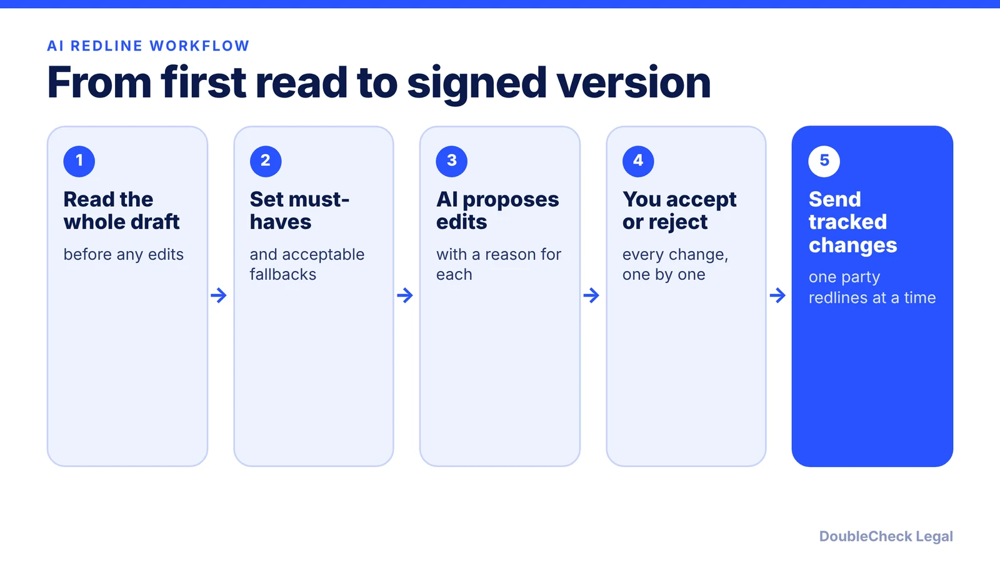
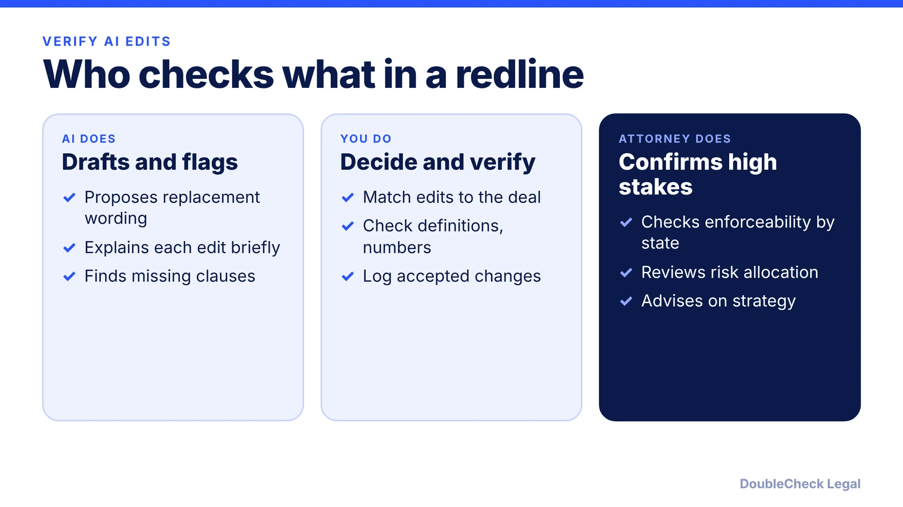

*A redline workflow for using AI to prepare and draft contract edits, with the checks that keep a person in control, as of November 2026.*

**Key takeaways:**

- Set must-haves, preferred terms and fallbacks before asking AI for edits, and tell it which side you are on.
- Have AI propose clause-level edits with reasons; you accept, reject or modify each one, and send them as tracked changes.
- Verify each edit against the deal, check definitions and cross-references, and keep a log of what changed and why.
- For high-stakes contracts, have an independent attorney verify before you send; keep AI in a draft-and-suggest role.

## 1. The quick answer

**Quick answer:** To negotiate a contract with AI, use it to prepare and draft, and keep a person in charge of what gets sent. A workable redline workflow is: read the whole contract, set your must-haves and fallbacks, have AI propose edits and explanations, accept or reject each one yourself, then send changes as tracked changes with short comments. Verify every AI edit against the deal, check that defined terms and cross-references still work, and never send markup you have not read. Thomson Reuters advises verifying every AI output against the original sources, and ABA Formal Opinion 512 warns lawyers against uncritical reliance on generative AI output.

## 2. Set your positions before you ask AI to redline

The most common failure is asking for a redline with no instructions. Review standards (rules for acceptable terms, fallback language and escalation thresholds) are the biggest lever on whether AI output is useful: the model can only flag deviations if it knows what good looks like.

Before you prompt, write down for each major clause:

- **Must-have:** what you will not sign without (for example, a liability cap that applies to both sides).
- **Preferred:** what you would like.
- **Fallback:** what you can accept to close the deal.
- **Trade:** what you could give up in return.

Then give the AI the context a negotiator would have: deal size, relationship, leverage, deadlines and any term sheet or email that set the commercial deal. Attach deal references so the contract can be checked against actual terms. Put your side in the prompt, since a generic model may soften terms toward balance and concede ground you did not intend to give.

Start by reading the full contract yourself. Take notes on the first read and hold formal revisions until you understand the whole document. For the list of clauses worth pushing on, see [contract red flags for small business](/blog/contract-red-flags-small-business/); for questions to ask first, see [AI contract review prompts](/blog/ai-contract-review-prompts-what-to-ask-and-what-to-verify/).

## 3. The redline workflow, step by step

**Step 1: Confirm the version.** Make sure you are reviewing the most recent version of the contract so you do not edit an outdated file. Save the received document unchanged as your baseline.

**Step 2: Redact if needed.** If you use a consumer tool, replace names, amounts and identifiers before pasting. See [what to redact before pasting a contract into AI](/blog/what-to-redact-before-pasting-a-contract-into-ai/) and [uploading contracts to ChatGPT](/blog/uploading-contracts-to-chatgpt-confidentiality/).

**Step 3: Ask for edits one clause at a time.** A useful AI first pass scans clause by clause, flags deviations and missing provisions and proposes changes with brief explanations. Ask for the exact replacement wording and a one-sentence reason you could say to the other side. Ask for two versions where useful: your preferred ask and your fallback.

**Step 4: Review each suggestion.** The human step is accepting, rejecting or modifying each suggestion based on deal strategy and context. Redlining is a weak point for general tools because it requires an understanding of your risk tolerance and negotiation strategy. Do not paste AI text into the contract unread.

**Step 5: Use tracked changes.** Use tracked changes so every party can see proposed edits without hand-comparing drafts. In Microsoft Word, per Microsoft Support, you turn it on from the Review tab, and the Accept and Reject options let you work through each change. If you receive a clean copy, Word's Compare feature (Review > Compare > Compare Documents) creates a new document that marks the differences with revision marks and leaves the original unchanged. Hiding changes does not remove them; you must accept or reject them.

**Step 6: Redline one at a time.** Only one party should redline at a time so the counterparty can review each round before responding.

**Step 7: Final consistency check.** Check that changes are consistent, defined terms are used correctly and the history shows who changed what.

For a customer returning your draft, see [how to review a customer's redlines](/blog/review-customer-contract-redlines/). For changes after signature, see [contract amendment vs. new contract](/blog/contract-amendment-vs-new-contract-how-to-change-a-signed-agreement/).

## 4. What to verify in every AI edit

AI edits can look polished and still break the deal. Check these before sending:

- **Does the edit match your deal?** A suggestion suited to a large enterprise deal may be too aggressive for a long-standing partnership.
- **Hallucination risk.** ABA Formal Opinion 512 notes generative AI tools can produce inaccurate or false output, including invented clauses or inapplicable law. Check any legal reference.
- **Cross-references and definitions.** A new term must be defined, and section numbers must still point to the right place. AI can miss conflicts between exhibits and the main body and defined terms that differ from everyday meaning, so check them yourself.
- **Did the edit move risk the other way?** Look at the liability cap together with its exclusions and at indemnity inside or outside the cap. See [limitation of liability](/blog/limitation-of-liability-clause-explained/), [indemnification](/blog/indemnification-clause-explained-small-business/) and [how to terminate a contract early](/blog/how-to-terminate-a-contract-early-termination-clause/).
- **Renewal and survival.** The same tutorial lists evergreen renewal windows and survival clauses as blind spots. Check [auto-renewal terms](/blog/auto-renewal-clauses-business-contracts/) manually.
- **Tone and relationship.** An edit that is legally defensible may still read as hostile. Edit comments before they go out.

Keep an audit trail. Record what the AI suggested, what was accepted or changed and why. For a small business that can be a simple log: clause, ask, fallback, outcome.

On data handling, ABA Formal Opinion 512 tells lawyers to assess the risk that information entered into a tool could be accessed by others and to review the tool's terms and privacy policy; confirm any vendor promise directly. See [AI vendor data retention and training opt-outs](/blog/ai-vendor-data-retention-and-training-opt-outs-what-to-check-in-settings/).

## 5. AI agents, authority and when to bring in an attorney

Tools that negotiate on your behalf raise a separate question: who authorized what? An AI that proposes edits for you to approve is different from an agent that sends them. Until you understand a tool's permissions, keep AI in the draft-and-suggest role and have a person send and sign. For background see [AI agents negotiating deals](/blog/ai-agents-negotiate-contracts-deals/). Also remember that the final document must still be a valid agreement; see [what makes a contract legally binding](/blog/what-makes-a-contract-legally-binding/) and [e-signature rules](/blog/electronic-signatures-esign-act-contracts/).

**Self-handle vs. get an attorney:**

- A low-value, standard agreement where you can walk away: AI-assisted redlines with your own review are often enough.
- Large commitments, exclusivity, IP assignment, personal guarantees, regulated data or litigation exposure: have an independent attorney verify your redlines before you send them. Do not rely on AI alone for bespoke, high-value or strategic agreements or for contracts with litigation, regulatory or IP transfer exposure.

For help deciding when, see [when to hire a lawyer for your small business](/blog/when-to-hire-lawyer-small-business/), [lawyer review of a ChatGPT contract](/blog/lawyer-review-chatgpt-contract/) and [handing off an AI-drafted document to an attorney](/blog/hand-off-an-ai-drafted-legal-document-to-an-attorney-package/). For method, [cross-checking a contract with two AI models](/blog/cross-check-a-contract-with-two-ai-models-method/) can show where your AI redlines disagree, and [AI contract review: what to check before signing](/blog/ai-contract-review-what-to-check-before-signing/) gives a term checklist. Any model, open or closed, can do the drafting help; the checking is yours.

## Where DoubleCheck fits

[DoubleCheck](https://www.contactdoublecheck.com) helps businesses and founders start legal work with AI, verify it, and, when professional advice is warranted, connect with an independent attorney, including for immigration questions. Attorney availability and practice areas vary. Attorneys on DoubleCheck are independent professionals; an attorney-client relationship forms only if an attorney accepts your engagement.

**Sources:** [NCBE Bar Examiner, Generative Artificial Intelligence Tools (ABA Formal Opinion 512)](https://thebarexaminer.ncbex.org/article/fall-2024/generative-artificial-intelligence-tools/); [Thomson Reuters Institute, What to check in AI-generated legal work](https://www.thomsonreuters.com/en/institute/articles/ai-generated-legal-work); [Microsoft Support, Track changes in Word](https://support.microsoft.com/en-gb/word/training/track-changes-in-word); [Microsoft Support, Compare and merge two versions of a document](https://support.microsoft.com/en-us/word/compare-and-merge-two-versions-of-a-document).

## FAQ

**Can I negotiate a contract with AI?**

You can use AI to prepare, draft edits and plan fallbacks, but a person should decide and send. Thomson Reuters likewise advises verifying AI output against primary sources and keeping human judgment in charge.

**How do I redline a contract with AI?**

Set your positions, ask for clause-level edits with reasons, review each suggestion, and send changes as tracked changes. Redline one round at a time so the other side can review each round.

**What should I verify in AI contract edits?**

Check that each edit fits your deal, that defined terms and cross-references still work, and that no legal references are invented. Generative AI can produce inaccurate or false output, per ABA Formal Opinion 512, including invented clauses or inapplicable law.

**Does AI soften my negotiating position?**

It can. A generic model may move terms toward balance and concede ground you did not intend to give, so tell it your side and your must-haves.

**When should a lawyer review my AI redlines?**

For large commitments, IP, personal guarantees or regulated data, have an independent attorney verify before you send. Do not rely on AI alone for high-value or strategic agreements.

---

*General information only. This article is not legal, tax, investment, or accounting advice.*
