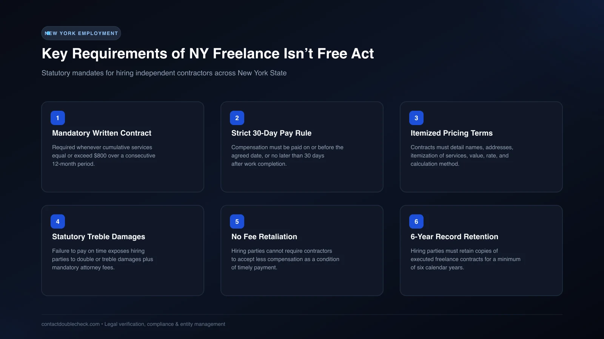
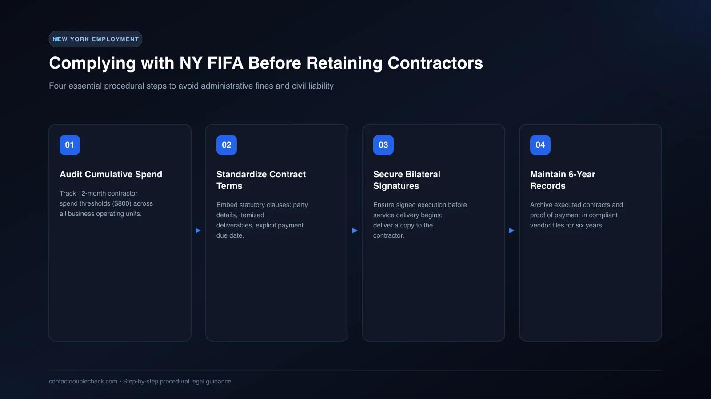

*Compliance guide for businesses, startups, and hiring parties retaining independent contractors under the statewide New York Freelance Isn’t Free Act (NY Labor Law Article 44-A), as of November 2026. General information, not legal advice.*

**Key takeaways:**

- A written contract is legally required whenever independent contractor services total $800 or more in a 12-month window.
- Payments must be delivered on or before the contract due date, or within 30 calendar days after deliverables are completed.
- Retaliation, conditioning payment on discounts, and demanding waivers of FIFA rights are strictly illegal under state law.
- Failure to provide a written contract or pay on time carries statutory liquidated damages equal to 100% of the contract value plus attorney fees.
- Hiring entities must retain executed agreements for no less than six years.

## 1. The quick answer

**Quick answer:** The statewide New York Freelance Isn’t Free Act (NY Labor Law §§ 900–905) requires any commercial hiring party retaining an independent contractor for services valued at **$800 or more** (either in a single project or cumulatively over 12 months) to execute a comprehensive written agreement *before* work begins. The contract must enumerate both parties’ legal details, an itemized scope of services, the agreed compensation rate or calculation formula, and a definitive payment date. If no date is stated, payment must be delivered no later than **30 days** after completed service delivery.

Hiring parties that fail to provide a conforming written agreement face statutory damages of $250. Hiring parties that pay late, withhold earned compensation, or pressure contractors into accepting reduced fees face liquidated damages up to 100% to 200% of unpaid amounts (treble damages for retaliation), along with mandatory attorney fees and administrative fines from the New York State Department of Labor (NYSDOL).

For business owners managing contractor workflows, review our guides on [how to write a freelance contract](/blog/how-to-write-a-freelance-contract/) and [independent contractor classification for startups](/blog/employee-vs-independent-contractor-classification-startups/).

## 2. The $800 threshold and who qualifies as a freelance worker

The statewide statute builds upon New York City’s pioneering 2017 local law, expanding identical protections across every county in New York State.

Under NY Labor Law § 900, a **"freelance worker"** is defined as any natural person or organization composed of no more than one natural person (such as a single-member LLC, single-shareholder corporation, or sole proprietorship) hired as an independent contractor to provide services in exchange for compensation.

**The $800 threshold applies under two distinct circumstances:**
1. A single statement of work, retainer, or project agreement with a contract value of $800 or greater.
2. Multiple smaller project agreements or purchase orders between the same hiring party and freelance worker that aggregate to $800 or more over the immediately preceding 12-month period.

**Statutory Exclusions:**
The law explicitly excludes certain licensed professionals from the definition of freelance worker:
- Licensed medical professionals (physicians, surgeons, and physical therapists).
- Admitted attorneys performing legal services.
- Licensed real estate salespersons or associate brokers.
- Construction contractors performing manual labor on job sites.

If an independent consultant, software developer, designer, or copywriter does not fall into these narrow professional exemptions, full FIFA compliance is mandatory. See also [consulting freelance LLC vs sole proprietor](/blog/consulting-freelance-llc-vs-sole-proprietor/).

## 3. Mandatory terms every NY freelancer agreement must contain

Under NY Labor Law § 901, the written contract must be furnished to the freelance worker physically or electronically, and both parties must maintain an executed counterpart. The contract must contain, at minimum, the following statutory elements:

1. **Party Identifiers:** The legal names and complete mailing addresses of both the hiring party and the freelance worker.
2. **Itemization of Services:** A granular, itemized description of the technical or professional services to be rendered.
3. **Value and Rate of Compensation:** The exact dollar value of services, including hourly rates, project milestones, or piece-rate calculations, and the explicit method of compensation calculation.
4. **Payment Due Date:** The specific date on which the hiring party will deliver payment, or the contractual mechanism by which that date will be determined (such as "within 15 days of invoice submission").
5. **Invoice Submission Guidelines:** If the hiring party requires an invoice to process disbursement, the contract must explicitly state the timeline and procedure for submission.

If the hiring party does not deliver a written contract conforming to these statutory requirements, the contractor has an automatic private right of action awarding $250 in statutory damages, plus the legal presumption that the worker's account of terms is accurate.

## 4. The strict 30-day payment rule and prohibited practices

Under NY Labor Law § 902, the hiring party must pay the agreed compensation on or before the date specified in the contract. **If the agreement does not state a payment date or mechanism, payment must be remitted no later than 30 calendar days after the completion of the freelance worker’s services.**

Once the contractor begins performing work under the agreement, the hiring party cannot condition timely payment on:
- Demanding a discount, concession, or reduced fee.
- Forcing the freelancer to sign a post-dispute release of claims.
- Extending payment terms beyond the contractually agreed window.

Furthermore, NY Labor Law § 904 strictly prohibits retaliation against any contractor who exercises or attempts to exercise rights under FIFA. Blacklisting, threatening, canceling existing agreements, or withholding future work because a freelancer demanded a written contract or statutory payment is actionable in court.

Review our companion analysis on [paycheck laws by state and employer payment deadlines](/blog/final-paycheck-laws-by-state-when-employers-must-pay/) and [1099-NEC threshold rules for hiring freelancers](/blog/1099-nec-2000-threshold-hiring-freelancers/).

## 5. Civil penalties, treble damages, and DOL enforcement

The enforcement provisions of NY FIFA grant freelancers substantial remedies through either the New York State Department of Labor Division of Labor Standards or the New York State Supreme Court:

- **Failure to Provide Written Agreement:** Statutory award of $250.
- **Unlawful Non-Payment or Late Payment:** The contractor recovers the full unpaid balance plus **100% liquidated damages** (double damages), reasonable attorney fees, and costs.
- **Retaliation Claims:** Statutory damages equal to the value of the underlying contract for each retaliatory act, plus punitive civil penalties up to $25,000 for systemic violations.
- **Civil Penalties by the State:** The NY Attorney General or NYSDOL Commissioner may bring civil actions against repeat offenders, assessing fines up to $25,000 for patterns of practice.

The statute of limitations under FIFA is **two years** for claims alleging failure to provide a written contract, and **six years** for unlawful payment withholding and retaliation claims.

See [independent contractor misclassification penalties for employers](/blog/independent-contractor-misclassification-penalties-employers/) for broader federal and state audit exposures.

## 6. Compliance checklist for startups and businesses

To protect your company from administrative complaints and costly statutory fee shifting, implement these standard operating procedures:

1. **Conduct a Vendor Audit:** Review accounts payable to identify every single-member LLC, sole proprietor, or 1099 contractor operating in New York or servicing your New York entity.
2. **Standardize Master Services Agreements:** Replace informal email confirmations and Slack message handshakes with an attorney-drafted MSA containing all five statutory clauses.
3. **Automate Invoice Processing:** Calibrate accounting systems to flag any contractor invoice approaching 20 days old, guaranteeing disbursement within the 30-day statutory boundary.
4. **Implement 6-Year File Retention:** Store PDF copies of countersigned agreements and bank payment confirmations in a centralized, secure archive for six calendar years.
5. **Avoid Rights Waivers:** Never insert boilerplate clauses attempting to disclaim statutory wage, labor, or freelance rights.

## Where DoubleCheck fits

[DoubleCheck](https://www.contactdoublecheck.com) helps startups, founders, and growing businesses verify vendor agreements, draft compliant contractor contracts, and ensure state-by-state regulatory adherence with AI-powered legal verification. When high-stakes vendor disputes or multi-state hiring audits arise, DoubleCheck connects you directly with independent corporate and employment attorneys.

**Related reading:**
- [How to Write a Freelance Contract: Clauses and Terms](/blog/how-to-write-a-freelance-contract/)
- [Independent Contractor Agreement: What to Include](/blog/independent-contractor-agreement-what-to-include/)
- [Independent Contractor Misclassification Penalties for Employers](/blog/independent-contractor-misclassification-penalties-employers/)
- [1099-NEC Threshold for Hiring Freelancers](/blog/1099-nec-2000-threshold-hiring-freelancers/)

**Sources:** [New York State Senate, Labor Law Article 44-A (Freelance Isn’t Free Act, §§ 900–905)](https://www.nysenate.gov/legislation/laws/LAB/A44-A); [New York State Department of Labor, Freelance Workers Protection Guidelines](https://dol.ny.gov/freelance-isnt-free-act); [New York City Department of Consumer and Worker Protection (DCWP), Freelance Isn’t Free Overview](https://www.nyc.gov/site/dca/workers/workers-freelance.page); [Cornell Legal Information Institute, State Independent Contractor Protections](https://www.law.cornell.edu/wex/independent_contractor); [New York State Attorney General, Labor Bureau Guidance on Independent Contracting](https://ag.ny.gov/bureau/labor-bureau).

## FAQ

**When does the New York Freelance Isn’t Free Act require a written contract?**

A written contract is mandatory whenever the cumulative value of services between a hiring party and a freelance worker equals or exceeds $800 over a consecutive 12-month period, under New York Labor Law Article 44-A.

**What happens if an employer pays a freelancer late under NY FIFA?**

Under NY Labor Law § 903, late payment exposes the hiring party to double statutory damages (100% liquidated damages on top of unpaid fees), injunctive relief, and mandatory attorney fees upon administrative or civil action.

**Does the New York statewide FIFA protect out-of-state remote freelancers?**

Yes. NY Department of Labor guidance establishes that FIFA protects freelance workers performing work for any hiring party located or doing business in New York State, regardless of the worker’s physical state of residence.

**Can an employer ask a contractor to waive FIFA rights for a discount?**

No. Any contract term attempting to waive statutory protections under the Freelance Isn’t Free Act is void as contrary to public policy. Conditioning timely payment on reduced compensation triggers explicit statutory damages.

**How long must companies retain freelance agreements under NY FIFA?**

Hiring parties must retain copies of executed freelance contracts for a minimum of six calendar years and present them to the New York State Department of Labor upon audit or demand.

---

*General information only. This article is not legal, tax, investment, or accounting advice.*
