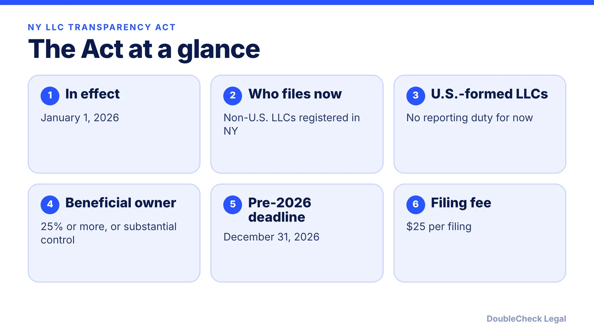
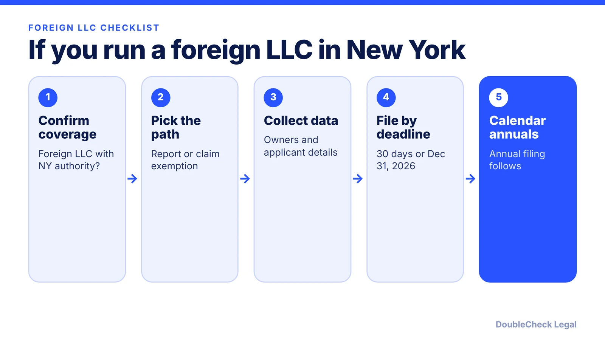

*Does the New York LLC Transparency Act apply to your LLC? Here is the scope after the governor's December 2025 veto, with deadlines and penalties.*

**Key takeaways:**

- The Act took effect January 1, 2026 and currently reaches only non-U.S. LLCs authorized in New York.
- Governor Hochul vetoed the decoupling bill on December 19, 2025, so U.S.-formed LLCs are exempt for now.
- Pre-2026 foreign LLCs face a December 31, 2026 deadline (some summaries say January 1, 2027); confirm with the Department of State.
- Late filings can bring fines up to $500 per day and loss of good standing; check the agency page for current status.

## 1. The quick answer

**Quick answer:** The New York LLC Transparency Act took effect January 1, 2026, but as of the latest sources we verified (January 2026), it reaches only LLCs formed outside the United States that are authorized to do business in New York. Governor Hochul vetoed a bill on December 19, 2025 that would have decoupled the law from the federal Corporate Transparency Act, so U.S.-formed LLCs, including New York LLCs, currently have no reporting duty, per Holland & Knight. Foreign LLCs authorized before 2026 face a December 31, 2026 deadline.

## 2. Why the scope is narrow

The New York Act borrows its definitions from the federal Corporate Transparency Act (CTA). In March 2025, FinCEN's interim final rule removed U.S. companies and U.S. beneficial owners from federal reporting. Because the New York law cross-references the CTA as revised, that carve-out flows into New York, according to Holland & Knight.

The legislature had passed Senate Bill 8432 to restore reporting for domestic LLCs. Per Holland & Knight and Buchalter, the governor vetoed it in December 2025, citing a wish not to impose New York burdens broader than the federal ones. The result:

- LLCs formed in New York or any other U.S. state are exempt from reporting.
- Non-U.S. LLCs authorized to do business in New York must file either a beneficial ownership report or an attestation of exemption.
- Buchalter notes the scope could change if federal law changes.

If you are deciding where to form, this is a reason to read the [federal BOI rules](/blog/beneficial-ownership-report-boi-2026/) alongside the state rules. For New York formation basics, see [how to start an LLC in New York](/blog/how-to-start-an-llc-in-new-york/) and the separate [New York publication requirement](/blog/new-york-llc-publication-requirement/).

## 3. What a covered LLC files, and when

For a covered foreign LLC, the Act asks for the following, per Crowell and the American Bar Association:

- Full legal name, date of birth, current address, and a unique ID number for each beneficial owner and each company applicant.
- A beneficial owner is anyone who owns or controls at least 25% of the company or exercises substantial control. The company applicant is the person who files, or directs the filing of, the registration document.
- Exempt LLCs file an attestation of exemption, signed under penalty of perjury.

Deadlines per Holland & Knight:

- Authorized on or after January 1, 2026: within 30 days of applying for a Certificate of Authority.
- Authorized before January 1, 2026: December 31, 2026. Some summaries list January 1, 2027, so confirm the date with the New York Department of State.
- Annual filings follow the initial filing.

Penalties can be significant. After 30 days late, a company is marked past due, and the Attorney General may fine up to $500 per day. Holland & Knight and Crowell also describe suspension, loss of good standing, and possible dissolution or cancellation for continued non-compliance. Clearing a past-due or delinquent status requires the filing plus a $250 Department of State fine and any Attorney General fine.

## 4. What is still unsettled, and how to stay current

Several practical points were open in the January 2026 sources, and we did not find a later source that closes them:

- The Department of State had not said which non-U.S. entities count as LLCs for the Act.
- FinCEN's interim rule is not final, and the Act tracks it.
- Holland & Knight reported that the online portal was forthcoming and filings were being submitted as PDFs.
- Company applicant information can be hard to obtain for older entities.

Information filed is confidential and available only by court order, to authorized government agencies, or with the owner's written consent, per Crowell. Before you rely on any of this, check the New York Department of State page for the current rules.

If you hold a New York LLC through a foreign parent, your tax filings may matter more than this Act; see [Form 5472 for foreign-owned single-member LLCs](/blog/form-5472-foreign-owned-single-member-llc/). Founders outside the U.S. can also read [starting a U.S. company as a non-U.S. resident](/blog/start-us-company-as-non-us-resident/) and [how to incorporate a company in the U.S.](/blog/how-to-incorporate-a-company-in-the-us/). An attorney can confirm whether your structure is covered.

## Where DoubleCheck fits

[DoubleCheck](https://www.contactdoublecheck.com) helps businesses and founders start legal work with AI, verify it, and, when professional advice is warranted, connect with an independent attorney, including for immigration questions. Attorney availability and practice areas vary. Attorneys on DoubleCheck are independent professionals; an attorney-client relationship forms only if an attorney accepts your engagement.

**Sources:** [Holland & Knight, January 2026](https://www.hklaw.com/en/insights/publications/2026/01/new-york-llc-transparency-act-reporting-limited); [Buchalter on the veto](https://www.buchalter.com/insights/new-york-governor-vetoes-amendment-to-ny-llc-transparency-act-u-s-persons-no-longer-obligated-to-file/); [Crowell, December 2025](https://www.crowell.com/en/insights/client-alerts/new-york-llc-transparency-act-key-requirements-and-deadlines); [American Bar Association, December 2025](https://www.americanbar.org/groups/business_law/resources/business-law-today/2025-december/beneficial-ownership-new-york-llc-transparency).

## FAQ

**Does the New York LLC Transparency Act apply to my New York LLC?**

Not currently, per Holland & Knight (January 2026). The law applies only to non-U.S. LLCs authorized to do business in New York, because it follows the federal CTA as revised in March 2025. Check the Department of State for any change.

**What is the deadline to file under the NY LLC Transparency Act?**

Per Holland & Knight, foreign LLCs authorized on or after January 1, 2026 file within 30 days of applying for a Certificate of Authority, and those authorized earlier by December 31, 2026. Some summaries list January 1, 2027, so confirm the date.

**What information must be reported?**

Per Crowell, each beneficial owner and company applicant's full legal name, date of birth, current address, and a unique ID number. A beneficial owner holds 25% or more or exercises substantial control.

**What are the penalties for not filing?**

Per Holland & Knight, a filing more than 30 days late is marked past due, the Attorney General may fine up to $500 per day, and continued non-compliance can lead to suspension or dissolution. Clearing past-due status requires the filing plus a $250 fine and any Attorney General fine.

---

*General information only. This article is not legal, tax, investment, or accounting advice.*
