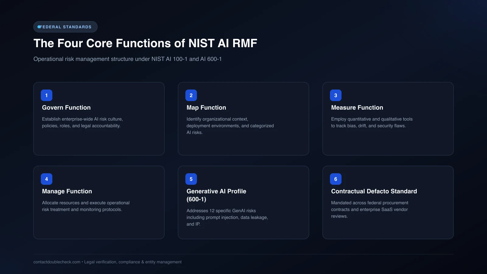
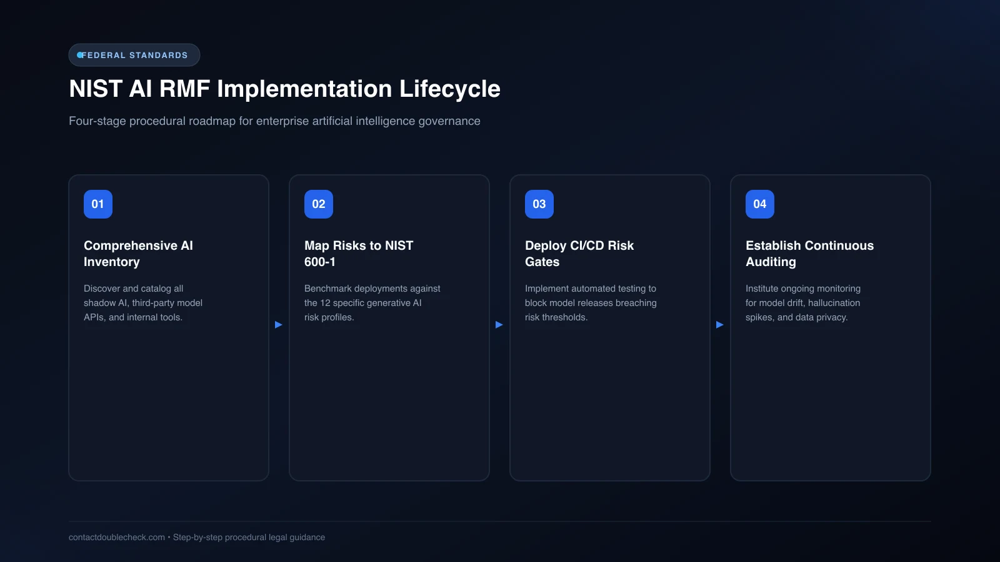

*A strategic enterprise guide to operationalizing the National Institute of Standards and Technology (NIST) AI Risk Management Framework (AI RMF 1.0) and Generative AI Profile (NIST AI 600-1) as of November 2026. General information, not legal advice.*

**Key takeaways:**

- The NIST AI Risk Management Framework (NIST AI 100-1) organizes AI compliance into four continuous functions: GOVERN, MAP, MEASURE, and MANAGE.
- NIST AI 600-1 (Generative AI Profile) extends the framework across 12 specific GenAI risks, including data privacy leakage, prompt injection, and IP infringement.
- Federal procurement mandates, GSA contract terms, and defense supply chain requirements make NIST AI RMF compliance operationally mandatory for government vendors.
- State statutes, including Colorado’s artificial intelligence framework, recognize substantial compliance with NIST AI RMF as an affirmative defense against liability.
- Organizations must maintain continuous model monitoring and technical validation rather than treating governance as a one-time audit checklist.

## 1. The quick answer

**Quick answer:** The **NIST AI Risk Management Framework (AI RMF 1.0 / NIST AI 100-1)**, developed by the National Institute of Standards and Technology, serves as the premier operational standard for managing artificial intelligence risks in the United States. Designed to be voluntary, the framework has become a **defacto legal and commercial requirement** through federal agency procurement rules, GSA schedules, and corporate vendor evaluations.

Enterprises deploying large language models or autonomous systems must also implement the companion **Generative AI Profile (NIST AI 600-1)**, which details concrete mitigation actions for 12 generative risk vectors, including hallucinations, data poisoning, prompt injections, and copyright violations. Achieving alignment provides critical legal protections and shields against corporate liability under state algorithmic discrimination statutes.

For corporate counsel and engineering leads managing SaaS compliance, review our related guides on [protecting trade secrets and cybersecurity in cloud tools](/blog/ai-agent-gmail-slack-drive-security-checklist/) and [data breach notification laws for commercial entities](/blog/state-data-breach-notification-laws-small-business/).

## 2. The four core functions: GOVERN, MAP, MEASURE, MANAGE

The NIST AI RMF structure abandons rigid compliance checkboxes in favor of an iterative, interconnected risk-management lifecycle:

- **GOVERN:** The foundational function. Cultivates an institutional risk-aware culture, establishes executive and board-level oversight, assigns specific roles and accountability, and defines legal and ethical risk tolerances across the enterprise.
- **MAP:** Contextualizes AI systems. Identifies specific business use cases, characterizes operational environments, determines societal and end-user impacts, and classifies potential risks before systems are deployed.
- **MEASURE:** Employs quantitative and qualitative metrics to evaluate, test, and track AI risks. Includes statistical demographic parity assessments, red-teaming for security vulnerabilities, groundedness scores, and hallucination frequency tracking.
- **MANAGE:** Operationalizes risk mitigation. Allocates engineering and legal resources, implements incident-response protocols, establishes automated CI/CD risk gates, and executes continuous monitoring.

## 3. The Generative AI Profile (NIST AI 600-1) risks

In response to the explosion of foundation models, NIST published **NIST AI 600-1**, mapping generative AI risks directly to the four core functions:

1. **Misinformation & Hallucinations:** Probabilistic outputs presenting inaccurate facts as truth.
2. **Data Privacy & Leakage:** Inadvertent memorization or disclosure of confidential corporate or personal data.
3. **Cybersecurity & Prompt Injection:** Vulnerabilities allowing malicious actors to manipulate model outputs or access backend system prompts.
4. **Intellectual Property Infringement:** Unlicensed reproduction of copyrighted text, images, or patented architectures.
5. **Harmful & Toxic Content:** Generation of violent, hateful, or discriminatory content.
6. **Value Chain Opaque Dependencies:** Reliance on unvetted third-party base models, unverified APIs, or unscrubbed training datasets.

## 4. Federal procurement, GSA rules, and legal safe harbors

Why must private companies align with a technically voluntary federal standard?

- **Federal Procurement Mandates:** Pursuant to federal executive directives and OMB memoranda, federal agencies must require software and AI contractors to prove alignment with the NIST AI RMF prior to contract awards.
- **The Affirmative Defense Safe Harbor:** State laws, such as Colorado’s regulatory framework, explicitly provide that a deployer has an affirmative defense against civil liability and algorithmic discrimination claims if the organization has implemented and maintained a risk management program aligned with the NIST AI RMF.
- **Commercial Supply Chain Pressures:** Fortune 500 legal and procurement departments routinely condition enterprise SaaS purchases on formal NIST AI RMF self-attestation or third-party SOC 2/NIST cross-mapping.

## 5. Supply chain governance and third-party model cards

Most organizations do not train foundational models from scratch; they procure third-party foundation models via APIs or open-source weights. NIST mandates strict supply chain controls:

- **Require Comprehensive System Cards:** Demand that AI vendors provide detailed System Cards and Model Cards documenting training data provenance, filtering methodologies, known limitations, and benchmark evaluations.
- **Enforce Anti-Training Warranties:** Contractually ensure vendor terms forbid the use of enterprise prompts, client data, or outputs for training the vendor's public models.
- **Establish Fallback Architectures:** Create redundant API and model architectures allowing rapid switching of model providers if a third-party vendor suffers a security incident or regulatory shutdown.

## 6. Enterprise implementation roadmap for AI RMF

Enterprises should adopt a four-step implementation roadmap:

1. **Conduct an Organization-Wide AI Discovery:** Discover shadow AI usage, vendor integrations, and internal model development across all departments.
2. **Benchmark Against NIST Functions:** Assess current controls against the subcategories of GOVERN, MAP, MEASURE, and MANAGE, identifying operational gaps.
3. **Incorporate Automated Evaluation Gates:** Integrate automated testing in the software deployment pipeline to block model updates that fail predefined accuracy, safety, or groundedness thresholds.
4. **Publish an Enterprise AI Governance Charter:** Formalize policies defining approved enterprise tools, prohibited data inputs, and mandatory human-in-the-loop validation checkpoints.

## Where DoubleCheck fits

[DoubleCheck](https://www.contactdoublecheck.com) provides businesses, general counsel, and enterprise teams with automated contract review, AI-assisted verification, and legal workflow assurance. DoubleCheck helps teams verify citations, audit regulatory compliance across California, Colorado, New York, and federal agencies, and connect with experienced attorneys to ensure compliance with emerging AI standards.

**Related reading:**
- [AI Agent Security Checklist: Gmail, Slack, and Drive](/blog/ai-agent-gmail-slack-drive-security-checklist/)
- [State Data Breach Notification Laws for Small Business](/blog/state-data-breach-notification-laws-small-business/)
- [Agentic AI for Lawyers and Legal Workflows](/blog/agentic-ai-lawyers-entrepreneurs-legal-work/)
- [AI Chats Are Not Privileged: Heppner Decision](/blog/ai-chats-not-privileged-heppner/)

**Sources:** [National Institute of Standards and Technology, Artificial Intelligence Risk Management Framework (NIST AI 100-1)](https://www.nist.gov/itl/ai-risk-management-framework); [National Institute of Standards and Technology, NIST AI 600-1: Artificial Intelligence Risk Management Framework Generative AI Profile](https://www.nist.gov/publications/artificial-intelligence-risk-management-framework-generative-ai-profile); [U.S. General Services Administration (GSA), AI Procurement and Risk Management Principles](https://www.gsa.gov/); [White House Office of Management and Budget (OMB), Memorandum M-24-10 Advancing Governance, Innovation, and Risk Management in Federal AI](https://www.whitehouse.gov/omb/briefing-room/2024/03/28/omb-releases-first-government-wide-policy-to-mitigate-risks-of-artificial-intelligence-and-harness-its-benefits/).

## FAQ

**Is the NIST AI Risk Management Framework legally mandatory?**

While NIST frameworks are voluntary federal guidance, federal procurement directives, executive actions, enterprise supply-chain audits, and state laws (e.g., Colorado) make compliance an operational necessity for major businesses.

**What is the NIST Generative AI Profile (NIST AI 600-1)?**

NIST AI 600-1 is a specialized companion guide to the core AI RMF that identifies 12 specific generative AI risk categories—such as prompt injection, IP infringement, and hallucination—and maps them to actionable controls.

**What are the four core functions of the NIST AI RMF?**

The four core functions are GOVERN (culture and policies), MAP (context and risk identification), MEASURE (assessment and quantitative metrics), and MANAGE (risk mitigation and monitoring).

**Can complying with the NIST AI RMF provide a legal safe harbor?**

Yes. State statutes such as Colorado’s AI framework recognize substantial compliance with established standards like the NIST AI RMF as an affirmative defense against claims of algorithmic discrimination.

**How does NIST AI RMF apply to third-party vendor AI tools?**

The GOVERN and MAP functions explicitly require organizations to conduct vendor due diligence, audit model cards, and ensure third-party SaaS tools conform to enterprise risk tolerances.

---

*General information only. This article is not legal, tax, investment, or accounting advice.*
