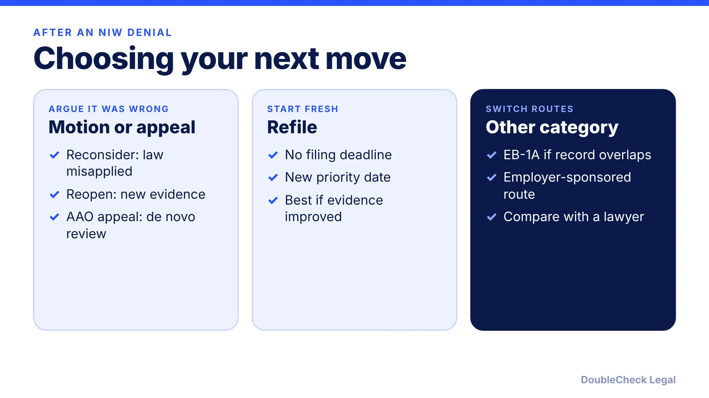
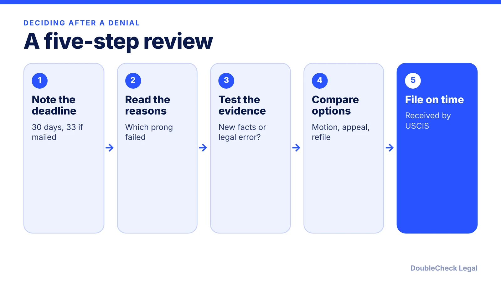

*Your national interest waiver was denied. Here are the main options, the deadlines, and what refiling does to your priority date.*

**Key takeaways:**

- Appeals and motions on Form I-290B are due within 30 days of the decision, or 33 if mailed, per USCIS.
- A motion to reconsider argues legal error; a motion to reopen adds new evidence.
- An AAO appeal is slower than a motion; a refile has no deadline but a new priority date.
- Choose based on why USCIS denied, ideally with a lawyer's review.

## 1. The quick answer

**Quick answer:** After an NIW denial you generally have four paths: a motion to reconsider, a motion to reopen, an appeal to the AAO, or a new petition. Per USCIS, an appeal or motion on Form I-290B is generally due within 30 days of the decision, or 33 if it was mailed, and appeal deadlines cannot be extended. A refile has no deadline but takes a new priority date. Which path fits depends on why USCIS denied, so read the decision before choosing.

## 2. First step: an RFE is not a denial

A request for evidence (RFE) arrives before a decision and gives you a chance to fix gaps. A denial is the decision. If you have an RFE, answer every point on time with organized evidence, as covered in [how to respond to a USCIS RFE](/blog/how-to-respond-to-uscis-request-for-evidence-rfe/).

For a denial, the decision letter explains which parts of the Dhanasar test USCIS found lacking. NIW has three prongs: substantial merit and national importance of the proposed endeavor, you being well positioned to advance it, and a net benefit to the U.S. from waiving the job offer and labor certification. The waiver is also discretionary, so USCIS can deny even when the prongs are argued. Match your response to the stated reason rather than reacting to the outcome. For the baseline, see the [NIW guide for software engineers and researchers](/blog/niw-for-software-engineers-and-researchers/) and the [NIW overview for founders](/blog/niw-eb-2-national-interest-waiver-founders/).

## 3. Motions, appeals, and refiling compared

Per USCIS and 8 CFR 103.5:

- **Motion to reconsider:** use when the officer misapplied law or policy based on the existing record. It adds no new facts.
- **Motion to reopen:** use to add new evidence that strengthens a prong.
- **AAO appeal:** the Administrative Appeals Office reviews the decision, and you may submit a brief and supporting evidence within 30 days after filing. USCIS says the AAO aims to finish within 180 days after receiving a complete case file, which is slower than a motion.
- **Refile:** a new petition on a stronger record, often cleanest when evidence has materially improved, but it loses the original priority date.
- **Federal court:** a lawsuit in federal district court is sometimes possible after a denial, but outcomes depend on the facts and the discretionary nature of the waiver, so ask an attorney.

Most appeals and motions are filed on Form I-290B with the required fee, and a fee waiver may be available in some cases. Check the current Form I-290B instructions and USCIS fee schedule before filing.

## 4. Refiling or pivoting without repeating mistakes

A refile should fix the earlier weaknesses and stay factually consistent with the prior filing. A thin proposed endeavor, unclear national importance, or scattered evidence are fixable. Because NIW and EB-1A records can overlap, a denial that turned on the discretionary balance rather than missing accomplishments may fit the other route. Compare them in [EB-1A vs. NIW for founders](/blog/eb-1a-vs-niw-which-is-better-for-founders/) and the [EB-1A guide for tech employees](/blog/eb-1a-for-software-engineers-and-tech-employees/).

Any status you hold on another basis has its own rules, but timelines for dependents, extensions, or a pending I-485 can be affected, so ask a professional. Deadlines are strict. Use [how to find a good immigration lawyer](/blog/how-to-find-good-immigration-lawyer-startup-founder/) and confirm fees as of November 2026 on USCIS.

## Where DoubleCheck fits

[DoubleCheck](https://www.contactdoublecheck.com) helps businesses and founders start legal work with AI, verify it, and, when professional advice is warranted, connect with an independent attorney, including for immigration questions. Attorney availability and practice areas vary. Attorneys on DoubleCheck are independent professionals; an attorney-client relationship forms only if an attorney accepts your engagement.

**Sources:** [USCIS: Questions and Answers on Appeals and Motions](https://uscis.gov/node/43398); [8 CFR 103.5, Reopening or reconsideration (eCFR)](https://www.ecfr.gov/current/title-8/chapter-I/subchapter-B/part-103/subpart-A/section-103.5); [8 CFR 103.8, Service of decisions (Cornell LII)](https://www.law.cornell.edu/cfr/text/8/103.8).

## FAQ

**How long do I have to appeal an NIW denial?**

Per USCIS, generally 30 days from the decision date, or 33 days if it was mailed. Appeal deadlines cannot be extended. Check the current Form I-290B instructions.

**What is the difference between a motion to reopen and reconsider?**

Per USCIS, a motion to reconsider argues the decision misapplied law or policy based on the existing record, while a motion to reopen presents new facts supported by documents.

**Can I refile an NIW after a denial?**

Yes. A new petition has no deadline tied to the denial, but it takes a new priority date and should be built on a materially stronger record.

**Can I switch to EB-1A after an NIW denial?**

Possibly. NIW and EB-1A records can overlap, so a denial that turned on discretion may suit EB-1A, which has a higher standard. Discuss it with an attorney.

---

*General information only. This article is not legal, tax, investment, or accounting advice.*
