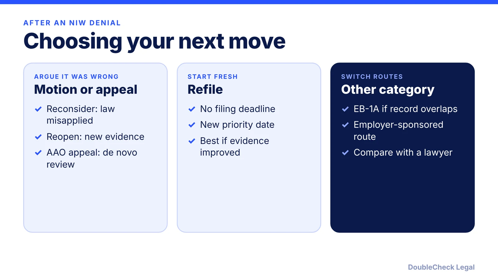
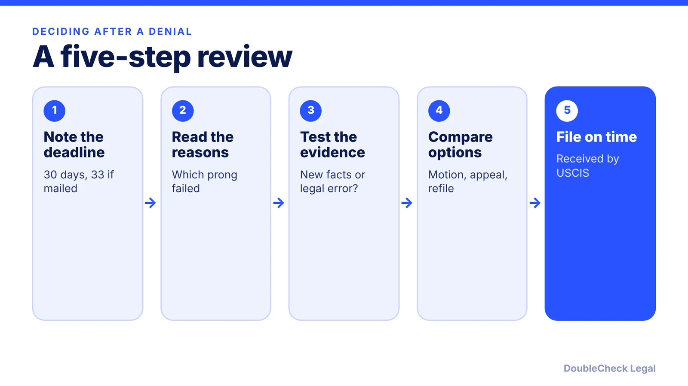

*Your national interest waiver was denied. Here are the main options, the deadlines, and what refiling does to your priority date.*

**Key takeaways:**

- Appeals and motions on Form I-290B are due within 30 days of the decision, or 33 if mailed, per Locke Immigration.
- A motion to reconsider argues legal error; a motion to reopen adds new evidence.
- An AAO appeal is de novo but slower; a refile has no deadline but a new priority date.
- Choose based on why USCIS denied, ideally with a lawyer's review.

## 1. The quick answer

**Quick answer:** After an NIW denial you generally have four paths: a motion to reconsider, a motion to reopen, an appeal to the AAO, or a new petition. Per Locke Immigration, an appeal or motion on Form I-290B is due within 30 days of the decision, or 33 if USCIS mailed it, and USCIS must receive it by then. A refile has no deadline but takes a new priority date. Which path fits depends on why USCIS denied, so read the decision before choosing.

## 2. First step: an RFE is not a denial

A request for evidence (RFE) arrives before a decision and gives you a chance to fix gaps. A denial is the decision. If you have an RFE, answer every point on time with organized evidence, as covered in [how to respond to a USCIS RFE](/blog/how-to-respond-to-uscis-request-for-evidence-rfe/).

For a denial, the decision letter explains which parts of the Dhanasar test USCIS found lacking. NIW has three prongs: substantial merit and national importance of the proposed endeavor, you being well positioned to advance it, and a net benefit to the U.S. from waiving the job offer and labor certification. The waiver is also discretionary, so USCIS can deny even when the prongs are argued. Match your response to the stated reason rather than reacting to the outcome. For the baseline, see the [NIW guide for software engineers and researchers](/blog/niw-for-software-engineers-and-researchers/) and the [NIW overview for founders](/blog/niw-eb-2-national-interest-waiver-founders/).

## 3. Motions, appeals, and refiling compared

Per Locke Immigration:

- **Motion to reconsider:** use when the officer misapplied the Dhanasar test to the existing record, such as requiring national or geographic scope. It adds no new facts.
- **Motion to reopen:** use to add new evidence that strengthens a prong.
- **AAO appeal:** the AAO reviews the case de novo, accepts new evidence, and can affirm on a different ground. It is slower than a motion.
- **Refile:** a new petition on a stronger record, often cleanest when evidence has materially improved, but it loses the original priority date.
- **Federal court:** a district court can set aside a denial that is contrary to law, but because the waiver is discretionary, courts generally will not reweigh the equities.

Per F1Jobs, which covers I-140 denials generally, the I-290B fee has been $800 for each of these, with motions taking roughly 3 to 6 months and AAO appeals 6 to 12 months or more. It cites practitioner reports that the AAO sustains denials in roughly 80 to 90 percent of appeals. Treat these as secondary figures and check the current Form I-290B instructions and fee schedule.

## 4. Refiling or pivoting without repeating mistakes

A refile should fix the earlier weaknesses and stay factually consistent with the prior filing. A thin proposed endeavor, unclear national importance, or scattered evidence are fixable. Locke Immigration also notes that because NIW and EB-1A records overlap, a denial that turned on the discretionary balance rather than missing accomplishments may fit the other route. Compare them in [EB-1A vs. NIW for founders](/blog/eb-1a-vs-niw-which-is-better-for-founders/) and the [EB-1A guide for tech employees](/blog/eb-1a-for-software-engineers-and-tech-employees/).

A denial of a petition does not by itself change a status you hold on another basis, per F1Jobs, but timelines for dependents, extensions, or a pending I-485 can be affected, so ask a professional. Deadlines are strict. Use [how to find a good immigration lawyer](/blog/how-to-find-good-immigration-lawyer-startup-founder/) and confirm fees as of November 2026 on USCIS.

## Where DoubleCheck fits

[DoubleCheck](https://www.contactdoublecheck.com) helps businesses and founders start legal work with AI, verify it, and, when professional advice is warranted, connect with an independent attorney, including for immigration questions. Attorney availability and practice areas vary. Attorneys on DoubleCheck are independent professionals; an attorney-client relationship forms only if an attorney accepts your engagement.

**Sources:** [Locke Immigration: NIW denial options](https://www.lockeimmigration.com/federal-litigation/niw-denial); [F1Jobs: I-140 denied next steps](https://www.f1jobs.io/resources/blog/i140-denied-next-steps); [Alaz Law: NIW denied in 2026](https://www.alazlaw.com/blog/eb-2-niw-denied-2026-appeal-motion-or-refile/).

## FAQ

**How long do I have to appeal an NIW denial?**

Per Locke Immigration, 30 days from the decision date, or 33 days if USCIS mailed it, and USCIS must receive the filing by the deadline. Check the current Form I-290B instructions.

**What is the difference between a motion to reopen and reconsider?**

Per Locke Immigration, a motion to reconsider argues USCIS misapplied the law to the existing record with no new facts, while a motion to reopen adds new evidence that strengthens a Dhanasar prong.

**Can I refile an NIW after a denial?**

Yes. Per Locke Immigration, there is no refile deadline, but a new petition takes a new priority date and should be built on a materially stronger record.

**Can I switch to EB-1A after an NIW denial?**

Possibly. Locke Immigration notes the NIW and EB-1A records overlap, so a denial that turned on discretion may suit EB-1A, which has a higher standard. Discuss it with an attorney.

---

*General information only. This article is not legal, tax, investment, or accounting advice.*
