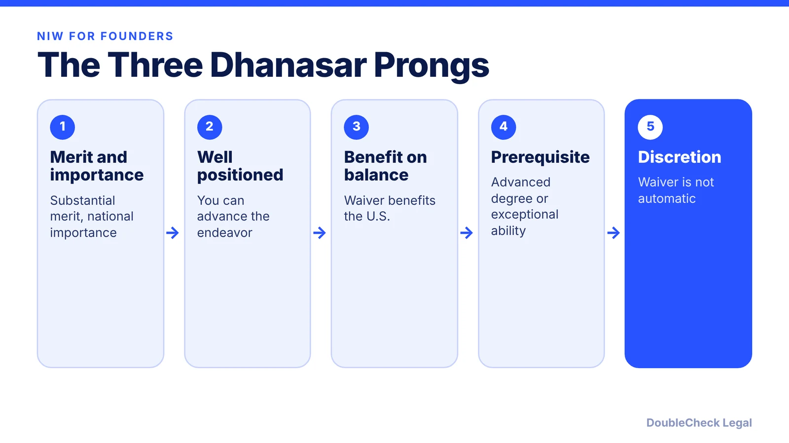
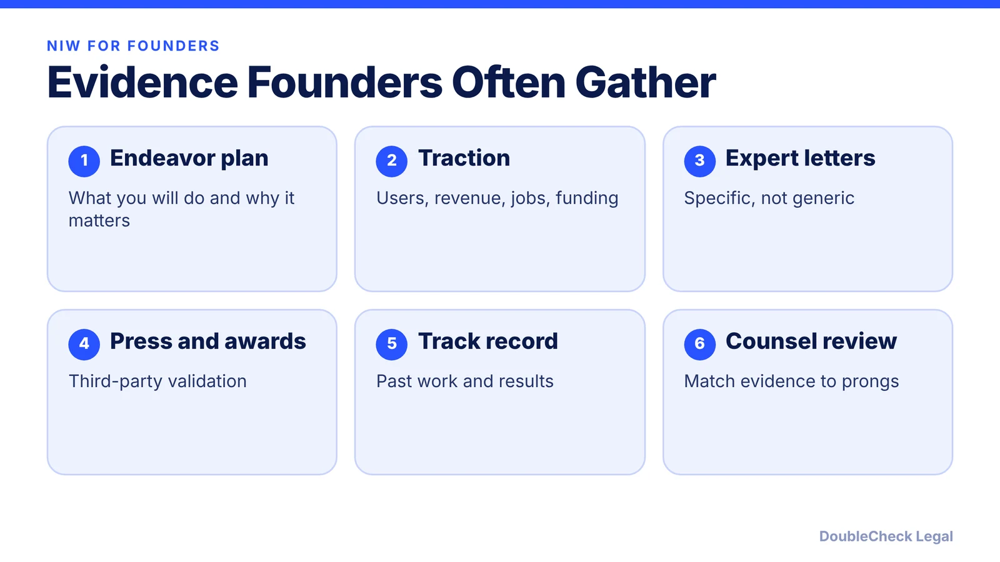

*Thinking about a national interest waiver as a founder? Here are the three Dhanasar prongs, the prerequisite, and how it differs from O-1 and EB-1A.*

**Key takeaways:**

- The NIW waives the EB-2 job offer and labor certification when it benefits the U.S.
- Dhanasar requires merit and national importance, being well positioned, and benefit on balance.
- You must first qualify through an advanced degree or exceptional ability.
- The waiver is discretionary, so a record can meet the test and still not succeed.

## 1. The quick answer

**Quick answer:** A national interest waiver, or NIW, is an EB-2 green card route that waives the job offer and labor certification when it benefits the United States. Under Matter of Dhanasar, as summarized by Greenberg Traurig, you must show by a preponderance of the evidence that your proposed endeavor has substantial merit and national importance, that you are well positioned to advance it, and that on balance it would benefit the U.S. to waive the job offer requirement. You must first qualify as a member of the professions holding an advanced degree or as an individual of exceptional ability, and the waiver is discretionary.

## 2. What Dhanasar changed

According to the Greenberg Traurig summary, under Dhanasar the petitioner no longer must show harm to the national interest if labor certification were required, or compare the beneficiary against U.S. workers. Even if qualified U.S. workers are available, the benefit analysis can still favor the waiver. The standard is "more likely than not."

## 3. How it compares with O-1 and EB-1A

The NIW sits in the EB-2 category and focuses on the endeavor's national importance and your position to advance it, while the EB-1A focuses on sustained acclaim. See [EB-1A vs. O-1](/blog/eb-1a-vs-o-1-founder-which-path/) and [O-1A for founders](/blog/o-1a-visa-for-startup-founders-evidence/). If your plan depends on company structure, see [how to incorporate a company in the U.S.](/blog/how-to-incorporate-a-company-in-the-us/). Whether your endeavor qualifies is a judgment for an immigration attorney.

## Where DoubleCheck fits

[DoubleCheck](https://www.contactdoublecheck.com) helps businesses and founders start legal work with AI, verify it, and, when professional advice is warranted, connect with an independent attorney, including for immigration questions. Attorney availability and practice areas vary. Attorneys on DoubleCheck are independent professionals; an attorney-client relationship forms only if an attorney accepts your engagement.

**Sources:** [Greenberg Traurig](https://www.gtlaw-insidebusinessimmigration.com/department-of-homeland-security/new-framework-for-adjudicating-national-interest-waivers/); [Ashoori Law](https://www.ashoorilaw.com/blog/eb1a-criteria).

## FAQ

**What is the Dhanasar test?**

A three-prong test: substantial merit and national importance, well positioned to advance the endeavor, and benefit to the U.S. in waiving the job offer, shown by a preponderance of the evidence.

**Does an NIW need a job offer?**

No. The point of the waiver is that the job offer and labor certification are waived when it benefits the United States.

**Is the NIW guaranteed if I meet the prongs?**

No. Greenberg Traurig notes the waiver is discretionary.

**Is NIW the same as EB-1A?**

No. NIW is in EB-2 and turns on the endeavor; EB-1A turns on sustained acclaim.

---

*General information only. This article is not legal, tax, investment, or accounting advice.*
