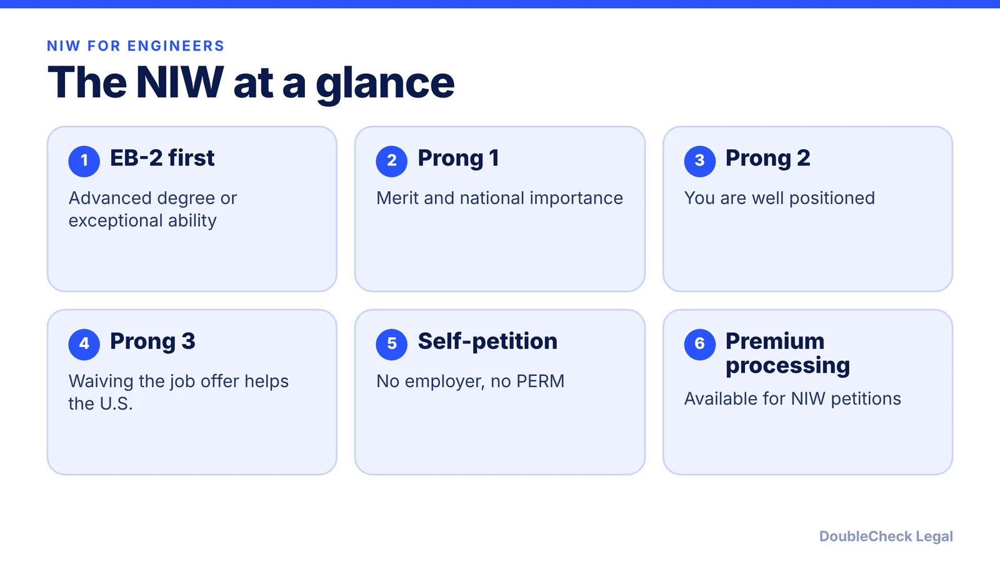
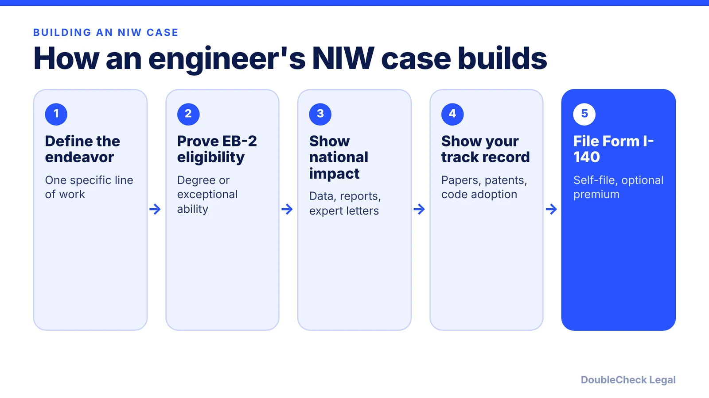

*Can a software engineer or researcher get a green card without an employer? The national interest waiver may allow it. Here is the test and the evidence.*

**Key takeaways:**

- The NIW is an EB-2 route with no job offer and no PERM labor certification.
- You must first qualify by advanced degree or exceptional ability.
- Dhanasar's three prongs: merit and national importance, well positioned, and benefit from waiving the job offer.
- Premium processing has been rolled out for NIWs; confirm the current fee and availability.

## 1. The quick answer

**Quick answer:** The national interest waiver (NIW) is an EB-2 green card route that lets a software engineer or researcher file Form I-140 without an employer, a job offer, or PERM labor certification. You first qualify for EB-2 through an advanced degree or exceptional ability, then show the three Matter of Dhanasar prongs by a preponderance of the evidence. The waiver is discretionary, so meeting the prongs does not guarantee approval.

## 2. Step one: advanced degree or exceptional ability

Before Dhanasar applies, you must be eligible for EB-2. Under 8 CFR 204.5(k), an advanced degree is a U.S. academic or professional degree, or a foreign equivalent, above a bachelor's. A bachelor's degree plus at least five years of progressive experience in the specialty counts as the equivalent of a master's.

If you lack the degree, exceptional ability requires evidence meeting at least three of six types: an academic record, letters showing ten years of full-time experience, a license or certification, evidence of salary showing exceptional ability, professional memberships, and recognition for achievements from peers or organizations. Comparable evidence is allowed if these do not fit your occupation. Many engineers qualify on the degree route, so the real work is in the three prongs.

## 3. The three Dhanasar prongs applied to engineers

As summarized by Mintz, the prongs are:

1. **Substantial merit and national importance.** The endeavor, not just your past work, must matter beyond one employer or locality. For engineers, that means describing a specific line of work (for example, a security tool, a medical imaging method, or an energy system) and why it matters nationally. A general job title is not an endeavor.
2. **Well positioned to advance it.** Education, skills, track record, plans, progress, and interest from customers, investors, or others. The endeavor does not have to be more likely than not to succeed.
3. **Waiving the job offer benefits the U.S. on balance.** The petitioner need not show harm to the national interest or compare themselves to U.S. workers.

Klasko Immigration summarizes January 2022 USCIS guidance: STEM education, especially a STEM PhD, is a strong positive factor, but a degree alone does not establish positioning. Work in a critical and emerging technology can support the waiver even where similar U.S. workers exist. That guidance is from 2022, so confirm current USCIS policy with counsel.

## 4. No PERM, premium processing, and how it compares

Bay Legal says the NIW is a self-petition and lists researchers, scientists, and engineers among typical applicants. Evidence it names includes independent expert letters, publications and citations, patents and licensing, business metrics, and a specific plan for future work. Because the job offer is waived, [PERM labor certification](/blog/perm-labor-certification-green-card-process/) is skipped, which also means you are not tied to one sponsoring employer.

Premium processing: Klasko reports USCIS began a phased rollout of premium processing for NIWs in 2022, with an initial decision due in 45 days, though that decision can be a request for evidence. Bay Legal says availability may vary and does not state the fee, so check the current USCIS premium processing page.

How to choose: the [EB-1A](/blog/eb-1a-for-software-engineers-and-tech-employees/) needs sustained acclaim at the top of the field; the NIW does not, but it needs a persuasive endeavor and a discretionary waiver. Founders can read the [NIW guide for founders](/blog/niw-eb-2-national-interest-waiver-founders/). Waiting times after approval depend on your country; see the [visa bulletin explained](/blog/visa-bulletin-explained-priority-dates-eb-categories/). If you are on H-1B, compare the [sponsored route](/blog/h-1b-to-green-card-timeline-tech-workers/). Bring a draft to [an immigration lawyer](/blog/how-to-find-good-immigration-lawyer-startup-founder/) before filing.

## Where DoubleCheck fits

[DoubleCheck](https://www.contactdoublecheck.com) helps businesses and founders start legal work with AI, verify it, and, when professional advice is warranted, connect with an independent attorney, including for immigration questions. Attorney availability and practice areas vary. Attorneys on DoubleCheck are independent professionals; an attorney-client relationship forms only if an attorney accepts your engagement.

**Sources:** [Mintz on Matter of Dhanasar](https://www.mintz.com/insights-center/viewpoints/2017-01-matter-dhanasar-breathes-new-life-niw-green-card-category); [8 CFR 204.5 (GovInfo)](https://www.govinfo.gov/content/pkg/CFR-2012-title8-vol1/pdf/CFR-2012-title8-vol1-sec204-5.pdf); [Klasko Immigration](https://www.klaskolaw.com/national-interest-waivers-current-state-of-play/); [Bay Legal](https://baylegal.com/eb-2-niw-national-interest-waiver-requirements-and-how-to-qualify/).

## FAQ

**Can a software engineer get an NIW?**

Possibly. Bay Legal lists engineers among typical NIW applicants, but you must have an advanced degree or exceptional ability and show the three Dhanasar prongs. Approval is discretionary.

**Do I need a master's degree for an NIW?**

Not necessarily. Under 8 CFR 204.5(k), a bachelor's degree plus at least five years of progressive experience counts as the equivalent of a master's, or you can show exceptional ability with three of six types of evidence.

**Does the NIW need PERM or an employer?**

No. The NIW waives the job offer and labor certification, so you can file Form I-140 for yourself, per Mintz and Bay Legal.

**Is premium processing available for the NIW?**

Klasko reports USCIS began phasing in premium processing for NIWs in 2022, with an initial decision within 45 days. Bay Legal says availability may vary, so check USCIS for the current fee.

---

*General information only. This article is not legal, tax, investment, or accounting advice.*
