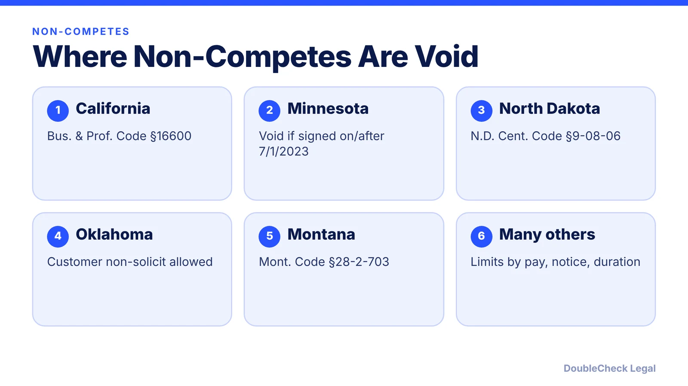
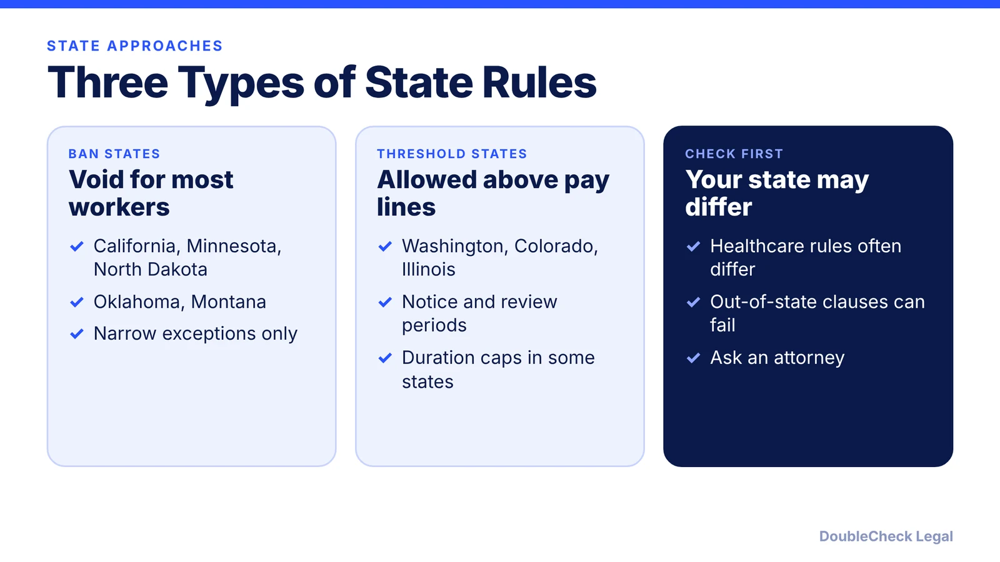

*With the FTC rule gone, your state decides whether a non-compete holds. Here is the state-by-state picture.*

**Key takeaways:**

- The FTC dismissed its appeals on September 5, 2025; the non-compete rule is not in effect.
- California, Minnesota, North Dakota, Oklahoma, and Montana void most employee non-competes, per Loio's tracker.
- Washington, Colorado, and Illinois use income thresholds; Washington moves to a near-total ban on June 30, 2027.
- Sale-of-business exceptions exist in several states but not everywhere; check your state.

## 1. The quick answer

**Quick answer:** There is no federal non-compete ban, so state law decides. California, Minnesota, North Dakota, Oklahoma, and Montana void most employee non-competes, according to a state tracker from Loio, while many other states limit them by pay level, notice, or duration. This guide is the state-by-state view; for the overall 2026 picture, start with our [noncompete overview](/blog/noncompete-agreements-2026-small-business/).

## 2. The federal status in one paragraph

On September 5, 2025, the FTC voted 3-1 to dismiss its appeals in *Ryan, LLC v. FTC* and *Properties of the Villages v. FTC* and to accede to the vacatur of its Non-Compete Clause Rule, per the FTC's press release. A federal district court had found the FTC lacked authority to issue the rule. The rule is therefore not in effect, and employers and workers must look to state law.

## 3. States that ban or sharply limit them

Per Loio's tracker (secondary source; verify against the statutes):

- **California:** Bus. & Prof. Code §16600 voids them. 2024 amendments extend this to agreements signed in any state and require employer notice to affected workers.
- **Minnesota:** Minn. Stat. §181.988 voids employment non-competes signed on or after July 1, 2023, with no income threshold, and out-of-state choice-of-law clauses meant to evade it are void.
- **North Dakota:** N.D. Cent. Code §9-08-06 has voided them for decades.
- **Oklahoma:** 15 Okla. Stat. §§217-219 lets employers bar former employees from directly soliciting established customers, but not from competing generally.
- **Montana:** Mont. Code §28-2-703; healthcare non-competes are voided by a separate statute.
- **Wyoming:** SF 107 (2025) voids most employee non-competes going forward, with narrow carve-outs for executives and equity holders.

**Income-based states** (2026 figures per Loio): Washington allows them only above $126,858 for employees, capped at 18 months, and ESHB 1155, signed March 23, 2026, moves it to a near-total ban effective June 30, 2027. Illinois voids them under $75,000 and requires 14 days to review. Colorado allows them only for workers earning about $127,091 in 2026, with 14 days' separate notice and a trade-secret purpose.

## 4. Sale-of-business exceptions and alternatives

Selling a business is treated differently from employment. Per Loio, California, North Dakota, and Montana each keep a sale-of-business exception, and Becker's reports Colorado's law also allows non-competes tied to a sale of business. The tracker did not list one for Oklahoma, so do not assume it. If you are buying or selling a company, build the restriction into the purchase documents ([buy or sell a small business checklist](/blog/how-to-buy-or-sell-a-small-business-legal-checklist/)).

If your state limits employee non-competes, common alternatives are confidentiality agreements, invention assignment, and narrow non-solicitation clauses, though enforceability varies. Also confirm the worker is correctly classified ([employee vs. contractor](/blog/employee-vs-independent-contractor-classification-startups/), [contractor agreements](/blog/independent-contractor-agreement-what-to-include/)). Because states change these laws often, check the current statute for the worker's state before signing.

## Where DoubleCheck fits

[DoubleCheck](https://www.contactdoublecheck.com) helps businesses and founders start legal work with AI, verify it, and, when professional advice is warranted, connect with an independent attorney, including for immigration questions. Attorney availability and practice areas vary. Attorneys on DoubleCheck are independent professionals; an attorney-client relationship forms only if an attorney accepts your engagement.

**Sources:** [FTC press release, September 5, 2025](https://ftc.gov/news-events/news/press-releases/2025/09/federal-trade-commission-files-accede-vacatur-non-compete-clause-rule); [Loio state tracker](https://loio.com/guides/non-compete-tracker-state-by-state/); [Becker's](https://www.beckersasc.com/asc-news/noncompete-laws-in-2026-state-by-state-breakdown/).

## FAQ

**Is there a federal non-compete ban in 2026?**

No. The FTC voted on September 5, 2025 to dismiss its appeals and accede to the vacatur of its rule, per the FTC.

**Which states ban non-competes?**

Per Loio's 2026 tracker: California, Minnesota, North Dakota, Oklahoma (with a customer non-solicit allowance), and Montana, plus Wyoming for most future employee agreements.

**Is there a sale-of-business exception?**

Per Loio, California, North Dakota, and Montana keep one, and Becker's says Colorado does too. Oklahoma's was not listed.

**What are the 2026 income thresholds?**

Per Loio: Washington $126,858, Illinois $75,000, and Colorado about $127,091, with Washington moving to a near-total ban on June 30, 2027.

---

*General information only. This article is not legal, tax, investment, or accounting advice.*
