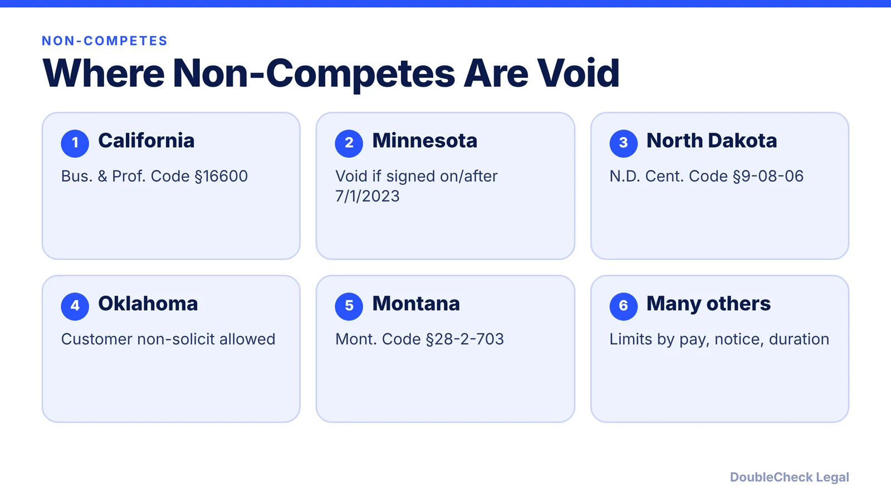
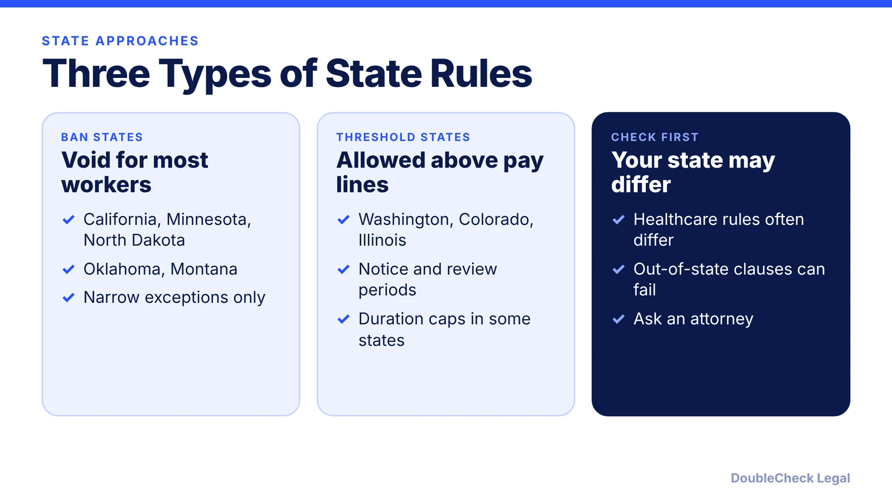

*With the FTC rule gone, your state decides whether a non-compete holds. Here is the state-by-state picture.*

**Key takeaways:**

- The FTC dismissed its appeals on September 5, 2025; the non-compete rule is not in effect.
- California, Minnesota, North Dakota, and Oklahoma are commonly cited as voiding most employee non-competes; verify the current statute.
- Washington, Colorado, and Illinois use income thresholds that change over time.
- Sale-of-business exceptions exist in several states but not everywhere; check your state.

## 1. The quick answer

**Quick answer:** There is no federal non-compete ban, so state law decides. California, Minnesota, North Dakota, and Oklahoma are commonly cited as voiding most employee non-competes, while many other states limit them by pay level, notice, or duration. This guide is the state-by-state view; for the overall 2026 picture, start with our [noncompete overview](/blog/noncompete-agreements-2026-small-business/).

## 2. The federal status in one paragraph

On September 5, 2025, the FTC voted 3-1 to dismiss its appeals in *Ryan, LLC v. FTC* and *Properties of the Villages v. FTC* and to accede to the vacatur of its Non-Compete Clause Rule, per the FTC's press release. A federal district court had found the FTC lacked authority to issue the rule. The rule is therefore not in effect, and employers and workers must look to state law.

## 3. States that ban or sharply limit them

Statutes commonly cited (verify against the current statute text before relying on them):

- **California:** Bus. & Prof. Code §16600 voids them. 2024 amendments extend this to agreements signed in any state and require employer notice to affected workers.
- **Minnesota:** Minn. Stat. §181.988 voids employment non-competes signed on or after July 1, 2023, with no income threshold, and out-of-state choice-of-law clauses meant to evade it are void.
- **North Dakota:** N.D. Cent. Code §9-08-06 has voided them for decades.
- **Oklahoma:** 15 Okla. Stat. §§217-219 lets employers bar former employees from directly soliciting established customers, but not from competing generally.
- **Montana:** Mont. Code §28-2-703; healthcare non-competes are voided by a separate statute.

**Income-based states:** Washington, Illinois, and Colorado allow non-competes only for workers above an earnings threshold, with notice or review requirements, and the thresholds are adjusted over time. Washington has been tightening its rules. Check the current threshold and notice rules with the state agency or an attorney.

## 4. Sale-of-business exceptions and alternatives

Selling a business is treated differently from employment. Many states, including California and North Dakota, keep a sale-of-business exception in their statutes, but not every state does, so do not assume one applies. If you are buying or selling a company, build the restriction into the purchase documents ([buy or sell a small business checklist](/blog/how-to-buy-or-sell-a-small-business-legal-checklist/)).

If your state limits employee non-competes, common alternatives are confidentiality agreements, invention assignment, and narrow [non-solicitation clauses](/blog/non-solicitation-agreements-explained/), though enforceability varies. Also confirm the worker is correctly classified ([employee vs. contractor](/blog/employee-vs-independent-contractor-classification-startups/), [contractor agreements](/blog/independent-contractor-agreement-what-to-include/)). Because states change these laws often, check the current statute for the worker's state before signing.

**Related reading:** [Non-compete vs non-solicit vs NDA](/blog/non-compete-vs-non-solicit-vs-nda-which-to-use-after-the-ftc-rule/); [FTC noncompete ban: what employees should do](/blog/ftc-noncompete-ban-what-employees-should-do-now-to-check-their-own-noncompete/); [Shareholder Agreement for a Small Business: What to Include](/blog/shareholder-agreement-small-business-what-to-include/); [Offer Letter vs Employment Contract: Differences for a Startup](/blog/offer-letter-vs-employment-contract-differences-startup/)

## Where DoubleCheck fits

[DoubleCheck](https://www.contactdoublecheck.com) helps businesses and founders start legal work with AI, verify it, and, when professional advice is warranted, connect with an independent attorney, including for immigration questions. Attorney availability and practice areas vary. Attorneys on DoubleCheck are independent professionals; an attorney-client relationship forms only if an attorney accepts your engagement.

**Sources:** [FTC press release, September 5, 2025](https://ftc.gov/news-events/news/press-releases/2025/09/federal-trade-commission-files-accede-vacatur-non-compete-clause-rule). State statutes are cited by section in the text; verify each against the official state code.

## FAQ

**Is there a federal non-compete ban in 2026?**

No. The FTC voted on September 5, 2025 to dismiss its appeals and accede to the vacatur of its rule, per the FTC.

**Which states ban non-competes?**

California, Minnesota, North Dakota, and Oklahoma (which allows a customer non-solicit) are commonly cited as voiding most employee non-competes, and other states restrict them in various ways. Verify each state's current statute.

**Is there a sale-of-business exception?**

Many states, including California and North Dakota, keep a sale-of-business exception in their statutes, but not every state does. Check the statute for your state before relying on one.

**What are the 2026 income thresholds?**

Washington, Illinois, and Colorado use earnings thresholds that are adjusted over time, and Washington has been tightening its rules. Check the current threshold with the state agency or an attorney.

---

*General information only. This article is not legal, tax, investment, or accounting advice.*
