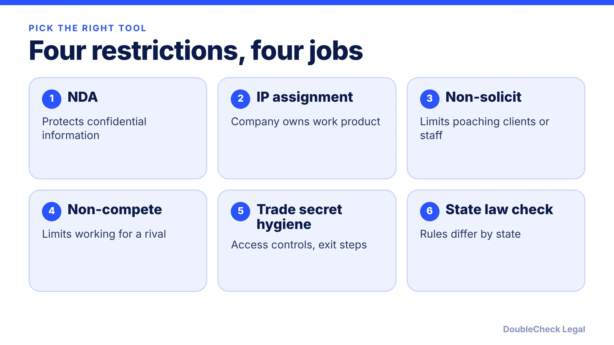
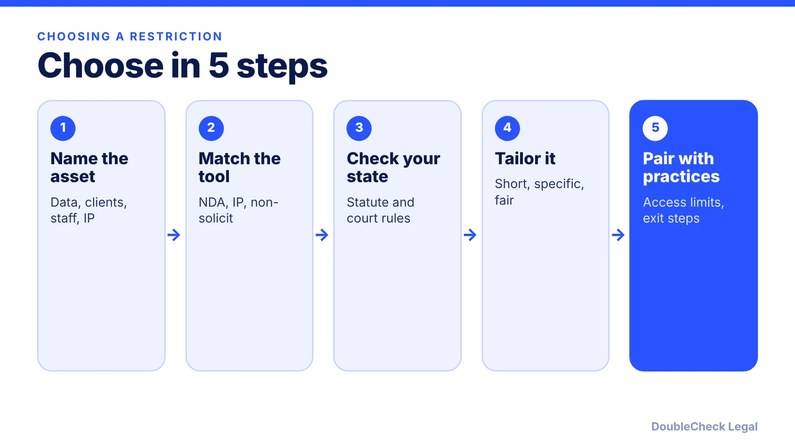

*Pick the restriction that matches what you protect. NDA and IP assignment first, then non-solicit, then non-compete if state law allows.*

**Key takeaways:**

- As of November 2026, the FTC non-compete ban is not in effect, but the FTC still acts case by case.
- Use NDA plus IP assignment for most workers, a narrow non-solicit for client-facing roles, and a non-compete only for a few senior ones.
- An overbroad NDA or non-solicit can work like a non-compete and cause the same problems.
- State law decides enforceability, so check your state before you rely on any restriction.

## 1. The quick answer

**Quick answer:** Non-compete vs non-solicit vs NDA: which to use after the FTC rule? As of November 2026, the FTC's 2024 nationwide non-compete ban is not in effect, so the choice comes down to what you are actually protecting and what your state allows. For most employees, a confidentiality agreement (NDA) plus an IP assignment and a narrow non-solicit does most of the work. Keep a non-compete for the few roles with real access to strategy, pricing, key client relationships or trade secrets. One law firm, Dynamis LLP, says the same: most employees should get a non-solicit and NDA rather than a non-compete.

This post is about choosing the tool. For the status of the rule itself, see [the FTC non-compete rule status in 2026](/blog/ftc-noncompete-rule-status-2026-what-small-businesses-can-still-do/).

## 2. What each restriction does

Each tool answers a different question, so they are not interchangeable.

- **NDA / confidentiality agreement.** Restricts using or sharing specific information. It does not stop anyone from changing jobs. See [how to write an NDA](/blog/how-to-write-an-nda-startups/) and [mutual vs one-way NDAs](/blog/mutual-vs-one-way-nda-which-to-use/).
- **IP assignment.** Says that work product made for the company belongs to the company. This is about ownership, not competition. See [confidentiality and IP assignment agreements for startups](/blog/confidentiality-ip-assignment-agreements-startups/).
- **Non-solicit.** Limits contacting the company's clients or employees after the person leaves. See [non-solicitation agreements explained](/blog/non-solicitation-agreements-explained/).
- **Non-compete.** Limits working for a competitor, usually for a set time and area. It is the most restrictive and the most regulated.

The FTC's own 2024 rule reasoning, as summarized by Holland & Knight in an April 29, 2024 alert, called NDAs, non-solicits and trade secret law "less restrictive alternatives" to non-competes, and said appropriately tailored NDAs burden competition less because they restrict use of information rather than employment itself. That alert was written before courts set the rule aside, so read it as the FTC's reasoning, not current law.

## 3. What the FTC rule status means for your choice

As of November 2026, per Dynamis LLP, the FTC withdrew its appeals on September 5, 2025, after federal courts in Texas and Florida held the 2024 rule unlawful. The same source says the FTC still plans to police non-competes case by case under Section 5 of the FTC Act. An American Bar Association roundup (Spring 2026) adds that in April 2026 the FTC ordered one business to stop enforcing non-competes and sent warning letters to numerous other companies.

What that means in practice:

- **No federal ban, but not a free-for-all.** The question is state law plus the risk of FTC attention for overbroad use.
- **Avoid the overbroad trap.** Holland & Knight noted that an NDA or non-solicit that effectively keeps a worker out of their field can be treated like a non-compete. Draft an NDA around defined confidential information, not "anything you learned here."
- **Do not rely on the restriction alone.** Dynamis LLP warns that a non-compete will not help if basics like access controls, need-to-know policies, exit interviews and device returns are missing.

A federal labor-law note from the same ABA roundup: in December 2025 an administrative law judge held that certain non-solicitation and non-interference covenants violated the National Labor Relations Act. That is one decision, so ask an attorney how it applies to non-supervisory staff.

## 4. State variation and a simple decision path

States differ more than the federal rule does. Examples from sourced 2026 summaries:

- **Texas** (Tully Legal, February 2026): a non-compete generally must be part of an otherwise enforceable agreement and reasonable under Section 15.50 of the Business and Commerce Code, and the firm recommends an NDA or non-solicit where those protect the legitimate interest.
- **Virginia** (ABA roundup): effective July 1, 2026, a non-compete cannot be enforced against an employee terminated without cause who receives no severance.
- **Washington** (ABA roundup): a March 2026 law, effective June 30, 2027, would largely ban non-competes for employees and independent contractors.
- **Illinois** (ABA roundup): non-competes are banned under $75,000 in pay and non-solicits under $45,000, with thresholds scheduled to rise.
- **Florida** (ABA roundup): the 2025 CHOICE Act makes non-competes easier for employers to enforce.

California is the classic ban state. Pearl Cohen reported in November 2020 that the Federal Circuit held an employment agreement's assignment provision void under Cal. Bus. & Prof. Code 16600 as applied to inventions conceived after the employee left, which shows that even IP clauses can be cut back there when they reach past employment. See [non-compete agreements by state](/blog/non-compete-agreements-by-state-2026/) and [non-compete agreements for small businesses](/blog/noncompete-agreements-2026-small-business/).

**A simple path:**

1. Every employee and contractor: NDA plus IP assignment, signed before work starts. See [how to hire your first employee](/blog/how-to-hire-first-employee-legal-checklist/) and [employee vs independent contractor](/blog/employee-vs-independent-contractor-classification-startups/).
2. Anyone who handles client relationships: add a narrow non-solicit if your state allows it.
3. A senior few with strategic access: consider a non-compete only if your state permits it, with a limited scope and term.

**Handle it yourself vs. get an attorney.** A standard NDA and IP assignment for a simple hire may be a reasonable DIY step with a verified template. Anything with a non-compete, a worker in more than one state, or a senior hire is worth an attorney's look, because enforceability depends on state law and the facts.

**Related reading:** [FTC noncompete ban: what employees should do](/blog/ftc-noncompete-ban-what-employees-should-do-now-to-check-their-own-noncompete/); [Employee Confidentiality vs Whistleblower Rights: What You Cannot Restrict](/blog/employee-confidentiality-vs-whistleblower-rights-what-you-cannot-restrict/); [Earnout Clauses Explained: Selling a Small Business](/blog/earnout-clauses-explained-selling-a-small-business/)

## Where DoubleCheck fits

[DoubleCheck](https://www.contactdoublecheck.com) helps businesses and founders start legal work with AI, verify it, and, when professional advice is warranted, connect with an independent attorney, including for immigration questions. Attorney availability and practice areas vary. Attorneys on DoubleCheck are independent professionals; an attorney-client relationship forms only if an attorney accepts your engagement.

**Sources:** [Dynamis LLP, The FTC dropped its noncompete ban](https://www.dynamisllp.com/knowledge/the-ftc-dropped-its-noncompete-ban); [Holland & Knight, Don't Fret (Yet): Trade Secrets, NDAs and Non-Solicits After the FTC Non-Compete Rule (Apr. 29, 2024)](https://www.hklaw.com/en/insights/publications/2024/04/dont-fret-yet-trade-secrets-ndas-and-non-solicits); [ABA Labor and Employment Law, Non-Compete Roundup (Spring 2026)](https://www.americanbar.org/groups/labor_law/resources/magazine/2026-spring/non-compete-roundup); [Tully Legal, 2026 Update on non-competes in Texas (Feb. 23, 2026)](https://www.tullylegal.com/resources/articles/2026-update-clarifying-the-legal-status-of-non-competes-in-texas/); [Pearl Cohen, Federal Circuit holds contractual assignment provision void under California law (Nov. 20, 2020)](https://www.pearlcohen.com/federal-circuit-holds-contractual-assignment-provision-void-under-california-law/).

## FAQ

**Should I use a non-compete, non-solicit or NDA?**

Start with an NDA and an IP assignment for everyone, add a narrow non-solicit for client-facing roles, and keep non-competes for a few senior roles. Dynamis LLP advises giving most employees a non-solicit and NDA rather than a non-compete.

**Is the FTC non-compete ban in effect in 2026?**

No. Per Dynamis LLP, the FTC withdrew its appeals on September 5, 2025 after courts held the rule unlawful, though it still enforces against non-competes case by case.

**Can an NDA be too broad?**

Yes. Holland and Knight noted in April 2024 that an NDA or non-solicit that works to keep someone out of their field could be treated like a non-compete. Define the confidential information narrowly.

**Does an IP assignment replace a non-compete?**

No. An IP assignment settles who owns work product, and an NDA limits use of confidential information. Neither stops a person from working for a competitor.

---

*General information only. This article is not legal, tax, investment, or accounting advice.*
