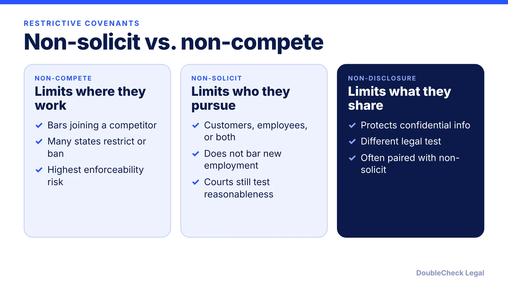
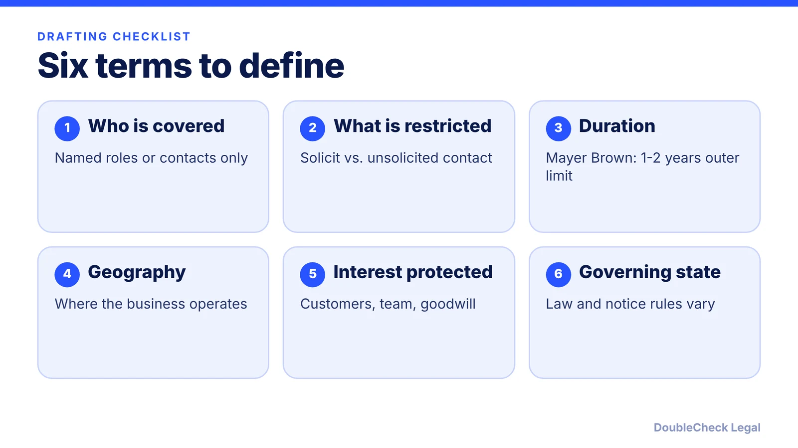

*A non-solicit limits who a former employee can pursue, not where they can work. Whether a court enforces it depends on your state and how narrowly it is written.*

**Key takeaways:**

- A non-solicit restricts soliciting customers or employees; it does not bar the person from taking a new job.
- Some states (for example New York, Texas, Wisconsin) have applied non-compete standards to employee non-solicits; California and Colorado courts have not, per Venable.
- Mayer Brown: outside a sale of a business, 1 to 2 years is generally the outer limit of reasonableness.
- Define who, what, how long, where, and which state's law governs.

## 1. The quick answer

**Quick answer:** A non-solicitation agreement restricts a departing employee or contractor from soliciting your customers (customer non-solicit) or your employees (employee non-solicit) for a period of time. It does not stop the person from working for a competitor, which is why it is often easier to defend than a non-compete, but not always: some courts apply non-compete standards to employee non-solicits. Enforceability is set by state law and varies widely, so scope, duration, and state matter more than the label.

## 2. Customer vs. employee non-solicits

**Customer non-solicit.** Per [Mayer Brown's 2024 overview of US restrictive covenants](https://www.mayerbrown.com/en/insights/publications/2024/07/restrictive-covenants-us), some jurisdictions apply the same reasonableness test to these as to non-competes, but most treat them differently because non-competes are "often more restrictive on one's ability to earn a livelihood." Mayer Brown says scope should be limited to clients, customers or personnel the employee had contact or responsibility for, and that outside a sale of a business, 1 to 2 years is generally the outer limit of reasonableness.

**Employee non-solicit.** This bars recruiting your team. Mayer Brown notes courts look at whether the departing employee actually solicited coworkers or whether the target reached out on their own.

A drafting point from [Venable](https://www.venable.com/insights/publications/2018/02/nonsolicitationofemployee-agreements-are-emnotem-n): avoid language that bars even unsolicited contact, and limit the clause by geography, time, and which employees it covers.

## 3. How states treat them

Venable's 2018 article (its case law may have changed since) found a split on employee non-solicits:

- **Treated like non-competes:** Wisconsin (an overbroad clause was unenforceable under the state's non-compete statute), New York, Georgia, Texas (no geographic or time limit, no defined employee group), and Virginia.
- **Not treated like non-competes:** California, Colorado (enforced even though the accompanying non-compete was invalid), and Louisiana.

Mayer Brown adds that California generally bars non-competes, courts there may disregard a "covenant not to solicit" label and treat a customer non-solicit as a non-compete, while employee non-solicits are generally allowed if reasonable. It also reports state process rules: Illinois limits these covenants by employee compensation thresholds, Colorado requires a separate notice before an employee accepts an offer, and Illinois and Massachusetts require written notice of the right to consult counsel.

## 4. Using one in your business

Practical steps for a small business:

1. Start with the state where the worker lives and works. Our [non-compete laws by state](/blog/non-compete-agreements-by-state-2026/) post and the broader [non-compete guide for small business](/blog/noncompete-agreements-2026-small-business/) show how restrictive-covenant rules vary.
2. State the interest you are protecting (key accounts, a specific team) and limit the clause to it.
3. Pair it with [confidentiality and IP assignment terms](/blog/confidentiality-ip-assignment-agreements-startups/), which do different work.
4. Deliver any required notices before the person signs.
5. Put it in your hiring paperwork from the start; see the [first employee legal checklist](/blog/how-to-hire-first-employee-legal-checklist/).

Mayer Brown described the FTC's 2024 non-compete rule as uncertain in July 2024 and did not say whether it covers non-solicits. Check the agency page and our non-compete posts for the current status. If you are ending a relationship, see [how to terminate an employee legally](/blog/how-to-terminate-an-employee-legally-small-business/).

## Where DoubleCheck fits

[DoubleCheck](https://www.contactdoublecheck.com) helps businesses and founders start legal work with AI, verify it, and, when professional advice is warranted, connect with an independent attorney, including for immigration questions. Attorney availability and practice areas vary. Attorneys on DoubleCheck are independent professionals; an attorney-client relationship forms only if an attorney accepts your engagement.

**Sources:** [Mayer Brown, Restrictive Covenants in the US (July 2024)](https://www.mayerbrown.com/en/insights/publications/2024/07/restrictive-covenants-us); [Venable, Non-Solicitation-of-Employee Agreements Are Not Non-Competes, Except When They Are (Feb. 2018)](https://www.venable.com/insights/publications/2018/02/nonsolicitationofemployee-agreements-are-emnotem-n).

## FAQ

**Is a non-solicitation agreement the same as a non-compete?**

No. A non-compete limits where someone can work; a non-solicit limits whom they can pursue after leaving. But Venable reports that courts in several states treat employee non-solicits under non-compete standards, so the label does not decide enforceability.

**How long can a non-solicit last?**

It varies by state and facts. Per Mayer Brown, outside the sale-of-business context, 1 to 2 years is generally the outer limit of reasonableness for customer non-solicits. Shorter, narrower terms are easier to defend.

**Are employee non-solicits legal in California?**

Per Mayer Brown, they are generally allowed in California if the employer meets reasonableness criteria and shows business disruption or other significant negative impacts, though California generally bars non-competes and courts may treat a customer non-solicit as a non-compete.

**Do I have to give notice before an employee signs?**

Some states require it. Mayer Brown reports that Colorado requires a separate notice before an employee accepts an offer, and Illinois and Massachusetts require written notice of the right to consult independent counsel. Check your state's rules.

---

*General information only. This article is not legal, tax, investment, or accounting advice.*
