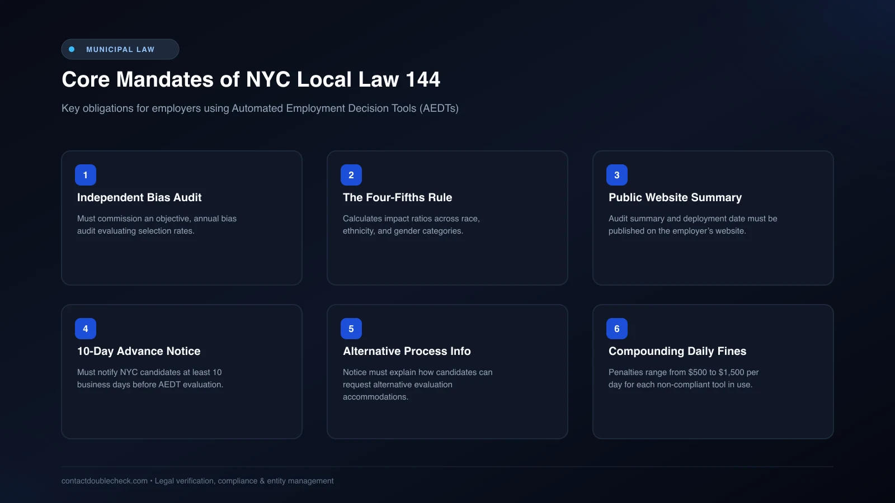
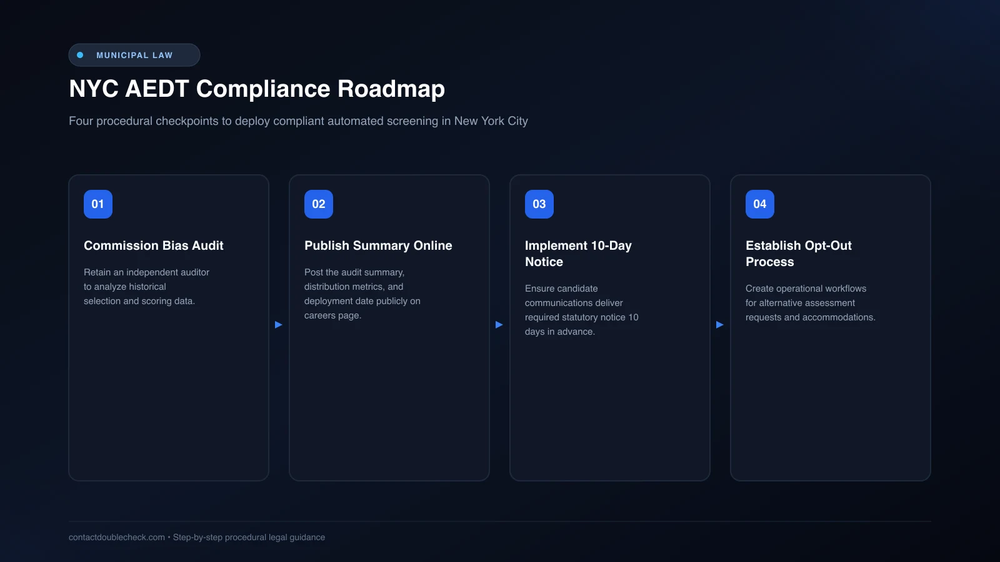

*A comprehensive compliance guide to New York City Local Law 144, Automated Employment Decision Tool (AEDT) bias audit mandates, candidate notice requirements, and municipal enforcement as of November 2026. General information, not legal advice.*

**Key takeaways:**

- NYC Local Law 144 mandates annual independent bias audits for any automated, algorithmic, or AI tool used to substantially assist or replace hiring or promotion decisions.
- Bias audits must calculate selection rate ratios (disparate impact) across race, ethnicity, and sex categories using EEOC four-fifths metrics.
- Employers must publish a public summary of the audit results and the tool's active deployment date on their careers website.
- Candidates and employees residing in New York City must receive written notice at least 10 business days prior to being evaluated by an AEDT.
- Violations carry severe, compounding fines under NYC Administrative Code § 20-872 of up to $1,500 per day per violation.

## 1. The quick answer

**Quick answer:** New York City Local Law 144 (codified at NYC Administrative Code §§ 20-870 through 20-874) makes it unlawful for an employer or employment agency to use an **Automated Employment Decision Tool (AEDT)** to screen candidates or evaluate employees in New York City unless the tool has undergone an **independent bias audit** within the preceding 12 months.

Furthermore, employers must publicly post a summary of the bias audit results on the employment section of their website and provide candidate-specific written notice at least **10 business days** before using the tool. Following sharp state comptroller audits and heightened enforcement sweeps by the NYC Department of Consumer and Worker Protection (DCWP), operating un-audited hiring algorithms exposes companies to daily penalties between $500 and $1,500 per tool.

For employers operating in the New York market, review our analyses on the [New York Freelance Isn’t Free Act](/blog/new-york-freelance-isnt-free-act-statewide-requirements-contracts/) and [multi-state remote employment compliance](/blog/multi-state-remote-employees-compliance-startups/).

## 2. What qualifies as an automated employment decision tool?

The statutory definition of an AEDT focuses on computational processes that drive employment outcomes:

- **The Statutory Definition:** Any computational process, derived from machine learning, statistical modeling, data analytics, or artificial intelligence, that issues simplified outputs (such as scores, rankings, or recommendations) used to substantially assist or replace human discretionary evaluation.
- **The "Substantially Assist" Threshold:** Under DCWP final rules, a tool "substantially assists" decision-making if:
  1. The tool's output is the sole criteria considered.
  2. The output is given more weight than any other single factor.
  3. The output is used to overrule human judgment.
- **Tools Covered:** Resume screening software, automated video interview analyzers, algorithmic personality assessments, and automated candidate ranking plugins.

## 3. Independent bias audits and the four-fifths metric

Before deploying an AEDT, employers must commission an audit that satisfies strict technical requirements:

### Who Can Conduct the Audit?
The audit must be executed by an **independent auditor**—an individual or firm that is objective, not an employee, and has no direct financial interest in the development, marketing, or sale of the tool.

### Required Metrics
The auditor must calculate the **impact ratio** across protected categories (race, ethnicity, and sex) consistent with the EEOC's Uniform Guidelines on Employee Selection Procedures:
- **Selection Rate Ratio:** The selection rate for each group divided by the selection rate of the highest-performing group.
- **Scoring Rate Metric:** For tools that generate continuous numerical scores, the auditor must assess median scores and the distribution across demographic subsets.

### Public Disclosure Mandate
Employers must post a summary on their website displaying:
- The date of the most recent bias audit.
- The distribution date of the AEDT.
- The summary of the selection rates and impact ratios.

## 4. Candidate notice rules and the 10-day window

Transparency toward job applicants is a mandatory pillar of Local Law 144:

- **10-Business-Day Advance Notice:** Employers must notify candidates residing in NYC at least 10 business days prior to using an AEDT. Notice can be provided in job postings, via direct email, or on application landing pages.
- **Content of Notice:** The notice must explicitly state that an AEDT will be used, describe the job qualifications and characteristics evaluated, and provide instructions on how the candidate can request an alternative assessment or accommodation.
- **Data Retention Disclosures:** Employers must provide information regarding the types of data collected, the source of data, and the company's data retention policy.

## 5. DCWP enforcement and compounding daily penalties

The NYC Department of Consumer and Worker Protection enforces Local Law 144 through targeted investigations and civil complaints:

- **NYC Administrative Code § 20-872 Penalties:**
  - Up to **$500** for the first violation (and any concurrent same-day violations).
  - Between **$500 and $1,500 per day** for each subsequent violation.
- **Compounding Daily Liability:** Because penalties accrue per day for each separate non-compliant tool in operation, an un-audited resume filter left running on a high-volume job board for 90 days can generate over $100,000 in municipal fines before formal administrative hearings commence.
- **Private Right of Action Intersection:** While Local Law 144 does not contain a direct private right of action, audit findings showing severe disparate impact routinely serve as central evidentiary exhibits in class-action discrimination lawsuits filed under the New York City Human Rights Law (NYCHRL) and Title VII.

## 6. Employer compliance protocol for NYC hiring

Companies recruiting talent in the New York metropolitan area should execute an immediate four-point compliance plan:

1. **Conduct an HR Tech Inventory:** Catalog every automated screening, parsing, or ranking software utilized across recruiting pipelines.
2. **Obtain Vendor Audit Certifications:** Contact software vendors to determine if they have completed a conforming independent bias audit. If using custom algorithms, retain an independent third-party auditor directly.
3. **Publish Website Audit Summaries:** Create a dedicated "AI Hiring Compliance" page on the corporate careers portal containing the required audit summaries.
4. **Deploy Pre-Application Notices:** Add mandatory 10-day notice banners and alternative evaluation request workflows to online job applications.
5. **Establish Alternative Assessment Pathways:** Design an operational procedure for evaluating applicants who request an accommodation or opt out of automated screening.

## Where DoubleCheck fits

[DoubleCheck](https://www.contactdoublecheck.com) provides businesses, general counsel, and enterprise teams with automated contract review, AI-assisted verification, and legal workflow assurance. DoubleCheck helps teams verify citations, audit regulatory compliance across California, Colorado, New York, and federal agencies, and connect with experienced attorneys to ensure compliance with emerging AI standards.

**Related reading:**
- [EEOC Title VII Guidance: AI Hiring & Disparate Impact](/blog/eeoc-title-vii-ai-selection-procedures-disparate-impact/)
- [Illinois HB 3773: AI Employment Bias Rules](/blog/illinois-human-rights-act-hb-3773-ai-employment-bias/)
- [New York Freelance Isn’t Free Act Statewide Rules](/blog/new-york-freelance-isnt-free-act-statewide-requirements-contracts/)
- [Multi-State Remote Employee Compliance for Startups](/blog/multi-state-remote-employees-compliance-startups/)
- [AI Employment Agreement Review Checklist](/blog/ai-employment-agreement-review-checklist/)
- [Illinois BIPA Biometric Privacy Small Business Compliance](/blog/illinois-bipa-biometric-privacy-small-business-compliance/)

**Sources:** [New York City Department of Consumer and Worker Protection (DCWP), Automated Employment Decision Tools Final Rules](https://www.nyc.gov/site/dca/about/automated-employment-decision-tools.page); [New York City Administrative Code §§ 20-870 through 20-874 (Local Law 144 of 2021)](https://codelibrary.amlegal.com/codes/newyorkcity/latest/NYCadmin/0-0-0-137535); [Office of the New York State Comptroller, Audit Report on DCWP Enforcement of Local Law 144](https://www.osc.ny.gov/); [U.S. Equal Employment Opportunity Commission (EEOC), Uniform Guidelines on Employee Selection Procedures (29 CFR Part 1607)](https://www.eeoc.gov/laws/guidance/uniform-guidelines-employee-selection-procedures).

## FAQ

**What is an Automated Employment Decision Tool (AEDT)?**

An AEDT is any computational process derived from machine learning, statistical modeling, or AI that issues simplified scores, classifications, or recommendations used to substantially assist or replace human discretionary employment decisions.

**Who must conduct the bias audit under Local Law 144?**

The bias audit must be conducted by an independent auditor who is not an employee of the employer or vendor and has no direct financial interest in the tool being evaluated.

**Does Local Law 144 apply to remote jobs?**

Yes. If a position is tied to an NYC office, or if an employer evaluates a candidate residing in New York City for a remote position, Local Law 144 applies.

**What are the penalties for violating NYC Local Law 144?**

Penalties under NYC Administrative Code § 20-872 range from up to $500 for the first violation to between $500 and $1,500 per day for each day a non-compliant AEDT remains in use.

**How far in advance must employers notify candidates about AI screening?**

Employers must provide written notice to NYC resident candidates or employees at least 10 business days prior to using an AEDT to evaluate them.

---

*General information only. This article is not legal, tax, investment, or accounting advice.*
