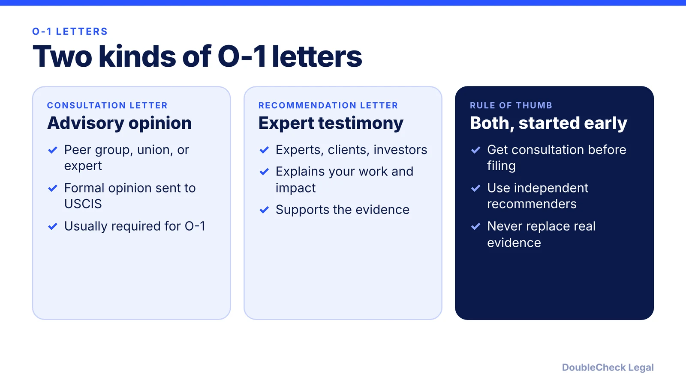
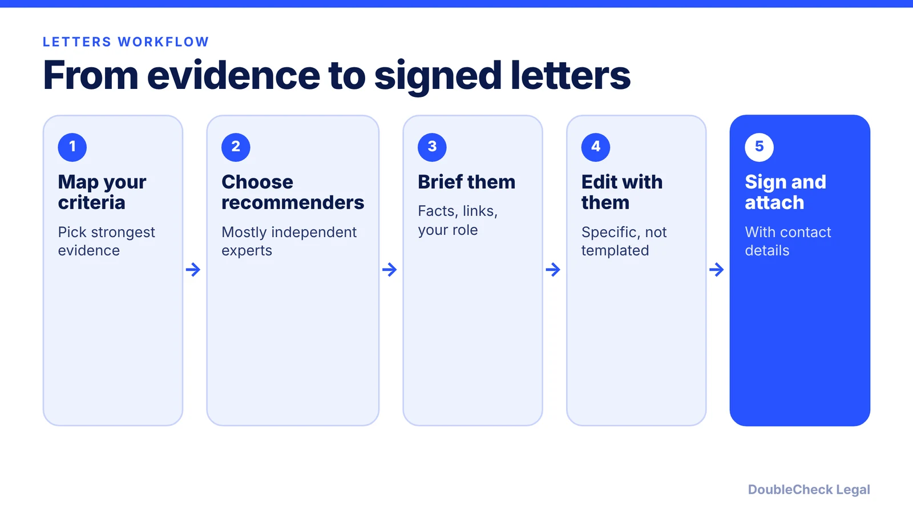

*Is a recommendation letter the same as the O-1 consultation letter? No. Here is how the two differ and how to write strong expert letters.*

**Key takeaways:**

- The consultation (advisory opinion) letter is usually required; recommendation letters are supporting evidence.
- A recommendation letter may not meet the consultation requirement unless it meets the advisory-opinion standard.
- Independent expert recommenders generally carry more weight than colleagues.
- Avoid vague praise, templated wording, and legal conclusions; letters never replace objective evidence.

## 1. The quick answer

**Quick answer:** An O-1 case can involve two different kinds of letters. A consultation (advisory opinion) letter is a formal opinion for USCIS from a peer group, labor or management organization, or qualified expert, and is usually required. Recommendation letters explain your achievements and impact and come from recognized experts or present or former employers, per the USCIS Policy Manual. A strong recommendation letter may not satisfy the consultation requirement unless it meets the advisory-opinion standard, and letters support objective evidence rather than replace it.

## 2. The consultation letter

Per USCIS, the source depends on the category:

- **O-1A** (business, science, education, athletics): a peer group or qualified expert in the field.
- **O-1B arts:** a peer group, organization, or expert in the same creative field.
- **O-1B motion picture or television:** both a relevant labor organization and a management organization.

If no appropriate peer group or labor organization exists, USCIS decides based on the evidence submitted, so the petitioner may want to identify a qualified expert or relevant organization. The letter should cover your qualifications and recognition, the proposed U.S. work, and why the role requires extraordinary ability. Per the USCIS Policy Manual, an opinion for O-1A or O-1B arts must be favorable or state "no objection."

Per USCIS, the consultation may be waived for an artist with extraordinary ability who is seeking readmission to perform similar services within two years of a previous consultation, and if no appropriate peer group exists USCIS decides on the evidence. Do not assume a waiver; if a credible source is available, getting the consultation is generally safer. Start before filing, since some organizations have specific forms, fees, or formatting requirements. For the full package, see the [O-1 documents checklist](/blog/o-1-visa-documents-checklist-founder/).

## 3. Writing strong expert recommendation letters

Per the USCIS Policy Manual, letters from employers or recognized experts must describe your qualities in specific, factual terms and state the writer's expertise and how they know your work. A strong letter typically covers the recommender's credentials, their relationship to you, your key achievements, and the impact of that work.

- **Who:** credible experts in your field, such as industry experts, senior executives, academic authorities, or independent peers. Yale's international office advises that most letters should come from experts who know you only through your achievements. Employer or colleague letters can be strong if they explain authority and firsthand knowledge.
- **How many:** USCIS sets no fixed number. Yale's international office recommends at least 3 as a general rule for its faculty. Quality beats volume.
- **What to include:** specific, verifiable details and analysis. The best letters explain what the evidence shows and why it matters.
- **Mistakes:** vague praise like "talented," jargon an officer cannot follow, repeating resume bullets, letters with identical wording that look templated, and listing achievements without explaining their significance.

Recommenders must review and genuinely adopt the final text. Per Yale's international office, each letter should be on the writer's letterhead, ideally with an original signature, and include the recommender's CV.

## 4. How letters fit the whole petition

Letters tie together the evidence you already have. They do not create eligibility. Pair them with press, awards, judging, high remuneration, or critical-role proof, as explained in the [O-1A evidence guide for founders](/blog/o-1a-visa-for-startup-founders-evidence/). Budget time and money using [O-1 costs and attorney fees](/blog/o-1-visa-cost-filing-and-attorney-fees/) and [O-1 processing times](/blog/o-1-visa-processing-time-premium-processing/).

If you are weighing the O-1 against a green card route, see [EB-1A vs. O-1 for founders](/blog/eb-1a-vs-o-1-founder-which-path/). A lawyer can help identify the right consultation source and review drafts, see [how to find a good immigration lawyer](/blog/how-to-find-good-immigration-lawyer-startup-founder/). Rules change, so confirm requirements as of November 2026 on USCIS.

## Where DoubleCheck fits

[DoubleCheck](https://www.contactdoublecheck.com) helps businesses and founders start legal work with AI, verify it, and, when professional advice is warranted, connect with an independent attorney, including for immigration questions. Attorney availability and practice areas vary. Attorneys on DoubleCheck are independent professionals; an attorney-client relationship forms only if an attorney accepts your engagement.

**Sources:** [USCIS: O-1 visa](https://uscis.gov/o-1); [USCIS Policy Manual, Vol. 2, Part M, Ch. 7: Documentation and Evidence](https://uscis.gov/es/node/89878); [Yale OISS: O-1 letters of recommendation](https://oiss.yale.edu/node/244).

## FAQ

**Is a recommendation letter the same as an O-1 consultation letter?**

No. Per USCIS, a consultation letter is a written advisory opinion from a peer group or a person with expertise in the field, while a recommendation letter explains your achievements. A strong recommendation letter may not meet the consultation standard.

**How many recommendation letters does an O-1 need?**

USCIS sets no fixed number. Yale international office recommends at least 3 as a general rule for its faculty, but quality matters more than volume.

**Who should write O-1 recommendation letters?**

Per Yale international office, most letters should come from experts who know you only through your achievements. Per USCIS, letters from employers or recognized experts must describe your qualities in specific, factual terms.

**Can the O-1 consultation letter be waived?**

Per USCIS, the consultation may be waived for an artist with extraordinary ability seeking readmission within two years of a previous consultation, and if no appropriate peer group exists USCIS decides on the evidence. Do not assume a waiver.

---

*General information only. This article is not legal, tax, investment, or accounting advice.*
