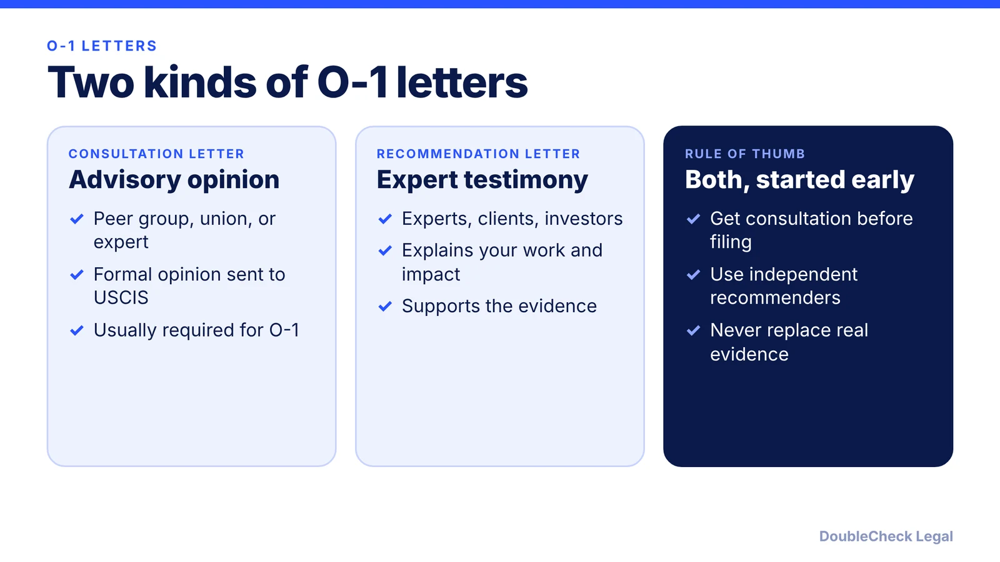
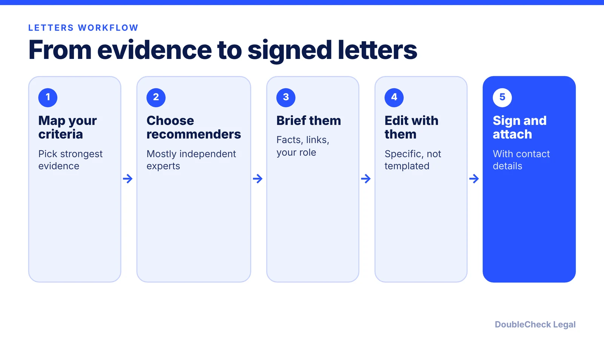

*Is a recommendation letter the same as the O-1 consultation letter? No. Here is how the two differ and how to write strong expert letters.*

**Key takeaways:**

- The consultation (advisory opinion) letter is usually required; recommendation letters are supporting evidence.
- A recommendation letter may not meet the consultation requirement unless it meets the advisory-opinion standard.
- Independent expert recommenders generally carry more weight than colleagues.
- Avoid vague praise, templated wording, and legal conclusions; letters never replace objective evidence.

## 1. The quick answer

**Quick answer:** An O-1 case can involve two different kinds of letters. A consultation (advisory opinion) letter is a formal opinion for USCIS from a peer group, labor or management organization, or qualified expert, and is usually required. Recommendation letters explain your achievements and impact and come from experts, employers, clients, collaborators, or investors, per Beyond Border. A strong recommendation letter may not satisfy the consultation requirement unless it meets the advisory-opinion standard, and letters support objective evidence rather than replace it.

## 2. The consultation letter

Per Beyond Border, the source depends on the category:

- **O-1A** (business, science, education, athletics): a peer group or qualified expert in the field.
- **O-1B arts:** a peer group, organization, or expert in the same creative field.
- **O-1B motion picture or television:** both a relevant labor organization and a management organization.

If no clear union or peer group exists, which Beyond Border says is common in tech and startups, the petitioner may need to identify a qualified expert or relevant organization. The letter should cover your qualifications and recognition, the proposed U.S. work, and why the role requires extraordinary ability. Some organizations issue a "no objection" letter instead of a detailed opinion, which can still help if it comes from the right source.

A waiver may apply if you received a consultation within the last two years and are returning to similar work, or if no appropriate consultation source exists. Beyond Border warns not to assume a waiver; if a credible source is available, getting the consultation is generally safer. Start before filing, since some organizations have specific forms, fees, or formatting requirements. For the full package, see the [O-1 documents checklist](/blog/o-1-visa-documents-checklist-founder/).

## 3. Writing strong expert recommendation letters

Per Ashoori Law, a strong letter typically covers the recommender's credentials, their relationship to you, your key achievements, the impact and significance of that work, and a closing endorsement, written as one narrative.

- **Who:** credible experts in your field, such as industry experts, senior executives, academic authorities, or independent peers. Independent recommenders outside your reporting chain generally carry more weight. Employer or colleague letters can be strong if they explain authority and firsthand knowledge.
- **How many:** no fixed number per Ashoori. Beyond Border suggests 4 to 6 letters from senior industry figures for founders. Quality beats volume.
- **What to include:** specific, verifiable details and analysis. The best letters explain what the evidence shows and why it matters.
- **Mistakes:** vague praise like "talented," jargon an officer cannot follow, repeating resume bullets, letters with identical wording that look templated, and legal conclusions in place of analysis.

Recommenders must review and genuinely adopt the final text. Notarization is generally not required, but the letter should be signed with real contact information, per Ashoori.

## 4. How letters fit the whole petition

Letters tie together the evidence you already have. They do not create eligibility. Pair them with press, awards, judging, high remuneration, or critical-role proof, as explained in the [O-1A evidence guide for founders](/blog/o-1a-visa-for-startup-founders-evidence/). Budget time and money using [O-1 costs and attorney fees](/blog/o-1-visa-cost-filing-and-attorney-fees/) and [O-1 processing times](/blog/o-1-visa-processing-time-premium-processing/).

If you are weighing the O-1 against a green card route, see [EB-1A vs. O-1 for founders](/blog/eb-1a-vs-o-1-founder-which-path/). A lawyer can help identify the right consultation source and review drafts, see [how to find a good immigration lawyer](/blog/how-to-find-good-immigration-lawyer-startup-founder/). Rules change, so confirm requirements as of November 2026 on USCIS.

## Where DoubleCheck fits

[DoubleCheck](https://www.contactdoublecheck.com) helps businesses and founders start legal work with AI, verify it, and, when professional advice is warranted, connect with an independent attorney, including for immigration questions. Attorney availability and practice areas vary. Attorneys on DoubleCheck are independent professionals; an attorney-client relationship forms only if an attorney accepts your engagement.

**Sources:** [Beyond Border: O-1 consultation letter](https://www.beyondborderglobal.com/resources/o-1-visa-consultation-letter); [Ashoori Law: O-1 recommendation letter](https://www.ashoorilaw.com/?p=21935); [Beyond Border: selecting the right peer group](https://www.beyondborderglobal.com/resources/o-1-consultation-letter-selecting-the-right-peer-group-and-documenting-advisory-credentials).

## FAQ

**Is a recommendation letter the same as an O-1 consultation letter?**

No. Per Beyond Border, a consultation letter is a formal advisory opinion from a peer group, organization, or qualified expert, while a recommendation letter explains your achievements. A strong recommendation letter may not meet the consultation standard.

**How many recommendation letters does an O-1 need?**

There is no fixed number per Ashoori Law. Beyond Border suggests 4 to 6 letters from senior industry figures for founders, but quality matters more than volume.

**Who should write O-1 recommendation letters?**

Credible experts in your field, ideally independent of your reporting chain, per Ashoori Law. Employer or colleague letters can also work if they explain the recommender's authority and firsthand knowledge.

**Can the O-1 consultation letter be waived?**

Per Beyond Border, a waiver may apply if you had a consultation in the last two years and are returning to similar work, or if no appropriate source exists. It warns against assuming a waiver.

---

*General information only. This article is not legal, tax, investment, or accounting advice.*
