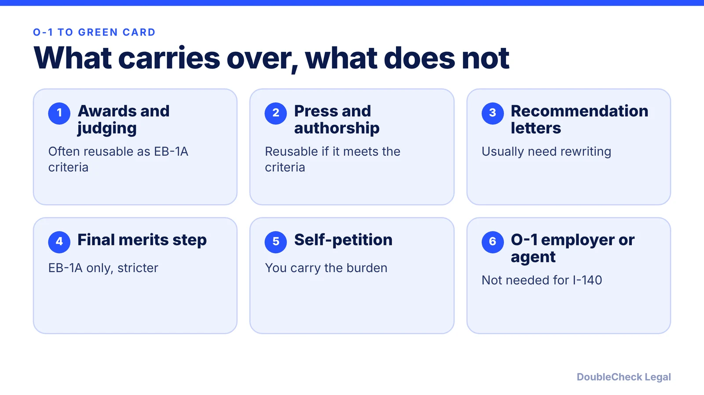
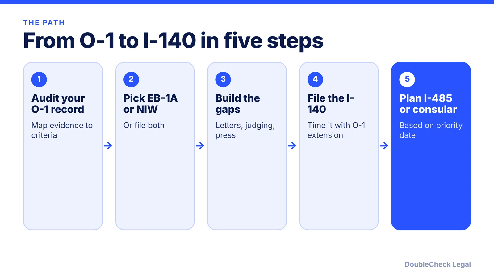

*How to use an approved O-1 as evidence and a bridge to an EB-1A or NIW green card, as of November 2026.*

**Key takeaways:**

- EB-1A and NIW are both I-140 self-petitions with no PERM; EB-1A applies a stricter standard and a final-merits step.
- O-1 evidence like judging, press and critical roles often carries over, but must be re-argued, not just resubmitted.
- Per the USCIS Policy Manual, USCIS should not deny an O-1 extension because a preference petition was filed, but consular risk remains.
- Timelines vary; check USCIS processing times and the visa bulletin, and have an attorney verify strategy before filing.

## 1. The quick answer

**Quick answer:** An approved O-1 is not a green card, but it is useful evidence and a workable bridge. Many O-1 holders self-petition on Form I-140 under EB-1A (extraordinary ability) or EB-2 NIW (national interest waiver), neither of which needs a PERM labor certification. Per the USCIS Policy Manual, USCIS should not deny an O-1 extension on the basis of a filed preference petition, so many holders file the I-140 before or alongside an O-1 extension. Your O-1 record often carries over, but EB-1A applies a stricter standard, and USCIS says a prior O-1 approval is not determinative, so the petition has to re-argue it.

## 2. EB-1A, NIW, and how they overlap

Both categories are self-petitions on Form I-140, so no employer sponsor or PERM is required. They use different standards:

- **EB-1A** requires a major international award or at least three of ten evidentiary criteria, then a final-merits review of whether you are in the small percentage at the very top of the field, per the [USCIS Policy Manual, Vol. 6 Part F Ch. 2](https://www.uscis.gov/policy-manual/volume-6-part-f-chapter-2). It does not need a job offer, and you may self-petition.
- **EB-2 NIW** uses the Dhanasar test (substantial merit and national importance, well positioned to advance the endeavor, and a waiver being beneficial to the U.S.), starting from EB-2 base qualifications.

Some applicants file an NIW alongside EB-1A as a backup, as two separate I-140s. Whether doing so makes sense, especially where backlogs apply, is a strategy call for an attorney.

For founders, see [EB-1A vs NIW for founders](/blog/eb-1a-vs-niw-which-is-better-for-founders/), [NIW for founders](/blog/niw-eb-2-national-interest-waiver-founders/), and [EB-1A vs O-1](/blog/eb-1a-vs-o-1-founder-which-path/). For engineers, see [EB-1A for software engineers](/blog/eb-1a-for-software-engineers-and-tech-employees/) and [NIW for software engineers](/blog/niw-for-software-engineers-and-researchers/).

**Evidence that tends to carry over:** several EB-1A criteria, such as judging the work of others, published material about you and leading or critical roles, resemble common O-1 evidence. Build the record from work already underway, not activity created for the petition. If the O-1 record was thin or was approved under the lower O-1B standard, consider building more evidence before filing EB-1A. Per the USCIS Policy Manual, a prior O-1 approval is relevant and can indicate eligibility but is not determinative. See [O-1A evidence for founders](/blog/o-1a-visa-for-startup-founders-evidence/) and [O-1 recommendation letters](/blog/o-1-recommendation-letters-expert-opinion/).

## 3. Status while the I-140 is pending: O-1 extension and dual intent

**Dual intent.** Per the [USCIS Policy Manual, Vol. 2 Part M Ch. 9](https://www.uscis.gov/policy-manual/volume-2-part-m-chapter-9), USCIS should not deny an O-1 extension of stay or change of status on the basis of an approved permanent labor certification or a filed preference petition. That guidance binds USCIS, not consular officers, who decide visa applications abroad on their own. Treat this as a practical risk, not a guarantee, especially when you travel and apply for a visa abroad.

**Concurrent filing.** When O-1 renewal is approaching and the I-140 is not yet filed, filing the I-140 before or with the extension is a common approach. Per the USCIS Policy Manual, there is no limit on the number of O-1 extensions USCIS may approve, in increments of up to one year.

**If an I-140 is denied.** The O-1 extension and the I-140 are separate requests, and you may be able to refile with a stronger record or pivot to NIW; ask an attorney about your facts. See [what to do after an NIW denial or RFE](/blog/niw-denial-rfe-reapply-options/).

**Timelines and costs (verify before planning).** Published ranges vary widely, so rely on USCIS for current figures:

- Green card timelines depend on the category, your country of birth, the visa bulletin and USCIS workload; check USCIS processing times rather than relying on a single published estimate.
- Per [USCIS](https://www.uscis.gov/forms/all-forms/how-do-i-request-premium-processing), premium processing is available for EB-1A with action guaranteed within 15 calendar days, and for NIW within 45 calendar days. Check the Form I-907 page for the current fee, and see [premium processing fees and timelines](/blog/premium-processing-fees-and-timelines-2026/).
- Concurrent I-140 and I-485 filing depends on a current priority date. India and China have historically had backlogs in these categories; confirm in the current [visa bulletin](/blog/visa-bulletin-explained-priority-dates-eb-categories/) and see [retrogression and backlogs](/blog/priority-date-retrogression-india-china-backlog/).

Travel after filing an I-485 needs care; see [advance parole and EAD while an I-485 is pending](/blog/advance-parole-and-ead-while-i-485-pending/) and the [I-485 guide](/blog/i-485-adjustment-of-status-guide/).

## 4. Self-handle or get an attorney to look at it

**Reasonable to do yourself first:** list your O-1 evidence, map it against the ten EB-1A criteria, and note gaps. You can also use AI to organize exhibits and draft a first outline of your petition narrative.

**Get an attorney to verify before filing when:**

- Your O-1 was O-1B or the record is borderline for EB-1A.
- You were born in India or China, or another country with backlogs, so the strategy turns on priority dates.
- You will travel soon, have a visa stamp expiring, or your O-1 ends within about a year.
- You want to file EB-1A and NIW together, or file the I-485 concurrently.
- You have prior status problems, which affect I-485 eligibility; see [unlawful presence and overstays](/blog/immigration-overstay-unlawful-presence-3-10-year-bars-explained/).

Fees vary; see [immigration lawyer fees](/blog/immigration-lawyer-fees-flat-fee-vs-hourly/) and [how to find a good immigration lawyer](/blog/how-to-find-good-immigration-lawyer-startup-founder/). Employer-sponsored alternatives are covered in [PERM labor certification](/blog/perm-labor-certification-green-card-process/) and [H-1B to green card timelines](/blog/h-1b-to-green-card-timeline-tech-workers/). Previous O-1 costs and timing are in [O-1 filing costs](/blog/o-1-visa-cost-filing-and-attorney-fees/) and [O-1 processing times](/blog/o-1-visa-processing-time-premium-processing/).

## Where DoubleCheck fits

[DoubleCheck](https://www.contactdoublecheck.com) helps businesses and founders start legal work with AI, verify it, and, when professional advice is warranted, connect with an independent attorney, including for immigration questions. Attorney availability and practice areas vary. Attorneys on DoubleCheck are independent professionals; an attorney-client relationship forms only if an attorney accepts your engagement.

**Sources:** [USCIS Policy Manual, Vol. 6 Part F Ch. 2 (extraordinary ability)](https://www.uscis.gov/policy-manual/volume-6-part-f-chapter-2); [USCIS Policy Manual, Vol. 6 Part F Ch. 5 (advanced degree, exceptional ability and national interest waiver)](https://www.uscis.gov/policy-manual/volume-6-part-f-chapter-5); [USCIS Policy Manual, Vol. 2 Part M Ch. 9 (O-1 admission, extension and change of status)](https://www.uscis.gov/policy-manual/volume-2-part-m-chapter-9); [USCIS, How do I request premium processing?](https://www.uscis.gov/forms/all-forms/how-do-i-request-premium-processing). Check uscis.gov for current fees, forms and processing times.

## FAQ

**Can I file EB-1A while on an O-1?**

Yes, an EB-1A can be self-petitioned without a job offer, and the USCIS Policy Manual says there is no limit on O-1 extensions and that USCIS should not deny an extension because a preference petition was filed. Confirm your facts with an immigration attorney.

**Is the O-1 a dual intent visa?**

Not in the way H-1B is. The USCIS Policy Manual says USCIS should not deny an O-1 extension or change of status because a preference petition was filed or a labor certification approved, but consular officers decide visa applications separately, so travel carries some risk.

**Does an approved O-1 guarantee EB-1A approval?**

No. Per the USCIS Policy Manual, a prior O-1 approval is relevant and can indicate eligibility, but it is not determinative, and each petition is decided on its own merits.

**Can I file EB-1A and NIW at the same time?**

Some applicants file an NIW alongside an EB-1A as a backup, as separate I-140 petitions. Whether it makes sense depends on your profile and priority date, so ask an immigration attorney.

---

*General information only. This article is not legal, tax, investment, or accounting advice.*
